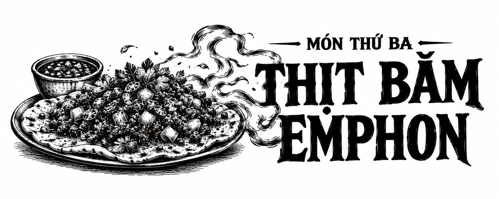

*Món Thứ Ba • Thịt Tái Emphon*

# Món Thứ Ba • Thịt băm Emphon

Thưởng thức ngon nhất khi dùng từng lượng nhỏ làm món khai vị. Đây là lựa chọn hoàn hảo cho những ai muốn nhận được lợi ích từ Sức bền ma thuật mà không cần phải dùng quái thú bò mộng Emphon làm món chính trong bữa ăn. Khác với nhiều món ăn khác, hiệu ứng của Đại công thức ma thuật này xuất hiện ngay sau miếng cắn đầu tiên và kéo dài lâu hơn nếu thực khách thưởng thức một cách từ tốn. Dùng kèm với rượu vang trắng, hoặc rượu tequila bạc nếu bạn thích cảm giác mạnh.

  

  

    **Nguyên liệu** (dành cho 1 người):

    

      100g thịt thăn nội quái thú bò mộng Emphon (hoặc thăn bò thái khối)

      Phần ớt jalapeño ngâm chua:

      

        1 thìa canh giấm

        1 thìa canh nước

        ½ thìa cà phê đường trắng

        Một nhúm muối

        ½ tép tỏi, băm nhỏ

        2 thìa canh ớt jalapeño, thái hạt lựu nhỏ

      

      1 quả bơ ổi

      ¼ chén nụ bạch hoa

      1 chén dầu chiên

      Phần sốt aioli chipotle:

      

        ½ chén sốt mayonnaise

        2 thìa cà phê nước cốt chanh

        1 thìa canh hẹ tây, thái nhỏ

        1½ thìa canh ớt chipotle sấy khói, băm nhỏ

        Muối ăn (lượng vừa đủ)

      

      2 thìa canh cà chua, thái hạt lựu nhỏ

      1 thìa canh hẹ tây đỏ, thái hạt lựu nhỏ

      1 quả trứng

      1 lát bánh mì men chua

      Củ cải thái lát để trang trí

      Tiêu đen (lượng vừa đủ)

      Rau mùi, thái nhỏ

    

    **Các bước thực hiện:**

    

      Cách làm ớt jalapeño ngâm chua:

      

        Trộn đều giấm, nước, muối, đường và tỏi trong một chiếc nồi nhỏ, đun trên lửa vừa.

        Khuấy đều cho đến khi muối và đường tan hoàn toàn rồi nhấc ra khỏi bếp.

        Cho ớt vào khuấy đều và để ngấm trong 15 phút.

      

      Thái thịt quái thú bò mộng Emphon thành các khối vuông 2cm rồi ướp đá trong 10 phút.

      Nghiền quả bơ ổi thành hỗn hợp sền sệt nhưng vẫn giữ lại vài miếng nhỏ.

      Chiên ngập dầu nụ bạch hoa trên lửa lớn. Vớt ra bằng thìa có lỗ rồi để ráo dầu.

      Làm sốt aioli chipotle bằng cách đánh đều tất cả các nguyên liệu với nhau.

      Lấy thịt quái thú bò mộng Emphon ra và dùng tay băm đến độ thô vừa ý.

      Trộn đều thịt quái thú bò mộng Emphon, ớt jalapeño ngâm chua, cà chua, hẹ tây đỏ, nụ bạch hoa cùng 2 thìa canh sốt aioli trong một chiếc bát sứ nhỏ (ramekin).

      Chần trứng và nướng chín lát bánh mì men chua.

      Trình bày ra đĩa: Phết sốt bơ lên lát bánh mì men chua. Úp ngược bát sứ nhỏ rồi gõ nhẹ một cái để khối thịt băm tách khỏi bát, rơi gọn lên mặt bánh mì. Đặt quả trứng chần lên trên cùng của khối thịt băm.

      Trang trí bằng tiêu đen, vài lát củ cải và rau mùi thái nhỏ. Thưởng thức.

    

    **Hiệu ứng Sức bền ma thuật dự kiến:**

    

      Sức bền ma thuật: 1,4 giờ.

      Xương cốt được gia cố: 1,4 giờ.

      Nắm đấm cứng như kim loại: 1,4 giờ.
