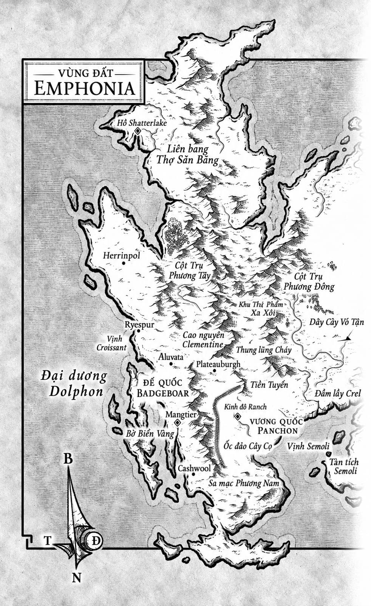
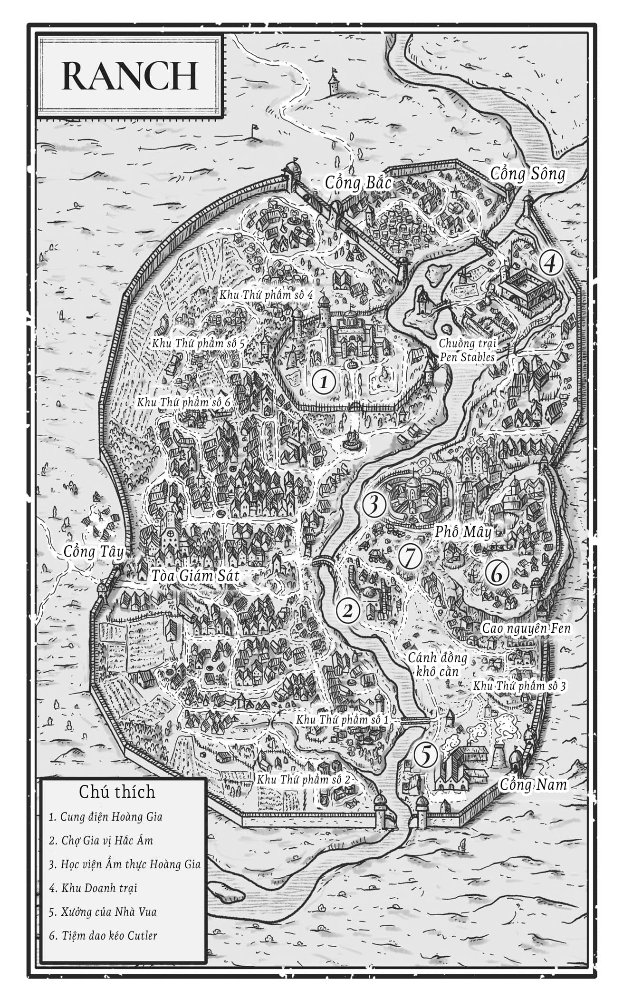

# Bày biện bàn ăn

Trước khi trở thành Paprick Đồ Tể, anh chỉ là Paprick, một người thợ xẻ thịt. Chưa phải thợ chính thức, anh vẫn chỉ là kẻ học việc - một cậu bé nông thôn bình thường ký khế ước bán thân cho xưởng mổ, ngày ngày xẻ những tảng sườn quái thú bò mộng emphon to như bò rừng thành từng dải thịt và miếng bít tết. Chẳng trách anh lại trở thành Đồ Tể. Xưởng mổ của Nhà Vua vốn chỉ làm ra duy nhất một thứ: thịt.

  Và Paprick đã đoạt lấy phần xương thịt của riêng mình.

  Dù điều đó chẳng mang lại kết cục tốt đẹp gì.

  “Các tội danh gồm có,” tên đao phủ đứng cạnh vị nữ hoàng trẻ tuổi dõng dạc đọc lớn, giọng gã vang rền trước biển người đặc quánh. “Ba tội phản quốc, bốn trăm tội giết người, một tội báng bổ, bảy tội gián điệp, một tội thí quân, và…” Nụ cười khinh bỉ của gã hướng lên xà treo cổ, nơi gã Đồ Tể đang bị trói chặt hai cổ tay và treo lơ lửng, giãy giụa như con cá mắc câu trên đường phố cách đó hơn hai mươi mét. “Hai tội ăn thịt đồng loại.”

  Lưu trữ viên Pháp luật mẫn cán ghi chép các tội danh vào sổ, trong khi đám đông bên dưới không ngừng la ó, gầm rú trong một cuộc xung đột gay gắt về tư tưởng. Theo nhận định của nữ lưu trữ viên, có quá nhiều kẻ chống đối gã Đồ Tể đã trà trộn cùng phe hoàng gia trên quảng trường, khiến phán quyết của Nữ hoàng khó lòng được bảo đảm tuyệt đối. Nhưng bản chất của đám đông muôn đời vẫn vậy, và kẻ nắm quyền cai trị khi ấy chưa đủ uy thế để cấm cản họ.

  “Đồ Tể,” Nữ hoàng lên tiếng khi đám đông dần trật tự, “ngươi nhận tội thế nào?”

  Hàng ngàn con mắt đổ dồn lên tầng cao nhất của tòa nhà bốn tầng, nơi gã Đồ Tể gầy gò đang bị treo lơ lửng. Anh vốn dĩ luôn gầy guộc, nhưng chuỗi ngày bị giam cầm đã vắt kiệt sức lực, biến anh thành một bộ xương khô quắt tựa sợi dây thừng. Mái tóc anh rũ rượi vì lâu ngày không được cắt tỉa, hoàn toàn trái ngược với kiểu đầu gọn gàng anh thường thích. Lồng ngực để trần hằn lên những mảng bầm tím và sẹo chằng chịt, đan xen dữ dội chẳng khác nào những hình xăm trên cánh tay. Thiếu đi chiếc tạp dề cùng thanh đao cưa đồ tể quen thuộc, anh gần như trần trụi. Thế nhưng, giọng nói của anh cất lên vẫn vang dội như sấm truyền:

  “Đó không phải là danh xưng của tôi.”

  Cơn ớn lạnh vì kinh ngạc chạy dọc sống lưng nữ lưu trữ viên. Tiếng nói của gã Đồ Tể rung chuyển cùng Sức bền ma thuật, bất chấp việc anh đang bị những kẻ giam cầm bỏ đói. Đối với bầy đàn trung thành của anh, thứ ma thuật ấy là một bữa tiệc đầy cảm hứng. Những tiếng hô vang dội truyền qua đám đông tựa tiếng vó guốc rầm rập của loài bò đực Emphon, làm rung chuyển cả những dãy nhà chung cư xung quanh khi những người ủng hộ cùng dậm chân tỏ lòng đồng thuận:

  “Vua Đầu Bếp! Vua Đầu Bếp! Vua Đầu Bếp!”

  “Đủ rồi!” Nữ hoàng quát lớn, lời nói của cô mang theo Sức bền ma thuật còn áp đảo hơn cả anh.

  Những tiếng hô lịm dần rồi tắt hẳn; mệnh lệnh ma thuật sắc bén tựa nanh vuốt của cô lập tức đè bẹp tất cả. Ngay cả bàn chân đang nhịp nhịp đầy sốt ruột của nữ lưu trữ viên cũng phải khựng lại trong thoáng chốc trước uy quyền tối thượng. Nhưng vẫn còn một giọng nói không chịu khuất phục trước mệnh lệnh ấy.

  “Tôi chấp nhận các tội danh này,” gã Đồ Tể cất tiếng, “nhưng không chấp nhận căn cứ hay những kẻ buộc tội tôi. Tôi yêu cầu được thực hiện Nghi lễ.”

  Ngòi bút của nữ lưu trữ viên sững lại. Cô không ngờ gã Đồ Tể lại am tường những bộ luật mà chính anh từng đứng lên tiêu diệt đến thế. Hàng loạt cái đầu trên bục cao ngoảnh qua ngoảnh lại giữa Nữ hoàng và gã Đồ Tể. Làn sóng bất bình theo cơn gió xuân ẩm ướt lan rộng khi những kẻ ủng hộ, như được tiếp thêm dũng khí, bắt đầu buông lời báng bổ vị quân chủ của mình, gào thét cổ vũ cho thần tượng.

  “Hãy chấp thuận yêu cầu của anh ấy đi, đồ đạo đức giả ăn thịt đồng loại!” một người thuộc tầng lớp Thứ Phẩm lẻn vào giữa hàng ghế đầu của giới quý tộc Thượng Phẩm hét lớn. Cô ta lập tức bị lôi xềnh xệch đi một cách tàn nhẫn.

  “Ngươi vin vào thẩm quyền của ai mà dám thốt ra lời ngu xuẩn đó?” tên đao phủ gắt gỏng, tiếng hắn lấn át cả làn sóng ủng hộ đang cuộn trào trong đám đông. “Ngươi chẳng còn bằng chứng nào để chứng minh dòng máu Thượng Phẩm của mình nữa đâu!”

  Đó là câu trả lời mà Đồ Tể không thể đưa ra, và ai nấy đều hiểu rõ điều đó. Ngọn lửa nhiệt huyết của đám đông lụi tàn dần theo từng khắc trôi qua, trong khi những nụ cười đắc thắng trên bục cao lại bắt đầu rạng rỡ.

  “Vậy thì…” tên đao phủ cất lời.

  “Của tôi,” nữ lưu trữ viên ngắt lời một cách yếu ớt, gượng gạo ép từng chữ thoát ra khỏi cần cổ ngập ngừng.

  Hàng ngàn ánh nhìn mang theo sức nặng tựa cú húc của một con Emphon đực hung hãn giáng thẳng vào bụng nữ lưu trữ viên, khiến hơi thở âu lo của cô như bị vắt kiệt. Dưới muôn vàn ánh mắt dò xét ấy, cô chỉ muốn chui tọt xuống gầm bàn mà biến mất; để bảo toàn khối gia sản cùng cuộc sống an yên mà sự phục tùng đã mang lại suốt một thập kỷ qua. Thế nhưng, sự thật phát ra từ Đồ Tể lại là một mỹ vị chưa từng có tiền lệ.

  “Tôi muốn nghe trực tiếp từ miệng Đồ tể.” Giọng nữ Lưu trữ viên chỉ vừa đủ để những hàng đầu của đám đông, Hội Đồng Phán Quyết, tên đao phủ và chính Nữ hoàng nghe thấy, nhưng âm hưởng của lời phản bội ấy lại vang dội tới tận những đứa trẻ đang đứng trên các thùng thịt thối rữa tít phía sau cùng. Những tiếng reo hò bùng lên, tức thì và chấn động như một cơn địa chấn.

  Đám đông đã trông đợi kết cục này. Đó là một niềm tin kỳ lạ đến khó tin, bởi chỉ vài giây trước đó, nữ Lưu trữ viên vẫn chưa hề đưa ra quyết định, và cả Đồ tể lẫn những kẻ cùng hội cùng thuyền với anh cũng chẳng thể biết liệu cô có làm vậy hay không. Hoàn toàn không có gì chắc chắn, nhất là khi phán quyết ấy lại đến từ chính kẻ từng kết án tử cho gia đình Đồ tể.

  Dẫu vậy.

  Khi những tiếng hô đồng thanh dâng lên đến đỉnh điểm, hiếm ai nghe thấy lời phân trần tiếp theo của nữ Lưu trữ viên: “Hắn biết thứ đó ở đâu.” Nhưng Nữ hoàng thì nghe thấy, và cơn thịnh nộ của cô ta bốc lên đỏ rực tựa thứ ớt bột paprika được dùng để đặt tên cho Đồ tể Paprick. Ánh nhìn tràn ngập ma thuật của bà ta tưởng chừng có thể thiêu rụi cả bục cao trong ngọn lửa giận dữ tột cùng. “Được thôi.”

  Một làn sóng sức mạnh quét qua, xô mạnh khiến nữ Lưu trữ viên ngã dúi dụi vào chiếc ghế chực sụp đổ.

  Một quý tộc Thượng Phẩm cao tuổi ở hàng đầu, vốn đã bị ép chặt giữa đám Thứ Phẩm sau lưng và hàng rào chắn tì sát mạn sườn, thở hắt ra rồi gục xuống lan can khi cùng một luồng sức mạnh ấy đánh trúng ông ta.

  Đã cả chục lần nữ Lưu trữ viên ngồi vào bàn tiệc với tư cách khách mời của Nữ hoàng, và cả chục lần ấy cô đều có thể thề rằng người phụ nữ kia chẳng thể nào nuốt nổi lượng thức ăn khổng lồ cần thiết để thi triển nhiều ma thuật Bền Bỉ đến thế. Việc Nữ hoàng chè chén no say giữa nạn đói hiện tại chính là một lời tuyên bố vượt lên trên mọi ngôn từ.

  Thế nhưng nữ Lưu trữ viên vẫn gượng dậy được, và tiếng gầm của đám đông bỗng trở nên cuồng loạn như thể quốc gia tráo trở này đã thực sự giành chiến thắng trong cuộc chiến. Giờ đây Nữ hoàng chẳng còn cách nào thoái thác, cơn giận dữ của cô dần chuyển thành nỗi thất vọng khôn nguôi: “Ngươi luôn đặt Chúa tể lên trên tổ quốc, và hôm nay điều đó sẽ hủy hoại ngươi. Khi tội trạng của hắn được chứng minh, ngươi sẽ phải chết cùng hắn.”

  “Hạ hắn xuống,” nữ Lưu trữ viên ra lệnh, làm như dửng dưng trước lời đe dọa.

  Đôi mắt nâu ti hí của tên đao phủ dõi tìm sắc vàng rực của ma thuật Bền Bỉ trong mắt Nữ hoàng. Không hề rời ánh nhìn khỏi nữ Lưu trữ viên, bà ta gật đầu. Dây ròng rọc rít lên kèn kẹt, và Đồ tể được hạ xuống với vẻ khoan thai chậm rãi tựa những thiên thần xứ Olearth. Mọi nỗi sợ từng len lỏi vào tâm can tầng lớp Thứ Phẩm đều bị thổi bùng tan biến. Đám đông vỡ òa trong cơn hân hoan tột cùng, xô đẩy tràn lên phía trước, chèn gãy xương sườn của hàng chục kẻ Thượng Phẩm đang bị ép chặt vào hàng rào.

  Hỗn loạn bùng nổ.

  Người ta giẫm đạp, la hét. Tầng lớp Thứ Phẩm mở đường máu xông thẳng lên bục vinh danh của Nữ hoàng để châm lửa thiêu rụi. Khi được hộ tống đến nơi an toàn, người từng là nhà sử học và nay trở thành quan chấp pháp thầm tự hỏi liệu các sử gia tương lai sẽ nhìn nhận khoảnh khắc này như khởi đầu của cuộc nội chiến thứ hai, hay chỉ đơn thuần là hồi kết của một giai đoạn chuyển giao tăm tối.

  Nhiều giờ sau, trong phòng giam bụi bặm nhuộm đỏ bởi ánh lửa ngùn ngụt bên ngoài cung điện, nữ Lưu trữ viên khẽ nhịp mũi chân, trĩu nặng mặc cảm trách nhiệm và thắc thỏm âu lo trước Nghi Lễ sắp sửa định đoạt sinh mạng của hai con người. Ngồi thẳng lưng trong tư thế mực thước chuẩn mực, cô cố tỏ ra tự tin rồi nhấc quản bút lên để bắt đầu.

  Về phần mình, Đồ tể uể oải tựa người sau chấn song sắt ngăn cách đôi bên, vẫn ngạo nghễ như mọi khi trong vẻ thản nhiên coi thường cái chết. Nữ Lưu trữ viên căm ghét thái độ ấy; hay đúng hơn, cô vẫn căm ghét anh: kẻ nồng nặc mùi ký ức, mùi mồ hôi, rau diếp xoăn và khói lửa.

  “Tôi biết cô sẽ cắn câu mà,” Đồ tể lên tiếng. Tính hiếu kỳ xưa nay vốn là điểm yếu của cô.

  “Tôi chẳng mấy bận tâm anh nghĩ gì về tôi đâu, Đồ tể.” Đó là một lời nói dối, và cả hai đều hiểu rõ. Nhưng đúng với bản tính của một đứa con được hai người mẹ nuôi nấng, Đồ tể mở ra một lối thoát cho nữ Lưu trữ viên thay vì vạch trần lời nói ấy.

  “Đó không phải danh xưng của tôi,” anh tuyên bố.

  “Anh từng rất thích thú với danh xưng ấy, nhưng giờ anh lại tự xưng là Vua Đầu Bếp. Có điều gì thay đổi sao? Tôi nhớ anh từng ghét cay ghét đắng ý nghĩ mình có thể mang dòng máu hoàng gia.”

  Đôi mắt ánh sắc vàng rực của ma thuật Bền Bỉ khẽ chớp dưới ánh đèn chép sách leo lét khi Đồ tể rướn người về phía trước. “Có hai loại người thuộc dòng dõi vương quyền: những kẻ sinh ra đã gánh chịu lời nguyền, và những kẻ dùng bạo lực để đoạt lấy vương quyền. Tôi chẳng thuộc loại nào cả.” Bóng tối phủ tràn lên những đường nét trên gương mặt đầy sẹo của Đồ tể khi màn đêm trong phòng giam lại nuốt trọn lấy anh, chỉ còn sót lại thứ ánh sáng vàng rực từ đôi mắt. “Và tôi cũng là cả hai.”

  Nữ lưu trữ viên ngắm nhìn cái bóng của người đàn ông mà vài kẻ tin rằng đã gần chạm tới thần linh. Lời tuyên bố của anh có lẽ chứa đựng đôi phần chân lý, và thông qua Nghi Lễ, điều đó sẽ được chứng thực hoặc bị bác bỏ khi tất cả ngã ngũ. Thế nhưng còn có một điều trọng đại hơn nhiều ẩn chứa trong câu chuyện của gã Đồ Tể: bí mật về chính Sức bền ma thuật, và bí mật về nơi ngự trị của Đấng Tối Cao. Chẳng có mấy điều mà cô không dám mạo hiểm đánh đổi để ghi chép lại sự thật ấy, dẫu phải xới lại những vết thương chưa lành, dẫu phải đối diện với cái chết của những người mà cả hai từng yêu thương, hay thậm chí là một buổi hành quyết cận kề nếu gã Đồ Tể không thể chứng minh được sự vô tội của mình.

  Song dẫn dụ gã Đồ Tể chịu tiết lộ điều đó sẽ chẳng phải chuyện dễ dàng; bởi thừa nhận điều ấy cũng đồng nghĩa với việc anh tự tay đóng dấu ấn tội lỗi lên chính bản thân.

  Phải, đây sẽ là một màn đấu trí xứng tầm giữa hai người từng là bạn hữu, cô tự nhủ, một cuộc đấu không thể phân định thắng thua trong chốc lát. Khi một tiếng nổ rền vang làm rung chuyển những bức tường phòng giam, như lời nhắc nhở rằng xung đột giữa hai người chỉ là một trong muôn vàn cuộc chiến ngoài kia, cô mở cuốn Sách Nghi Lễ ra một trang giấy trắng tinh.

  “Vậy thì, bắt đầu từ những ngày đầu tiên,” cô cất giọng yêu cầu. “Xưởng của Nhà Vua. Cả Meg nữa.”
