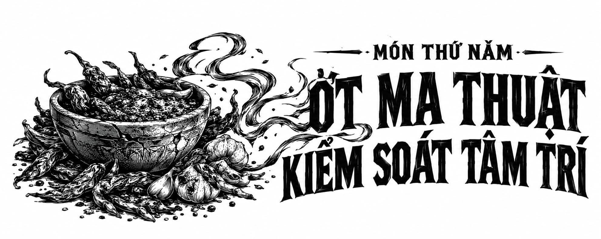

*Món Thứ Năm • Kiểm Soát Ớt Cay*

# Món Thứ Năm • Ớt ma thuật kiểm soát tâm trí

Một món ăn tốt nhất là đừng bao giờ đụng tới.

  

  

    **Hiệu ứng Sức bền ma thuật dự kiến:**

    

      Sức bền ma thuật, kéo dài từ 2–3 giờ.

      Khả năng kiểm soát bằng thần giao cách cảm đối với các sinh vật sống có cấu trúc xương chứa năng lượng ma thuật Endurium, kéo dài từ 2–3 giờ.

    

    **Tác dụng phụ ghi nhận:**

    

      Mất đi lý trí, kéo dài từ 2–3 giờ.
