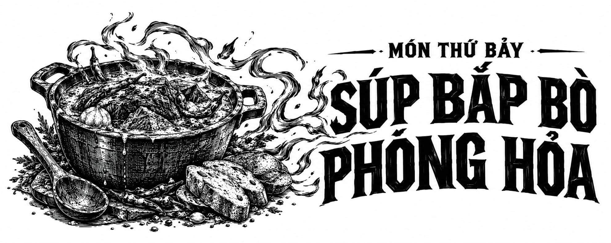

# Món Thứ Bảy • Súp Bắp Bò Phóng Hỏa (Cường Hóa)

Còn được biết đến với tên gọi Súp bánh mì men chua của Sesa, phiên bản Cường hóa Ma thuật của món Súp bắp bò phóng hỏa - Đại công thức 7 tự thân nó đã là một bữa ăn hoàn chỉnh. Chiếc bát làm bằng bánh mì cung cấp lượng tinh bột dồi dào, còn bản thân món súp lại mang trọn vẹn mọi tầng hương vị phong phú mà người ta hằng mong ước. Hãy thưởng thức kèm một loại đồ uống tùy chọn và cảm nhận trọn vẹn sự thỏa mãn ngập tràn sau khi dùng xong bữa.

  

  

    **Nguyên liệu** (khẩu phần 4 người):

    

      1 củ hành tây trắng lớn, thái hạt lựu

      2 củ cà rốt cỡ vừa, thái hạt lựu

      1 quả ớt chuông xanh, băm nhỏ

      6 thìa canh dầu ăn, chia làm nhiều phần

      4 nhánh tỏi, băm nhuyễn

      1 thìa cà phê cỏ xạ hương băm nhỏ

      4 cốc nước dùng rau củ

      4 ounce sốt cà chua cô đặc

      ½ cốc rượu vang trắng

      ½ thìa cà phê tiêu đen

      3 thìa cà phê bột rễ trời

      ½ thìa cà phê kinh giới cay oregano

      800 g thịt bắp quái thú bò mộng Emphon, thái lát dày 1 cm

      Nước cốt của 1 quả chanh

      1 củ khoai tây nâu russet, gọt vỏ và cắt khối vuông

      ¼ cốc nước ở nhiệt độ phòng

      Bát bánh mì:

      

        1½ cốc men cái bột chua

        ¾ cốc nước ấm

        ½ thìa canh muối biển

        Tối đa 4 cốc bột mì làm bánh

        1 thìa canh dầu ô liu

        4 thìa canh bơ, đun chảy

      

      1 thìa cà phê bột ớt chipotle

      1 thìa cà phê bột ớt cayenne

      Muối và ớt đỏ mảnh nêm theo khẩu vị

    

    **Các bước thực hiện:**

    

      Trong một chiếc nồi lớn, xào hành tây, cà rốt và ớt chuông cùng 2 thìa canh dầu ăn trên lửa vừa đến lớn trong 6 phút.

      Cho tỏi và cỏ xạ hương vào, nấu thêm 1 phút nữa.

      Khuấy đều nước dùng, sốt cà chua cô đặc, rượu vang cùng các loại gia vị trong một chiếc bát hoặc cốc đong rồi đổ vào nồi.

      Đun cho hỗn hợp sôi lăn tăn rồi đậy nắp lại.

      Trên một chiếc chảo gang, làm nóng phần dầu ăn còn lại trên lửa vừa đến lớn rồi cho bắp bò vào. Lập tức vắt nước cốt chanh lên bề mặt thịt và áp chảo mỗi mặt trong 2 phút.

      Nhấc chảo gang khỏi bếp, chuyển phần bắp bò từ chảo sang nồi. Cho khoai tây đã cắt khối vào cùng.

      (Tùy chọn) Để chảo gang nguội bớt trong 1 phút trước khi thêm nước vào tráng chảo nhằm tận dụng toàn bộ phần dầu mỡ thơm ngon còn sót lại. Đổ phần nước tráng chảo này vào nồi súp.

      Hạ nhỏ lửa, đậy kín nắp và ninh kỹ tối đa 6 tiếng.

      Trong lúc đó, trộn đều men cái bột chua, nước, muối và 2 cốc bột mì trong bát trộn, đánh đều tay cho đến khi khối bột thật mịn màng.

      Dùng rây, thêm phần bột mì còn lại vào, mỗi lần rây ¼ cốc, rồi đánh đều cho đến khi bột kết dính thành khối.

      Nhào bột trên mặt phẳng đã rắc sẵn bột áo cho đến khi không còn dính tay, khoảng 10–12 phút.

      Quét dầu quanh một chiếc bát thủy tinh rồi lăn đều khối bột để dầu phủ kín bề mặt.

      Đậy kín miệng bát và ủ bột ở nơi ấm áp cho đến khi bột nở gấp đôi thể tích ban đầu.

      Lấy khối bột ra khỏi bát, ấn và đập nhẹ xuống mặt bàn phủ bột áo để bột xẹp bớt bọt khí. Chia đều thành bốn phần bằng nhau.

      Vo tròn từng phần bột rồi đặt lên giấy nến, ủ tiếp cho đến khi nở gấp đôi.

      Làm nóng lò nướng cùng đá nướng bánh ở mức nhiệt 230°C.

      Quét bơ chảy lên từng viên bột, sau đó dùng dao sắc rạch một hình chữ X trên đỉnh bánh.

      Nướng trên đá nướng trong khoảng 30–35 phút cho đến khi phần đáy bánh chuyển màu vàng nâu sẫm, khi gõ nhẹ vào đáy bát bánh mì nghe thấy tiếng bồm bộp vang rỗng.

      Để các bát bánh mì nghỉ trong 5 phút hoặc chờ đến khi chạm tay vào thấy nguội bớt.

      Dùng dao khoét mở phần nắp trên, nhẹ nhàng ấn chặt ruột bánh mì vào thành bát ở những chỗ có thể để nén khung bánh cho thật vững chắc.

      Múc súp vào các bát bánh mì cho đến khi đầy ba phần tư.

      Rắc bột ớt chipotle, bột ớt cayenne, muối cùng ớt đỏ mảnh lên trên bề mặt.

    

    **Hiệu ứng Sức bền ma thuật dự kiến:**

    

      Sức bền ma thuật, duy trì trong 18–20 giờ.

      Khả năng tự phát sinh lửa, duy trì trong 1–2 giờ.

    

    **Hiệu ứng Sức bền ma thuật Cường hóa:**

    

      Khả năng phóng các quả cầu lửa ở tầm xa lên tới 1 km và kích nổ theo hình dạng tùy ý lựa chọn, duy trì trong 1–2 giờ.
