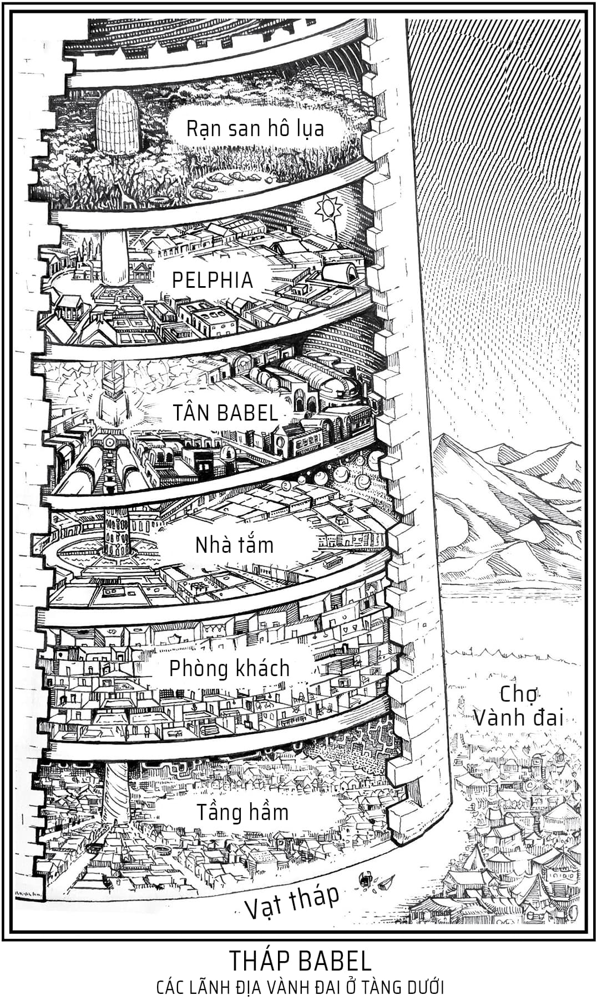
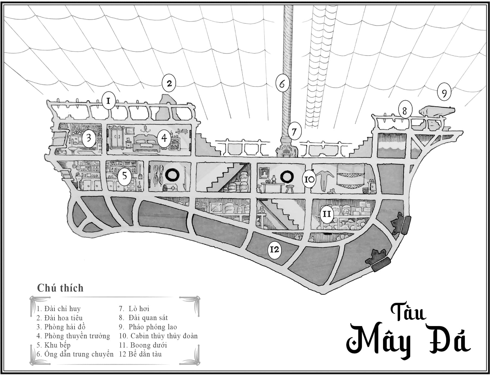

# Giới thiệu

Nền văn minh tựa như ánh mặt trời. Lan tỏa ánh sáng ấy khắp muôn nơi, thế giới sẽ bừng nở văn hóa, sự tân tiến cùng tình huynh đệ. Nhưng nếu gom trọn tất cả vào một điểm duy nhất, nhân loại sẽ thiêu rụi mặt đất tựa như tia sáng hội tụ qua chiếc kính lúp.

Trích nhật ký hải trình của tàu <em>Mây Đá</em>, qua bút tích của Thuyền trưởng Tom Mudd

