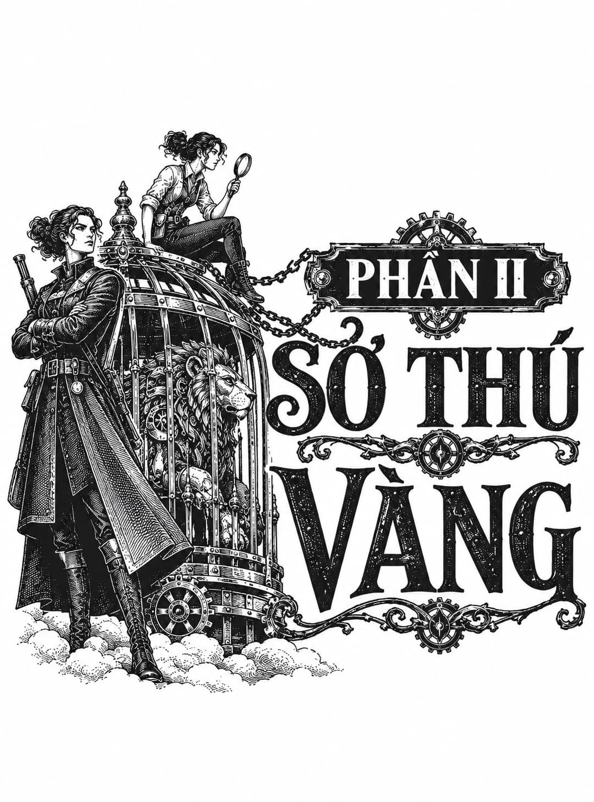

*Phần II: Sở Thú Vàng*

# Chương Một

  
<i>Mỗi chúng ta đều là một tập hợp đông đảo. Ta không phải là kẻ của buổi sáng nay, cũng chẳng phải là người của ngày hôm qua. Ta là một đám đông tự tập hợp qua dòng thời gian. Thưa độc giả hiền triết, mỗi chúng ta đều là một đám đông giữa lòng đám đông.</i>

  
<i>Phong tục và Lối đi trong Vườn Lụa, Vô danh.</i>

Trong những ngày trăng mật sau khi trốn khỏi Tân Babel, tàu Mây Đá từng có vẻ huy hoàng chẳng khác nào một chiếc du thuyền giải trí đối với đoàn thủy thủ vừa được cứu của cô ấy. Tất nhiên, họ không mù quáng trước những khiếm khuyết của nó. Họ nhận ra những chỗ vá chằng chịt trên giàn giáo và độ nghiêng tinh vi của boong tàu. Lò hơi của nó nóng nảy chẳng khác gì đứa trẻ hai tuổi. Thế nhưng, từ boong dưới dơ bẩn cho đến những dải vải báo hiệu sờn rách, nó hoàn toàn là vị cứu tinh của họ, và họ yêu quý nó.

Họ dành một ngày lăn lộn trong trận bão tuyết đưa họ ra khỏi tầm với của cao ủy, rồi thoát ra khỏi bức tường tuyết vĩ đại để đến với khung cảnh đồng quê yên ả gồm đàn cừu tụ tập, một ngôi làng ngái ngủ và những cánh đồng được chải chuốt cho giấc ngủ mùa đông. Không hề có ý định từ trước, họ đã vượt qua những dãy núi bao quanh Thung lũng Babel.

Thoáng nhìn thấy đất nông trại khiến Edith vô cùng hoài niệm, nhưng ý nghĩ đầu tiên của Senlin khi nhìn thấy lại thế giới cũ là: <i>Chúng ta không được đi lang thang quá xa Tháp.</i>

Anh chẳng cần phải lo lắng làm gì. Ngọn gió tàn lụi, và con tàu rơi vào lớp sương mù tràn qua các chân đồi tựa như một vùng biển sữa. Khi họ chìm xuống, mặt trời thu nhỏ lại và đen đúa như một quả nho khô, mời gọi một bầu không khí ảm đạm dày đặc thành màn đêm. Senlin chưa bao giờ trải qua sự im lặng sâu sắc đến thế trước đây. Anh có thể nghe thấy những người khác cựa quậy và thở, có thể nghe thấy tiếng thì thầm của trái tim chính mình. Họ thắp đèn boong tàu, dẫu cho ánh sáng chỉ đổi phương tiện mờ đục này lấy phương tiện mờ đục khác, màu đen đổi lấy màu trắng, bóng tối đổi lấy sương mù.

Thay vì cảm thấy bị bao vây hay mù lòa, họ cảm thấy được sương mù ôm ấp, bởi vì nếu họ hầu như không thể nhìn thấy nhau khi đứng trên cùng một boong tàu, thì bất kỳ ai khác lấy đâu ra cơ hội nhìn thấy họ?

Thật là một sự xa xỉ khi không còn sợ hãi.

Họ tận dụng khoảng thời gian tạm nghỉ để dọn dẹp những gì thủy thủ đoàn của Lee để lại. Giống như một chú chim mang những sợi chỉ mới đến chiếc tổ cũ, họ bắt đầu biến tàu Mây Đá thành của riêng mình.

Trong phòng thuyền trưởng lớn, Senlin cố gắng giải quyết câu đố gia đình cổ xưa nhất ấy: sự sắp xếp đồ đạc trong một căn phòng. Mục đích, tất nhiên, là làm hài lòng thị giác mà không làm tổn hại đến cẳng chân, thoạt nghe thì có vẻ đơn giản nhưng thực ra lại là một câu đố hóc búa. Thuyền trưởng Lee vốn không bị vướng bận bởi bất kỳ khiếu thẩm mỹ nào; bằng chứng cho điều đó thể hiện qua quyết định đẩy mọi món đồ đạc sát vào tường. Chiếc tủ quần áo to lớn như con hải mã, chiếc rương viền da, bộ bàn ăn và chiếc giường bốn cọc kiểu cách đều rình rập ở chu vi căn phòng.

Marya quay người giữa sàn nhà và nói: “Cảm giác như bị bao vây phải không? Chiếc tủ quần áo đó trông giống như đang mưu tính điều gì vậy.” Cô hất cằm và mỉm cười với anh, y như cách cô từng làm từ khung cửa sổ toa tàu vào ngày cô trở về từ nhạc viện nữ sinh. Cô rạng rỡ trước nhà ga khiêm tốn của Isaugh, những phu khuân vác già cỗi và những quý cô đội chiếc mũ nặng nề, lỗi thời. Mái tóc màu hạt dẻ của cô bay lượn quanh khuôn mặt, bị thổi bởi làn hơi nước đang cạn dần, và Senlin, vì đến vì một công việc nào đó mà anh quên bẵng ngay lập tức, ngước nhìn người phụ nữ quyến rũ này, cựu học trò của anh, và say đắm đến mức vô phương cứu chữa.

Anh ngờ rằng hình bóng tưởng tượng sẽ sớm biến mất thôi, và trong lúc này cô ấy chẳng gây phiền toái gì lớn lao cả. Đây là thời kỳ chuyển giao đối với anh, thời gian để thích nghi với chức năng mới của mình là thuyền trưởng, một vai trò thoạt nhìn có vẻ không phù hợp với tài năng của anh nhưng lại là điều không thể từ chối, một vai trò khiến anh phải vật lộn với đạo đức của việc đặt bạn bè vào tình thế nguy hiểm vì lợi ích của vợ mình. Từ trong sự hỗn loạn nội tâm này, cái bóng của Marya đã xuất hiện. Cô để anh nhớ lại người đàn ông mà anh từng là: vị hiệu trưởng chân thành, kẻ tẻ nhạt trong các buổi tiệc, người vị hôn phu vụng về.

Tất nhiên, Senlin đủ khôn ngoan để không tạo ra sự gắn bó với hình bóng tưởng tượng ấy. Anh quyết định ngay lập tức rằng mình sẽ không trò chuyện với cô, nhưng điều đó không có nghĩa là anh không thể tận hưởng bóng ma hoài niệm này. Khi chiếc Crumb kết thúc hành trình và cô lại biến mất vào ký ức, anh sẽ thở dài một hơi thật dài và tiếp tục bước tiếp.

Marya đặt một đốt ngón tay lên cằm và nheo mắt suy ngẫm khi Senlin dùng vai đẩy chiếc tủ quần áo ra khỏi góc cabin. “Như vậy tốt hơn đấy. Ở đó trông nó thân thiện hơn nhiều. Giờ thì, phải làm gì với chiếc rương này đây?”

Một tiếng gõ cửa vang lên nhanh chóng, và cánh cửa nặng dẫn ra boong chính mở toang ra giữa làn mây. Voleta bước ra từ sương mù, đôi mắt dán chặt vào khay trà cô cầm trước mặt. Cô mặc một bộ quần áo kỳ lạ không vừa vặn; đôi ủng nuốt chửng lấy đôi chân cô qua cả đầu gối.

Cô khép cửa lại bằng hông và nói: “Edith, ý tôi là Mister Winters — ôi, nghe lạ lẫm thật đấy — chị ấy bảo thầy phải ăn đấy.”

Senlin ngừng đẩy chiếc tủ quần áo và nhận lấy khay trà ngay lập tức. “Trời ạ, cháu không cần phải phục vụ ta đâu. Làm ơn, hãy nói với Mister Winters trong tương lai rằng ta sẽ dùng bữa cùng tất cả các cháu ở bếp tàu.” Anh dọn một chỗ trên bàn để đặt bộ trà, tách và đĩa lót, cùng một bát đựng thứ gì đó run rẩy và có màu xám.

Senlin hỏi: “Liệu đây có phải là bánh pudding không?”

Voleta đáp: “Có thể là bánh pudding đấy ạ,” rồi chắp hai tay sau lưng. Cô nhìn quanh món đồ đạc bị xáo trộn, những chồng sách, mớ khăn choàng sáng màu và chuỗi hạt rối tung nằm thành một búi trên giường. Cô nói: “Ở đây khá dễ chịu đấy chứ.”

Senlin đã nhìn thấy những khu vực khác và cảm thấy ngượng ngùng trước sự xa hoa tương đối trong phòng riêng của mình. Đó chắc chắn không phải là lựa chọn chỗ ở ban đầu của anh, nhưng Edith đã nằng nặc đòi hỏi, và anh đã nhượng bộ. Anh vừa lục lọi đồ đạc của Lee và tìm thấy một bộ sưu tập những món đồ trang sức nhỏ, có lẽ cô sẽ gọi chúng là như vậy. Anh ngờ rằng chúng chẳng có giá trị gì, nhưng cô có muốn giữ chúng không?

<i>Không, không, cảm ơn ngài. Những thứ đó giống như mồi câu cá dành cho những cô gái ngốc nghếch. Hơn nữa, tôi không nghĩ cướp biển lại đeo đồ trang sức.</i>

Senlin bật cười khẽ khi quét đống đồ lấp lánh khỏi giường và thả vào chiếc rương. <i>Chúng ta không phải là cướp biển, Voleta.</i>

Lời này thốt ra từ thuyền trưởng của con tàu cướp biển.

Thật là một ngạc nhiên dễ chịu khi phát hiện ra em gái của Adam lại sắc sảo đến vậy, dù có phần hơi hỗn xược. Adam có rất nhiều đức tính đáng ngưỡng mộ; cậu ta là một thợ máy giỏi và là một người làm việc không biết mệt mỏi, nhưng cậu ta lại không có khiếu giao tiếp. Senlin nhận thức được ở cô bé này một trí tuệ sắc sảo và tò mò. Chúng ta thực sự chưa có cơ hội để trò chuyện.

<i>Chúng ta bận rộn với việc la hét và cắn móng tay mất rồi. Đó là một cơn bão tồi tệ.</i>

Đúng thế. Xin mời, Senlin ra hiệu về phía một chiếc ghế, vì cháu đã ở đây rồi, sao chúng ta không dùng một tách trà nhỉ?

Voleta nhún chân hành lễ, lập tức tỏ vẻ bực bội với chính mình, rồi thả phịch xuống ghế. <i>Sẽ không còn những nghi thức đó nữa, Thuyền trưởng. Không còn những cái nhún gối chào nữa. Chào theo kiểu quân ngũ thì chắc chắn có. Bắt tay, nếu ngài thích. Nhưng tôi đã bỏ lại tất cả những cái nhún gối của mình ở Tân Babel rồi.</i>

Lẽ ra cháu nên làm vậy. Senlin lấy thêm chiếc cốc thứ hai từ giá đựng đồ sứ và rót trà ra hai cốc. Cháu nghĩ gì về sự sắp xếp nhỏ bé này của chúng ta?

<i>Ý ngài là trở thành một nhà hàng không học? Sống trên tàu? Có ngài làm thuyền trưởng? Tất cả những điều đó sao?</i>

Đúng vậy, chính xác là tất cả những điều đó. Senlin múc một thìa cháo không mùi vị, nuốt xuống với chút khó khăn, và chiêu ngụm trà đắng để át đi khối bột nhạt nhẽo đó.

<i>Thật tuyệt vời,</i> Voleta vừa nói vừa mở hũ đường và nhìn vào bên trong. <i>Tôi thích phiêu lưu, và tôi cũng thích ngài nữa. Tôi đặc biệt thích việc ngài đã bắn Rodion.</i>

Senlin nhìn thấy chiếc chìa khóa của ngục tối trong tay mình, làn khói súng và dòng máu rướm chảy xuống khuôn mặt Rodion. Biểu cảm của gã trở nên trong suốt, để lộ ra đứa trẻ bên trong cái tôi đầy thù hận và giận dữ. Và chính con người đó, cậu thiếu niên cởi mở và đầy hy vọng ấy, đã ngã xuống chết ngay dưới chân Senlin.

Senlin nghĩ việc tự vệ và bảo vệ những người bạn của mình là đúng đắn, anh cất giọng với vẻ gượng gạo. Nhưng anh nghĩ mình sẽ không bao giờ cảm thấy tự hào về việc bắn bất kỳ ai.

<i>Cậu ta không phải là bất kỳ ai đâu, thưa ngài. Cậu ta là một kẻ ác độc hạng nhất. Cậu ta là kẻ săn mồi thích, thích…</i> Cô bắt đầu lắc đầu, ánh mắt đờ đẫn. Cô rùng mình rồi lấy lại nụ cười. <i>Dù sao thì cũng cảm ơn ngài vì đã đưa tôi và Adam thoát ra ngoài.</i>

Senlin duy trì một biểu cảm dễ chịu, nhưng việc nhắc đến tên người em trai đã khiến suy nghĩ trong lòng thầy trở nên giằng xé. Thầy sẽ không bao giờ thừa nhận sự phản bội của Adam đã tổn thương thầy sâu sắc đến mức nào. Không chỉ sự lừa dối mới cứa rách tâm can thầy; mà chính là sự tính toán thực tế của Adam. Rodion, dù đê tiện đến đâu, lại là lựa chọn hợp lý và là đồng minh có giá trị hơn. Quyết định của cậu thiếu niên không phải là độc ác; mà là để tự bảo vệ mình. Làm sao những mối liên kết tình bạn nhận nuôi lại có thể cạnh tranh được với mối quan hệ gia đình và bản năng sinh tồn?

Thầy không thể nghĩ ra điều gì để nói, vì vậy chỉ mỉm cười và nhấp một ngụm trà.

<i>Tôi không nghĩ ngài và cậu ấy có thể làm bạn lại được đâu,</i> cô vừa nói vừa xoay tròn chiếc cốc trên đĩa lót, nhìn làn khói bốc lên thay vì nụ cười cứng đờ của thầy. <i>Chúng tôi biết điều đó. Adam có thể mất một thời gian để đi đến cùng kết luận đó, nhưng tôi nghĩ cậu ấy cũng sẽ nhận ra thôi.</i>

Hơi bất ngờ trước sự sắc sảo trong lời nói của cô, Senlin cố gắng tỏ ra ngoại giao. Thầy không trách cậu ấy vì đã chọn cô thay vì thầy. Gia đình được đặt lên trên hết. Thầy hiểu điều đó, và thầy chắc chắn cậu ấy nghĩ rằng mình…

<i>Ngài không cần phải biện hộ cho cậu ấy đâu. Chắc chắn tôi sẽ không làm thế. Tôi nghĩ cậu ấy đã mắc sai lầm. Tôi có thể nói cho ngài biết là cậu ấy không hề đưa tôi vào quyết định đó. Tôi sẽ không bao giờ chọn Rodion. Không bao giờ.</i> Cô bỏ ba thìa đường xỉn màu vào tách trà và bắt đầu khuấy mạnh. <i>Nhưng câu hỏi thực sự là, nếu hai người không thể làm bạn, thì hai người có thể là gì?</i>

Không mất nhiều thời gian suy ngẫm để biết cô ấy đã nói đúng. Việc thầy không thể tin tưởng Adam không giải quyết được vấn đề liệu thầy có thể cùng tồn tại hòa bình với cậu ta hay không. Thầy đã không nói chuyện với Adam kể từ cuộc tẩu thoát của họ, nhưng thầy biết cuối cùng mình sẽ phải làm thế, và sẽ tốt hơn cho tất cả những ai liên quan nếu sự im lặng này bị phá vỡ sớm còn hơn muộn.

Thầy đoán chúng ta có thể dựa vào các chức vụ mà mình đảm nhận. Thầy sẽ là thuyền trưởng của cậu ấy, và cậu ấy sẽ là thủy thủ đoàn của thầy, Senlin nói với sự pha trộn giữa sự nhẹ nhõm và hối tiếc. Có lẽ một vài nghi thức hình thức sẽ tốt cho cả hai chúng ta…

Một tiếng gõ cửa cắt ngang lời thầy. Adam bước ra từ làn sương mù, gương mặt cúi gằm xuống. Cánh tay cậu ta được băng bó, và những vết thâm tím hiện rõ trên khuôn mặt khôi ngô, nhưng vết thương tồi tệ nhất của cậu ta không phải là loại có thể nhìn thấy bằng mắt thường.

<i>Tôi vừa thả một quả dọi để kiểm tra khoảng không phía dưới. Tôi đã dùng hết dây rồi, thế nên chúng ta có ít nhất một trăm thước không gian trống bên dưới.</i> Không đợi câu trả lời, Adam quay người định bước đi.

Voleta ném cho Senlin một ánh nhìn đầy chờ đợi.

Đợi một chút đã, thầy vừa nói vừa đứng dậy khỏi ghế. Cậu có nghĩ hiện tại chúng ta đủ an toàn không?

Adam ngước ánh mắt lên đủ lâu để quan sát biểu cảm của vị thuyền trưởng, vốn đang giữ vẻ điềm tĩnh đáng nể. Cậu ta hắng giọng và thẳng lưng lên một chút. <i>Hiện tại chúng ta vẫn ổn, nhưng chúng ta nên nghĩ đến việc thò đầu ra ngoài để quan sát xung quanh. Xác định lại phương hướng.</i>

Nghe có vẻ hợp lý đấy. Hãy bàn bạc với cô Winters, và nếu cô ấy đồng ý, hãy đưa chúng ta bay lên để quan sát.

<i>Vâng, thưa thuyền trưởng.</i>

Và, Adam… Cậu thanh niên khựng lại, tay vẫn đặt trên nắm đấm cửa. Làm tốt lắm.

Tàu Mây Đá đã trơ ra những khung xương.

Quả đại bác đã xé toạc đài chỉ huy phía trước, cào rách boong chính, tàn phá khoang lớn và xóa sổ phòng bản đồ trên đường bay thoát ra. Senlin đứng ở giữa boong tàu và nhìn chằm chằm về phía đuôi tàu, chờ đợi sự tàn phá này trở thành sự thật.

Thầy đang cố hết sức để che giấu sự bàng hoàng trước những người khác, nhưng thực tế là họ rất may mắn vì vẫn còn sống, và thầy là người may mắn nhất trong số đó khi canh bạc liều lĩnh của thầy đã không kết thúc bằng việc họ bị ép lao vào đất liền, hoặc bị kéo lê sau một đoàn tàu, hay bị thổi bay khỏi bầu trời.

Ống khói rách rưới nằm cuộn tròn trên boong tàu giống như nội tạng bị lòi ra. Vỏ khí cầu là một khối méo mó và nhăn nheo. Độ nghiêng của boong tàu không còn nhẹ nữa. Trên thực tế, toàn bộ con tàu dường như sắp lật úp.

Senlin tự hỏi Marya sẽ nói gì về tình trạng của tàu Mây Đá, chắc hẳn là một lời nhận xét cay độc và sắc sảo nào đó… Nhưng thật điên rồ làm sao! Senlin đang nghĩ về cô ấy như thể cô ấy có thật, như thể cô ấy không phải là một mảnh vụn của Miền Vụn…

“Gió vẫn thuận chiều với chúng ta,” Adam nói, bước vào tầm nhìn của Senlin. Viên thuyền trưởng đang cau mày giận dữ đến mức Adam chần chừ một lát trước khi nói tiếp: “Nó đã thổi bay chiếc <i>Ararat</i> đi rồi. Voleta đã không nhìn thấy bóng dáng con tàu đó trong hai giờ qua.”

Voleta đang ở trên giàn lưới, bò khắp quả khí cầu sần sùi, lắng nghe tại những vết rách tự vá để tìm xem còn chỗ rò rỉ nào không. Bất cứ khi nào cô bé nghe thấy tiếng xì xì đáng ngờ, cô bé lại quét keo lên chỗ đó, rồi vá lại bằng một miếng lụa vuông.

Đầu óc Senlin bận rộn với quá nhiều chuyện khác đến mức anh mất một lúc mới tiếp thu được tin tức này. “Ta ngờ rằng hắn sẽ không chịu ở yên lâu đâu. Chúng ta cứ liên tiếp giáng cho hắn những sự nhục nhã, và hắn không phải là kẻ dễ dàng bỏ qua sự bẽ mặt đó.”

“Theo tính toán của tôi, đó là ba lần ngài đã chế nhạo hắn. Có lẽ hắn sẽ rút ra bài học cho mình. Thuyền trưởng Mudd không phải là người để đùa giỡn đâu.”

Senlin cười mà không cười. “Đó không phải là bài học mà ta rút ra được. Lần tới khi cậu xin làm việc trên tàu, ta nên để cậu làm. Cây đòn bẩy bị hỏng đó suýt chút nữa đã giết chết chúng ta rồi.”

“Tôi có thể không bao giờ đoán được nó sẽ gãy ở đâu. Có tới một trăm feet ống thủy lực bị mục khô chạy ngay dưới chân chúng ta. Thứ duy nhất giữ chúng ta lại với nhau vào lúc này chỉ là hy vọng.”

“Xem ra chúng ta đã cạn kiệt thứ đó rồi.”

“Không thể nào. Chúng ta có ngài mà.”

Senlin mang vẻ mặt đầy uất ức của một người không quen nhận những lời khen ngợi. “Ta nghĩ cậu đang nhầm lẫn hy vọng với sự bướng bỉnh đấy, Adam.”

“Tôi khá chắc chắn hy vọng chính là thứ đó. Sự bướng bỉnh. Từ chối việc gục ngã. Ngài đã phóng lao vào một đoàn tàu, chặt đứt thân tàu, và suýt đưa chiếc <i>Ararat</i> xuống mặt đất. Cứ gọi nó là gì tùy ý ngài, nhưng cảm giác này giống như hy vọng.” Adam mỉm cười, một cảnh tượng rất hiếm thấy, và Senlin thoáng thấy lại người bạn mà anh đã đánh mất.

Sự khích lệ của Adam đã sưởi ấm tâm hồn Senlin, và khi anh nhìn lại con tàu của mình, anh đã thấy phép màu ẩn giấu bên dưới thảm họa. Bất chấp mọi lỗ thủng, tàu Mây Đá vẫn nổi. Adam đã nói đúng: Vẫn còn hy vọng.

Khi Edith bước đến, kéo theo một mảnh vách ngăn từ phòng cô, cô thấy Senlin và Adam đang mỉm cười trước đống hỗn độn xung quanh họ. “Hy vọng là tin vui chứ?” cô hỏi.

“Chiếc <i>Ararat</i> đã đi rồi, và chúng ta vẫn đang nổi,” Senlin nói, và giúp cô chuyển gánh nặng lên đống gỗ vụn đang ngày một cao hơn. Họ sẽ nhổ những chiếc đinh còn dùng được, tận dụng những tấm ván tốt hơn, và phần còn lại sẽ được vứt qua mạn tàu. Senlin thấy thật tò mò khi cô không dùng cánh tay máy móc của mình cho công việc nặng nhọc này. Có lẽ cô muốn rèn luyện các cơ bắp ở chi kia của mình.

Cô lau mồ hôi trên cằm vào áo sơ mi. “Còn đường ống thì sao? Chúng ta có sửa được nó không?”

Adam không còn mỉm cười nữa. “Bất cứ nơi nào chúng ta hạ cánh tiếp theo, chúng ta sẽ mắc kẹt ở đó cho đến khi tìm được vật thay thế. Và tôi chắc chắn mình không cần phải nhắc ngài rằng chúng ta không thể trụ lại lâu trên bầu trời này đâu. Đó có thể không phải là một cú hạ cánh êm ái đâu.”

Cô xoa dịu khớp cơ học ở khuỷu tay như thể nó làm cô đau đớn, như thể nó có thể đau đớn, và chỉ dừng lại khi bắt gặp Senlin đang nhìn. “Chúng ta còn lựa chọn nào khác không, hay chúng ta chỉ đang tự chọn một chỗ trên mặt đất để rơi xuống thôi?”

Senlin đã chuẩn bị sẵn câu trả lời. “Chúng ta sẽ hướng tới Vườn Lụa. Chúng ta vẫn còn món quà hòa bình của mình. Đã đến lúc tìm hiểu xem Luc Marat có sẵn lòng mở rộng lòng bác ái của mình dành cho những người lao động nghèo đối với một vài kẻ lang thang hay không.”

“Tôi không chắc mình có thể đưa chúng ta đến Rạn Lụa. Tất cả các bản đồ đáng tin cậy đều ở trong phòng bản đồ rồi. Chúng ta sẽ phải bay bằng trực giác thôi.”

Senlin đã hiểu nhầm giọng điệu bình thản của cô là sự kiên cường, và do đó đã vô tình chọc tức cô về chủ đề nhạy cảm là căn phòng đã bị phá hủy của cô. “Bản đồ không bằng một nửa giá trị của cô đâu, Mister Winters.”

Cô nghiến răng. “Chúng ta đã hết dắt tàu rồi. Một khi đống phế liệu này bay sạch, chúng ta sẽ phải tháo cả ván tàu xuống để đốt đấy.”

“Nếu tình hình đến mức đó, hãy bắt đầu từ cabin của ta,” Senlin nói với vẻ hào phóng hơi quá mức. “Ta sẽ đi xem thư viện của vị bác sĩ đáng kính có điều gì hữu ích để nói về Vườn Lụa hay không.”

Anh đang cảm thấy phấn khởi, và vì thế đã phớt lờ sự thất vọng của Edith khi cô bắt đầu tháo tung những tấm ván trên tường phòng ngủ của mình.

Edith hoàn toàn không mấy hào hứng với việc đến Rạn Lụa, nơi mà cô nhất quyết không gọi là “vườn”. Cô đã dành đủ thời gian với những phi công kỳ cựu để biết rằng Rạn Lụa là một vùng đất hoang vu, không có người ở và đầy hiểm trở. Về bề ngoài, đó là một khu phi quân sự giữa các Lãnh địa Vành Đai không mấy thân thiện, nhưng Edith cho rằng mục đích thực tế của nó là để ngăn chặn dòng người qua lại, bởi vì không một du khách nào, dù có gan dạ đến đâu, có thể vượt qua Rạn Lụa. Rạn Lụa giữ cho đám người vô lại không thể lọt vào các Lãnh địa Vành Đai phía trên.

Và ai cũng biết nơi đó đầy rẫy nhện.

Khu Vườn Lụa nằm kẹp giữa hai vương quốc đối địch Pelphia và Algez, từng đóng vai trò là chiến lợi phẩm cùng sân khấu cho các cuộc chiến tranh của hai bên suốt nhiều thế kỷ. Khi pháo của họ ngày càng trở nên khổng lồ và quân số của hai đội quân tăng lên, cổng phía đông của Rạn Lụa đã phải được mở rộng bằng đục và cuồng phong để đáp ứng sự phát triển đó. Cuối cùng, đường hầm đã đủ rộng để một khí cầu bay qua. Và đó chính là thời điểm mà mối thù cũ biến thành sự tự sát lẫn nhau. Hai kẻ địch đã nhồi nhét hạm đội của mình vào khoảng trời nhỏ bé của Rạn Lụa và nhanh chóng phát hiện ra rằng những túi khí hydro cùng lượng lớn thuốc súng, khi bị nén chặt bên trong Tòa Tháp, sẽ tạo ra một cơn mưa đẫm máu.

Rồi một trăm năm trước, Pelphia và Algez đã ký một hiệp định đình chiến, bao gồm việc biến vương quốc thứ sáu thành một công viên chung, tượng trưng cho hồi kết vĩnh viễn cho nhiều thế hệ thù hận. Nền hòa bình lịch sử ấy kéo dài trọn vẹn năm năm, nhưng nó đã thực sự chuyển chiến tranh ra bầu trời rộng lớn vì không bên nào muốn phá hủy công viên mà họ cùng xây dựng nhưng lại coi là của riêng mình. Thế là những khu vườn bị bỏ quên cuối cùng đã trở thành Rạn Lụa mọc um tùm và không ai cai quản. Một nơi được thì thầm bàn tán và né tránh; một cảng cứu ranh giới cuối cùng dành cho những kẻ tiều tụy và tuyệt vọng.

Việc đọc sách vẫn luôn là một chốn lui tới đáng tin cậy đối với Senlin. Anh được ban cho một thể chất cho phép bản thân đọc sách trên tàu hỏa và trong xe ngựa. Anh đã trải qua nhiều buổi tối đọc các bài luận tại quán Xăm Xanh trong khi các thủy thủ và những người bán cá hát những khúc ca hỗn tạp hoàn hảo theo tiếng đàn piano của Marya. Có lần, anh đã bỏ lỡ toàn bộ khoảng thời gian diễn ra một trận cuồng phong chỉ vì quá mải mê với lịch sử của dấu chấm chữ cái do một thợ sắp chữ viết. Anh chỉ nhận ra một cơn bão đã đi qua khi thức dậy vào sáng hôm sau và phát hiện ra hàng rào, bụi cây cùng những bông hoa của mình đã bị cạo sạch khỏi sườn đồi tựa như bị cạo bởi một chiếc dao cạo râu thẳng.

Nhưng lần đầu tiên trong đời, anh cảm thấy bị cản trở bởi những cuốn sách trước mặt. Anh tự hỏi liệu bản thân có đang bị phân tâm bởi căn cabin tàn tạ của mình hay không. Chiếc giường nghiêng của anh đã mất hai chiếc cột. Chẳng còn lại gì từ chiếc đèn chùm bằng thiết ngoài một vài đoạn xích, và bộ sưu tập áo choàng sặc sỡ của Thuyền trưởng Lee đã bị vứt vào mọi góc phòng, nơi chúng nằm cuộn tròn trong cơn gió lồng lộng tựa như những con mèo bồn chồn.

Không, những sự xao lãng này không phải là nguồn cơn thực sự cho sự bất an của anh. Nếu thật lòng với chính mình, anh đang gặp khó khăn trong việc vượt qua sự kinh hoàng khi phải đọc thêm những lời nhảm nhí tương tự từng khiến bản thân lầm đường lạc lối trong quá khứ.

Dù vậy, công việc này vẫn phải được hoàn thành.

Senlin phân loại qua những cuốn sách, sắp xếp chúng thành từng chồng dựa trên tiềm năng của chúng. Các tiểu thuyết và tập thơ, bất chấp mọi nỗ lực tỏ ra uyên thâm, đều vô dụng đối với anh. Gần như kém phần thiết thực không kém là những triết học tự nhiên, bao gồm một số hình minh họa rất đẹp. Những cuốn lịch sử dát vàng, sau cuộc diện kiến gần đây với phu nhân Bhata, dường như bị ám ảnh một cách rõ rệt bởi những người đàn ông giàu có và các cuộc chiến tranh của họ, có lẽ vẫn chứa đựng một hạt dẻ nào đó. Ngoài những hướng dẫn độc hại thông thường, chỉ có hai cuốn sách trong bộ sưu tập của vị bác sĩ là hoàn toàn dành riêng cho chủ đề Vườn Lụa.

Tập đầu tiên, <i>Phong tục và Lối đi trong Vườn Lụa</i>, là một cuốn sách về phép tắc. Tác giả giấu tên có thói quen tẻ nhạt là xưng hô với khán giả của mình là độc giả hiền lành, và những lời khuyên của ông ta thường rơi vào tình trạng phi lý siêu hình, vốn tiếp tục bị phá vỡ bởi những bức vẽ nghiệp dư về các đặc điểm khác nhau của khu vườn. Senlin đã đọc hết chương đầu tiên trước khi kết luận rằng cuốn sách đó là một cái ống nhổ trí tuệ tràn ngập nước bọt.

Cái tên đầy hứa hẹn khác, <i>Lễ khánh thành Vườn Lụa</i>, được viết bởi một sứ thần hoàng gia tên là Niccolo Salo. Salo đã tham dự lễ khai trương hoành tráng của Vườn Lụa trong thời gian đình chiến ngắn ngủi giữa Pelphia và Algez. Phần lớn bản ghi chép bị chi phối bởi sự nịnh hót của Salo dành cho vị công tước, đối tượng khán giả ban đầu của ông ta, trong một nỗ lực lộ rõ ý đồ nhằm kiếm lấy một tước hiệp sĩ.

Senlin bắt đầu đọc phần lời đề tặng dài mười bốn trang gửi cho Công tước xứ Pelphia bằng một tiếng thở dài nhanh chóng chuyển thành một tiếng rên rỉ.

Một giờ sau, Voleta tìm thấy thuyền trưởng đang đập một cuốn sách mở trên bàn của mình. Senlin nghiêm túc trong việc trừng phạt cuốn sách vô tri đến mức không nhận ra Voleta đã bước vào cabin cho đến khi cô bé bắt đầu cổ vũ anh.

“Đúng thế, Thuyền trưởng! Hãy dạy cho nó vài phép tắc đi!”

Senlin dừng lại giữa chừng cú đập.

Bản năng đầu tiên của Senlin là biện minh cho hành động đối xử thô bạo với cuốn sách, thứ mà anh đã tìm đến với hy vọng tha thiết rằng nó sẽ mang lại cho mình sự chỉ dẫn rõ ràng và ngắn gọn. Senlin muốn những sự thật không thể chối cãi. Senlin muốn một chữ <i>X</i> trên bản đồ. Senlin muốn biết Vườn Thú Vàng nằm ở đâu bên trong vương quốc nguy hiểm đó. Thay vào đó, anh nhận lại rất nhiều sự hợm hĩnh, một chút triết lý bài ngoại, và vô số những âm mưu chính trị chẳng có gì là thú vị cả.

Dẫu vậy, việc lăng mạ một cuốn sách thì có ích gì chứ?

“Thầy xin lỗi vì cháu đã chứng kiến cảnh đó, Voleta. Đó không phải là cách thầy khao khát ứng xử,” anh nói với vẻ bình tĩnh lớn. “Cháu cần gì vậy?”

“Toàn bộ thức ăn đã hết rồi,” cô bé nói.

Nụ cười hiền hòa ngắn ngủi của Senlin vụt tắt thành một cái cau mày.

“Có một cái lỗ trên phòng bếp rộng bằng thế này.” Cô bé tạo thành một vòng tròn bằng đôi tay của mình. Phòng bếp nằm bên dưới đài chỉ huy nơi khẩu súng lao đã thổi bay.

“Không còn gì sót lại sao?” Senlin hỏi.

“Vẫn còn một ít mù tạt.”

“Mù tạt?”

“Khoảng hai thìa. Và một hũ nước củ cải muối, nhưng không có củ cải.”

“Chà,” anh nói, tự lên dây cót tinh thần trước tin tức đáng thương này. “Hãy giăng lưới đi. Chúng ta sẽ phải bắt bữa tối thôi.” Những tấm lưới bắt chim khó mà bắt được nhiều thứ khi ở trên mặt đất quá cao và vào lúc chiều muộn như thế này, nhưng họ còn lựa chọn nào khác ngoài việc hy vọng điều tốt nhất chứ?

“Con bé này là ai vậy?” Voleta vừa nói vừa nhặt bức tranh nhỏ vẽ trên tấm ván gỗ nằm trên bàn giữa những chồng sách đóng bìa da. “Đây có phải là vợ của ngài không?”

Senlin đã quên mất rằng bản thân vừa lấy chân dung của Marya ra để làm bạn trong lúc đọc sách. Bình thường, Senlin luôn cố gắng cất kỹ bức tranh để không ai nhìn thấy. “Đúng vậy.”

Voleta chăm chú ngắm nghía, ngước lên nhìn thuyền trưởng rồi lại nhìn bức tranh khi cố gắng hình dung sự kết hợp giữa hai người trong tâm trí. Senlin cảm thấy vô cùng ngượng ngùng, lại nhớ đến sự tự ti vốn có về việc sở hữu một người vợ trẻ trung và xinh đẹp. “Tranh có giống người thật không?”

“Giống.”

“Trông cô ấy rất đẹp.”

“Đúng thế.”

Voleta nhăn mặt. “Nhưng bức tranh bám đầy bụi bẩn.”

“Tôi khó lòng gọi đó là bụi bẩn. Đây là một bức tranh khỏa thân mang tính nghệ thuật. Em phải hiểu rằng, cô ấy đã rơi vào cảnh khốn cùng khi gặp họa sĩ, người mà tôi thực sự nghĩ không có ý định lợi dụng cô ấy. Tôi nghĩ họa sĩ chỉ coi cô ấy như một đối tượng nghệ thuật thuần túy, chứ không phải…”

“Không, không, ý em là bức tranh bị phủ một lớp màng bẩn. Nó rất bẩn.”

“Ồ. Phải rồi. Lớp sơn ít nhiều bị hỏng vì Bạch Sương và tuyết.”

“Ngài nên lau sạch nó đi.”

“Tôi không thể cứ thế xả nước rồi dùng bàn chải cọ được. Làm vậy sẽ làm trôi mất bức tranh.”

“Và bức tranh vô cùng quý giá đối với ngài.”

“Đúng vậy.” Senlin chìa tay ra với một nụ cười điềm đạm, và cô bé trả lại tấm ván gỗ cho anh. “Voleta, có chuyện gì khác nữa sao?”

Lần này đến lượt Voleta tỏ ra hơi bối rối. “Iren nói Rạn Lụa đầy nhện và gấu, lại chẳng có ai đến đó bao giờ.”

“Và em đang cảm thấy lo lắng,” anh kết luận.

“Không đâu! Em chưa từng nhìn thấy con gấu nào bao giờ,” cô bé nói, sự hào hứng khiến gương mặt bừng sáng. “Em muốn biết liệu chúng ta có được nhìn thấy gấu không.”

Senlin bật cười, một phần vì chính mình, một phần vì sự khao khát phiêu lưu không bao giờ đủ của cô bé. Chỉ vài tiếng trước, họ còn đang giao chiến với một nhóm cướp, thế mà bây giờ cô bé đã nghĩ đến chuyện xem gấu. “Tôi rất tiếc phải làm em thất vọng, nhưng tôi không tin có bất kỳ con gấu nào ở Vườn Lụa. Tuy nhiên, ở đó có nhện, được nuôi dưỡng để lấy tơ, và có cả những sinh vật ăn thịt nhện…”

“Sinh vật ăn thịt nhện là gì ạ?” Voleta hỏi, nỗi thất vọng về loài gấu đã được xoa dịu nhờ sự tò mò về sinh vật mới mẻ này.

“Nếu những gì ghi chép ở đây là đáng tin,” Senlin nói, nâng cuốn sách dày mà anh vừa vỗ phịch lên mặt bàn, “chúng có họ hàng với loài thú ăn kiến. Loài ăn thịt nhện được nuôi dưỡng để kiểm soát đàn nhện, nhằm ngăn chúng sinh sôi lan tràn khắp công viên. Nhưng đừng có mơ tưởng gì sất, Voleta. Em sẽ ở lại trên tàu trong khi tôi đi gặp Luc Marat.”

“Dĩ nhiên rồi!” Voleta rướn người về phía trước bàn và dành cho anh biểu cảm nghiêm túc nhất. “Đó là lý do tại sao em đang nhờ ngài miêu tả lại: bởi vì em sẽ không thể tự mình nhìn thấy nó. Chỉ là, nơi đó được gọi là khu vườn. Đã lâu lắm rồi em chưa được thấy một khu vườn nào…” Cô bé ngập ngừng, đếm lại những tháng ngày dài đằng đẵng bị giam cầm trong phòng trang điểm cũ. Ở Tân Babel chẳng có thứ cây xanh nào mọc được. Đôi khi, với cái giá rất đắt, một số người đàn ông sẽ nhập khẩu hoa hồng hoặc loài hoa nào khác để làm mồi nhử các cô gái. Bản thân cô bé từng nhận không ít bó hoa như thế, thậm chí có những bó quá đỗi xa xỉ, do những quý tộc giàu có gửi đến với mong muốn chuộc cô khỏi tay Rodion. Cô đã từng rất thích ngắm nhìn những bông hoa héo tàn vì biết rằng hy vọng của những kẻ đó cũng lụi tàn theo.

“Ở đó có cây cối không ạ?” cô hỏi, tìm lại được giọng nói của mình.

“Có rất nhiều cây. Cả một khu rừng lớn.”

“Xin hãy kể cho em nghe về chúng đi.”

Senlin không khỏi bị cuốn hút bởi sự nhiệt tình của cô bé. “Chỉ có một chủng loại mọc ở đó: cây sứ ngọc. Thân chúng trắng như xương, giòn như tách trà, và hoàn toàn không có lá. Chúng là một loại cây trong hang động. Thật thú vị phải không? Tôi chưa từng biết trên đời lại có thứ cây như vậy.” Anh lật qua lật lại các trang sách một lúc. “Tôi đã tìm thấy hình vẽ về một cái cây như thế. Trông không đẹp lắm, nhưng nó…” Anh lóng ngóng cầm cuốn sách <i>Phong tục và Lối đi trong Vườn Lụa</i> khiến nó bật mở ra trên bàn. Khi anh nhặt lên, một tờ giấy gấp đôi rơi ra và trôi dạt xuống sàn nhà.

Voleta nhặt lấy và mở tờ giấy ra trong khi Senlin theo dõi. “Trông có vẻ như từ đầu ngài đã đoán đúng rồi đấy, Thuyền trưởng. Đôi khi ngài phải mạnh tay thì chúng mới chịu khuất phục,” cô bé nói, ngước lên từ trang giấy với một nụ cười ranh mãnh. “Đây là một tấm bản đồ.”

“Đừng ngốc nghếch thế, Voleta. Đưa tôi xem nào,” anh nói, nghe hoàn toàn thiếu thuyết phục.

Nhưng chỉ cần liếc qua là đủ để xác nhận cô bé đã đúng. Có một hoa tiêu chỉ hướng và phần chú giải ở góc trang giấy; có những con đường ngoằn ngoèo và những vùng nước nhỏ được vẽ bằng những đường sóng nước mềm mại. Ở trung tâm của tất cả các lối đi là một biểu tượng giống như chiếc lồng chim. Nơi đó được chú thích chi tiết: “Vườn Thú Vàng.”

Trong đôi bàn tay đang run rẩy, anh cầm một tấm bản đồ có thể dẫn đường cho anh đến với người vợ dấu yêu.
