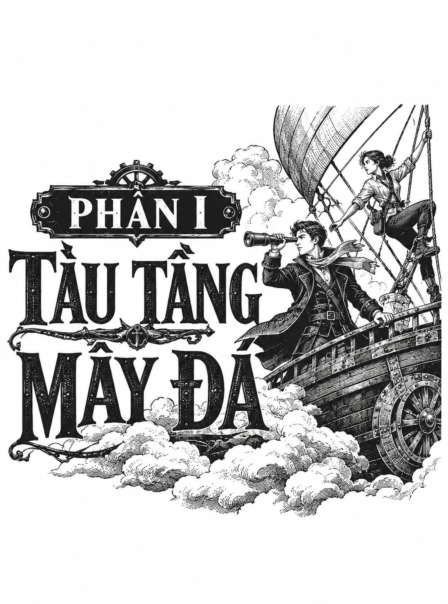

*Phần I: Tàu Tầng Mây Đá*

# Chương Một

  
Khó khăn của việc ngụy trang nằm ở chỗ bộ trang phục ấy phải được khoác lên một thời gian thì mới trông tự nhiên trên đôi vai người mặc. Thế nhưng, nếu khoác quá lâu, lớp vỏ bọc ấy bỗng trở nên quen thuộc, tự nhiên đến lạ thường. Một kẻ luôn luôn ngụy trang phải hết sức cẩn trọng, kẻo rồi chính mình lại trở thành hiện thân của lớp ngụy trang ấy.

  
Nhật ký hải trình tàu <i>Mây Đá</i>, Thuyền trưởng Tom Mudd

Chiếc phi thuyền lướt qua con đèo phủ đầy băng giá trên luồng khí buốt buốt tựa một trận tuyết lở. Thân tàu thuôn dài hệt như một chiến thuyền cổ, chỉ thiếu mỗi hàng mái chèo, với phần mũi tàu uốn lượn chạm khắc hình đầu một con chó săn ngẩng cao. Dưới con mắt hoài nghi và cay nghiệt, con tàu trông chẳng khác nào một cỗ quan tài thô kệch được chở trên lưng một con chó đang nhe răng cười.

Nhưng đối với thủy thủ đoàn, nó chỉ đơn thuần là một chiếc bè băng giá.

Quấn kín trong những lớp áo lông thú dày cộm, họ dậm chân bình bịch trên boong tàu như những con gấu đang hằn học. Gió rít qua hệ thống dây dợ chằng chịt. Không ai nói một lời nào. Bốn mươi thùng rượu rum sóng sánh chật ních ở khoang hàng chính ngay dưới chân họ, rỉ mật ngọt ngào và len lỏi vào bầu không khí hương thơm của đường mía cùng gỗ sồi mới.

Con tàu <i>Cairo Hound</i> đang trên đường hướng về tầng Nhà Tắm, nơi giá một thùng rum cao gấp mười lần so với các thủ phủ của Ur. Chỉ vài tiếng ngắn ngủi nữa thôi, trong túi mỗi người sẽ rủng rỉnh tiền lương nửa năm trời và cả tầng Nhà Tắm bao la để tha hồ phung phí. Thế nhưng, bất chấp ngày trả lương cùng sự tự do đang cận kề, thủy thủ đoàn vẫn vô cùng bứt rứt. Họ sợ hãi không dám cất lời, bởi một khi đã mở miệng, những câu chuyện phiếm sẽ nhanh chóng biến thành những lời lảm nhảm đầy âu lo, và khi ấy sự hoảng loạn chắc chắn sẽ ập đến tức thì.

Bọn cướp biển vẫn thường lảng vảng trên những tầng trời này. Những đợt cắt gió dữ dội cũng chẳng phải là chuyện hiếm hoi. Chưa kể đến những bất trắc khôn lường từ các bến cảng của Tháp Babel. Một chuyến hải trình có thể cập bến bình an nhưng chuyến sau lại biến thành một bãi bắn bia đẫm máu. Chỉ vài tháng trước, đạn đại bác và biển lửa đã san bằng một trong những bến cảng đáng tin cậy nhất ở New Babel. Thủy thủ đoàn chẳng bao giờ có thể đoán trước được Tòa Tháp sẽ chào đón họ bằng nghi thức nào.

Và vị thuyền trưởng của họ đang ở đâu giữa lúc mọi người âu lo thế này? Lại say mèm, vẫn say mèm, và lúc nào cũng say xỉn một cách tuyệt đỉnh.

Thôi, tốt nhất là không nên mở lời. Tốt nhất là cứ giữ vẻ mặt điềm nhiên khắc kỷ.

Tận phía sâu thẳm bên dưới, những triền dốc hiểm trở nhường chỗ cho một vùng ngoại ô lều bạt, rồi tiếp đó là khu ổ chuột dựng bằng vải bạt và những mái nhà lợp giấy dầu. Những đoàn tàu lao vun vút qua khu Chợ Vành Đai sầm uất trên các đường ray tỏa ra từ Tháp Babel tựa như những tia trên vòng hoa hướng đạo. Trông Tháp Babel không giống như được xây dựng nên từng viên gạch bởi bàn tay con người. Ngược lại, nó trông giống như một tạo vật mà thế giới bắt đầu thai nghén từ thuở hồng hoang, có lẽ là một vầng trăng lưỡi liềm mới, trước khi từ bỏ công trình dang dở. Tháp Babel sừng sững uy nghi bao trùm lên dãy núi uốn lượn xung quanh. Một lớp sương mù điềm nhiên bao phủ lấy đỉnh tháp. Những kẻ lãng mạn gọi làn sương mù bất biến này là “Vành Đai Thiên Đường”, tin rằng đó chính là ranh giới nơi Tòa Tháp vươn từ bầu trời xanh thẳm vào khoảng không vũ trụ đen ngòm, lạnh lẽo.

Vị thuyền trưởng lúc nào thức giấc cũng mang một bộ mặt cộc cằn, cay nghiệt.

Lúc nào ông ta cũng hằn học như thế, nhưng tính khí tồi tệ ấy lại càng bộc phát dữ dội vào những lúc vừa thức giấc. Dù say hay tỉnh, dù cay nghiệt hay không, vị thuyền trưởng vẫn phải đặt bút ký vào bản kê khai hàng hóa và kỳ kèo với viên quản cảng về giá của từng thùng rum. Ông ta vẫn có công việc phải hoàn thành. Họ sẽ phải rút thăm xem ai là kẻ bất đắc dĩ phải đi đánh thức ông ta dậy. Viên thủy thủ trưởng đã ngắt những cọng rơm từ chiếc chổi quét và so độ dài của chúng trong lòng bàn tay.

Đúng lúc đó, cô bé xuất hiện.

Cứ như thể cô bé vừa hiện hình từ cõi hư không ngay gần lò sưởi đang kêu lách tách và những thùng bánh quy. Một cánh tay cô bé luồn qua sợi dây thừng đang giữ lấy mình; mũi giày khẽ chạm nhẹ lên boong tàu, hệt như một người đang thử dòng nước tắm mát lạnh. Cô bé rất xinh đẹp, nhưng không phải kiểu diêm dúa lẳng lơ như những ả đào nơi quán rượu sẵn sàng sà vào lòng khách nếu được thết một ly rượu. Cô bé cũng chẳng hề nảy nở đẫy đà như những bức họa trong sách của các quý ông, hay kiều diễm như những bức tượng cẩm thạch khoác lớp áo mỏng manh tựa dòng sữa đổ.

Cô bé đẹp như một con nai vàng nơi thung lũng: uyển chuyển, cảnh giác và đầy xa cách. Mái tóc xù rối, khuôn mặt nhỏ nhắn, đôi mắt sáng ngời. Chiếc áo đầm màu vàng đã bị cắt cụt ngủn ngang eo, còn đôi găng tay rộng thùng thình trông hệt như thứ đồ mà một người thợ rèn hay mang.

Không phải tất cả bọn họ đều nhìn thấy cô bé trong cùng một khoảnh khắc. Cô bé thôi miên từng người một.

Đám thủy thủ khoác áo da gấu trên tàu <i>Cairo Hound</i> bắt đầu áp sát cô bé với những bước đi chậm rãi, thận trọng như những kẻ mộng du. Theo mỗi bước chân họ tiến đến, cô bé lại nhích dần lên sợi dây thừng và hướng về phía khoang khí cầu bên trên. Cô bé trông chẳng có vẻ gì là sợ hãi cả. Đám đàn ông bị cuốn hút bởi phong thái điềm tĩnh lạ kỳ của cô bé. Họ phát cuồng vì điều đó.

Đến khi không thể kìm nén thêm được nữa, họ lao đầu đuổi theo cô bé.

Cô bé luồn nhanh như chớp vào tấm lưới trên cao, và họ va sầm vào nhau ngay bên dưới, làm lật nhào các thùng gỗ và xô đẩy nhau ngã vào chiếc lò sưởi đang tỏa nhiệt hừng hực khi cố tranh giành sợi dây thừng. Vừa có kẻ trèo lên được một quãng, những kẻ khác đã kéo tụt hắn xuống. Cô bé giật giật tai và thè lưỡi trêu tức. Một tên thủy thủ ném chiếc gáo múc nước về phía cô bé. Cô bé nhanh nhẹn chộp lấy chiếc gáo giữa không trung và ném trả lại hắn.

Họ bắt đầu cãi cọ xem ai là kẻ nhìn thấy cô bé đầu tiên, và ai sẽ phải đi đánh thức thuyền trưởng, bởi bây giờ thì ông ta chắc chắn phải được gọi dậy, và thế nào cũng phải có kẻ nhận việc đó, vậy còn những cọng rơm rút thăm đâu rồi?

Cuộc tranh luận sôi nổi của họ đột ngột bị cắt đứt bởi tiếng ủng lạ hoắc nện dồn dập vang lên từ phía sau.

Đám thủy thủ tàu <i>Cairo Hound</i> quay phắt lại và bàng hoàng nhận ra tàu của họ đã bị kẻ lạ đột nhập.

Thuyền trưởng Padraic DeFord đã chui tọt vào một thùng rượu rum ngay ngày đầu tiên khởi hành và cứ thế vùi mình trong đó suốt chuyến đi. Là một kẻ có thân hình béo phì cùng làn da loang lổ như trẻ sơ sinh mới chào đời, ông ta đang ở giai đoạn sự nghiệp mà trong mắt ông ta, tất cả những kẻ khác đều là đồ ngốc, công việc kinh doanh thì nhảm nhí, còn tiền lương chỉ xứng cho lũ đần độn. Đám thuộc hạ cho rằng ông ta là một kẻ bạo ngược, nhưng thực chất ông ta lại quá đỗi nuông chiều họ. Thuở còn làm cậu bé phục vụ khoang tàu, nếu dám mắc phải dù chỉ một lỗi lầm nhỏ nhặt như đám thủy thủ gây ra hằng ngày, ông ta chắc chắn đã bị quất roi cho tơi tả đến mức bật máu. Ông ta không phải một bạo chúa; ông ta chỉ là một bậc phụ huynh đang mắc kẹt với một đàn con dốt nát. Và thay vì tiến bộ hơn, thay vì vươn lên trước thử thách từ sự lãnh đạo của ông ta, đám thuộc hạ ngày càng trở nên u uất và đầy vẻ oán hận. Chúng đang trượt dài hướng tới âm mưu nổi loạn.

Thế giới đã đổi thay nhường nào.

Trước nghịch cảnh ấy, liệu có kẻ có khí chất nào lại trách cứ ông ta vì đã tìm đến men cay để giải sầu? Ông ta nhận ra rằng nếu uống đủ nhiều, bản thân sẽ chìm vào giấc ngủ sâu và chẳng mộng mị gì mấy. Ông ta có thể ngã xuống giường hệt như ngã vào mộ phần của chính mình. Mỗi sớm mai là một lần hồi sinh; mỗi buổi chiều tà là một cái chết. Thật là một điều tuyệt diệu khi được ra vào cõi u minh tùy thích.

Sáng nay, ông ta bị đánh thức một cách thô bạo khỏi cõi chết êm đềm ấy bởi thứ gì đó tựa như một sợi xích neo đang siết chặt lấy cổ, giật thốc ông ta khỏi chiếc giường đơn và lôi tuột ra khỏi cõi tối tăm tuyệt vời.

Vốn đã tự rèn luyện bản thân từ lâu để có thể chợp mắt cùng khẩu súng lục trong tay, DeFord nhanh chóng nhắm thẳng vào hình bóng phía sau sợi xích. Ngay khi ngón tay ông ta vừa chạm vào cò súng, một cánh tay vạm vỡ đã hất ngược nòng súng lên trời, và phát đạn nổ tung vào trần khoang với tiếng gầm đinh tai nhức óc. Bụi gỗ và khói xám xộc thẳng làm xót mắt ông ta. Ánh nắng rọi qua lỗ đạn, làm bừng sáng không gian tối tăm và mang lại cho DeFord cái nhìn đầu tiên về kẻ đứng sau vòng xích sắt.

Nhưng đó không phải là một người đàn ông. Đó là một người đàn bà hộ pháp khổng lồ với mái tóc ngắn màu bạc áp sát vào khuôn mặt vuông vức, lạnh ngắt như đá. Ông ta có cảm giác như mình đang ngước nhìn một con bò mộng đứng sừng sững bằng hai chân sau.

Thuyền trưởng DeFord tung một cú đá dò dẫm vào người nữ chiến binh, và để đáp lại, cô tóm lấy hai tay ông ta rồi xách bổng lên, đập người ông ta vào trần khoang hai cú liên tiếp. Những cú va đập khiến sợi xích leng keng vang dội bên tai ông ta. Khi tiếng đập dừng lại, cột sống của ông ta có cảm giác như ngắn đi đôi chút. Giờ đây, khi đã trở nên ngoan ngoãn vì đau đớn và bàng hoàng, DeFord không còn chống cự nữa khi bị lôi lên trên boong tàu, trên người chẳng mặc gì ngoài chiếc quần chẽn cùng một tấm vải trải giường trắng nhàu nhĩ.

Ông ta cảm thấy thất vọng nhưng không hề ngạc nhiên khi trông thấy đám thủy thủ vô tích sự của mình đang đứng giơ cao hai tay đầu hàng. Một cô gái trong chiếc váy rách tả tơi cùng một người phụ nữ gắn cánh tay cơ khí bằng đồng đang chĩa súng uy hiếp chúng, vô cùng tự tin và quyết đoán. Nhận thức ấy mang lại cho DeFord nỗi đau đớn thể xác tột cùng: Một bộ ba phụ nữ đã chiếm đoạt con tàu của ông ta! Còn bằng chứng nào rõ ràng hơn thế nữa? Đám thuộc hạ của ông ta đang thông đồng chống lại ông ta. Chúng thậm chí còn chẳng buồn kháng cự lấy một lần.

Có một kẻ lạ mặt khác: một người đàn ông gầy lêu nghêu trong chiếc áo măng tô đen dài. Trông anh vững chãi hệt như một con bù nhìn rơm. Thế nhưng, ẩn chứa trong biểu cảm của anh lại là sự bình thản cùng nét nghiêm nghị khó tả.

“À, anh đây rồi,” người mang vóc dáng bù nhìn rơm lên tiếng. “Thuyền trưởng DeFord phải không?” Anh đưa tay ra. DeFord thẫn thờ bắt lấy bàn tay ấy. “Tôi là Thuyền trưởng Tom Mudd. Đây là thủy thủ đoàn của tôi. Như anh có lẽ đã đoán được, chúng tôi lên tàu của anh với mục đích là để… giảm bớt tải trọng cho quý tàu.”

“Đừng có mở miệng nói chuyện như thể các người ghé qua để thưởng trà,” DeFord gắt lên, giọng nói đặc quánh vì cơn buồn ngủ và hơi men còn vương vấn. “Hãy đưa ta một thanh gươm, và chúng ta có thể giải quyết chuyện này như những trang nam nhi.” Đó là những lời đầy hào khí đối với một kẻ đang có chiếc cổ bị xích sắt siết chặt.

“Chúng tôi không phải kiểu hải tặc như thế,” Thuyền trưởng Mudd nói. Anh tì vào chiếc Gậy định hướng khí lưu được đánh bóng loáng của mình như thể nó chỉ là một chiếc ba-toong chứ không phải là một công cụ thiêng liêng của ngành điều hướng. Sự thiếu tôn trọng đối với những dụng cụ nghề nghiệp ấy đã nói cho DeFord biết tất cả những gì ông ta cần hiểu về kẻ xâm nhập này. Anh ta không phải là một phi công lão luyện. Đám thủy thủ đoàn toàn phụ nữ của anh ta cho thấy sự nghiệp trước đây của anh ta có lẽ chỉ là một kẻ dắt mối lầu xanh hoặc một tên buôn vợ đê tiện. Hắn có lẽ là kiểu người chưa từng làm việc vất vả, chưa từng nỗ lực phấn đấu. Hắn lười biếng, hèn nhát và tự mãn. Nói tóm lại, tên Mudd này đại diện cho tất cả những gì sai trái của cả một thế hệ.

“Ồ, đừng có giả vờ làm một thứ thiên tài hiếm có nào chứ,” DeFord nói. “Cả một đàn bò đeo chuông cũng có thể lẻn qua đám người này cơ mà.” DeFord quắc mắt nhìn đám thủy thủ của mình. Chúng cũng trừng mắt nhìn lại ông ta. Ông ta thừa biết rằng việc sỉ nhục chúng vào thời điểm dễ bị tổn thương này là vô cùng nguy hiểm, nhưng ông ta chẳng màng tới nữa. Chúng thật quá sức thất vọng. “Các người chẳng thể đổ lỗi cho ai ngoài chính mình vì cái kết cục thê thảm này!” DeFord mắng nhiếc chúng.

“Nào, thực ra chẳng có lý do gì để phải lớn tiếng cả,” Thuyền trưởng Mudd nói. “Tôi chắc chắn rằng đám thuộc hạ của anh rất kiên cường. Trên thực tế, trong một trận chiến sòng phẳng, tôi không mảy may nghi ngờ việc họ sẽ gây cho chúng tôi không ít khó khăn. Và chúng tôi sẽ không vắt kiệt anh đâu. Chúng tôi chỉ cần một chút… một chút…” Người mang vóc dáng bù nhìn rơm ngập ngừng bỏ lửng câu nói, trán nhăn lại và ánh mắt bỗng trở nên vô hồn xa xăm. Hệt như một người đang chăm chú lắng nghe một giai điệu âm nhạc vẳng lại từ nơi xa xôi diệu vợi, anh tỏ ra hoàn toàn mất tập trung. DeFord tự hỏi rốt cuộc loại kẻ điên khát nước nào đã đột nhập lên con tàu của mình thế này.

“Rượu rum, thưa ngài,” người phụ nữ mang cánh tay máy móc lên tiếng. “Họ đang chở theo rượu rum.” Những hoa văn chạm trổ trang trí trên lớp vỏ đồng sáng bóng của cánh tay ấy tinh xảo chẳng kém gì chiếc mặt dây chuyền của một tiểu thư quý tộc, dẫu cho bộ máy cơ khí lộ ra giữa những mảnh giáp trông chẳng khác nào hệ thống vận hành đen ngòm của một cỗ đầu máy xe lửa.

“Đúng vậy. Chúng tôi chỉ cần một ít rượu rum của anh,” Mudd nói, đã lấy lại được sự tập trung. “Chúng tôi cũng sẽ lấy toàn bộ số lương thực mà anh có. Sau đó các anh có thể tiếp tục hành trình. Đến tối nay, các anh sẽ cập cảng, nhận đủ tiền lương và chìm trong hơi men, rồi toàn bộ vụ việc không may này sẽ chỉ còn là một ký ức phai mờ dần theo năm tháng.”

“Đừng hòng có kẻ nào trong các ngươi nghĩ đến chuyện được trả công! Ta không quan tâm gã bùn lầy này nói gì…” DeFord khựng lại, nheo mắt khi một ý nghĩ chợt lóe lên trong đầu. “Mudd. Ta đã từng nghe cái tên đó ở đâu rồi. Phải. Phải rồi, ta từng gặp một nạn nhân của ngươi một lần. Ta đã đãi hắn một ly bởi câu chuyện của hắn về ngươi quá đỗi thú vị. Hắn khiến cả quán rượu cười lăn cười bò. Mudd nửa mùa cướp biển! Mudd gã hề! Hắn bảo ngươi xuất hiện giữa một đám mây mòng biển và nội tạng cá, rồi ngươi, nồng nặc mùi thùng mồi câu giữa tháng Bảy và phủ đầy lông vũ, đã đòi một phần mười hàng hóa của hắn. Một phần mười! Ngươi là cái thứ hải tặc keo kiệt gì thế hả?”

Người phụ nữ có cánh tay bằng đồng khẽ hừ mũi.

“Cảm ơn Mister Winters,” Thuyền trưởng Mudd cất lời. “Bây giờ, chúng tôi sẽ lấy hai thùng rum của các anh, phòng đựng thức ăn, và bất kỳ loại thuốc súng nào các anh có.”

“Anh chẳng hề đả động gì đến thuốc súng trước đó,” DeFord nói.

“Đó là trước khi anh phàn nàn về lòng hào phóng của tôi,” Mudd đáp.

Một mũi lao đâm sầm xuống sàn tàu phía sau họ. Ở mạn lái, một chiếc phi thuyền đang hạ xuống vượt qua độ cong của quả khí cầu thuộc con tàu <i>Cairo Hound</i>. Con tàu xuất hiện chi chít những vết sẹo của chiến trận, thời gian và sự sửa chữa vá víu.

Một ròng rọc lao vút xuống theo sợi cáp của mũi lao rồi đập cộp xuống sàn tàu. Thuyền trưởng Mudd quay sang thủy thủ đoàn của con tàu <i>Cairo Hound</i> và nói, “Thưa các ngài, các ngài càng sớm chất hàng lên tàu của tôi, tôi càng sớm rời khỏi tàu của các ngài.”

Đám thủy thủ mặc áo khoác da gấu nhìn vị thuyền trưởng của họ với những nét mặt tối sầm.

Người nữ chiến binh rút sợi xích khỏi cổ DeFord, và ông ta gom tấm vải trắng quấn quanh bờ vai, ưỡn ngực tạo ra một tư thế đường bệ nhất có thể dù gió làm ông ta run lẩy bẩy và trong người vẫn còn đang say mèm. Ông ta hướng về phía thuộc hạ của mình: “Các người muốn làm nhục ta sao? Phải, các người đã làm được rồi đấy. Nhưng ta không hề cảm thấy bị nhục mạ vì đang đứng đây trong một tấm vải liệm trên con tàu dâng hiến cho một gã bùn lầy cùng dàn thê thiếp của hắn ta. Không, ta cảm thấy nhục nhã vì được đứng chung hàng ngũ với các người! Các người sẽ trở thành trò cười nếu dung túng cho gã này, nếu các người dâng cho hắn dù chỉ một giọt rum, rum của <i>chính ta</i>!” DeFord đấm thình thịch vào lồng ngực nửa trần của mình. “Nếu trong người các ngươi còn sót lại dù chỉ một nguyên tử tự trọng hay lòng trung thành, các ngươi sẽ không giúp đỡ gã này. Các ngươi sẽ sát cánh bên ta, vị thuyền trưởng của các ngươi. Các ngươi sẽ từ chối sự bất công này, hoặc các ngươi hãy đi tìm việc khác mà làm!”

Thuyền trưởng Mudd không nói gì để biện hộ. Anh mỉm cười với đám thủy thủ đang bị mắng mỏ, chờ đợi quyết định của họ. Anh không phải đợi lâu.

Hải tặc phổ biến như bồ câu trong các luồng khí quyển quần tụ quanh Tòa Tháp. Vô số vị thuyền trưởng đáng kính từng bị bước ngoặt nghiệt ngã của vận mệnh xô đẩy đến chỗ sập bẫy làm cướp biển vào thời điểm này hay thời điểm khác. Một số người tìm lại được lương tâm ngay khi sổ sách của họ được thanh toán sòng phẳng. Tất nhiên, những kẻ khác nhúng chàm lại nảy sinh niềm đam mê với lối sống ấy hoặc không thể thoát khỏi nó. Và rồi vẫn có những kẻ cơ hội trơ trẽn tự nguyện dấn thân vào công việc đẫm máu đó. Chúng tự coi mình là một thứ nhu cầu tất yếu của sinh thái: Chúng là bầy sói tỉa bớt những cá thể già yếu để mang lại lợi ích cho cả bầy đàn.

Bất kể nguyên nhân là gì, cuộc đời của một tên hải tặc luôn đầy rẫy hiểm nguy. Các Lãnh địa Vành Đai giàu có và hùng mạnh thường xuyên điều pháo thuyền đi tuần tra trên vùng trời sa mạc. Sự khét tiếng giúp công việc của một thuyền trưởng hải tặc dễ bề thực hiện nhưng lại khó lòng duy trì. Danh tiếng loài sói có thể khiến một mục tiêu chùn bước, nhưng nó đồng thời thu hút sự chú ý không mấy hoan nghênh từ giới quân nhân đang nóng lòng muốn nâng cao tên tuổi bản thân. Thường thì, ngay khi một vị thuyền trưởng trở thành nhân vật trong một khúc ca hay bài thơ trào phúng, ông ta sẽ được chào đón đến với sự bất tử bằng một vết thương chí mạng. Người ta có thể cố gắng duy trì một vẻ bề ngoài vô hại hoặc dễ mến, giống như Thuyền trưởng Mudd đã làm, nhưng sự tinh tế thường bị bỏ quên bởi những kẻ kiếm sống bằng đầu sợi thừng, buộc chặt vào một túi khí dễ cháy.

Thành thật mà nói, Thuyền trưởng Mudd cùng thủy thủ đoàn ô hợp của anh phần lớn chỉ là một bầy sói không răng. Con tàu của họ, chiếc <i>Mây Đá</i>, đã là một thứ cổ vật. Hỏa khí họ có lúc tốt nhất cũng chẳng đáng tin cậy còn lúc tệ nhất thì chỉ để làm cảnh. Con tàu có một khẩu pháo phóng lao ở mũi nhưng lại bất khả năng bắn ra một quả đạn. Nếu một con tàu khác quyết định giao chiến, phương án duy nhất hợp lý của chiếc <i>Mây Đá</i> là tháo chạy. Và họ đã phải tháo chạy không chỉ một lần.

Theo lời của Edith Winters, thuyền phó của con tàu và cũng là nhà hàng không kỳ cựu duy nhất trong số họ, vị thuyền trưởng tiền nhiệm của chiếc <i>Mây Đá</i> thực hiện các vụ cướp biển hoàn toàn bằng cách áp sát sàn tàu địch. Thủy thủ đoàn gồm một tá kẻ cắt cổ của Thuyền trưởng Billy Lee thường đánh úp một con tàu buôn béo bở, phóng lao xuyên qua nó, kéo sát lại và áp đảo khi đám thủy thủ đang ngái ngủ vẫn còn đang xỏ giày. Đó là một canh bạc mạo hiểm, và Thuyền trưởng Lee đã mất cùng thay thế vô số phi công trong suốt thời gian chỉ huy.

Dưới quyền Mudd, chiếc <i>Mây Đá</i> chỉ tự hào có một thủy thủ đoàn vỏn vẹn năm người, tính cả thuyền trưởng. Họ quá ít ỏi để có thể tràn lên chiếm sàn tàu, vì vậy họ đã thích nghi để sinh tồn. Những gì họ thiếu hụt về sức mạnh cơ bắp, họ đã bù đắp bằng sự tháo vát.

Thuyền trưởng Mudd có một thứ tài năng trong việc nghĩ ra những phương thức độc đáo để đột kích một con tàu. Thủy thủ đoàn của anh, phải công nhận rằng, đã tuân thủ những chỉ đạo kỳ quặc đó mà chẳng hề mảy may nheo mắt hoài nghi.

Đã có lần, họ lẻn lên một con thuyền buôn dưới lớp sương mù dày đặc và khui một thùng dầu ăn trên boong. Độ chao đảo tự nhiên của con thuyền đã phân tán lớp dầu đều đặn, và sáng hôm sau, họ tấn công bằng giày đinh có gai trong lúc thủy thủ đoàn xấu số trượt ngã bất lực, chật vật cố gắng để không tự đâm vào gươm giáo của chính mình. Lần khác, băng của Mudd lại thả vài pa-ao cá thối lên lớp vỏ bọc khí cầu của một con thuyền rồi lao lên giữa một bầy hải âu đang điên cuồng réo gọi. Họ từng có lúc dùng đến chiêu trò giả làm một con tàu bị thương chở đầy những thiếu nữ kiệt sức. Những vị hoàng tử cứu tinh hụt của họ, những kẻ cưỡi trên một chiếc sà lan chở đầy thuốc lá sợi đã được ướp hương, sốt sắng cột chặt hai con thuyền vào nhau rồi bước sang mang theo những bình đựng rượu mạnh để hồi tỉnh các tiểu thư khỏi cơn ngất xỉu. Những kẻ cứu hộ lao đến bên các thiếu nữ ngã quỵ chỉ để đối mặt với những nòng súng được rút ra từ dưới lớp váy.

“Các quy tắc giao chiến,” Thuyền trưởng Tom Mudd giải thích với vị thuyền trưởng cáu kỉnh đã bị lừa bởi mưu mẹo này, “được phát minh bởi những kẻ thu được nhiều lợi ích nhất từ chúng.”

Tuyên ngôn triết học này có lẽ đã chiếm được nhiều sự tôn trọng hơn nếu nó không được thốt ra bởi một người đang đội chiếc mũ trùm đầu diêm dúa.

Việc chiếm đoạt chiếc <i>Cairo Hound</i> diễn ra vô cùng đơn giản nếu đem ra so sánh. Họ đã bám đuôi con tàu từ rạng sáng. Một khi chắc chắn rằng sự tiếp cận của mình không bị phát hiện, họ băng qua chiếc thang thừng để sang phần khí cầu của chiếc <i>Hound</i> và dùng lưới để trèo xuống khoang thuyền. Voleta đánh lạc hướng thủy thủ đoàn trong khi thuyền trưởng và những người khác tìm được vị trí thuận lợi. Phần còn lại chỉ là trò chuyện, việc mà vị thuyền trưởng tỏ ra vô cùng xuất sắc.

Khi số vật tư đã được chuyển từ chiếc <i>Cairo Hound</i> sang, hai con tàu chắp nối liền tách rời và trôi dạt về hai hướng.

Edith gọi Adam đang cầm lái ở đài chỉ huy phía sau, “Đốt lò mức tối đa nhé. Hãy xem chúng ta có thể tìm thấy dòng hải lưu hướng tây nam lúc nãy hay không.” Adam lặp lại mệnh lệnh và gạt cần gạt để mở ống khói dẫn tới bộ phận sưởi ấm trong lớp vỏ bọc khí cầu của con thuyền. Xác suất chiếc <i>Cairo Hound</i> bám theo họ là không cao, nhưng nếu chúng thực sự làm vậy, Edith muốn chính chúng mới là những kẻ phải nheo mắt nhìn ngược hướng mặt trời.

Voleta dõi theo con tàu đang rút lui để quan sát bất kỳ sự thay đổi nào về hướng đi. Dù cô bé vừa mới nhử mồi và trốn thoát khỏi một đám đông giận dữ, cô bé chẳng hề có biểu hiện gì cho thấy vừa có một chuyện phi thường xảy ra. Cô bé giữ thăng bằng trên một thanh lan can và nhoài người ra khoảng không vực thẳm mênh mông, thản nhiên nắm lấy một sợi dây buộc theo cách khiến người anh trai Adam của cô bé vô cùng hồi hộp. Một con chim sáo đá bay vào tầm mắt, và cô bé để ý đến chuyển động tinh tế của đôi cánh nó. “Dòng hải lưu đã chuyển hướng thẳng về phía tây rồi,” Voleta nói.

“Thế là ổn,” Edith nói. Cô quay sang Thuyền trưởng Mudd. Anh đứng thẳng đơ như một ống khói lò, đăm đăm nhìn về phía Tòa Tháp đang sừng sững chiếm lĩnh bầu trời. “Thuyền trưởng,” cô gọi anh hai lần, lần thứ hai có phần gay gắt hơn, nhưng chẳng gì có thể phá vỡ được sự tập trung cao độ trong cơn xuất thần của anh.

“Tom,” cô cất lời với một chút dịu dàng. Sự lo lắng đã biến đôi lông mày tối màu của cô thành một đường nét nghiêm nghị duy nhất. Thomas Senlin kéo lại sự chú ý về khuôn mặt cô và mỉm cười. “Chúng ta đi đâu đây, Thuyền trưởng?”

Anh vẫn cảm thấy không thoải mái với những lễ nghi mà Edith khăng khăng đòi hỏi. Cô chỉ gọi anh là <i>Tom</i> khi ở riêng và yêu cầu anh gọi cô là <i>Mister Winters</i> trước mặt thủy thủ đoàn. <i>Mister</i> là tước hiệu dành cho các sĩ quan thuyền phó và điều đó hoàn toàn hợp lý, thế nhưng <i>Winters</i> lại là họ của người chồng ghẻ lạnh đã hất cẳng cô khỏi việc quản lý trang trại của gia đình rồi sau đó từ chối ly hôn khi cô ngỏ lời. Senlin không thể tưởng tượng nổi tại sao cô lại muốn bị nhắc nhở liên tục về một kẻ như vậy.

Trong những khoảnh khắc tĩnh lặng, Senlin nhớ lại những giờ phút họ từng chia sẻ cùng nhau trong một chiếc lồng sắt được bắt vít vào mặt ngoài của Tòa Tháp. Họ từng hoảng sợ trước sự tàn nhẫn bất ngờ của Phòng Khách và bối rối trước tình đồng chí nảy sinh đầy bất ngờ từ thử thách ấy. Nhưng họ khi đó cũng chỉ là <i>Tom</i> và <i>Edith</i> đối với nhau mà thôi.

Mọi chuyện có vẻ như đã từ rất lâu rồi. Đó là trước khi cô mất đi cánh tay và gia nhập một băng hải tặc, trước khi anh bỏ lỡ cuộc hội ngộ với người vợ của mình chỉ trong gang tấc và đi ăn cắp trước là một bức tranh, sau đó là cả một con thuyền.

Đứng trước Edith lúc này, Senlin không khỏi kinh ngạc trước việc bất chấp tất cả những điều đó, tình bạn của họ vẫn tồn tại.

“Tôi nghĩ chúng ta sẽ hướng đến Cảng Ống Tiêu Gió, Mister Winters,” anh nói. “Chúng ta còn một ít rượu rum cần bán.” Thực ra, họ chẳng còn nhiều lựa chọn về điểm đến. Cảng Ống Tiêu Gió là vũng vịnh duy nhất không xua đuổi họ.

“Vâng, thưa ngài.” Cô suýt quay người đi để truyền đạt mệnh lệnh nhưng chợt khựng lại. Cô tiến lại gần để giữ cho giọng mình không bị loãng đi trong không gian tĩnh lặng thanh bình. Khác với đại dương với những tiếng gầm thét, gào thét và sóng vỗ bạt ngàn, bầu trời dường như là một môi trường hoàn toàn yên ả. “Anh lại bị như vậy nữa rồi, Tom. Anh lại nhìn đăm đăm vào cõi xa xăm nào đó.” Khi phản ứng duy nhất của anh chỉ là một cái cau mày nhăn nhó, cô tiếp tục: “Nếu tôi nhận ra anh đang bị phân tâm, thủy thủ đoàn cũng sẽ nhìn ra điều đó. Điều đó khiến tôi lo lắng. Anh chắc là mình ổn chứ?” Cánh tay máy móc của cô, được ánh nắng chiếu rọi tuyệt đẹp, soi sáng khuôn mặt cô bằng một thứ ánh sáng vàng rực.

“Ừ, ừ, tất nhiên rồi.” Anh đặt một tay lên vai cô. “Tôi chỉ là…”

“Có người rơi xuống nước!” Voleta hô lên từ phía lan can. Họ quay người lại vừa kịp lúc để nhìn thấy một bóng người đang giãy giụa trong chiếc khăn trải giường màu trắng lao xuống từ chiếc <i>Cairo Hound</i>. Họ ở quá xa để có thể nghe thấy một tiếng thét nếu có tiếng thét nào phát ra, nhưng sự tĩnh lặng của cảnh tượng đó càng làm nó trở nên ảm đạm hơn.

Chẳng ai hoài nghi đó là ai.

Iren phá vỡ khoảng lặng trầm tư. “Hắn là một tên thuyền trưởng tồi.”

“Nhưng lại là một con chim tồi tệ hơn,” Voleta nói.
