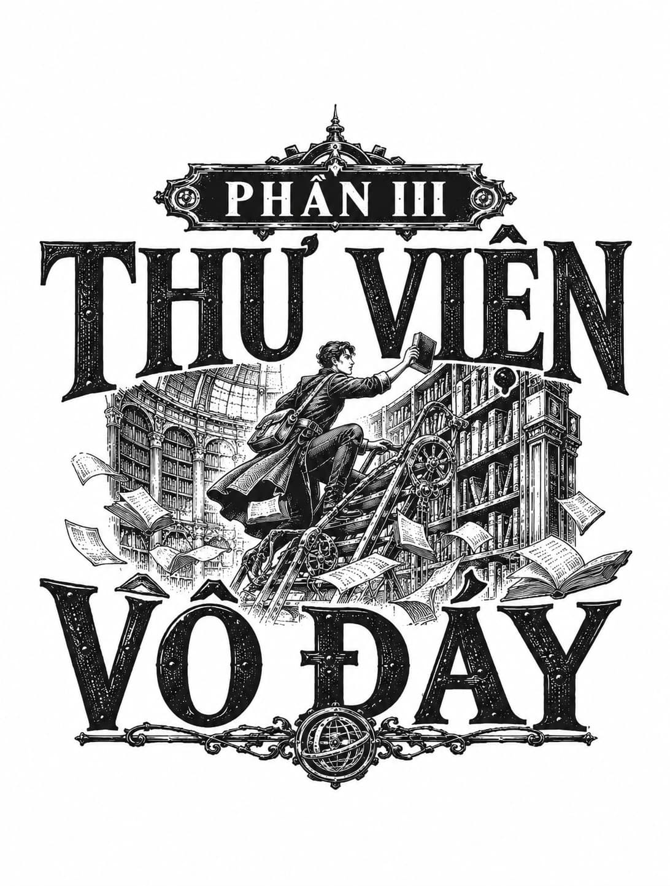

*Phần III: Thư Viện Vô Đáy*

# Chương Một

  
<i>Ai cũng biết rằng Nhân Sư không hề tồn tại. Tuy nhiên, thực tế đó chẳng hề làm giảm đi chút danh tiếng nào của ngài.</i>

  
<i>Theo Huyền thoại về Nhân Sư: Khảo cứu Lịch sử, Saavedra</i>

Không một nhà khí cầu học sành sỏi nào tin rằng Nhân Sư có thật.

Nhân Sư là một dạng bù nhìn rơm mà giới hoa tiêu thường đổ vạ cho những cơn gió bất chợt, những lớp sương mù cứng đầu, hay lớp sương giá buổi sớm bám trên bệ xí. Ngài là một tín điều của những kẻ mê tín và dốt nát. Khi một cô hầu phòng đánh rơi chiếc đĩa mà nó chỉ nảy lên chứ không vỡ toang trên sàn nhà, cô ta có thể thốt lên: “Ồ, tạ ơn Nhân Sư!” Khi cánh cửa xe ngựa vướng vào vạt áo của gã tùy tùng, hắn có thể chửi thề một tiếng rồi lẩm bẩm: “Lại là Nhân Sư, ngài lại giở trò rồi đấy.”

Nhiều công dân khai sáng của Tháp tin rằng Nhân Sư gần như chắc chắn là một nhân vật có thật trong lịch sử, dù họ tranh cãi không hồi kết về việc ngài từng là một con người bằng xương bằng thịt hay chỉ là danh xưng thương hiệu của một bang hội cổ xưa nay đã giải thể. Dù là gì đi nữa, dấu ấn của ngài xuất hiện ở khắp mọi nơi: trên vòng quay tiếp bia của Tầng Hầm, trên những con hà mã cơ khí ở Nhà Tắm, trên tháp chuông sấm sét tại trung tâm Tân Babel. Tên tuổi ngài được khắc ghi trên các tấm biển và bệ đá ở mọi Lãnh địa Vành Đai, và trớ trêu thay, chính sự hiện diện nhan nhản khắp nơi ấy lại khiến người ta dễ bề phớt lờ ngài hơn.

Một số học giả uyên bác lại tin rằng Nhân Sư chỉ là một hình ảnh ẩn dụ thi vị, giống như Ông Già Mùa Đông hay Mẹ Trăng. Nhân Sư chính là hiện thân của Tháp Babel, và tất cả những kỳ quan được gán cho ngài — những cỗ máy mang chi bằng đồng, những cỗ xe tự hành, và những loài côn trùng cơ khí bò thoăn thoắt trên vách gạch để bảo trì — không phải là thành quả của một thiên tài ẩn dật, mà thực chất là sản phẩm từ các đại gia tộc của Babel: nhà Pell và nhà Algezian, nhà Japheth và nhà Thane.

Vốn là một kẻ chân ướt chân ráo đặt chân đến đây chưa lâu, Thomas Senlin hoàn toàn xa lạ với những liên tưởng thâm căn cố đế mà cái tên Nhân Sư gợi lên trong tâm trí cư dân bản địa. Thế nên, trong khi việc đến gõ cửa nhà nhân vật ấy có vẻ chẳng có gì là to tát đối với Senlin, thì tuyên bố ghé thăm Nhân Sư thần thoại của anh lại khiến cả thủy thủ đoàn được một phen sững sờ kinh ngạc. Anh chẳng khác nào vừa đề xuất họ chèo thuyền ra tận rìa của trái đất phẳng để câu những vì sao băng.

Cho đến tận lúc này, các thành viên trên tàu Mây Đá chưa từng phản đối bất kỳ mệnh lệnh nào của thuyền trưởng, dù chúng có kỳ quặc và liều lĩnh đến đâu đi chăng nữa. Khi anh yêu cầu họ giả dạng thành những thiếu nữ bị thương, nằm rạp trên boong tàu để làm mồi nhử cướp biển đột kích, họ đã tuân thủ răm rắp không một lời phàn nàn. Khi anh bảo họ lẻn vào một con tàu thù địch dưới sự che chở của một đàn mòng biển hung hăng đang khạc nhổ và phóng uế ra những bãi cá tiêu hóa dở dang, họ đã hò reo vang dội rồi lao vào hành động. Họ đã quen với sự sáng tạo khác thường trong phong cách chỉ huy của Senlin, nhưng kế hoạch hành động hiện tại của anh lại là một thử thách vượt ngoài sức tưởng tượng.

Không phải là Iren, Adam và Voleta không tin rằng biến cố kinh hoàng gần đây của Edith Winters đã để lại một khoảng lặng đầy chấn thương, nơi một cánh tay kim loại được cấy ghép vào cơ thể cô. Bằng chứng rành rành ra đó rồi. Nhưng liệu có nhất thiết phải là Nhân Sư huyền thoại đã làm điều đó hay không? Liệu đây có phải chỉ là một giai thoại thêu dệt bên bàn rượu của giới phi công: một sự lãng mạn hóa dễ chịu để che đậy một hiện thực tàn khốc? Ngay cả bản thân Edith cũng thừa nhận mình đã mê man sốt li bì trong suốt quá trình cấy ghép. Có lẽ cô đã tưởng tượng ra tất cả. Có lẽ sự né tránh khi phải bàn về vấn đề này chính là dấu hiệu cho thấy bản thân cô cũng không dám chắc về sự thật đó.

“Đó là một điểm dừng chân bắt buộc,” Senlin trấn an họ trong buổi tập hợp ban sớm trên boong chính. Vịnh không khí tĩnh lặng nhỏ bé vẫn đang chở che họ nép sát vào vách Tháp Babel, mặc dù ánh nắng sớm lúc này đã hắt bóng con tàu lên nền sa thạch, nổi bật lên hệt như một vệt rượu vang trên ngực áo trắng.

“Cánh tay cơ khí của Người Thức Tỉnh mà Edith đang mang cần được nạp thêm tinh chất, và Nhân Sư là người duy nhất nắm giữ nguồn năng lượng đó. Đây sẽ chỉ là một điểm dừng chân chớp nhoáng, nhưng hy vọng nó sẽ cho chúng ta đủ thời gian để hoàn thành những công việc sửa chữa thiết yếu mà Adam và Iren đã dốc sức thực hiện một cách đầy quả cảm.” Senlin đưa mắt nhìn quanh, cố gắng nở một nụ cười khích lệ trước thành quả lao động của họ, dù dưới ánh nắng mai gay gắt, con tàu trông có vẻ mong manh và đoản mệnh chẳng khác nào một chiếc tổ chim trước gió. “Trên thực tế, tôi nghĩ chúng ta chẳng cần thiết phải rời khỏi tàu đâu.” Đó là điều kiện tiên quyết mà Edith đã kiên quyết đòi hỏi, và Senlin không thấy có lý do gì để bác bỏ. Cô tỏ ra vô cùng cứng rắn về mối lo ngại đối với sự an toàn của thủy thủ đoàn, đặc biệt là Adam. “Tôi nghĩ tốt nhất là tất cả chúng ta nên ở yên trên tàu chừng nào còn thả neo tại bến của Nhân Sư.”

Voleta cố nén một tràng cười ngặt nghẽo trước khi nó kịp bật ra, nhưng cô bé không kìm lại được. Cô bé không cười vì thấy lời lẽ của Senlin hài hước. Cô bé cười là vì Squit đã chọn đúng khoảnh khắc trang nghiêm ấy để phát hiện ra rằng chiếc rốn của Voleta có kích thước y hệt cái mõm lông xù của nó, một phát hiện khiến cô bé nhột nhạt đến mức không chịu nổi.

Edith, người nãy giờ vẫn đứng lặng lẽ bên cạnh bảng điều khiển chắp vá, với cánh tay máy bất động được buộc chặt trước ngực bằng một chiếc đai treo bằng vải thô màu đen, liếc mắt nhìn sang Voleta, người vẫn đang chật vật nén tiếng cười rúc rích. “Thuyền trưởng, tôi có thể nói vài lời được không?”

“Cứ tự nhiên.” Senlin lịch thiệp lùi lại nhường chỗ cho thuyền phó bước lên.

Sáng sớm hôm đó, Voleta đã tận mắt chứng kiến Iren giúp Edith mặc quần áo ở khoang dưới. Nữ thuyền phó không hề mở lời nhờ vả, nhưng cô cũng không gạt đi. Vẻ trầm mặc nghiêm cẩn khi Iren luồn cánh tay cơ khí nặng nề của Edith qua ống tay áo sơ mi, thắt chặt dây nịt ngực và xỏ đôi bốt da cho đến khi gót chân cô nằm gọn gàng bên trong đã khiến Voleta cảm thấy bứt rứt vì những lý do mà cô bé không thể gọi tên. Đó là một khoảnh khắc quá đỗi yếu mềm và dễ tổn thương. Cô bé đã muốn lẻn biến khỏi căn phòng đó ngay tức khắc.

Vào giây phút ấy, Voleta từng tự hỏi liệu Edith có đánh mất đi phần nào uy thế sau khi cánh tay máy bị tê liệt hay không. Nhưng giờ đây, khi nữ thuyền phó cúi người áp sát và xoáy vào cô bé bằng một ánh nhìn sắc lạnh như thép, Voleta đã có ngay câu trả lời.

“Tôi tự trách mình,” Edith nói, dù sắc mặt cô hoàn toàn đanh thép. “Trong suốt nhiều tháng qua, tôi đã làm ngơ việc cô phớt lờ mọi mệnh lệnh không khiến cô hứng thú. Tôi để cô tùy tiện quậy phá khắp con tàu và các bến cảng. Tôi bỏ qua thói xấc xược và tính liều lĩnh của cô mà không trừng phạt. Đó là sai lầm của tôi. Hãy tha thứ cho tôi. Tôi sẽ chấn chỉnh lại ngay từ bây giờ.”

Những lời răn đe ấy được thốt ra với sự quyết đoán lạnh lùng đến mức đủ sức cải tạo cả một tên tội phạm ngoan cố. Đáng tiếc thay, ngay cả trước uy lực phả ra nóng rực của Edith, Voleta vẫn phải cắn môi để giữ vẻ mặt nghiêm túc giữa lúc chú sóc Squit đang cặm cụi khám phá.

“Tôi thừa biết cô đang nghĩ gì trong đầu,” Edith tiếp tục nói bằng giọng đanh gọn. “Cô đã đến giải cứu Thomas Senlin và tôi. Cô sẽ không thể làm được điều đó nếu cứ răm rắp tuân thủ mệnh lệnh. Điều đó đúng. Nhưng nếu cô muốn nhận công trạng vì việc đó, thì cô cũng phải gánh lấy trách nhiệm vì tội khiêu khích quan chức cảng ở Pelphia khiến họ nã đại bác vào chúng ta. Đừng quên việc chúng ta bị cấm cửa ở cảng Windsock chính là hậu quả từ thói trộm cắp của cô. Và cô cũng phải chịu trách nhiệm vì đã không phát hiện ra chiến hạm pháo đài <i>Ararat</i> cho đến khi nó đè sát ngay trên đầu chúng ta, một sơ suất suýt chút nữa đã chôn vùi toàn bộ con tàu.”

Dù có nhột nhạt đến đâu, những lời sắc như dao của thuyền phó cũng dập tắt ngay nụ cười cợt nhả trên mặt Voleta.

“Thế nên, cứ việc tự hào nhận lấy công lao đi. Cô có thừa chiến tích để khoe khoang đấy.” Edith túm lấy sau gáy Voleta, kéo khuôn mặt hình trái tim nhỏ nhắn của cô gái trẻ sát lại gần mình. “Nhưng trên con tàu này chỉ có chỗ cho thủy thủ đoàn thực thụ. Và thủy thủ đoàn thì phải phục tùng mệnh lệnh tuyệt đối, không thắc mắc, không ngoại lệ. Nếu cô không muốn tiếp tục làm thuyền viên của chúng tôi, thuyền trưởng sẽ thanh toán sòng phẳng tiền công cho cô, và chúng tôi sẽ thả cô xuống mỏm đá thuận tiện gần nhất ngay tại đây.”

Khi nữ thuyền phó buông tay lùi lại, hàm Voleta trễ xuống vì sững sờ.

Cô bé quay phắt ánh mắt bàng hoàng sang phía anh trai mình, thầm mong Adam sẽ nổi trận lôi đình đứng lên bênh vực em gái, hoặc chí ít cũng phải tỏ thái độ phản đối trước sự răn đe gay gắt này. Nhưng đáp lại cô bé chỉ là vẻ mặt lạnh tanh. Cậu chỉ nhún vai với cô bé như muốn nói: <i>Đừng nhìn anh.</i>

Voleta thấy phản ứng đó thật lạ lùng. Có điều gì đó vừa rạn nứt và đổi thay giữa hai anh em; có điều gì đó không còn như trước nữa.

Cô bé nuốt khan một ngụm nước bọt rồi đáp lời nữ thuyền phó đang khoanh tay chờ đợi: “Rõ, thưa Thuyền phó.”

Senlin bước trở lại vị trí đầu mũi tàu. “Mister Winters vừa nhấn mạnh một điều cốt tử. Chúng ta đang bay vào một vùng gió đầy cạm bẫy. Cố Thuyền trưởng Lee từng có một thỏa ước lâu năm với Nhân Sư, bao gồm cả việc giao nộp những kẻ tha hương cùng đường lạc lối.” Một nụ cười chua chát thoáng hiện nơi khóe môi anh. “Một món hàng mà chúng ta chẳng bao giờ thiếu thốn.” Anh nhanh chóng lấy lại vẻ nghiêm nghị vốn có. “Dĩ nhiên, giao kèo của Lee không ràng buộc chúng ta, nhưng Nhân Sư hoàn toàn có thể lợi dụng tình thế ngặt nghèo này. Ngài có thể tìm cách chia rẽ chúng ta, dụ dỗ chúng ta, khoét sâu vào những nỗi tự ti giấu kín trong lòng mỗi người. Vì vậy, điều sống còn là chúng ta phải tuyệt đối đoàn kết và sát cánh bên nhau.”

“Tôi có thể hỏi một câu không?” Iren lên tiếng.

“Cứ tự nhiên.”

“Nhân Sư trông như thế nào?”

“Nguy hiểm,” Edith đáp ngay tắp lự, nhanh như một chiếc lò xo bật mở. “Quyết đoán. Muốn thứ gì là đoạt lấy thứ đó bằng mọi giá. Xảo quyệt. Khó lường.”

“Ý tôi là, diện mạo bên ngoài của ngài trông ra sao cơ?” Iren gặng hỏi.

Edith cau mày nhìn người nữ chiến binh khổng lồ. Cô hiểu Iren thực sự đang hoài nghi điều gì. Iren vẫn chưa chịu tin rằng Nhân Sư là một nhân vật có thật bằng xương bằng thịt. Thế nên Edith bèn đưa ra một câu trả lời quái đản nhất có thể: “Ngài trông giống một chiếc thìa.”

“Giống một chiếc thìa ư?”

“Một chiếc thìa,” Edith nhắc lại với vẻ mặt chắc nịch tuyệt đối.

Voleta bật cười khúc khích rồi vội vàng lấy tay bịt miệng xin lỗi.

Đưa tay ra hiệu như một nhạc trưởng đang vãn hồi trật tự cho dàn nhạc, Senlin cất lời: “Diện mạo của Nhân Sư ra sao lúc này không quan trọng. Mọi người sẽ không phải giáp mặt ngài đâu. Mọi người sẽ ở yên trên tàu. Bây giờ, tôi đã dành cả buổi sáng để nghiên cứu ghi chép của Thuyền trưởng Lee về hải trình dẫn tới sào huyệt của Nhân Sư. Nơi đó tọa lạc ngay bên dưới đỉnh tháp, nép mình dưới lớp sương mù của Vành Đai Thiên Đường, trên sườn phía nam của Tháp Babel. Chúng ta không có đủ dằn, túi khí hydro hay than đá để bay vòng ra ngoài xa rồi tiếp cận ở cao độ lớn, dù đó mới là lộ trình khôn ngoan duy nhất. Chúng ta không còn cách nào khác ngoài việc chọn đường bay trực diện và mạo hiểm này. Tôi đã định vị được một luồng phong áp thích hợp có thể đưa chúng ta đến trước cửa sào huyệt của Nhân Sư trong vòng khoảng một giờ nữa.

“Nhưng đáng ngại là lộ trình này sẽ buộc chúng ta phải băng qua không phận của khá nhiều Lãnh địa Vành Đai, những pháo đài được vũ trang hạng nặng và hiển nhiên là vô cùng bài ngoại. Tôi không tin có bất kỳ nơi nào trong số đó lại thiếu hỏa lực để bắn rụng con tàu tả tơi này xuống vực sâu.”

Edith nhận thấy dũng khí đang tụt dần trên gương mặt các thuyền viên. Sau màn khiển trách nghiêm khắc vừa rồi dành cho Voleta cộng thêm thông báo rằng họ sắp sửa đối đầu với một huyền thoại nguy hiểm, tinh thần của cả đoàn rõ ràng đang chịu một đòn giáng nặng nề. Lúc này rất cần một sự trấn an để khơi dậy niềm tin. Cô bèn cất lời cắt ngang trước khi Senlin kịp liệt kê thêm những hiểm họa rợn người: “Nhưng tôi tin chắc là Thuyền trưởng đã có sẵn một kế hoạch để đưa chúng ta vượt qua an toàn rồi, phải không?”

“Tất nhiên là tôi có kế hoạch rồi,” Senlin vỗ hai bàn tay vào nhau đầy tự tin. “Chúng ta sẽ giả chết.”
