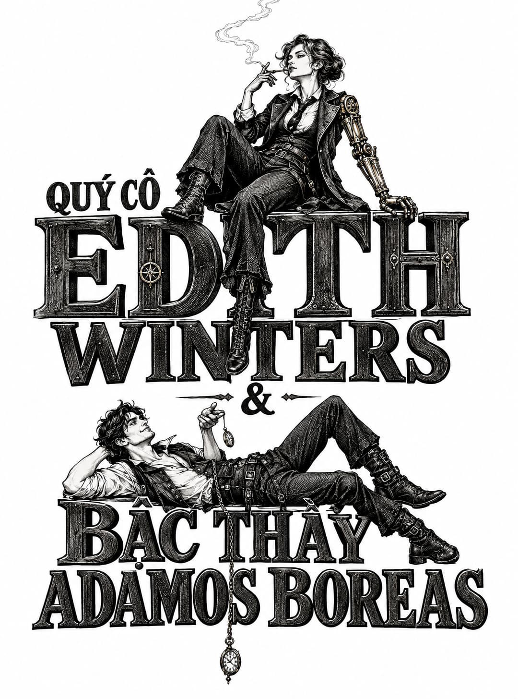

*Phần IV: Quý cô Edith Winters và Bậc thầy Adamos Boreas*

# Chương Bảy

  
<i>Lề thói thường ngày cũng giống như lòng trắng trứng trong bột nhào: Chẳng mang lại mấy vị hương, nhưng lại giữ cho mọi thứ gắn kết vẹn toàn.</i>

  
<i>Theo Bổn phận làm vợ, Nữ công tước K. A. Pell</i>

Adam đang cố gắng hết sức để không thấy chán ngán. Sự buồn chán vốn là điểm yếu của cô em gái, và cậu luôn tự cho mình đứng trên điều đó. Chừng nào còn công việc để bận rộn đôi tay, cậu chưa bao giờ cảm thấy bất mãn.

Thế nhưng, đúng một tuần sau khi cánh cửa thư viện khép lại sau lưng vị thuyền trưởng, Adam đã phải nếm trải đến tận cùng hiện tượng tẻ nhạt mang tên <i>sự nhàn rỗi</i>.

Một phần của vấn đề nằm ở việc Nhân Sư kiên quyết từ chối cho phép cậu chạm tay vào tàu Mây Đá. Đâu đó phía sau lớp giấy dán tường nhàu nhĩ và những căn phòng kỳ dị, bên trong một ụ tàu sâu hoắm đầy những cỗ máy tự hành lên dây cót, con tàu của họ đang được sửa chữa mà không có sự góp mặt của cậu. Thực tế đó thật khó nuốt trôi, nhưng vì vật tư, dụng cụ và cả bến đỗ đều thuộc quyền sở hữu của Nhân Sư, Adam chẳng ở vị thế nào để cự cãi. Ai sẽ giám sát công việc và ai là người trực tiếp thi công, Nhân Sư nhất quyết không hé môi nửa lời.

Không phải là Nhân Sư bận tâm tiết lộ cho họ nhiều nhặn gì. Sau tất cả những tranh cãi về một bản khế ước đảm bảo cho ngài quyền tiếp cận không hạn chế với thủy thủ đoàn của tàu Mây Đá, Nhân Sư hóa ra chẳng hề vội vã trong việc tiến hành phỏng vấn họ. Trên thực tế, kể từ khi bố trí cho họ chỗ ở vào buổi tối sau khi giam lỏng thuyền trưởng, Nhân Sư chưa từng quay lại, dẫu ngài có cử gã quản gia đầu hươu đến thăm chừng họ từ bận này sang bận khác.

Ít ra thì Nhân Sư cũng đã sắp đặt cho họ một dãy phòng ốc tử tế. Nơi này hoàn toàn khác xa những căn hộ ổ chuột tồi tàn ở Tân Babel, vốn chật chội chẳng khác nào chuồng bồ câu. Đây là một không gian xa hoa thực thụ, dẫu có vương chút bụi bặm sờn rách của thời gian.

Căn hộ được bài trí đầy đủ với những trần nhà cao vút lộng lẫy. Bên cạnh phòng ngủ riêng của mỗi người, thủy thủ đoàn dùng chung một bàn ăn lớn, một lò sưởi ấm cúng và một gian bếp được trang bị tận răng, hoàn chỉnh với những tiện nghi kỳ diệu của bếp ga cùng vòi nước cung cấp liên tục nguồn nước nóng lạnh không bao giờ cạn. Thiết kế không gian mở cùng những thiết bị lạ lẫm ấy biến việc nấu nướng thành một màn trình diễn có người thưởng ngoạn. Nếu phát hiện kho dự trữ thiếu thốn thứ gì, họ chỉ cần nhờ Byron bổ sung đơn hàng, dẫu việc làm đó luôn đòi hỏi phải lắng nghe ít nhất mười lăm phút cằn nhằn đầy tính kịch nghệ suýt soát đạt đến tầm độc thoại nội tâm.

Lò sưởi và bệ đá cẩm thạch đã chịu nhiều dấu ấn thời gian nhưng vẫn giữ nguyên nét uy nghi; lớp bọc nhung của những chiếc ghế bành đã trụi lông ở phần tay vịn, thế nhưng đệm mút bên trong vẫn giữ nguyên phom dáng êm ái. Họ có hai phòng tắm tiện nghi chia sẻ cho bốn người, và mỗi gian phòng gạch men bóng loáng này đều ngự trị một chiếc bồn tắm tráng men uốn lượn có chân quỳ kiểu cách. Lần ngâm mình đầu tiên của Adam đã làm đổi màu nước rõ rệt đến mức cậu thấy mình chẳng khác nào một túi trà vừa được nhúng nước sôi.

Trong khi đó, vị thuyền trưởng đang bận rộn đi đuổi theo một con mèo trong Thư Viện Không Đáy, với nỗ lực chứng minh cho Nhân Sư thấy rằng bản thân đã, hoặc ít ra là sắp sửa tỉnh táo trở lại hoàn toàn.

Họ không thực sự bàn luận nhiều về chuyện đó, dẫu sự im lặng chẳng thể ngăn họ nghiền ngẫm về đề tài ấy trong thâm tâm. Về phần mình, khao khát lấy lại lòng tin của thuyền trưởng nơi Adam giờ đây trở nên phức tạp hơn rất nhiều. Thêm vào câu đố hóc búa đó, Adam không còn biết phải cư xử ra sao với em gái mình; sau khi trút bỏ được gánh nặng phải cằn nhằn và bao bọc lấy cô bé, giờ đây cậu rơi vào trạng thái hoàn toàn mất phương hướng không biết nên mở lời thế nào với em.

Nhưng xét về mặt vật chất, về mặt sinh hoạt thực tế, cậu chẳng thiếu thốn thứ gì.

Ngoại trừ sự kích thích trí não, công việc tay chân, và sự trôi đi nhanh chóng của thời gian.

Với tư cách là thuyền phó, Edith Winters tự nhận trách nhiệm duy trì kỷ luật bất cứ khi nào sự tẻ nhạt có nguy cơ làm rệu rã tinh thần cả đoàn. Cô thiết lập và thi hành một thời gian biểu nghiêm ngặt mà Adam thấy cứng nhắc đến mức buồn ngủ. Tệ hơn thế, cô hiếm khi để cậu rời khỏi tầm mắt vì đinh ninh rằng Nhân Sư đang nhắm đến con mắt lành lặn của cậu và có thể bắt cậu đi bất cứ lúc nào mà chẳng cần báo trước. Edith chiếm lấy phòng ngủ liền kề với cậu trong khi Iren và Voleta ở hai căn phòng đối diện. Adam ngờ rằng có những đêm Mister Winters đã ngồi canh gác ngay ngoài cửa phòng vào những lúc nỗi lo âu khiến cô không tài nào chợp mắt nổi.

Sự tù túng giam hãm ấy chỉ càng nuôi dưỡng thêm nỗi ám ảnh của Adam về vị thuyền trưởng đoản mệnh Joram Brahe. Ban đêm, Adam lén đọc lại cuốn nhật ký của Brahe, nghiền ngẫm những ghi chép của vị thuyền trưởng bạc mệnh về “những người đàn ông phóng tia lửa”, “những chiếc lỗ thông gió khổng lồ” không bao giờ ngớt tiếng rít gầm, và “một thành phố ngự trị dưới chiếc chuông pha lê bất khả xâm phạm”. Cuốn nhật ký ngập tràn những gợi mở huyền ảo về kho báu đang chờ đợi ngay phía trên đỉnh đầu. Cậu tự hỏi liệu có một cầu thang bí mật hay một cỗ thang máy nào đó, được giấu kín đâu đó trong hẻm núi của những cánh cửa sâu trong sào huyệt của Nhân Sư, có thể đưa cậu tiến thẳng lên đỉnh tháp hay không. Dẫu cho không có đường tắt thì cũng chẳng hề gì; cậu đã hạ quyết tâm sẽ tự tay leo dọc vách Tháp Babel nếu buộc phải làm thế.

Trong khi đó, Edith lại thấy thời gian biểu kỷ luật ấy là hoàn toàn cần thiết. Trên thực tế, cô thấy mình đang bấu víu lấy chính nếp sống khuôn phép đó trong những giờ phút chán chường của đêm khuya, khoảng thời gian vô định, co giãn đến mức dường như chẳng thể nào bước tiếp về phía trước. Tựa như màn sương mù bao bọc lấy con tàu, những giờ khắc tĩnh mịch ấy tước đoạt khỏi cô mọi ý thức về tiến độ, tốc độ và phương hướng. Cô trải qua đêm dài trằn trọc lăn qua lộn lại trên tấm nệm lông vũ, luân phiên giữa những giấc mơ đầy âu lo và nỗi sợ hãi lúc tỉnh giấc. Cô lo lắng cho sự an toàn của thủy thủ đoàn, tự hỏi liệu mình có giữ được để Nhân Sư không cắm móng vuốt vào họ hay không. Cô tự hỏi liệu Nhân Sư có thực hiện lời đe dọa tước bỏ vĩnh viễn cánh tay cơ khí của cô hay không, và điều đó sẽ giáng đòn chí mạng thế nào vào quyền tự chủ của cô nếu ngài thực sự làm thế.

Rồi còn có Thomas Senlin. Một Senlin đáng thương và cô độc. Anh đã dành suốt những tháng ngày qua để tự đầu độc mình bằng bức chân dung của vợ, nơm nớp lo sợ rằng trí óc của mình đang dần suy thoái, một nỗi sợ mà anh khó lòng thừa nhận với chính mình, chứ đừng nói chi đến cả đoàn tàu. Nhưng thực tế là anh chỉ bị nhiễm độc ma dược và chối bỏ mọi thứ lại tầm thường đến thế! Làm sao họ có thể hy vọng thành công khi đối mặt với sự dửng dưng vô cảm đến tột cùng cùng xác suất mong manh đến tội nghiệp ấy, nếu một thứ bụi độc cỏn con như phấn trên tấm bảng đen lại có thể suýt chút nữa phá hỏng mọi thành quả mà họ đã đổ bao mồ hôi công sức để gây dựng nên? Có lẽ họ đã chạm phải giới hạn của hy vọng, thứ chẳng bao giờ bồi đắp thêm cho năng lực và lại càng chẳng mảy may đóng góp gì cho may mắn. Nếu mọi chuyện suôn sẻ, anh sẽ trở lại sau vài ngày tới, được gột rửa khỏi thói quen tai hại đó. Nhưng rồi sao nữa? Liệu anh có vờ như mọi sai lầm đều bắt nguồn từ thuốc Crumb? Liệu các thành viên trong đoàn sẽ bao dung đón nhận hay xa lánh anh? Liệu anh có nỗ lực giành lại lòng tin của họ, hay sẽ để sự ngượng ngùng của bản thân đóng băng lên những vết rạn của quá khứ?

Chà, nhưng sự giải khuây ngọt ngào của thói quen mới dễ chịu làm sao! Thói quen mang lại một câu trả lời đầy tính áp đặt, dẫu chỉ là tạm thời, cho câu hỏi rắc rối nhất: <i>Bây giờ chúng ta phải làm gì đây?</i>

Voleta và Iren phụ trách bữa sáng, tùy thuộc vào tâm trạng của họ, món ăn sẽ dao động từ bánh mì nướng cháy khét cho đến bánh kếp kiều mạch (cũng bị cháy nốt). Dù có bị nướng đen thui hay không, họ vẫn ngốn sạch mọi thứ bày trên bàn, ăn uống ngấu nghiến chẳng khác nào những con lạc đà bên vòm ốc đảo giữa sa mạc.

Sau bữa sáng, họ đẩy dạt đồ đạc trong phòng khách sát vào tường và Edith dẫn dắt tất cả tập các bài thể dục buổi sáng: chống đẩy, gập bụng, chùng chân và bật nhảy tại chỗ. Cô đã học được những bài tập vận động này khi còn là một thiếu nữ bằng cách quan sát học sinh tập thể dục ở sân trường quận. Năm mười lăm tuổi, cô từng nằm sấp xuống con mương cỏ bên kia làn đường đối diện với sân trường và chăm chú nhìn đám con trai cùng lúc bật nhảy, cùng lúc gập người, và đồng loạt tung mình vào không trung dưới ánh mắt soi mói của vị giáo viên thể chất, một gã đàn ông vạm vỡ mang giọng điệu và tác phong của một lão tiều phu sừng sỏ.

Edith đã tự mình luyện tập những gì quan sát được trong không gian kín đáo ở phòng ngủ tại nhà cho đến khi những cú bật nhảy của cô làm rung chuyển cả trần nhà của phòng làm việc phía dưới và lôi kéo cha cô đến tận cửa phòng. Khi cô thú nhận mình đã học các bài tập thể dục nhịp điệu đó ở đâu, ông đã vội vã đi đến kết luận chắc như đinh đóng cột rằng cô đến đó để tò mò ngắm nghía đám con trai.

Điều đó có nghĩa là đã đến lúc gia đình phải bắt đầu lên kế hoạch gả bán cô.

Nếu cô đã đủ lớn để tò mò, thì cô cũng đủ tuổi để lấy chồng, và phải thật nhanh chóng, trước khi ai đó bắt gặp cô đang nằm dưới mương và đưa mắt đưa tình với mấy cậu ấm của hạt.

Cha cô luôn đinh ninh rằng cô sẽ kết hôn khi còn trẻ và sau đó, ngay lập tức, bắt đầu làm đầy ngôi nhà bằng những đứa trẻ. Ông chắc mẩm về thiên chức gia đình của cô đến mức, trong suốt những tuần tiếp theo, ông liên tục thốt ra những câu nói khiến người ta phải đỏ mặt tía tai kiểu như: “Ồ, tự nhiên thúc giục người mẹ từ thiếu nữ nhanh biết bao!”

Dĩ nhiên, cha cô đã sai lầm hoàn toàn trên mọi phương diện.

Nhưng suy cho cùng, ông đâu có tận mắt chứng kiến những hàng thanh niên đứng thẳng tắp và chuẩn xác như những con búp bê giấy, mạnh mẽ xé tan lớp sương mai, quá sợ hãi vị giáo viên thể chất nên không dám dừng lại. Ngay cả khi đã vượt qua giới hạn kiệt quệ của thể xác, họ vẫn bật người vùng lên theo tiếng quát tháo của lão.

Nếu cha cô tự mình chứng kiến cảnh tượng đó, hẳn ông đã hiểu được điều gì khiến cô thấy mê hoặc đến vậy. Không phải đám con trai mặt đỏ tía tai, đang nghiến răng nghiến lợi và vã mồ hôi vượt qua buổi trừng phạt buổi sáng. Chính uy quyền sắt đá, khí chất chỉ huy của vị giáo viên thể chất mới là thứ đã chiếm lĩnh trọn vẹn trí tưởng tượng của cô.

Adam cảm thấy nhịp điệu các bài tập buổi sáng của Edith và sự nghiêm khắc của cô dành cho chúng thật ngột ngạt. Nhưng khi cô ngả người xuống sàn và bắt đầu chống đẩy thuần thục chỉ bằng một cánh tay lành lặn, cậu còn biết làm gì ngoài việc ngoan ngoãn nhập cuộc cùng cô?

Adam nấu bữa trưa, và họ vô cùng kinh ngạc khi phát hiện ra cậu có năng khiếu ẩm thực bẩm sinh. Cậu có thể làm món bánh pudding thơm ngon từ con số không; cậu có thể nhồi gia vị, rút xương và nướng chín một con gà; và cậu có thể hầm món đậu lima mềm mại và ngọt ngào đến mức ngay cả Iren cũng ăn hết sạch mà chẳng kêu ca nửa lời.

Sau bữa trưa, Edith dẫn họ đi cái mà cô gọi là chuyến tản bộ hàng ngày, dẫu thực chất nó giống một màn lê bước ngắn thì đúng hơn. Đầu tiên, họ lê bước qua ba căn phòng dọc theo hành lang thang máy để đến phòng trò chơi, rồi ba tiếng sau, họ lại lê bước qua bốn căn phòng để quay ngược lại phòng đọc sách, nơi chứa một đống sách phổ thông lỗi thời, tất cả đều có vẻ phù hợp với những kẻ thích giao du mới nổi và trẻ em hơn là một nhóm thuyền viên mắc kẹt.

Họ không thể tự do đi lại bởi vì Ferdinand luôn túc trực ngoài hành lang. Ngay khi họ vừa bước chân ra khỏi căn hộ, cỗ máy khổng lồ liền gầm rú lầm lũi bám theo sau, hơi nước phả mù mịt vào những bức tường hồng, sàn nhà rung chuyển và thảm mục rách tơi tả dưới đôi bàn chân kim loại nặng nề của nó. Thật là một cảnh tượng hãi hùng. Ferdinand chưa bao giờ tỏ rõ thái độ thù địch với họ, nhưng họ thừa hiểu lý do vì sao cỗ máy lại có mặt ở đó.

Dù là vì buồn chán hay do sự hối lỗi thực sự, Voleta đã tỏ ra ngoan ngoãn một cách bất thường suốt cả tuần qua. Cô bé chẳng có vẻ gì thích thú hơn việc nằm cuộn tròn ngủ gục trong chiếc áo choàng tắm rộng thùng thình, thứ mà cô bé đã lục lọi từ tủ quần áo trong phòng mình. Cô bé thiu thiu ngủ trên những chiếc ghế dài ở phòng trò chơi trong lúc Adam và Edith chơi bida còn Iren ném phi tiêu; cô bé gục đầu ngủ gật trong phòng đọc sách trong khi Edith cau mày nghiên cứu các cuốn cẩm nang phép tắc xã giao, Adam chăm chú lật giở các cuốn sách dạy nấu ăn, và Iren chật vật đánh vần từng bài học vỡ lòng trong các cuốn sách tập đọc dành cho thiếu nhi. Dường như mỗi lần Adam quay đầu lại, Voleta lại tìm thấy một mặt phẳng mới để lăn ra ngủ. Cậu tự hỏi liệu em gái mình có đang bước vào giai đoạn phát triển chiều cao muộn hay không.

Edith đảm nhận nấu bữa tối, và đó quả thực là khoảng thời gian thử thách nhất trong ngày của cô. Dường như luôn có sự cố xảy ra với các món ăn do chính tay cô chuẩn bị. Không phải kiểu cháy khét lộ liễu như lúc Voleta và Iren nấu nướng ban sáng, mà là những lỗi ẩm thực âm thầm tệ hại. Nước sốt luôn bị vón cục hoặc trong thịt cá vẫn còn sót lại những chiếc xương dăm nhọn hoắt. Điều đó khiến cô phát bực, nhưng cô buộc phải nén giận để giữ hòa khí. Thật kiệt sức làm sao khi có quá nhiều cách để làm hỏng một bữa ăn.

Cô rất muốn đổ lỗi sự vụng về này cho cánh tay cơ khí đã bị tước đoạt, nhưng sự thật nghiệt ngã là việc phải gánh chịu một thương tật thể xác không hề giải thoát cô khỏi hàng trăm khiếm khuyết đời thường khác. Cánh tay bị mất không phải là căn nguyên của mọi sự bất toàn nơi cô. Nhưng theo một góc độ nào đó, ý nghĩ ấy lại mang đến sự an ủi kỳ lạ: Việc không quy mọi lỗi lầm lên cánh tay máy đã làm vơi bớt cảm giác mất mát, và điều đó đặc biệt có ý nghĩa khi tạo tác của cô đang bị Nhân Sư giam giữ.

Đêm hôm đó, sau khi Edith đành chấp nhận thực tế là món thịt lợn hầm đã bị nấu quá nhừ đến mức khô khốc, khiến cô phải nhờ Iren dùng dao cưa miếng thịt thành những phần nhỏ vừa ăn, Byron bỗng xộc thẳng vào dãy phòng của họ tựa như một con búp bê dây cót bật ra khỏi hộp đồng hồ để điểm chuông.

“Có tin tức gì về Thuyền trưởng chưa?” Edith cất tiếng hỏi mà không buồn ngẩng đầu lên khỏi đĩa thức ăn. Cô hỏi theo thói quen máy móc và chẳng mấy hy vọng. Ngay sau khi họ chứng kiến Senlin bước vào Thư Viện Không Đáy, cô đã thẳng thắn thừa nhận với cả đoàn rằng chuyến đi của anh hoàn toàn có thể kéo dài hơn dự tính. Cô đã không nói thẳng điều đó với Senlin trước khi chia tay bởi anh vốn đã phải đối mặt với quá nhiều cú sốc tâm lý, và việc bảo rằng anh có thể sẽ phải dùng đến toàn bộ hai mươi tám hộp khẩu phần ăn dường như là một sự tàn nhẫn không cần thiết.

“Cô nhất thiết phải hỏi đúng một câu đó mỗi lần giáp mặt tôi sao?” Gã người hươu vừa nói vừa thong thả lột đôi găng tay trắng ra từng ngón một. “Cô không thể tự suy luận rằng tôi sẽ lập tức báo tin nếu có biến chuyển gì ư? Tệ hơn nữa, sao cô không mặc định rằng ngay khoảnh khắc Thư Viện Không Đáy nhả cái gã phiền toái ấy ra, tôi sẽ áp giải hắn đến tận mắt cô, để cô tha hồ tra tấn hắn cho đổi gió và để tôi được yên thân?”

“Tôi ước gì anh hiểu rõ hơn về hai từ <i>có</i> và <i>không</i>, Byron,” Edith lạnh lùng đáp. “Anh ăn mặc chỉnh tề như một sĩ quan nhận lệnh, nhưng dường như anh không tài nào trả lời một câu hỏi đơn giản bằng thứ gì ngắn gọn hơn một bài diễn văn dài dòng.”

Tất cả bọn họ vẫn thản nhiên tiếp tục ăn uống ngay trước mắt gã, tựa như gã chỉ là một người hầu bàn bình thường không hơn không kém. Điều đó thật quá đỗi chướng mắt đối với lòng kiêu hãnh của Byron. Để bày tỏ sự phật ý, gã sải bước đến sát mép ghế của Edith, cúi gập chiếc cổ dài áp sát đến mức gã gần như có thể phả hơi thở vào đĩa thức ăn của cô. “Ít nhất tôi không giả vờ làm một kẻ tự do trong khi đang đeo một chiếc xích vô hình quanh cổ.”

Edith bật dậy dứt khoát đến mức suýt va trúng cằm gã người hươu. Ngay cả khi một bên tay áo blouse được buộc gọn gàng trước ngực, cô vẫn toát lên một uy quyền áp chế đáng nể. Đôi mắt sẫm màu của Byron thoáng chớp lên một tia hoảng hốt.

“Chúng ta hết sạch dầu dừa rồi,” Voleta bỗng cất tiếng lanh lảnh, thành công chuyển hướng sự chú ý của Byron đủ lâu để Iren kịp đưa tay nắm lấy bàn tay lành lặn của Edith và kéo cô ngồi xuống. Iren làm điều đó một cách thuần thục mà không hề ngắt quãng nhịp đưa dĩa xúc đống khoai tây nghiền vào miệng.

Bị cắt ngang, Byron bực dọc quay sang trút giận lên Voleta để gỡ gạc thể diện: “Nếu cô không chịu ngừng cái trò uống nó, hay bôi trét nó vương vãi khắp nơi, hoặc bất cứ trò nghịch ngợm nào cô đang làm với hũ dầu dừa chết tiệt của tôi, tôi sẽ không bao giờ mang thêm cho cô một giọt nào nữa đâu!”

“Cứ chờ xem đã,” Voleta thản nhiên nháy mắt đáp lại.

Byron cảm thấy mình đã phải chịu đựng quá đủ sự sỉ nhục từ cái đám người vô kỷ luật này. Rõ ràng gã đang hạ mình thể hiện sự hiếu khách, thế mà bọn họ lại hợp sức bắt nạt gã.

Vừa xoay xoay những chiếc khuy áo bằng vàng tròn lẳn như những quả việt quất ở cổ tay, gã vừa đanh giọng tuyên bố: “Nhân Sư truyền lệnh thông báo rằng các cuộc thẩm vấn sẽ chính thức bắt đầu vào ngày mai. Ngài sẽ bắt đầu trước tiên với Adam. Tôi sẽ đến áp giải các người đúng mười một giờ trưa mai. Hãy chuẩn bị sẵn sàng.”

Gã dậm gót bốt thình thịch bước nhanh ra khỏi phòng như thể đang cố rũ sạch lớp bụi bẩn bám dưới chân.
