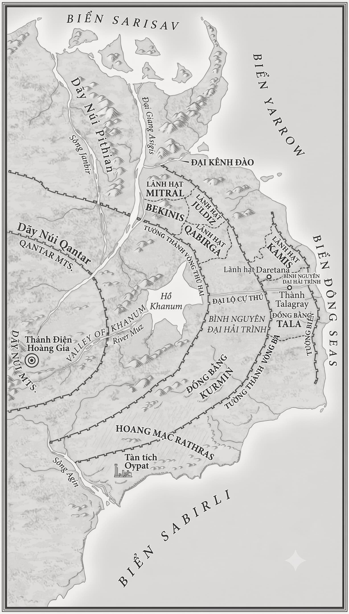
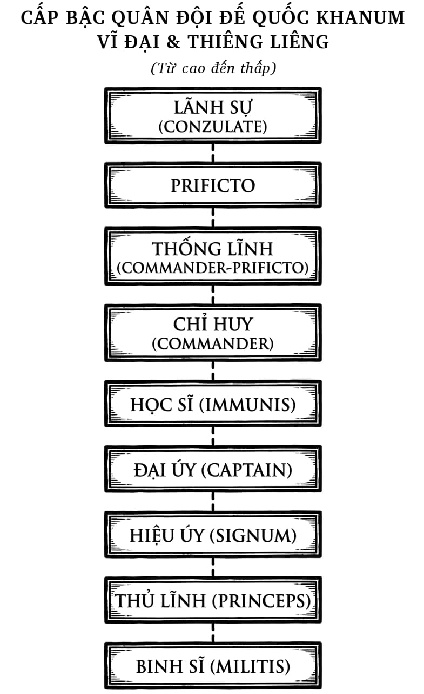

# GIỚI THIỆU

*Nội Dung Tác Phẩm*

## GIỚI THIỆU

  

  

Thuở ký ức còn chưa thành hình, trước khi lịch sử được ghi chép, hải quái đã hiện hữu. Chúng là những sinh vật khổng lồ, dị dạng, nện từng bước nặng nề lên bờ vào mỗi mùa mưa rồi lầm lũi tràn qua các đồng bằng, gieo rắc chết chóc cùng nỗi kinh hoàng tột độ. Suốt hàng thế kỷ, cư dân trên mảnh đất này đành phó mặc sinh mạng cho sự định đoạt của chúng, nếm trải không gì ngoài nỗi sợ hãi và thống khổ.

  

Rồi người dân Thung lũng Khanum cũng thấu triệt được bí thuật thao túng sinh thể, những mật pháp được tinh luyện từ chính dòng máu của hải quái.

  

Họ cải tạo thể xác. Họ tự biến mình trở nên ưu việt và cường tráng. Và khi bước ra khỏi bóng tối của thung lũng ấy với một diện mạo hoàn toàn đổi khác, họ bắt đầu tái thiết lại toàn bộ thế giới trước mắt.

  

Trước tiên, họ chế ngự và hạ gục loài hải quái. Kế đến, họ chinh phạt những tiểu bạo chúa đang cát cứ tại các vùng cao nguyên, nơi hải quái không thể bén mảng tới. Và cứ thế, Đế quốc Khanum được khai sinh.

  

Suốt sáu trăm năm, Đế quốc không ngừng bành trướng và sinh tồn, nhưng tất cả chỉ là sự cầm cự trong gang tấc. Những cư dân Khanum thế hệ đầu tiên đã khuất bóng từ lâu, mang theo cả kho tàng tri thức cổ xưa cùng những bí thuật tinh xảo về miền cát bụi. Mỗi năm, hải quái vẫn đều đặn lên bờ. Mỗi năm, Đế quốc lại phải dốc toàn bộ tài lực cùng những bộ óc kiệt xuất nhất để đẩy lùi chúng. Và trong suốt cuộc chiến sinh tồn ấy, sự hòa hợp, bình đẳng cùng tiến bộ xã hội luôn phải được giữ vững, bởi chỉ cần thiếu đi những nền tảng ấy, Đế quốc sẽ lập tức sụp đổ.

  

Phục vụ trong lòng Đế quốc này là Dinios Kol, người thuộc biên chế Bộ Tư Pháp, cơ quan thực thi công lý tối cao của triều đình. Bộ não của anh đã qua thăng hoa để sở hữu Trí nhớ Tuyệt đối, giúp anh không bao giờ quên lãng bất cứ điều gì. Anh đảm nhận vai trò Trợ lý Điều tra cho Ana Dolabra, một phụ nữ kiệt xuất đến mức phải trải qua phần lớn cuộc đời phía sau chiếc băng bịt mắt và hiếm khi bước chân ra khỏi phòng, bởi bà luôn e sợ rằng nhịp sống hỗn loạn bên ngoài sẽ khiến tâm trí mình quá tải.

  

Cùng nhau, họ được giao phó trọng trách điều tra những cái chết kỳ bí và hiểm họa khôn lường trong nội bộ Đế quốc. Anh dấn thân điều tra và ghi nhớ vĩnh viễn; bà phân tích, thẩm định và bóc tách sự thật ẩn sau từng chi tiết anh chứng kiến.

  

Cùng nhau, họ thực thi công lý cho Đế quốc.