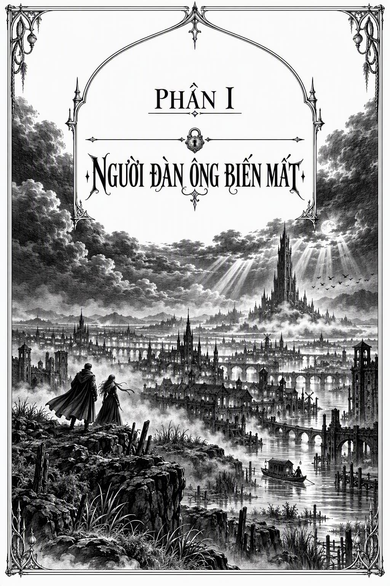

# CHƯƠNG 1

*PHẦN I: NGƯỜI ĐÀN ÔNG BIẾN MẤT*

## CHƯƠNG 1

  

Tôi từng ngỡ những Cánh rừng phía đông Đế quốc đã là chốn ngột ngạt nhất trần đời. Nhưng khi ngồi nơi mũi thuyền xuôi dòng kênh, mặc cho mồ hôi ròng ròng trên trán, tôi mới thấu phương Bắc này đích thị còn ngột ngạt hơn gấp bội. Chặng cuối của hành trình hầu như hoàn toàn nằm dưới bóng râm của những vòm cây rậm rạp. Thế nhưng, ngay cả trong những bóng râm mát mẻ nhất, thảm thực vật bên dưới vẫn liên tục bốc hơi nghi ngút, như thể cả thế giới này đang chực chờ sôi lên. Chiếc áo khoác xanh của Bộ Tư pháp đã ướt đẫm mồ hôi từ cổ đến ống tay suốt gần ba ngày qua, ướt đến mức mỗi khi ngồi xuống lại in hằn một vệt mồ hôi ướt sũng. Đây quả không phải là ấn tượng ban đầu tốt đẹp dành cho vị sĩ quan đang đợi tôi.

  

Chúng tôi ngoặt khúc cua cuối cùng trên dòng kênh rồi cập bến nước Yarrowdale. Dù lúc này còn rất sớm, cầu cảng đã tấp nập tàu thuyền: từ những chiếc thuyền chài nhỏ bé, những chiếc xà lan ục ịch, đến những chiếc thuyền cào hàu lạ mắt, cùng một số loại thuyền kỳ dị tôi chưa từng thấy bao giờ.

  

Tôi chăm chú quan sát khi thuyền tiến sát cầu cảng. Những con thuyền ấy cồng kềnh, mạn thấp, hai bên ốp những tấm ván gỗ dày cộp, nhưng trên mặt gỗ lại ánh lên những mảnh sắt rèn. Tôi nhận ra chúng cắm đầy những đầu mũi tên đâm sâu vào thớ gỗ, phần thân tên đã bị gãy vụn hoặc chặt phăng. Cứ như thể mỗi con thuyền vừa trải qua hàng loạt trận mưa tên dồn dập chỉ vài khoảnh khắc trước. Một cảnh tượng kỳ quặc ở một nơi yên bình đến thế.

  

Tôi bước xuống thuyền, đeo túi qua vai, đứng trên bến nước đông đúc và dáo dác tìm kiếm vị sĩ quan Đế quốc được giao nhiệm vụ đón tôi.

  

Nhưng chẳng có ai xuất hiện. Chỉ có những ngư dân đứng dọc cầu cảng, tay quấn lưới, mình trần để lộ làn da vốn nhợt nhạt nay đã bị nắng thiêu cháy sạm. Có vài kẻ nghèo khổ, gầy gò hốc hác với mái tóc bết chặt, ngồi bên mép bến nước, cúi đầu như những tín đồ phủ phục. Có rất nhiều binh lính thuộc Bộ Công binh trở về từ các kênh đào, bùn đất bọc kín người như xác ướp, đến mức khó lòng nhận ra sắc tím trên bộ đồng phục của họ. Và cuối cùng là hàng loạt binh sĩ thuộc Bộ Sinh dược đứng gác, vai khoác áo bào đỏ tươi đặc trưng, tay lăm lăm ngọn giáo, đôi mắt lạnh lẽo, sắc bén quan sát đám đông.

  

Tôi chú ý đến tư thế căng thẳng của họ. Thật kỳ lạ khi thấy người của Bộ Sinh dược được giao nhiệm vụ gác cổng: họ thường bận rộn với các loại cồn thuốc và hóa chất phản ứng hơn. Tôi lại liếc nhìn những con thuyền bọc thép chằng chịt vết sẹo neo dọc cầu cảng, thầm thắc mắc rốt cuộc chuyện gì đã và đang xảy ra ở thị trấn cảng Yarrowdale này.

  

Tôi đợi suốt hai mươi phút tại cầu cảng. Không khí cuồn cuộn bốc hơi, khu rừng rậm phía xa thỉnh thoảng thở dài khi gió lay động vòm cây, nhưng tôi vẫn không thấy vị sĩ quan của mình đâu. Tôi thầm nguyền rủa hệ thống liên lạc luôn trễ nải và rối rắm của Đế quốc. Có lẽ họ đã báo sai ngày cho đối phương.

  

Tôi lững thững bước đi, túi đeo trên vai, hướng về phía hầm mộ Yarrowdale, bởi đó là nơi cất giữ cái xác. Nhưng vừa bước xuống đường, tôi khựng lại.

  

Ngay phía cuối đường có một gò đất nhỏ, rải rác những cây barri với thảm cỏ dày quanh gốc. Nằm ngay giữa thảm cỏ ấy là một người phụ nữ trẻ, khoác chiếc áo choàng có mũ, hai tay chắp lên bụng như thể đang chìm vào giấc ngủ an lành. Quần và ủng của cô bết chặt bùn đất đến mức trông chẳng khác nào những cục đất sét, nhưng màu áo choàng lại là sắc đỏ tươi của Bộ Sinh dược.

  

Và kia, ngay trước ngực cô: vài chiếc huy hiệu lấp lánh. Những vạch hiệu của cấp Hiệu úy Đế quốc, giống hệt như tôi.

  

Tôi được báo rằng một Hiệu úy thuộc Bộ Sinh dược sẽ đợi mình ở đây. Tôi tiến lại gần cô, thầm mong mình đã nhận nhầm người.

  

Tôi định bụng sẽ hắng giọng để đánh thức cô khi lại gần, nhưng khi tôi còn cách chừng mười sải tay, cô đã cất tiếng nói, chất giọng vùng Yarrow đặc sệt: “Tôi có thể giúp gì cho cậu?”

  

“Người ta bảo tôi đến đây gặp một Hiệu úy Bộ Sinh dược,” tôi nói. “Liệu có phải là cô không?”

  

Cô mở mắt nhìn tôi. Cô còn khá trẻ và thấp người, dáng người tròn trịa, da trắng hồng, gương mặt thô rộng, với mái tóc ngắn bết dầu dính chặt vào da đầu. Đôi mắt cô rất tròn, tròng trắng ánh lên sắc xanh lục, một đặc điểm thường thấy của người dân vùng Yarrow, nhưng phần thịt quanh mắt lại thâm tím, cả vùng da ở tai và mũi cô cũng vậy: dấu hiệu của những ca dung hợp sinh học sâu. Rất có thể cô gái này nghe thấy được từng nhịp tim tôi và ngửi được từng giọt mồ hôi trên cơ thể tôi.

  

“Ồ!” cô nói, nhìn tôi từ đầu đến chân trong khi vẫn nằm xoài trên cỏ. “Tôi cứ nghĩ cậu phải toát ra vẻ đắt tiền hơn cơ.”

  

“Tôi… Cái gì cơ?”

  

Cô chống khuỷu tay ngồi dậy. “Tôi vừa đón gió vừa đợi cậu đấy. Sĩ quan ở các Vòng Nội đô luôn có mùi rất đắt tiền. Tóc họ xức đầy tinh dầu, còn da thịt thì nức hương thơm. Nhưng cậu thì chẳng có mùi đó.” Cô nheo mắt nhìn tôi. “Vậy ra, cậu là vị sĩ quan Bộ Tư pháp đến để giúp chúng tôi giải quyết cái xác bí ẩn kia?”

  

“Chính là tôi,” tôi nói và khẽ cúi đầu. “Tôi là Hiệu úy Dinios Kol, Phân ban Đặc biệt Bộ Tư pháp.”

  

Cô nhìn tôi một lượt nhưng không nói gì.

  

“Còn cô là…?” tôi hỏi.

  

“Cậu có ăn cá khô trên đường đến đây không?” cô hỏi lại.

  

“Tôi không hiểu ý cô?”

  

“Cá khô ấy. Hôm nay cậu có ăn một hai lát không? Có khi là loại ướp với hạt rau mùi?”

  

“Tôi… ừ thì, có? Sao chứ?”

  

“Ừm,” cô gật đầu, ra chiều đã hiểu. Rồi cô đứng dậy, cúi chào tôi và nói: “Hiệu úy Tira Malo, Cảnh vệ Bộ Sinh dược. Xin lỗi vì đã không đón tiếp cậu chu đáo hơn, Kol. Trung tâm Đế quốc cách nơi này xa lắm. Thỉnh thoảng, chúng tôi lại quên mất nhịp sống của nơi ấy.”

  

“Sĩ quan ở Yarrow ai cũng thích nằm ườn bên bờ sông vào buổi sáng thế này à?”

  

“Nằm ườn ra sao?” cô nói. “Tôi đang cố làm khô người đấy chứ.” Cô đưa một cánh tay ra ngoài nắng, những vạt hơi nước mỏng như bóng ma bốc lên từ tay áo cô. “Tôi đã có một đêm dài làm việc vất vả ngoài kênh đào và đầm lầy, cố tìm hiểu lý do tại sao cái xác của chúng ta lại chết thảm đến thế. Việc đó bẩn thỉu và vô ích, nhưng sắp tới sẽ còn bẩn thỉu hơn nhiều.” Cô nhìn qua vai tôi. “Tôi cứ nghĩ phải có hai người chứ.”

  

“Học sĩ của tôi sẽ tới sau, theo lịch trình của bà ấy,” tôi đáp. “Tôi đoán là cô đã sắp xếp chỗ ở cho chúng tôi rồi chứ?”

  

“Dĩ nhiên. Đồng đội của tôi sẽ chăm sóc bà ấy khi bà ấy tới.” Cô gật đầu về phía những người mà tôi từng ngỡ là kẻ nghèo khổ đang ngồi bên bến nước. Giờ tôi mới nhận ra họ cũng khoác áo choàng đỏ của Bộ Sinh dược, bùn đất bám đầy người chẳng kém gì cô. “Nhưng trước khi đi, cậu muốn nôn ở đây, ngoài trời này luôn hả Kol? Hay cậu muốn đợi thêm chút nữa?”

  

Tôi trợn mắt nhìn cô. “Cô nói gì cơ?”

  

“Mùi cá trong hơi thở của cậu,” cô nói. “Nó không ổn chút nào đâu. Tôi nghĩ miếng cá đó đã bị ôi rồi, và kẻ dọn món cho cậu đã ướp thật nhiều gia vị để cậu không nhận ra. Tôi đoán, ồ, khoảng một tiếng nữa bụng cậu sẽ bắt đầu cào xé, rồi mọi thứ sẽ trào ra thôi.” Cô quay sang tôi, nở nụ cười lười nhác. “Vào hầm mộ cũng chẳng giúp ích gì đâu. Nơi đó ngột ngạt lắm, kể cả khi dạ dày cậu có vững như đá. Nhất là khi nhìn vào tình trạng của cái xác.”

  

Tôi đặt tay lên bụng, tin chắc cô ấy đã nhầm. Nhưng rồi, sâu trong bụng, tôi chợt cảm thấy một cơn quặn nhẹ, khó chịu.

  

Tôi trừng mắt nhìn cô. “Cô phỏng đoán nhiều quá đấy, Malo. Tôi hoàn toàn ổn và sẵn sàng bắt đầu công việc.”

  

“Thật thế sao,” cô thản nhiên đáp. “Thế thì tốt quá! Chúng ta hãy đến hầm mộ và làm mấy công việc bẩn thỉu ở đó nào.”

  

  

Hầm mộ Yarrowdale khiến tôi vô cùng khó chịu. Những trần vòm thấp lè tè cùng tiếng thì thầm văng vẳng của các nhân viên Bộ Sinh dược càng khiến nơi này ngột ngạt, âm u như một nấm mồ. Tệ nhất là mùi xạ hương kỳ quái, kinh khủng bốc lên từ bầu không khí ẩm thấp.

  

“Cậu là một người may mắn đấy, Kol,” Malo vừa nói vừa bước đi dọc theo các hành lang. “Cậu có biết tại sao không?”

  

“Tại sao?”

  

“Mới đây họ vừa tiến hành dọn dẹp các mẫu vật của chúng tôi,” cô nói. “Vứt bỏ tất cả những thứ đã quá hạn, vì chúng tôi chỉ có thể bảo quản chúng trong một khoảng thời gian nhất định thôi. Không khí ở đây giờ giống như trên một cánh đồng xuân vậy, so với tình trạng của nó tháng trước.”

  

Tôi dí ngón tay lên mũi: “Làm sao người ta chịu nổi thứ mùi này cơ chứ?”

  

“Câu trả lời đơn giản thôi.” Cô dừng lại để nắm lấy một chiếc xe đẩy có bánh xe nan hoa cao và bắt đầu đẩy nó đi cùng chúng tôi. “Hầu hết mọi người đều không chịu nổi.”

  

Tôi dõi theo Malo suốt dọc đường. Trông cô dửng dưng như thể chẳng mảy may để tâm đến xung quanh: cô thong thả bước đi, nhai một mẩu rễ hina, một loại chất kích thích nhẹ, làm cho miệng cô đen sì. Cô đã treo chiếc áo choàng của mình ở cửa, và giờ tôi mới thấy cô không chỉ đeo một thanh kiếm ngắn bên hông mà còn giắt hai con dao ở thắt lưng, một con trong ủng, và một con dao nhỏ giấu ở cổ tay. Tôi thầm thắc mắc rốt cuộc nhiệm vụ của cô là gì mà lại cần đến nhiều vũ khí đến vậy.

  

Cuối cùng, chúng tôi đến trước một cánh cửa tủ nhỏ ở cuối hành lang. “Ông ta ở đây này,” cô cất tiếng hát ngân nga.

  

Cô mở cánh cửa tủ. Tôi chuẩn bị tinh thần, thế nhưng thứ duy nhất bên trong lại là một chiếc hộp gỗ dẹt, cao khoảng mười phân, rộng và dài chừng ba mươi phân: không lớn hơn tấm khiên của một Binh sĩ Quân đoàn là bao. Malo chộp lấy chiếc hộp và trượt nó ra chiếc xe đẩy, những nan hoa mảnh khảnh của bánh xe kêu ken kẹt dưới sức nặng mới.

  

Tôi chăm chú nhìn chiếc hộp gỗ nông choẹt.

  

“Tôi cứ nghĩ,” tôi chậm rãi nói, “tôi đến đây để khám nghiệm một cái xác.”

  

“Một cái gì cơ?”

  

“Lệnh của tôi ghi rõ rằng tôi phải khám nghiệm thi thể của một sĩ quan được tìm thấy dưới kênh đào, người bị nghi ngờ là nạn nhân của một vụ mưu sát.”

  

“Ồ,” cô nói, vẻ đăm chiêu. “Chà. Vậy thì có ai đó đã nhầm lẫn rồi! Vì tôi đâu có nói chúng tôi có một cái xác. Tôi đã báo cáo với cấp trên rằng chúng tôi tìm thấy hài cốt. Tôi đã chọn từ ngữ cực kỳ cẩn thận đấy chứ.”

  

Sự im lặng bao trùm khi tôi tiếp tục nhìn vào chiếc hộp dẹt trên chiếc xe đẩy.

  

“Vậy là,” tôi thở dài, “tôi hiểu là ông ta không chỉ đơn giản là rất thấp bé.”

  

Cô nở nụ cười tươi, răng cô giờ đen như quả nho Rathras do rễ hina. “Chẳng may mắn thế đâu. Ta xem qua một chút nhé?”

  

  

Chúng tôi chuyển sang một phòng thí nghiệm hình tròn, có chiếc bàn đồng rộng đặt bên dưới dãy đèn sâu mai xanh lam lung linh. Không khí ở đây nồng sặc mùi kiềm và các hóa chất tẩy rửa khác. Một lỗ thoát nước được đặt dưới sàn nhà ngay dưới chiếc bàn, với một quầng ố màu hồng nhạt trên mặt đá xung quanh: một nơi thường xuyên được lau dọn, tôi đoán vậy, nhưng chẳng bao giờ thực sự sạch sẽ.

  

Ngâm nga một giai điệu, Hiệu úy Malo trượt chiếc hộp từ xe đẩy sang bàn, rồi bước đến các kệ sách, khoác chiếc tạp dề da lớn bên ngoài bộ đồng phục đỏ bẩn thỉu của Bộ Sinh dược rồi đeo găng tay. “Cậu nên lấy một chiếc ghế đấy,” cô nói. “Việc này có thể mất thời gian. Tôi là một cảnh vệ, và do đó được huấn luyện nhiều kỹ nghệ của Bộ Sinh dược, nhưng hầu hết những gì tôi làm là theo dấu và, à…” Cô làm động tác bắn cung. “Giải quyết các tranh chấp, tôi nên nói thế nhỉ?”

  

Tôi gạt chiếc áo choàng ướt sũng sang một bên và thả mình xuống ghế, thanh kiếm đung đưa bên hông. “Tôi cứ nghĩ nhiệm vụ của một cảnh vệ là giữ an toàn cho các hóa chất phản ứng và độc chất đắt giá chứ không phải chiến đấu.”

  

“Chà, chúng tôi không có Binh sĩ Quân đoàn nào để bảo vệ ở ngoài này cả. Chúng tôi ở xa trung tâm Đế quốc, và không có con thủy quái leviathan nào ở mãi tận phương Bắc này. Nhưng xét cho cùng, lập luận ấy cũng có phần hợp lý, đúng không? Rốt cuộc con người là gì, nếu không phải là những bao tải di động chứa đầy các hóa chất và hợp chất đắt giá?” Cô cười xảo quyệt. “Tại sao tôi lại không nên theo dấu họ, và rút bớt một số hóa chất quan trọng của họ khi thấy thích hợp chứ?”

  

Cô quay lại chiếc hộp gỗ trên bàn, vặn ba chiếc khóa đồng chạy dọc theo đường nối ở bên cạnh, rồi nhấc phần nắp. Với một tiếng lách cách lớn, phần nắp và các vách hộp rời ra.

  

Bên trong không phải là một cơ thể, cũng chẳng phải bất cứ thứ gì giống như chi thể của con người, mà là một khối lớn hình chữ nhật làm bằng một loại rêu rất kỳ lạ, với những tua cứng giống như xương mọc chằng chịt vào nhau. Khối rêu hình chữ nhật hoàn hảo, đã phát triển để lấp đầy bên trong chiếc hộp, hoặc tôi đoán vậy.

  

Malo nhẹ nhàng đẩy khối rêu ra khỏi tấm gỗ đáy cho đến khi nó nằm trọn trên mặt bàn.

  

Tôi nhìn chòng chọc vào khối rêu, tâm trí mắc lại ở hai chữ: hài cốt.

  

Mùi xạ hương nồng nặc trong phòng càng lúc càng đậm đặc, và cùng với nó là một cơn cào xé khó chịu dội lên trong dạ dày tôi. Tôi giữ cho nét mặt mình bất động nhưng thầm nghĩ: *Mẹ kiếp, cô ấy đã đúng về miếng cá.*

  

“Sẽ không mất nhiều thời gian đâu,” Malo nói.

  

Vừa ngâm nga, cô vừa bước đến một chiếc kệ, nhặt một chiếc khay chứa nhiều dao nhỏ và một chiếc hũ màu xanh lam lớn được nút chặt bằng nút bấc. Sau đó cô quay lại khối rêu, rút nút bấc khỏi hũ, rót một dòng dầu mỏng lên khối rêu với một cú hất tay điệu nghệ, giống như một đầu bếp đang tráng dầu vào chiếc chảo nóng. Cô nút chai lại, đặt sang một bên, rồi bắt đầu xoa dầu dọc theo khối rêu bằng đôi tay đeo găng, mát-xa vào những kẽ hở của các tua rêu.

  

“Cái này hoạt động thế nào?” tôi hỏi.

  

“Khối rêu này ấy à?” cô nói. “Cậu chưa từng thấy nó bao giờ sao?”

  

“Hầu hết các thi thể tôi từng khám nghiệm đều còn rất mới hoặc đã phân hủy từ lâu rồi.”

  

“Thật là một điều may mắn cho cậu,” cô nói. “Nó thường được gọi là rêu mộ thất, dẫu bản chất không phải rêu mà là một loài nấm săn mồi. Nó ẩn mình nơi hang hốc, bám kín các ngóc ngách dưới lòng đất và chực chờ con mồi sảy chân rơi xuống. Khi họ rơi vào, rêu sẽ chích họ, làm họ tê liệt, và từ từ phát triển để nuốt chửng họ, giống như một cái kén. Đó là lúc những điều thực sự thú vị xảy ra.” Cô càu nhàu khi dịch chuyển khối rêu. “Nó tiết ra một loại dịch giúp ngăn nhiều quá trình phân hủy mô. Có thể xem như một hình thức ướp xác, nhờ đó nó giữ được các mô nguyên vẹn để tiêu thụ mà không lãng phí chút nào. Loại chúng tôi đã biến đổi dĩ nhiên không còn tiêu thụ thịt nữa. Nó chỉ đơn giản để lại cho chúng tôi một mẫu vật giữ được độ tươi lên đến hai năm.”

  

Tôi liếc nhìn những chiếc tủ lót dọc hành lang phía sau. “Các mẫu vật sao?”

  

Malo nở nụ cười tươi với tôi. Trong bóng tối của phòng thí nghiệm, với đôi mắt và chiếc mũi thâm tím, gương mặt cô trông chẳng khác nào một bộ xương. “Chúng tôi là người của Bộ Sinh dược, Kol. Chúng tôi sử dụng nhiều loại mô. Một số trong đó là của chính chúng tôi.”

  

Lại một làn sóng xạ hương thối rữa nữa bốc lên. Dầu giờ đây đã ngấm vào lớp vỏ của rêu cho đến khi nó đạt được một độ bóng hơi trong suốt. Tôi thoáng thấy một khối màu trắng như bóng ma ở lõi của nó.

  

“Xin hãy nói cho tôi biết những gì cô biết về vụ án mạng,” tôi nói.

  

Cô cười cay đắng. “Có lẽ là một chủ đề dễ chịu hơn. Dù chỉ là đôi chút.”

  

  

“Tên của người chết là Học sĩ Mineti Sujedo,” Malo bắt đầu, “thuộc Bộ Tài Chính Đế quốc. Đến từ Vòng Nội đô thứ hai của Đế quốc với tư cách là thành viên của một phái đoàn Bộ Tài Chính, đến đây để hội đàm với vua của Yarrow về các công việc cấp cao của Đế quốc.”

  

Giọng cô đượm vẻ mỉa mai cay độc. “Ông ta là người cuối cùng trong phái đoàn đến nơi, chỉ mới đến cách đây hơn hai tuần, ngày mười tháng Hajnal. Ông ta được các vệ sĩ thuộc Bộ Sinh dược đón tại bến nước, có vẻ trong tình trạng sức khỏe tốt và tinh thần phấn chấn, và được hộ tống đến chỗ ở của mình. Giống như chúng tôi sẽ làm cho Học sĩ của cậu, khi bà ấy đến.”

  

Tôi khựng lại. Tôi đã biết nhiều điều trong số này, nhưng không biết chi tiết cuối cùng đó. “Tại sao ông ta lại được vệ sĩ hộ tống?” tôi hỏi.

  

“Bởi vì ông ta đến đây để bàn về thuế,” cô nói. “Và ai cũng ghét kẻ thu thuế cả, đặc biệt là ở Yarrow này. Nơi đây chẳng phải là một nơi an toàn đâu.”

  

Hình ảnh những con thuyền bọc thép cắm đầy đầu mũi tên lóe lên trong trí óc tôi.

  

“Tôi hiểu rồi,” tôi nhỏ nhẹ nói.

  

“Vệ sĩ đã đưa ông ta vào phòng của mình,” Malo tiếp tục. “Sau đó ông ta đến Ngân hàng Bộ Tài Chính trong thành phố, lại được vệ sĩ hộ tống. Ông ta làm một số việc ở đó và quay lại ngay trước khi mặt trời lặn. Khi quay lại chỗ ở, ông ta nói mình thấy không khỏe sau chuyến đi. Ông ta có vẻ bị mệt dạ dày.”

  

Tôi gật đầu nghiêm nghị, cố không nghĩ đến cơn cào xé khó chịu trong ruột gan mình.

  

“Ông ta bảo các vệ sĩ gửi một thông báo cho vị Trưởng phái đoàn Bộ Tài Chính của mình nói rằng ông ta sẽ ở lại trong phòng tối hôm đó,” Malo nói. “Sau đó ông ta gọi bữa tối, nhưng ăn rất ít, và đi ngủ. Ông ta dự định sẽ đến gặp các thành viên khác trong phái đoàn của mình vào sáng hôm sau, nhưng… ông ta đã không xuất hiện. Một tin nhắn được gửi đến phòng của Sujedo, yêu cầu sự có mặt của ông ta. Khi không có ai trả lời, các vệ sĩ đi vào và phát hiện ra người đàn ông đã… Chà. Ông ta đã bị bắt cóc trong đêm!”

  

“Bị bắt cóc?” tôi hỏi, ngạc nhiên. “Lệnh được giao cho tôi chỉ ghi rằng ông ta bị mất tích.”

  

“Đó không phải là cách mà bất kỳ ai ở đây sẽ nói,” cô nói. “*Mất tích* sẽ khiến người ta nghĩ rằng ông ta biến mất trong khi di chuyển từ nơi này sang nơi khác. Nhưng một vệ sĩ đã canh gác tại cửa phòng ông ta suốt đêm, bản thân cánh cửa vẫn được khóa trong suốt thời gian đó, và người đàn ông chưa từng rời khỏi phòng. Dấu hiệu duy nhất cho thấy có điều gì đó không ổn là chiếc giường của ông ta, nó cho thấy dấu vết của một cuộc vật lộn, bị dính máu và xới tung.”

  

“Dính máu?” tôi hỏi.

  

“Đúng vậy, như thể ông ta đã bị tấn công hoặc bị đâm khi đang ngủ. Kỳ lạ hơn nữa: các cửa sổ trong phòng ông ta đều vẫn được khóa từ bên trong! Không có dấu vết của sự can thiệp, không có đập phá, không có gì cả. Chẳng một ai mường tượng được kẻ tấn công đã ra vào bằng cách nào. Và ngoài bản thân người đàn ông, không có gì bên trong bị lấy đi. Tôi đã đến phòng ông ta và đánh hơi thật kỹ.” Cô vỗ nhẹ vào chiếc mũi thâm tím của mình, dường như không bận tâm đến vết dầu trên đầu ngón tay đeo găng. “Tôi có thể theo dấu một con sóc qua khu rừng ướt đẫm suốt hơn một dặm chỉ với một chỏm lông nhỏ. Thế nhưng khi tôi đến phòng của Sujedo, tôi không tìm thấy mùi nào khác ngoài mùi của ông ta, và mùi của gia nhân. Ông ta chỉ có một mình trong phòng suốt thời gian trước khi chúng tôi phát hiện ông ta biến mất. Ông ta đã biến mất khỏi đó bằng cách nào, tôi không thể nói được.”

  

Tôi liếc nhìn khối rêu, giờ đang lấp lánh dầu. “Và khi nào, ở đâu cô tìm thấy hài cốt?”

  

“Chúng tôi phát hiện ra chúng vào ngày mười lăm tháng Hajnal, năm ngày sau khi ông ta đến và biến mất,” cô nói. “Vậy là, cách đây mười ngày rồi, phòng trường hợp cậu quên mất hôm nay là ngày mấy sau ngần ấy chuyến đi.”

  

Tôi trao cho cô một nụ cười khẽ, lạnh lẽo. “Tôi không quên.”

  

“Dĩ nhiên là không rồi. Chúng tôi tìm thấy tất cả các mảnh vỡ cách chỗ ở của ông ta khoảng mười hai dặm. Chặng đường đến chính xác điểm đó rất dài, nhiều đồi núi, rừng rậm rạp, lầy lội. Và đó là sau khi cậu rời khỏi thị trấn Yarrowdale, dưới bao nhiêu đôi mắt đang quan sát. Một con đường hiểm hóc để đi mà không bị phát hiện, chưa nói đến việc mang theo một cái xác.” Cô nhổ một bãi nước bọt màu đen sang bên phải. Nó rơi trúng vào lỗ thoát nước bên dưới chiếc bàn: một kỳ tích về độ chính xác kinh ngạc. “Tôi bị bủa vây bởi những điều bất khả thi. Làm sao người đàn ông này có thể bị bắt đi khỏi một nơi như vậy mà không ai nhận ra? Làm sao ông ta có thể xuất hiện lại trong tình trạng như vậy, ở một nơi xa đến thế? Mấy Cảnh vệ chúng tôi không thể trả lời được bất cứ điều gì trong số đó.” Cô trao cho tôi một ánh nhìn hóm hỉnh. “Tôi hạnh phúc biết bao khi có người của Bộ Tư pháp các cậu ở đây để thi triển phép thuật của mình. Tôi thích đi săn mấy kẻ buôn lậu cứt chuột trong rừng hơn là làm việc này.”

  

Một luồng khí thối rữa bốc lên từ các tua rêu. Mùi hôi thối trong phòng giờ đã kinh khủng đến mức không sao chịu nổi.

  

Malo hít hà không khí. “Ngửi mùi thì có vẻ được rồi đấy,” cô nói. “Để xem nào…”

  

Một luồng hôi thối cuối cùng bốc ra từ khối rêu, và rồi từ từ, nó bắt đầu mềm đi, bắt đầu bằng một vết lõm xuống ở chính giữa, rồi lớn dần cho đến khi các góc héo rũ và rủ xuống, và rồi, nhẹ nhàng, khối tua màu nhợt nhạt bắt đầu xòe ra.

  

Malo bắt đầu gạt đống rêu rũ xuống, sử dụng một chiếc kẹp giống như một đầu bếp đang xới nồi cơm. “À, đúng rồi. Đến đây!”

  

Tôi bước đến bên cạnh cô bên bàn. Cô lại gạt đống rêu đang tan ra, và một hình thù bắt đầu lộ ra ở lõi.

  

Không, điều đó không đúng: không phải một hình thù, mà là ba.

  

Đầu tiên là một bàn tay, các ngón tay co lại như thể đang nắm lấy một quả bóng vô hình. Móng tay của nó có màu nước trà, đậm màu hơn phần thịt xám nhợt nhạt. Nó bị xé rách ở cổ tay, những chiếc xương mỏng manh ở đó kết thúc bằng những mảnh vụn bị đập nát, phần tủy xốp thấm đượm những vết bẩn đen.

  

Bên cạnh đó là một khúc thân mình, không đầu không tay. Hầu hết là vai trái và lồng ngực, nhưng không có gì nhiều hơn. Nó đã bị móc sạch nội tạng, như thể tất cả các cơ quan đã bị múc ra bởi một chiếc thìa khổng lồ. Mấy chiếc xương sườn nhô ra khỏi phần thịt nhợt nhạt như những nan quạt bằng cỏ ống nhô ra ở mép chiếc quạt giấy của một quý tộc. Bằng cách nào đó, thật nực cười, núm vú bên trái vẫn còn nguyên, màu tối và sần sùi, cùng với một chỏm lông ngực màu đen lởm chởm.

  

Và ở đó, nằm ngay bên dưới phần thân trên chiếc giường rêu, là một chiếc xương hàm, không còn thịt và bị cắt đứt hoàn toàn khỏi bất kỳ hộp sọ nào mà nó từng gắn vào. Rất giống với phần tủy của cổ tay bị gãy, các kẽ hở của răng đen kịt những cặn bẩn và vết ố.

  

“Đó là tất cả những gì họ tìm thấy về ông ta,” Malo nói. “Đó là tất cả những gì họ vớt được dưới các kênh đào, tất cả những gì còn lại của Sujedo, vị quan chức Bộ Tài Chính mất tích của chúng ta. Thật buồn, đúng không?”

  

Tôi chòng chọc nhìn những mảnh thi thể bị cắt rời, mũi ngập tràn mùi rêu, và giờ là mùi thối rữa của sự phân hủy.

  

Miếng cá ôi trong bụng tôi lại cuộn lên một lần nữa.

  

Tôi quay người, loạng choạng bước đến lỗ thoát nước trên sàn, quỳ xuống, chống hai tay hai bên, và nôn trực tiếp xuống đó, ho dữ dội đến mức toàn bộ cơ thể bắt đầu đau nhức.

  

“Nó ra rồi đấy,” Malo nói với vẻ tán thưởng. “Cậu có vẻ rất thành thục đấy! Đó là bãi nôn chính xác nhất mà tôi từng thấy.”

  

Tôi lại gục xuống lỗ thoát nước và oẹ thêm một lần nữa.