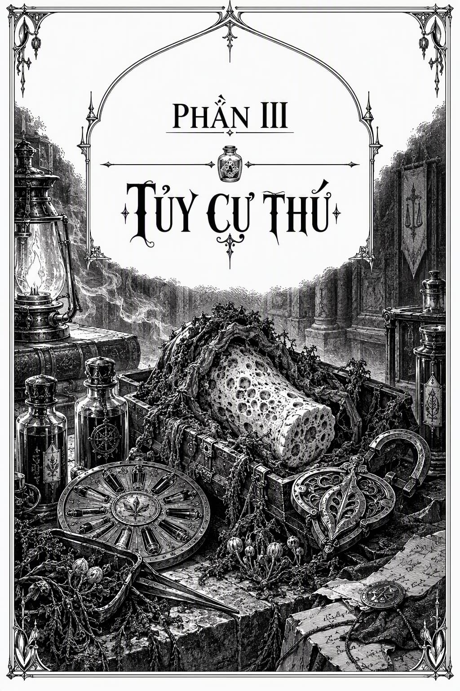

# CHƯƠNG 26

*PHẦN III: TỦY CỰ THÚ*

## CHƯƠNG 26

  

Trời đã về chiều khi chúng tôi quay trở lại Yarrowdale. Malo cho dừng thuyền cách bờ sông chừng năm dải lộ trình, rồi lục lọi trong hộc tủ cho đến khi tìm thấy thứ trông như một quả pháo hoa cỡ lớn. “Tôi ghét cay ghét đắng cái trò châm mấy của nợ này,” cô càu nhàu trong lúc cắm nó vào mũi thuyền. Sau đó, cô quỳ xuống và quẹt đá lửa lên ngòi nổ màu đen sẫm.

  

Một tiếng xì dài rợn người rít lên, làn khói nồng nặc xộc ra, rồi một vệt lửa đỏ rực gầm rú phóng vút qua bầu trời. Đám buôn lậu bị bắt giữ thét lên vì kinh hãi, trong khi những cai ngục áp giải chỉ lặng lẽ quan sát, nét mặt lạnh lùng không chút dao động.

  

Rồi mọi thứ nhanh chóng hóa thành địa ngục hỗn loạn.

  

Những chiếc sà lan chở đầy người của Bộ Sinh dược túa ra từ thành phố, và chẳng mấy chốc chúng tôi đã bị vây quanh bởi những kẻ trùm kín mít trong các bộ đồ bảo hộ phòng dịch, không để lộ dù chỉ một phân da thịt. Họ quát tháo dồn dập những câu hỏi vào mặt chúng tôi trong lúc lùa cả bọn sang sà lan của họ, tay liên tục vung vẩy những nhánh cây chỉ thị quanh người chúng tôi như thể các bình hương trầm trong một buổi lễ ban phước.

  

Vừa bước lên boong, chúng tôi lập tức bị lệnh phải lột sạch đồ để khám xét, nhằm xác nhận xem trên thân thể có dấu vết nhiễm độc nào nhìn thấy được hay không. Đám cai ngục thản nhiên cởi bỏ y phục với vẻ dửng dưng coi như không, rõ ràng đây là chuyện cơm bữa đối với họ, nhưng tôi thì lên tiếng phản đối: “Tôi là người của Bộ Tư pháp. Không phải quân Sinh dược.”

  

“Cái đó tôi nhìn là thấy,” viên sĩ quan Bộ Sinh dược đang kiểm tra tôi lạnh lùng đáp. “Nhưng vừa rồi ngài cũng lặn lội giữa đống cứt đái bẩn thỉu ngoài kia mà, đúng không thưa ngài?”

  

“Đúng vậy.”

  

“Thế thì cởi đồ ra, thưa ngài. Mau lên!”

  

Tôi miễn cưỡng trút bỏ quần áo và cố hết sức giữ lấy chút thể diện còn lại. Một nữ cai ngục quay sang nhìn chằm chằm vào cơ thể trần như nhộng của tôi với ánh mắt thích thú ra mặt, rồi vỗ vào vai Sabudara và buông một câu nhận xét gì đó. Sabudara quay lại nhìn tôi một lượt từ đầu đến chân, rồi khẽ gật đầu hài lòng, như muốn nói: *Đúng như tôi bảo mà.* Tôi kiên quyết dán chặt mắt vào gáy của người đàn ông đứng ngay trước mặt mình, tự nhủ trong lòng rằng tấn trò hề này sẽ sớm kết thúc thôi.

  

Nhưng tôi đã lầm to. Sau khi vượt qua đợt kiểm tra đầu tiên, chúng tôi được phát cho những tấm chăn để quấn tạm che thân, phần lớn đám cai ngục, bao gồm cả Malo, chỉ đơn giản là gấp chăn lại rồi ngồi đè lên làm đệm lót, có lẽ như một hành động phản kháng ngầm, rồi cả bọn bị giải thẳng về một khu giam giữ biệt lập của Bộ Sinh dược. Tại đây, mỗi người chúng tôi bị nhốt vào từng phòng giam riêng biệt được lót kín xung quanh bằng các loài cây chỉ thị. Một bên vách gắn một chiếc nệm rêu mềm để ngủ, còn phía đối diện là một khung cửa kính lớn. Cứ mỗi giờ trôi qua, lại có một nhân viên Sinh dược xuất hiện bên khung kính, yêu cầu tôi phải đứng dậy, buông tấm chăn xuống và để hắn ta săm soi cơ thể trần truồng của mình, từ mắt, miệng, răng cho đến cả vùng hạ bộ.

  

Sau bốn đợt kiểm tra nhục nhã như thế, tôi được chỉ thị phải đứng vào ngay chính giữa phòng giam. Liền sau đó, một thứ dầu màu nâu sẫm, ấm nóng và nhớp nháp bắt đầu tuôn xối xả từ đường ống gắn trên trần nhà. Tôi bị ép phải xoa đều thứ dầu đó lên khắp toàn bộ cơ thể mình, rồi ngồi im một chỗ mà chờ đợi.

  

Da thịt tôi bắt đầu châm chích râm ran, rồi tê dại đi. Sau đó người đàn ông quay lại, bảo tôi đứng dưới miệng ống một lần nữa, và lần này một thứ chất lỏng nóng rẫy, hăng nồng trút xuống xối sạch lớp dầu trên người tôi. Khi mọi việc hoàn tất, từng vết phát ban, vết cắt, vết bầm và tì vết trên cơ thể tôi đều biến mất không còn dấu vết, làn da xám xịt của tôi dường như mềm mại và săn chắc hơn bao giờ hết. Tôi thoáng tự hỏi liệu có bõ công phơi mình trước mầm bệnh lây nhiễm chỉ để được hưởng một liệu trình điều trị như thế này hay không.

  

Một toán y sĩ ập đến, kiểm tra khắp thân thể tôi một lượt nữa, tôi bắt đầu trở nên dửng dưng với những màn phơi bày thân xác này chẳng kém gì đám cai ngục, và thông báo tôi đã vượt qua mọi bài kiểm tra của họ, dẫu vậy họ vẫn cần giữ tôi lại đây thêm mười hai giờ nữa để theo dõi. Tôi yêu cầu họ báo tin cho Ana về tình cảnh của mình, họ đồng ý rồi đẩy một chiếc khay đựng bánh mì đậu cùng nước uống qua khe hẹp dưới chân cửa.

  

Tôi ngồi xuống, ăn và uống.

  

Lại thêm một ngày làm việc dưới trướng Ana, tôi thầm nghĩ, dẫu ngày hôm nay nhục nhã khác thường. Tôi thử tính toán xem mình còn phải cắn răng chịu đựng bao nhiêu ngày như thế này nữa cho đến khi trả hết các món nợ của cha, rồi nhanh chóng bỏ cuộc.

  

Chính qua những công cụ cao quý như tôi đây, công lý của Hoàng đế mới được thực thi.

  

  

Tôi ngủ vùi quá lâu trong gian buồng giam chật hẹp không chút ánh mặt trời đến mức mất hết khái niệm về thời gian. Tôi nghe thấy tiếng gõ lách cách lên tấm kính, hé mở một bên mắt, tôi nhìn thấy một cận vệ Bộ Sinh dược đang ngập ngừng mỉm cười nhìn xuống mình từ phía bên kia cửa sổ.

  

“Tôi mang quần áo của ngài đến rồi, thưa ngài,” anh ta nói. “Phiền ngài vui lòng mặc đồ vào được không?”

  

Tôi đứng dậy, tấm chăn mỏng manh vẫn quấn quanh người. “Tôi được tự do rồi chứ?”

  

“Chưa hẳn đâu, thưa ngài.” Anh ta luồn quần áo của tôi qua khe hẹp trên vách tường. “Ngài thấy đấy, đang có một cuộc điều tra, thưa ngài.”

  

“Học sĩ của tôi đã được thông báo chưa?”

  

“Tôi không được báo về chuyện đó, thưa ngài,” người cận vệ đáp.

  

“Nếu bà ấy không được can dự vào bất cứ trò gì đang diễn ra ở đây, hậu quả sẽ khôn lường đấy,” tôi nói. “Đây không phải lời đe dọa, mà chỉ là… quy luật tự nhiên thôi. Một khi bị cản đường, bà ấy sẽ đập nát mọi thứ.”

  

“Tôi… không được báo về chuyện đó, thưa ngài,” người cận vệ lặp lại một lần nữa.

  

Hoặc là tôi đã lỡ lời, hoặc là tôi đang nói chuyện với sai người. Tôi đành cho qua chuyện đó.

  

Sau khi chỉnh đốn lại trang phục chỉnh tề, tôi được dẫn qua một dãy hành lang rồi bước ra những con đường của thung lũng Yarrowdale. Tôi nhăn mặt trước ánh sáng ban ngày, tia nắng đầu tiên tôi được thấy sau nhiều giờ liền, rồi bước lên cỗ xe đang đợi sẵn. Tôi và người cận vệ đi cùng nhau, nhưng tôi chẳng buồn bõ công hỏi chúng tôi đang đi đâu; tôi đã gọi ra tấm bản đồ thành phố trong tâm trí và biết rõ hướng này chỉ dẫn tới một điểm đến khả dĩ duy nhất.

  

Tôi chăm chú nhìn đường nét của xưởng lên men cao cấp khi cỗ xe dừng lại. Nơi đây trông gần như chẳng khác gì cái ngày tôi cùng Ana tới gặp Học sĩ Ghrelin, những khối cầu bằng dây leo Fretvine vẫn lấp lánh như trứng cá dưới ánh nắng chiều hanh hao dễ vỡ. Thế nhưng khi bước xuống xe, tôi cảm nhận được toàn bộ bầu không khí nơi này đã đổi khác: mọi thứ đều nhuốm vẻ căng thẳng và âu lo tột độ, các thành viên Bộ Sinh dược thì lao qua lao lại như đàn kiến hoảng loạn vừa bị người ta giẫm nát tổ.

  

Tôi được dẫn qua cổng chính, rồi đi qua một dãy hành lang quanh co cho đến khi chúng tôi tới trước một dãy cửa đóng kín. Người lính gõ cửa, và cánh cửa mở ra để lộ một phòng họp tương tự như căn phòng có bình xông hơi, những bức tường dây leo thấm đẫm ánh sáng xám xịt nhạt nhòa rọi xuống từ các ô cửa sổ bên trên; dẫu vậy, căn phòng này đông đúc hơn rất nhiều.

  

Malo, Tangis, Sabudara và các giám ngục khác ngồi ở một đầu bàn, trang phục chỉnh tề, nét mặt họ hoặc cau có hoặc khắc kỷ; ở đầu bàn bên kia là Thống lĩnh Thelenai với đôi mắt xanh lục và đôi môi cũng nhuốm sắc xanh, bà vẫn khoác trên mình bộ lễ phục rực rỡ sắc đỏ và vàng. Bên cạnh bà là ba chú vịt con cau có của bà, như lần trước tôi từng thầm nghĩ: các Chỉ huy Biktas, Nepasiti và Sizeides. Vài viên chức khác ngồi dọc theo bức tường phía sau họ, gồm các đại úy, hiệu úy và thủ lĩnh mà tôi không quen biết. Họ phần lớn đều bận rộn ghi chép. Tôi không thấy bóng dáng Ghrelin ở đâu cả.

  

Mọi người ngước nhìn lên khi tôi bước vào. Malo ném cho tôi một ánh nhìn như muốn nói *Chuẩn bị đi*.

  

“À,” Thelenai khẽ nói. “Hiệu úy Kol. Cảm ơn cậu đã tham gia cùng chúng tôi.”

  

Tôi bước vào, đứng nghiêm và cúi đầu chào. “Thưa ngài.”

  

“Tôi xin lỗi vì cách cậu bị đối đãi, Kol,” Thelenai nói. “Dẫu vậy, việc cách ly là luôn luôn cần thiết sau những lần phơi nhiễm như thế. Chúng ta không thể mạo hiểm để bất kỳ mầm bệnh lây nhiễm nào bám rễ ở thành phố này.”

  

“Tôi hiểu, thưa ngài.”

  

“Và quả thực, đó chính là lý do tôi triệu tập cậu tới đây hôm nay. Lời khai của cậu dưới tư cách một Khắc Ký Sư sẽ vô cùng quý giá đối với sự an toàn của chúng ta. Nhất là khi nó có lẽ sẽ không cần phải qua khâu phiên dịch rườm rà…”

  

Một thoáng cau mày lướt qua gương mặt Malo.

  

Thelenai ra hiệu về phía cuối bàn. “Mời cậu ngồi.”

  

Tôi làm theo, ngồi xuống cạnh Malo. Đôi mắt ánh sắc xanh lục của Thelenai quan sát tôi trong lúc tôi ngồi xuống. Với cái đầu trọc lốc và ánh sáng rọi từ phía trên, bà khiến tôi liên tưởng đến một hộp sọ được khắc trên cánh cửa hầm mộ.

  

“Nào…” Thelenai bắt đầu. “Cậu có nhận thức được rằng những hiện tượng cậu đã chứng kiến trong rừng nhiệt đới là triệu chứng của một sự chuyển hóa sinh học sâu sắc không, Kol?”

  

“Tôi nhận thức được, thưa ngài.” Tôi đã định nói rằng nguyên nhân chắc chắn là do Tinh huyết Thủy Quái Leviathan, nhưng trực giác mách bảo đây là một cuộc họp mà tôi chỉ nên cung cấp những thông tin được hỏi, thay vì tự ý đưa ra ý kiến của mình.

  

“Và cậu cũng biết rằng những hiện tượng như vậy là cực kỳ nguy hiểm và hiếm gặp,” Thelenai nói. “Vì thế, điều cấp thiết là chúng ta phải nắm rõ mọi ngóc ngách về nó.”

  

“Tất nhiên rồi, thưa ngài.”

  

“Vậy thì hãy thuật lại toàn bộ những sự việc cậu đã trải qua trên các con kênh, bắt đầu từ cái xác trôi xuôi dòng. Không được bỏ sót bất cứ điều gì.”

  

Tôi ngập ngừng. “Tôi rất muốn, thưa ngài, nhưng…”

  

Một nếp nhăn hằn lên vầng trán nhợt nhạt của bà. “Sao cơ?”

  

“Bởi vì phần lớn thời gian xảy ra các sự việc, đầu tôi đều bị bọc kín trong mũ phòng hộ, nên tôi không thể dùng mùi hương để neo giữ những gì mình đã chứng kiến. Thành thử, có lẽ sẽ mất đôi chút thời gian để tôi, à, thuật lại chúng. Và những gì tôi thuật lại có thể sẽ không hoàn toàn sáng tỏ, thưa ngài.”

  

“Chúng tôi sẽ tiếp nhận mọi thứ có thể. Cứ tiếp tục đi.”

  

Tôi thuật lại mọi biến cố chính xác theo đúng những gì đã xảy ra, nhưng vì thiếu đi mùi hương kích thích, lời khai của tôi trở nên lắp bắp và ngắt quãng. Tôi cảm thấy mắt mình giật liên hồi, cơ mặt co rúm, và tự nghe chính mình thốt ra những cụm từ rời rạc một cách vụng về như: “Thời tiết nóng bức, rất ngột ngạt. Sáu giọt nước đọng trên mũ sắt của Malo. Thị vệ đứng cạnh cô ấy, thuận tay phải,” bất kể thông tin này có ích cho ai hay không.

  

Mất gần trọn hai tiếng đồng hồ, nhưng tôi đã trả lời toàn bộ các câu hỏi của họ, đặc biệt là khi nhắc đến những người-dây-leo mà chúng tôi phát hiện. Thống lĩnh Thelenai chất vấn tôi cặn kẽ về họ, và về tất cả những đồ vật chúng tôi tìm thấy bên trong hình hài đó.

  

Cuối cùng, chúng tôi chuyển sang bức tường thực vật bao quanh khu trại và bãi đất trống.

  

“Và những loại thực vật nào đã tạo nên thảm sinh trưởng này?” Thống lĩnh Thelenai hỏi, giọng bà giờ đây trầm xuống.

  

Tôi đáp lại, tuôn ra một tràng miêu tả chi tiết về mọi hình dạng lá và dây leo mà mình đã tận mắt chứng kiến. Căn phòng vang vọng tiếng ngòi bút sột soạt khi vô số thuộc viên Bộ Sinh dược cắm cúi ghi chép bằng bút tro.

  

“Và khi cậu tiến vào bên trong… bức tường đó,” Thống lĩnh Thelenai nói, “cậu đã thấy bên trong bị biến đổi rất nhiều. Đúng chứ?”

  

“Thưa đúng, thưa Thống lĩnh,” tôi đáp.

  

Một khoảng lặng kéo dài.

  

“Nhưng ở trung tâm là một… cỗ máy nào đó,” Thống lĩnh Thelenai nói. “Một hệ thống được chế tác cơ học. Đó là những gì những người khác đã khai báo với chúng tôi, có đúng vậy không?”

  

“Đúng vậy, thưa Thống lĩnh. Đó là một tổ hợp gồm nhiều bình chứa và đường ống dẫn.”

  

Thống lĩnh Thelenai chậm rãi gật đầu. Tôi cảm nhận được câu hỏi tiếp theo của bà mang tầm quan trọng sống còn.

  

“Bây giờ… hãy truy xuất ký ức đó cho ta, Kol. Hãy quan sát thứ này thật kỹ lưỡng trong tâm trí cậu. Cậu đã thấy nó chưa?”

  

Mắt tôi khẽ đảo. “Tôi thấy rồi, thưa Thống lĩnh.”

  

“Tốt lắm. Giờ thì, làm ơn… hãy miêu tả hệ thống này cho tôi…”

  

Đúng lúc đó, một tiếng gõ cửa vang lên đanh gọn, chói tai.

  

Tất cả mọi người trong phòng đều giật bắn mình, ngoại trừ Malo và đám thị vệ của cô, những kẻ dường như đã nghe thấy tiếng bước chân người đang tiến lại gần từ trước.

  

Chúng tôi đưa mắt nhìn nhau, rồi nhìn sang Thống lĩnh Thelenai. Không một ai cử động.

  

Lại thêm một tràng gõ cửa dồn dập đanh thép vang lên, lần này lặp lại tới năm nhịp.

  

“Ta… ta đã dặn bọn họ rằng không được phép…” Thống lĩnh Thelenai lắp bắp. “Chết tiệt, bất kể là ai ở ngoài đó, đuổi đi ngay!”

  

Một cai ngục Bộ Sinh dược bật dậy, lách qua cánh cửa, khép chặt lại sau lưng rồi đối chất với kẻ vừa gõ cửa. Tôi nghe thấy một giọng nói đáp lại, đưa ra lời phản bác đanh thép rồi nhanh chóng bùng lên thành những lời thóa mạ sấm sét.

  

Tôi nhanh chóng thu lại toàn bộ cảm xúc trên gương mặt, bởi tôi nhận ra giọng nói ấy.

  

“Đó…” Malo lẩm bẩm bên cạnh tôi, “đó là Học sĩ của cậu đấy, Kol.”

  

“Tôi biết rồi,” tôi khẽ rít qua kẽ răng.

  

Thống lĩnh Thelenai bồn chồn bực bội trên ghế khi những tiếng quát tháo bên ngoài vẫn tiếp diễn, vẻ điềm tĩnh lạnh lùng thường thấy của bà hoàn toàn tan biến. Rồi tiếng quát tháo đột ngột im bặt; một khoảng lặng bao trùm; và kế đó là những tiếng hít hà kinh ngạc lẫn tiếng cười khúc khích rải rác từ đám thị vệ ngồi phía sau lưng tôi.

  

Malo giơ tay ra hiệu cho bọn họ im lặng, rồi ngượng ngùng hắng giọng. “Ờm. Thống lĩnh?”

  

“Sao?” Thống lĩnh Thelenai bực dọc gắt. “Có chuyện gì? Người của cô bị làm sao thế hả, Hiệu úy?”

  

“Bà ấy… vừa bảo tôi làm một việc,” Malo nói.

  

“Bà ấy cái gì? Ai? Cô đang ám chỉ ai cơ?”

  

“Ý tôi là, người ở ngoài kia…” Cô lại hắng giọng lần nữa. “Bà ấy hẳn đã đoán được tôi đang ở trong này, thưa Thống lĩnh, và biết tôi có thể nghe thấy bà ấy. Thế nên. Bà ấy bảo tôi phải hỏi Din, ý tôi là, hỏi Hiệu úy Kol ở đây, một câu hỏi.”

  

Thống lĩnh Thelenai há hốc miệng. “Bà ta bảo cái gì cơ?”

  

“Bà ấy bảo tôi…” Lần thứ ba, Malo lại hắng giọng. “Bà ấy nói: ‘Malo, hãy hỏi Din xem những khí cụ cậu ta nhìn thấy trong rừng có giống một chồng nồi niêu xếp chồng lên nhau không, và cái trên cùng có phải có nắp thủy tinh gắn ống khói, cùng một bộ phận dây dợ lỉnh kỉnh bên trong không.’”

  

Giờ thì đến lượt miệng tôi há hốc. Tôi khẽ ho một tiếng, lấy lại bình tĩnh rồi đáp: “À. Vâng. Thiết bị đó trông gần như chính xác là như vậy, thưa bà.” Sau đó tôi bồi thêm: “Và, à, lúc này tôi đang thưa với ngài đấy ạ, thưa Thống lĩnh.”

  

Thelenai trừng mắt nhìn tôi, rồi nhìn Malo, rồi lại nhìn ra cánh cửa đóng chặt. “Làm… làm sao bà ta biết được chuyện đó?” Bà quay sang đám lính canh giữ. “Các người đâu có kể với ai, phải không? Các người có nói cho *bất kỳ ai* biết về những gì mình đã chứng kiến không?”

  

Đám lính canh lắc đầu quầy quậy. Sabudara trông đặc biệt hung hăng bặm trợn.

  

“Làm gì có ai để mà kể, thưa Thống lĩnh,” Malo nói. “Chúng tôi bị nhốt trần như nhộng trong hòm. Nhưng xin lưu ý là không phải *cùng* một hòm…”

  

“Còn các người?” Thelenai gặng hỏi, lần này hướng về ba viên chỉ huy dưới quyền cùng toàn bộ đám thuộc cấp còn lại. Tất cả bọn họ đều vội vã lắc đầu.

  

Một khoảng lặng kéo dài nín thở.

  

Rồi tiếng Ana lại dội vào từ ngoài cửa: “*Sao nào? Các người có định cho tôi vào hay không đây?*”

  

“Mẹ kiếp!” Thelenai gắt lên. “Cho bà ta vào đây, để xem rốt cuộc làm quái nào mà bà ta biết được chuyện đó!”

  

  

Khi Ana rốt cuộc cũng được cho vào, vẻ đắc thắng ngạo nghễ toát ra từ bà mãnh liệt đến mức khiến gần như tất cả mọi người đều phải ném về phía bà những cái lườm tóe lửa. Bà bước vào với dải băng bịt mắt, vừa khẽ cúi đầu vừa nắm chặt cẳng tay của một người phu khiêng đồ đang sợ run bần bật, chính là chàng trai trẻ từng nhấp nhổm lo lắng bên đống vỏ hàu của bà, và trên vai bà vác một bao tải giấy tờ đồ sộ. Người phu dẫn bà đến một chiếc ghế; bà lóng ngóng ngồi xuống rồi phất tay cho cậu ta lui. Cậu trai ba chân bốn cẳng tháo chạy như thể tòa nhà sắp bốc cháy đến nơi.

  

“Chà!” Ana vui vẻ thốt lên khi kéo ghế xích lại gần bàn. “Chào buổi sáng tất cả mọi người.”

  

Thelenai phải chật vật lắm mới lấy lại được vẻ điềm tĩnh lạnh lùng. “Chào buổi sáng cơ đấy?” bà gắt. “Tự tiện xâm phạm một cuộc điều tra về sự cố mức độ này là trọng tội đấy, Dolabra. Nhưng trước khi chúng ta tính đến chuyện đó, tôi yêu cầu bà phải trả lời… làm sao bà biết được những gì Kol đã nhìn thấy trong khu rừng đó? Ai đã cung cấp thông tin này cho bà?”

  

“Ồ, dĩ nhiên rồi,” Ana đáp. “Tôi có hai câu trả lời cho việc đó, thưa bà, một gián tiếp, và một trực tiếp. Như thế đã đủ chưa?”

  

Thelenai nhìn chằm chằm Ana như thể bà là một bãi phân chực chờ bị cạo khỏi đế ủng. “Nếu bà buộc phải dài dòng thế.”

  

“Về phần gián tiếp, tôi rất tiếc phải thông báo rằng phần lớn thành phố lúc này ít nhiều đã lờ mờ đoán ra chuyện gì vừa xảy ra. Bắn một quả pháo hiệu đỏ rực lên trời, rồi cả một lũ người mặc đồ bảo hộ lao ra đốt trụi một vạt rừng… chà, ngần ấy thứ đủ để khơi gợi suy đoán cho bất kỳ ai rồi. Và nó củng cố thêm cho kết luận của tôi về những gì Din có thể đã chạm trán trong chuyến thâm nhập của cậu ấy.” Bà thò tay vào chiếc túi đeo của mình và lôi ra một xấp giấy da đồ sộ, lộn xộn. “Nhưng một câu trả lời trực tiếp hơn thì phải nói rằng chính *ngài* đã cung cấp thông tin đó cho tôi, thưa bà.”

  

“Tôi ư?” Thelenai hỏi, giọng đầy vẻ bị xúc phạm. “*Tôi* đã làm thế sao?”

  

“Quả đúng như vậy.” Ana lôi ra thêm một xấp da cừu dày cộp khác rồi đập mạnh xuống bàn, tạo nên một tiếng thịch vang dội. “Ngài thấy đấy, tôi đã nghiên cứu kỹ hồ sơ về tất cả những vụ trộm cắp diễn ra trên các con kênh suốt hai năm qua,” bà tiếp tục, dù mắt bị bịt kín, đôi tay bà vẫn thoăn thoắt lật giở xấp tài liệu rồi rút ra một nắm văn bản. “Chính là những tập hồ sơ mà ngài đã giao cho tôi, thưa Thống lĩnh. Tôi đã mất kha khá thời gian mới tìm ra được quy luật, nhưng quy luật ấy thực sự tồn tại! Bởi lẽ dù đám buôn lậu có xu hướng nhắm vào cùng các tiền chất và các chuyến hàng quen thuộc, những vật liệu giá trị cao dùng cho mảnh ghép trị liệu, cùng vài thứ tương tự, thì vẫn có một vài điểm bất thường rải rác qua từng tháng, những vụ trộm thoạt nhìn hoàn toàn vô lý… cho đến khi tôi nhận ra rằng trong những vụ này, đám buôn lậu không hề trộm các thuốc thử, mà là trộm các thiết bị được vận chuyển cùng chúng!” Nở nụ cười toe toét, bà xếp các tờ da cừu thành một mạng lưới lộn xộn trước mặt. “Nói một cách ví von, chúng trộm rổ của thợ làm bánh chứ chẳng thèm lấy bột mì.”

  

“Nhưng đám buôn lậu thì cần quái gì đến các thiết bị cơ chứ,” Thelenai lên tiếng. “Chúng làm gì có chút kiến thức nào về cấu tạo và cách sử dụng của chúng.”

  

“Người ta thường sẽ nghĩ như vậy,” Ana đáp. “Nhưng sự thật lại chứng minh điều ngược lại! Càng đọc nhiều về những linh kiện này, tôi lại càng hiểu rõ số lượng cấu hình hạn chế mà chúng có thể được kết hợp để tạo thành. Và rồi tôi bắt đầu nhận ra *thứ* mà hắn nhiều khả năng đang chế tạo…”

  

“Thứ gì… ai đang chế tạo cơ?” Thelenai yếu ớt hỏi lại.

  

“Ồ, dĩ nhiên là kẻ mạo danh của chúng ta rồi,” Ana thản nhiên nói. “Tất nhiên tôi không phải Sinh dược sư, nhưng tôi đoán hắn đang lắp ráp thứ được gọi là *bộ khuếch tán thoái hóa*, có gắn kèm một đầu phân tán. Trông nó giống như một chồng nồi niêu xếp lớp với một ống khói bằng thủy tinh trên đỉnh cùng hàng đống đường ống chằng chịt. Theo hiểu biết của tôi, cỗ máy này tiếp nhận các thuốc thử đã ở trạng thái ổn định rồi luân chuyển chúng qua hàng loạt chu trình cho đến khi chúng phân rã trở lại trạng thái phản ứng ban đầu. Đối với hầu hết các loại thuốc thử, điều này sẽ không *quá* nguy hiểm, nhưng…” Bà rút ra thêm một mảnh da cừu khác. “Khoảng mười tháng trước, một chuyến hàng phân bón biến đổi sinh học tối tân đã bị đám buôn lậu cướp mất! Chuyến hàng đó vốn được chuyển đến cho một vườn ươm của Bộ Sinh dược ở vành đai thứ hai. Do đó, nó chứa nồng độ cực cao của thành phần gốc Tinh huyết Thủy Quái chưa tinh chế! Hay nói theo ngôn ngữ bình dân, đó chính là thứ huyết dịch Thủy Quái Leviathan nguyên chất đậm đặc nhất! Đem chạy *thứ đó* qua một bộ khuếch tán thoái hóa quá nhiều lần, rồi nạp nó qua một đầu phân tán để nó phun ra làn sương mịn lơ lửng giữa không trung, thì, ồ… người ta chỉ cần tưởng tượng đến hậu quả thôi cũng đủ rùng mình rồi! Nhưng mà, như tôi đã nói đấy, tôi chẳng phải Sinh dược sư. Có thể tôi đoán sai.”

  

Cả căn phòng chìm vào sự im lặng chết chóc.

  

Nụ cười trên môi Ana càng toe toét hơn, bà đưa mắt nhìn quanh phòng dù dải băng vẫn bịt kín mắt. “Tôi nói *có sai* không?”

  

Phía Thelenai ngồi lập tức rộ lên những tiếng xì xào. Một trong những viên chỉ huy dưới quyền bà giật lấy những tờ da cừu từ tay Ana rồi đưa cho Thelenai; bà chăm chú săm soi chúng với vẻ mặt bàng hoàng đến sửng sốt.

  

“Một… một bộ khuếch tán thoái hóa là một thiết bị *vô cùng* phức tạp,” Thelenai lắp bắp. “Toàn bộ vùng Yarrowdale này chúng tôi cũng chỉ có vẻn vẹn ba cỗ máy như thế. Ý nghĩ cho rằng một tên buôn lậu nào đó có thể ăn cắp vài món linh kiện rời rạc rồi tự ráp thành một cỗ máy hoàn chỉnh ngoài rừng rậm thật là… thật là…”

  

“Điên rồ!” Ana thốt lên. “Hoàn toàn điên rồ! Tôi đồng ý. Nhưng rõ ràng kẻ này lại là một thiên tài tuyệt đỉnh. Chúng ta không nên đánh giá thấp hắn.” Bà đưa một tay về phía Thelenai: một cử chỉ rộng lượng đến mức khó ưa. “Và quả thực ngài đã không làm thế, thưa ngài. Rất khôn ngoan. Tôi xin khen ngợi tầm nhìn xa trông rộng của ngài.”

  

“Ý bà là sao? Ta đã không làm gì cơ?”

  

“Đánh giá thấp hắn,” Ana điềm nhiên đáp. “Tôi đoán đó chính là lý do ngài phái hắn tới làm việc bên trong Tấm Màn Chắn.”

  

Cả căn phòng dường như chùng xuống trong nỗi căng thẳng tột độ, ngoại trừ Ana. Bà chỉ thản nhiên rút thêm một tệp giấy da nữa ra khỏi xấp tài liệu rồi lấy một ngón tay gõ nhẹ lên đó đầy vẻ suy tư.

  

“Học sĩ!” Thelenai đanh giọng. “Có phải bà đang ám chỉ rằng… rằng ta đã từng *gặp* tên tội phạm này?”

  

“Đúng vậy đấy, thưa ngài,” Ana cất giọng the thé vui vẻ.

  

“Nhưng… điều đó ngụ ý rằng bà *biết* gã này là ai.”

  

“Và tôi dám chắc là mình biết đấy, thưa ngài!”

  

“Vậy thì dẹp mấy cái trò chơi khốn kiếp của bà đi, mụ đàn bà kia!” Thelenai gầm gừ. “Nói cho chúng ta biết kết luận của bà mau!”

  

“Ồ, tôi sẽ nói,” Ana đáp. “Nhưng với hai điều kiện.”

  

Thelenai trừng mắt nhìn với vẻ phẫn nộ không thèm che giấu. “Bà không có tư cách đưa ra yêu sách ở đây! Ta là sĩ quan chỉ huy cấp cao nhất tại đây, và đây là tình huống khẩn cấp!”

  

Ana nhoài người về phía trước. “Và trên danh nghĩa, chúng ta *không* còn ở trong lãnh thổ Đế quốc!” bà nói. “Đó quả là một kẽ hở luật pháp vô cùng tiện lợi cho ngài, đúng không thưa ngài? Vài quy tắc thì có thể tuân theo, còn những thứ khác thì có thể châm chước. Vậy thì chuyện gì sẽ xảy ra nếu tôi cũng làm y như vậy?” Bà tựa lưng lại vào ghế. “Tôi muốn nói chuyện riêng với Din. Đó là điều kiện thứ nhất. Và điều kiện thứ hai, tôi muốn nói chuyện với ngài, thưa Thống lĩnh. *Cùng với* Học sĩ Ghrelin. Bởi tôi cảm thấy lát nữa thôi, hai người sẽ có khối điều để giãi bày với tôi đấy.”

  

Đôi mắt ánh sắc lục của Thelenai mở to. Tôi thoáng thấy một tia hoảng sợ lướt qua ánh nhìn của bà. Bà thầm cân nhắc thiệt hơn.

  

Thelenai đứng dậy. “Tất cả ra ngoài,” bà ra lệnh. “Trừ người của Bộ Tư pháp.”

  

“Ồ, xin giữ Malo lại nữa,” Ana nói. “Tôi muốn cô ấy ở lại.”

  

“Cái gì!” Thelenai gắt lên. “Con bé cai ngục đó ư? Tại sao?”

  

Malo giơ hai tay lên như thể vừa bị ai đó chĩa mũi dao vào mặt. “Tôi chẳng có hứng thú dính mũi vào đống cứt này đâu.”

  

“Tôi ngờ rằng hiểu biết của Malo về vùng đất này sẽ rất có giá trị đấy!” Ana toét miệng cười. “Tôi đoán việc này sẽ không mất quá mười lăm phút đâu, cũng vừa đủ thời gian để triệu tập Ghrelin tới đây, phải không nào?”

  

Một lần nữa, việc nhắc đến cái tên Ghrelin dường như đã chèn ép được nữ Thống lĩnh. Thelenai ngậm chặt miệng rồi sải bước rời khỏi phòng. Đội cai ngục cũng làm theo, Sabudara kín đáo nháy mắt với tôi một cái, đoàn tùy tùng của Thelenai nối đuôi theo sau, và rồi căn phòng chỉ còn lại chúng tôi.

  

  

Ngay khoảnh khắc cánh cửa đóng sầm lại, Ana lập tức quay ngoắt sang Malo. “Hiệu úy, vểnh tai lên mà nghe,” bà nói, “và cô phải báo ngay cho ta nếu có bất kỳ ai đứng ngoài cửa, cũng như khi có người khác đang tiến lại gần. Nghe rõ chưa?”

  

“Đó là lý do bà giữ tôi lại đấy à?” Malo bực bội nói. “Để làm chó canh cửa cho bà sao?”

  

“Ta cũng nghĩ cô sẽ muốn tham gia vào vụ này chứ,” Ana nói, “xét cho cùng thì việc tóm cổ tên khốn kiếp này *cũng* là nhiệm vụ của cô mà!” Sau đó, bà quay đầu sang phía tôi. “Din, ta cần cậu tóm tắt lại tất cả những gì cậu đã nhìn thấy ngoài khu rừng nhiệt đới đằng kia, và phải làm thật chết tiệt nhanh lên đấy.”

  

“Nhưng tôi không có mùi hương nào để neo giữ ký ức cả, thưa Trưởng quan,” tôi phản bác. “Suốt ngần ấy thời gian tôi đều phải đội mũ trùm phòng hộ.”

  

“Nhìn cái cách đám người bên Sinh dược phản ứng khi cậu trở về, ta cũng đoán được chừng đó,” Ana nói. “Nên ta đã bảo bọn họ pha chế thứ này.”

  

Bà rút từ trong túi xách ra một chiếc lọ nhỏ rồi đưa cho tôi. Tôi mở nút lọ, đưa lên mũi hít một hơi rồi nhăn mặt.

  

“Dầu tảo,” tôi nói. “Nước bọt. Dịch nhầy. Và… mồ hôi ư?”

  

“Và cả mùi của chút keo dán họ dùng cho kính nhìn của mũ trùm nữa,” Ana hài lòng nói. “Ta đoán chừng cậu đã phải ngửi thứ đó suốt cơn hoạn nạn vừa rồi. Giờ thì cậu có mùi hương rồi đấy. Nói đi, cậu nhóc! Nói, và nói thật nhanh vào!”

  

Tôi hít sâu mùi hương từ chiếc lọ. Mắt tôi chớp liên hồi, và tôi nhanh chóng tuôn ra toàn bộ sự việc cho bà nghe. Dù chúng tôi đang ở trong hoàn cảnh kỳ quặc nhất trần đời, cảm giác này lại dần trở nên quen thuộc như bao bản báo cáo khác tôi từng trình lên cho bà: tên tuổi, thời gian, từng lời được thốt ra, và số lượng người chết. Khi tôi dứt lời, một khoảng lặng căng thẳng bao trùm khi Ana tiếp thu toàn bộ lượng thông tin ấy.

  

“Vậy ra,” Ana lẩm bẩm. “Kẻ của chúng ta không đơn thuần là một tên trộm, cũng chẳng phải một kẻ sát nhân, mà là… một thứ gì đó rất, rất khác biệt. Một kẻ bày mưu tính kế và đồ sát ở cấp độ mà ngay cả ta cũng phải chật vật mới hiểu nổi. Có Thánh Điện mới biết hắn đã giết bao nhiêu mạng người!”

  

“Hắn đang làm gì vậy, thưa Trưởng quan?” Malo hỏi. “Đối với tôi, tất cả những chuyện này chỉ toàn là điên rồ và kinh hãi.”

  

“Đúng như ta đã nói với Din,” Ana đáp. “Hắn đang gửi những *thông điệp*. Thế nhưng ta không chắc người nhận dự kiến là ai. Dẫu vậy, ta dám chắc người đó không phải là Bộ Tư pháp.”

  

“Ghrelin và Thelenai,” tôi nói. “Đoạn mật mã đó hẳn là dành cho họ, đúng không ạ?”

  

“Phải,” Ana nói. “Ta *nghĩ* là vậy. Và trước khi cậu kịp hỏi, thì câu trả lời là không, ta không quen thuộc với loại mật mã này, dù nếu có thời gian ta có thể đạt được tiến triển. Nhưng chính những lời lẽ mà kẻ đó để lại mới khiến ta vô cùng bận tâm. Ta đoán là cả hai đứa các cậu đều không biết đến chúng đúng không?”

  

Malo và tôi cùng lắc đầu.

  

“Mẹ kiếp,” Ana gắt gỏng. “Ta đoán là cả hai đứa đều vừa lắc đầu đấy à? Bộ các người quên mất ta đang bịt mắt sao? Ta không thể biết hết mọi thứ được đâu!”

  

“Chúng tôi không biết, thưa Trưởng quan,” tôi nói.

  

“Đáng tiếc thật…” Ana nói. “Dạo này hiếm ai còn đọc các giáo điều đế chế cũ. Những từ ngữ đó trích từ một câu nói lừng danh, từ những lá thư của Hoàng đế Daavir gửi cho các đại úy của ngài trong cuộc trường chinh ra biển dọc theo Đại Hải Trình. Toàn bộ đoạn văn rất nổi tiếng nhưng khá dài dòng. Ta tin là nó như thế này…” Bà hắng giọng. “*Chúng ta khiếp sợ thiên nhiên, dịch bệnh, và cơn thịnh nộ của bầy Thủy Quái Leviathan. Nhưng nếu nhìn nhận một cách tỉnh táo, ta sẽ phải thừa nhận rằng dã tâm của con người cũng tàn nhẫn chẳng kém những thứ ấy. Đã có biết bao thủ lĩnh và chiến binh gieo rắc đau thương chẳng khác nào những mùa mưa cuồng nộ? Vì thế, ta phải cai trị bằng sự cẩn trọng, và chế ngự những dục vọng ấy một cách khôn ngoan, bởi nếu để những kẻ này tự tung tự tác, chúng ta sẽ quay trở về thời kỳ hồng hoang nguyên thủy, biến thành muông thú, và toàn cõi nhân gian sẽ trở thành một khu vườn man rợ, vô tri và điên cuồng.*” Bà khịt mũi. “Hoàng đế Daavir thời trẻ thật sự chẳng bao giờ biết nói ngắn gọn cả.”

  

Da gà tôi nổi khắp người khi ngẫm nghĩ về câu trích dẫn đó. “Tại sao hắn lại để lại những lời như thế cho chúng ta?” Tôi thì thào.

  

“Ta không chắc, nhưng một mạch logic đang bắt đầu lộ diện,” Ana nói. “Câu trích đầu tiên chúng ta tìm thấy bao gồm một sự đảo ngược của tín điều đế quốc: *Ta chính là Đế quốc*, trích từ câu nói mà hoàng đế từng lo sợ vương quốc của ngài sẽ trở nên ích kỷ, bất công và sụp đổ. Còn câu này lại là sự đảo ngược viễn cảnh của hoàng đế, bởi Daavir từng lo sợ dã tâm của những kẻ tàn độc sẽ biến cả thế giới thành một khu vườn hoang dại. Thế nhưng, hai người đã chứng kiến những gì ngoài khu rừng rậm đó?”

  

Tôi và Malo trao nhau một ánh nhìn đầy âu lo sợ hãi.

  

“Một góc thế giới đã phát điên,” tôi nói. “Một khu vườn hoang dại.”

  

“Chính xác,” Ana nói. “Cảm giác của ta là người đàn ông này ngầm ám chỉ rằng hắn mang những cảm xúc chẳng mấy dễ chịu về sự hiện diện của Đế quốc nơi đây! Hắn cảm thấy ách thống trị của Đế quốc thật ích kỷ và bất công, và khao khát phá hủy nó. Nhưng nếu hắn thực sự cảm thấy như vậy… tại sao lại giết bọn buôn lậu? Tại sao lại sát hại người dân Yarrow, những kẻ dù sao cũng đang chống lại Đế quốc theo cách kín đáo riêng của họ? Ta thú thật, điều đó hoàn toàn vô lý.”

  

“Nhưng Trưởng quan biết hung thủ là ai rồi mà,” tôi rướn người về phía trước. “Hay là ngài đang nói dối, thưa Trưởng quan?”

  

“Ta không nói dối!” Ana tự ái gắt lên. “Hoặc chí ít, lần này thì không.”

  

“Vậy thì chắc hẳn danh tính của hắn có thể hé lộ mưu đồ chứ ạ?”

  

“Không,” Ana đáp. “Chưa đâu. Bởi dù ta đã tìm ra cái tên nhiều khả năng nhất của hắn, ta vẫn biết rất ít về bản thân con người này. Ta đã kỳ vọng lời khai của cậu có thể mang lại cho ta chút manh mối sâu hơn về Thelenai và Ghrelin… bởi ta chắc chắn rằng kẻ này có liên quan đến bọn họ bằng cách nào đó. Bọn họ đang làm điều gì đó, một điều gì đó lén lút, một thứ mà họ muốn bảo vệ… có lẽ liên quan đến thứ tủy xương mà tên sát nhân đã nhắc đến trong mảnh giấy đầu tiên.”

  

Một cơn buồn nôn chua chát quặn lên trong bụng tôi. “Tủy Thủy Quái Leviathan,” tôi khẽ nói. “Và Tấm Màn Chắn.”

  

Malo làm một thủ ấn, cầu xin sự che chở từ một linh hồn nào đó.

  

“Lần trước nói chuyện, chúng ta đã chất vấn Thelenai và thuộc hạ của bà ta về chuyện này,” Ana nói, “nhưng họ chẳng hề có phản ứng gì, bởi vì họ đã liệu trước rằng chúng ta sẽ đề cập tới nó. Điều đó có ý nghĩa nhất định, nhưng ta chưa rõ là gì. Chúng ta có quá ít dữ liệu chết tiệt để suy đoán!”

  

Malo giật mình dỏng tai. “Tôi nghe thấy tiếng bước chân,” cô nói.

  

Gương mặt bịt mắt của Ana thoắt quay phắt về phía tôi. “Din! Mật mã cậu đã thấy, cậu đã miêu tả nó cho Thelenai nghe chưa?”

  

“Chưa, thưa Trưởng quan. Bọn tôi chưa kịp nói tới chuyện đó.”

  

“Vậy là bọn họ vẫn chưa biết về nó. Cậu có thể chép lại không?”

  

“Nó không phải chữ cái, thưa Trưởng quan, mà là những ký hiệu đơn giản,” tôi nói. “Nên tôi vẽ lại sẽ dễ thôi.”

  

Malo cau mày. “Việc cậu chép lại chữ thì liên quan gì đ…”

  

“Chúng ta không có thời gian để giải thích đâu!” Ana nạt lớn, vung tay loạn xạ về phía cô. “Lấy một cây bút tro đằng kia đi, cậu nhóc, rồi chép lại nhanh nhất có thể!”

  

Tôi chộp lấy một tờ giấy da của bà, lật mặt sau rồi hí hoáy vẽ lại mười hai ký hiệu đầu tiên tôi từng thấy, tỉ mỉ hoàn thiện từng nét một. Sau đó Ana cầm lấy và nhét nó vào túi áo.

  

“Tốt,” bà lầm bầm. “Đòn bẩy này chẳng lớn lắm, nhưng có còn hơn không.”

  

“Trưởng quan có hiểu nó có nghĩa là gì không?” tôi hỏi.

  

“Ta hiểu cái quái gì về nó đâu!” bà nói. “Nhưng ta ngờ rằng Ghrelin và Thelenai sẽ chẳng đời nào thích việc chúng ta nắm giữ thứ này! Có lẽ đủ để khiến họ chịu nói ra sự thật…”

  

“Họ đến rồi,” Malo nói.

  

Cánh cửa bật mở.