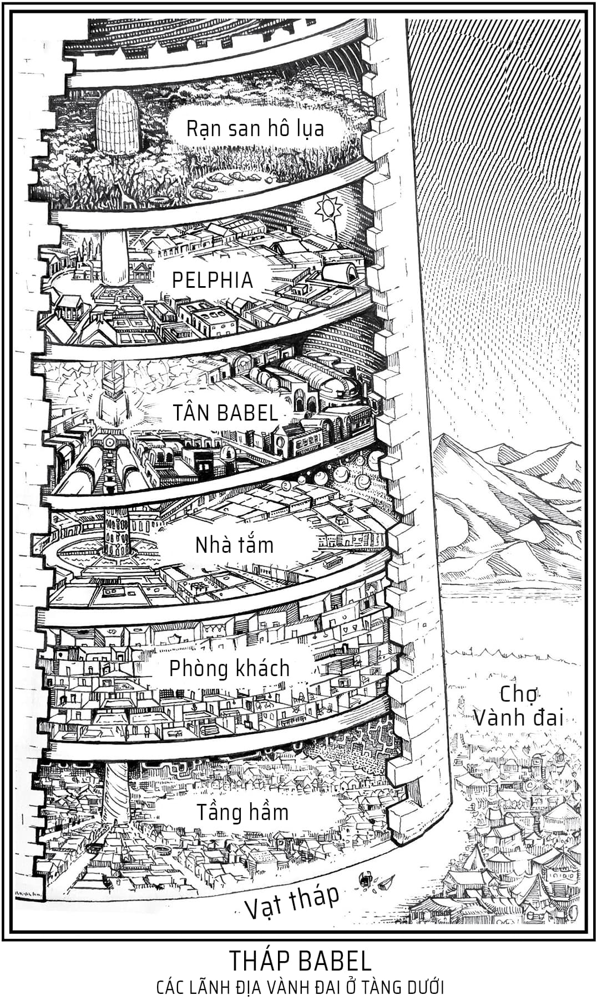

  
Tháp Babel đôi khi vẫn được xưng tụng là Nơi Hội Tụ Trầm Tích của Nhân Loại. Quy mô đồ sộ khôn cùng, sự đa dạng của các Lãnh địa Vành Đai, cùng những đỉnh cao huyền bí và xa hoa tột bậc của tòa tháp ấy mang một mê lực khôn cưỡng đối với lữ khách thập phương. Tất cả chúng ta đều bị cuốn về nơi đó, tựa hồ dòng nước cuộn chảy vào lòng phễu.

  
Lời giới thiệu cuốn <em>Cẩm nang Tháp Babel cho Mọi người</em> (Ấn bản lần thứ mười bốn)

