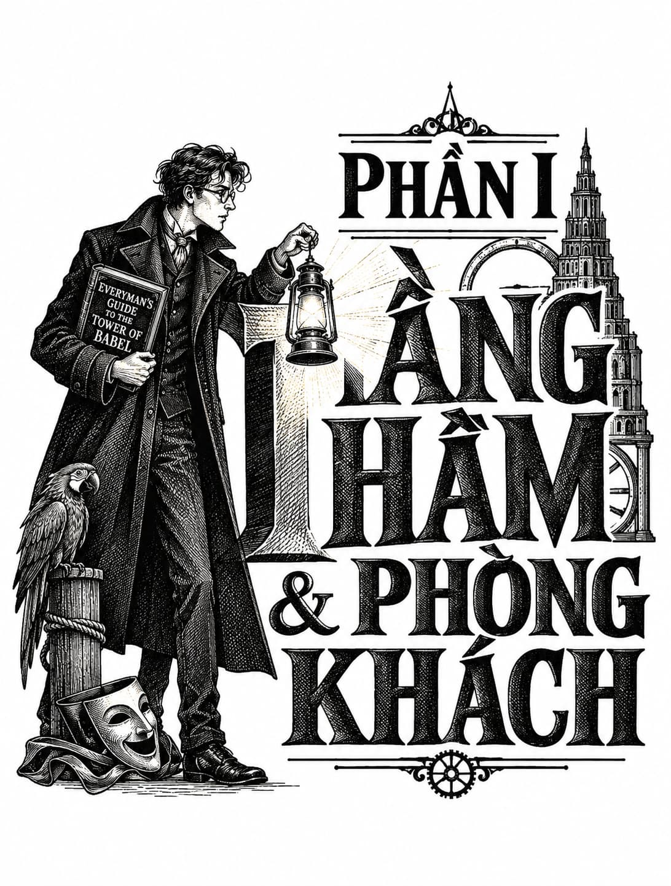

*Phần I: Tầng Hầm & Phòng Khách*

# Chương Một

  
Tháp Babel lừng danh nhất nhờ những dải lụa là gấm vóc thượng hạng và những phi thuyền kỳ vĩ mà nó chế tác, song du khách sẽ còn tìm thấy những mặt hàng xuất khẩu vô hình khác. Sự kỳ ảo, phiêu lưu và lãng mạn mới chính là thứ hàng hóa giao thương thực thụ của tòa Tháp này.

  
<i>Cẩm nang Tháp Babel cho Mọi người</i>, I. V

Bốn ngày ròng rã trên tàu hỏa, hành trình từ vùng duyên hải đến sa mạc cuối cùng cũng lộ diện đích đến: Tháp Babel sừng sững vươn lên, tựa một chiếc ngà voi khổng lồ đâm toạc hàm thiếc của mặt đất. Đầu tiên, họ băng qua những cánh đồng cỏ lốm đốm đàn gia súc đang được vỗ béo và những bản làng tẻ nhạt, rồi đoàn tàu gầm thét leo qua một dãy núi mang những vệt tuyết đỏ lừ như gân máu, nơi loài kền kền khoang cổ đóng tổ lớn như những đống rơm khô. Họ đã đi xa nhà hơn bất kỳ lúc nào trước đây. Đoàn tàu đổ đèo qua những chân đồi đá phiến mà anh ví von như một cánh đồng bảng đen vỡ vụn, xuyên qua những hàng cây bách mà cô bảo trông giống như những chiếc ô đang xòe mở, và cuối cùng, họ lao vào lòng chảo khô cằn. Mặt đất mang màu của những sợi xích rỉ sét, và bụi bặm bám chặt lấy mọi thứ. Sa mạc ấy chẳng hề hoang vu. Đoàn tàu của họ đồng hành cùng một đạo quân lữ hành, mỗi đoàn là một đường dây uốn lượn của những bánh xe, móng guốc và bước chân người. Suốt buổi sáng, các dải giao thông dày đặc dần cho đến khi hội tụ thành một khối khổng lồ, nêm chặt đến mức đoàn tàu buộc phải bò trườn chậm chạp. Toa tàu của họ như đang rẽ sóng vượt qua dòng thủy triều ồn ã của những cỗ xe ngựa đường dài và xe bò kéo, xuyên qua đám đông hỗn tạp gồm khách du lịch, tín đồ hành hương, người di cư và thương nhân từ khắp mọi tiểu bang trong quốc gia Ur rộng lớn.

Thomas Senlin và Marya, người vợ mới cưới của anh, chăm chú quan sát “vườn bách thú nhân loại” ấy qua khung cửa sổ mở toang của toa giường nằm ngập nắng. Bàn tay trắng như sứ của cô đặt nhẹ lên những ngón tay dài của anh. Một toán lính ngực đỏ uể oải cưỡi ngựa Palomino đi ngang qua, tách đôi một gia đình quấn khăn rằn đang lọt thỏm trên lưng lạc đà. Tiếng voi rống vang lên át cả tiếng lạch cạch của tàu hỏa, và đâu đó trong những luồng gió nóng trên cao, các phi thuyền lười biếng trôi dạt, bị hút về phía Tháp Babel bởi một lực hấp dẫn không thể cưỡng lại. Những quả khí cầu giữ cho tàu bay lơ lửng rực rỡ sắc màu như những cây nêu trong ngày hội.

Kể từ khi chuyển hướng về phía ngọn Tháp, họ đã không còn nhìn thấy đỉnh tháp vĩ đại từ cửa sổ toa tàu. Nhưng điều đó chẳng thể ngăn cản Senlin thao thao bất tuyệt về nó. “Có rất nhiều tranh cãi về số lượng tầng tháp. Một số học giả nói có năm mươi hai tầng, số khác lại khẳng định con số lên tới sáu mươi. Thật không thể phán đoán được từ dưới mặt đất,” Senlin nói, tiếp tục liệt kê những sự thật mà anh đã dùng để thu hút sự chú ý của người vợ trẻ trong suốt hành trình. “Một số người, chủ yếu là các phi công và những kẻ thần bí, tuyên bố họ đã nhìn thấy đỉnh tháp. Tất nhiên, chẳng ai có bằng chứng để chứng minh cho lời khoác lác của mình. Một vài nhà thám hiểm thậm chí còn khẳng định ngọn Tháp vẫn đang được xây cao thêm, nếu em có thể tin được điều đó.” Những sự thật vụn vặt này an ủi anh, như mọi sự thật khác vẫn thế. Thomas Senlin là một người đàn ông kín đáo và nhút nhát bẩm sinh, người luôn tìm thấy sự tự tin trong các lịch trình, quy tắc và những ghi chép bằng văn bản.

Marya ngoan ngoãn gật đầu nhưng rõ ràng cô đang bị xao nhãng bởi cuộc diễu hành của nhân loại bên ngoài. Đôi mắt xanh to tròn của cô háo hức đảo qua từng cảnh tượng kỳ lạ: Những gì Senlin chỉ quan sát, cô lại hấp thụ chúng. Senlin biết rằng, khác với mình, Marya thấy những cảnh tượng náo nhiệt và đám đông thật phấn khích, dù cô hiếm khi thấy cả hai ở quê nhà. Buổi trình diễn ngoài cửa sổ kia chẳng có chút gì giống với Isaugh, ngôi làng chài bị muối biển bào mòn giờ đã nằm lại hàng trăm dặm phía sau họ. Isaugh là ngôi nhà thực sự duy nhất cô từng biết, ngoài bốn năm theo học tại nhạc viện dành cho thiếu nữ. Isaugh có hai quán rượu, một Câu lạc bộ Bài Whist, và một tòa thị chính kiêm luôn phòng khiêu vũ khi cần thiết. Nhưng nó khó có thể gọi là một đô thị.

Marya nảy người trên ghế khi một cái đầu lạc đà bất ngờ vươn sát lại gần. Senlin cố giữ vẻ điềm tĩnh để trấn an vợ, nhưng chính anh cũng không kìm được tiếng la khi con lạc đà khịt mũi, phun một luồng nước bọt ấm nóng vào người họ. Bực bội vì sự mất lịch sự này, Senlin hắng giọng và dùng khăn tay xua con lạc đà đi.

Bộ đồ trà phục vụ bữa sáng bắt đầu va vào nhau lanh lảnh, những chiếc thìa run rẩy trong tách rỗng khi người lái tàu nghiến phanh, khiến đoàn tàu khựng lại đột ngột. Thomas Senlin đã chắt bóp và lên kế hoạch cho hành trình này suốt cả sự nghiệp. Anh khao khát được tận mắt chiêm ngưỡng những kỳ quan vốn chỉ nằm trên trang sách bấy lâu, và dù đây là một thử thách cực hạn cho hệ thần kinh, anh vẫn hy vọng sự điềm tĩnh và trí tuệ sẽ giúp mình trụ vững. Leo lên Tháp Babel, dù chỉ là một đoạn ngắn, chính là tham vọng lớn nhất đời anh, và lồng ngực anh đang sục sôi niềm phấn khích. Tuy nhiên, vẻ ngoài của anh chẳng hề để lộ điều đó: Senlin luôn duy trì một phong thái tách biệt, lạnh lùng như một nguyên tắc bất di bất dịch để che giấu những cảm xúc mãnh liệt bên trong. Đó là cách anh vận hành lớp học của mình, và cũng là cách duy nhất anh biết để đối mặt với thế giới.

Bên ngoài, một phi thuyền hạ thấp cao độ đến mức những sợi dây neo bắt đầu quất vun vút vào đầu đám đông. Senlin tự hỏi liệu nó đang hạ cánh hay vừa mới cất cánh mà lại bay sát mặt đất đến vậy. Marya bật cười thích thú rồi vội lấy tay che miệng. Anh sững sờ nhìn vị thuyền trưởng phi thuyền vung tay điên cuồng, gào thét ra lệnh cho thủy thủ đoàn đốt lò và kéo dây neo. Mọi việc diễn ra chớp nhoáng giữa cơn hỗn loạn, nhưng vẫn không nhanh bằng một gã thanh niên liều lĩnh trong đám đông. Gã chộp lấy một sợi dây đang lơ lửng, và ngay lập tức, gã bị giật phắt lên không trung. Đôi chân gã vừa kịp lướt qua mui một cỗ xe ngựa trước khi bị hất tung lên cao rồi mất hút khỏi tầm mắt.

Cảnh tượng nhìn từ mặt đất có vẻ khôi hài, nhưng bụng dạ Senlin cồn cào khi tưởng tượng ra cảm giác của gã thanh niên kia: phải gồng mình đu bám trên cao, phó mặc mạng sống cho sức mạnh đôi tay khi bay vút qua biển người nhung nhúc. Thực sự, toàn bộ sự việc diễn ra quá kỳ quái và đột ngột đến mức anh quyết định gạt phắt nó ra khỏi đầu. Cuốn <i>Cẩm nang Everyman</i> gọi Chợ Vành Đai & Vạt Tháp là một nơi “náo nhiệt”. Có vẻ như đó là một cách nói giảm nói tránh đầy nực cười.

Anh chưa bao giờ mường tượng mình sẽ thực hiện chuyến hành trình này với tư cách một người đang hưởng tuần trăng mật. Đúng hơn là, anh chưa từng nghĩ mình sẽ tìm được một người phụ nữ chấp nhận lấy mình. Marya kém anh mười hai tuổi, nhưng ở độ tuổi giữa ba mươi, Senlin không thấy cuộc hôn nhân này có gì quá đặc biệt. Tuy nhiên, nó đã khiến không ít kẻ ở Isaugh phải nhướn mày kinh ngạc. Tọa lạc trên những vách đá cheo leo bên bờ Đại dương Niro, dân thị trấn Isaugh luôn nghi kỵ bất cứ thứ gì lệch khỏi nhịp điệu đều đặn của thủy triều và mùa đánh cá. Nhưng với tư cách là hiệu trưởng, đồng thời là giáo viên duy nhất của ngôi trường tại Isaugh, Senlin thường phớt lờ những lời đàm tiếu. Anh đã nghe đủ rồi. Với anh, buôn chuyện là trò tiêu khiển của hạng người thiếu học, và anh kết hôn không phải để làm món quà giải trí cho bữa sáng của bất kỳ ai.

Anh kết hôn hoàn toàn vì những lý do thực tế.

Marya là một người bạn đời lý tưởng. Cô có tính khí tốt và học thức rộng; chu đáo nhưng không u sầu; lịch thiệp mà không xa cách. Cô bao dung cho những giờ học tập kéo dài và sự im lặng thường trực của anh, điều mà người khác thường nhầm lẫn với vẻ khắc khổ. Anh đồ rằng cô cưới mình vì anh tử tế, điềm đạm và có công việc ổn định. Anh kiếm được mười lăm shekel một tuần, tương đương mức lương mười ba mina mỗi năm; đó chẳng phải là một gia tài kếch xù, nhưng đủ để đảm bảo một cuộc sống sung túc. Chắc chắn cô không cưới anh vì vẻ ngoài. Dù các đường nét của anh khi tách riêng ra thì cũng khá bảnh bao, nhưng khi kết hợp lại, chúng trông có vẻ hơi dài và đặt sai chỗ. Biệt danh của anh trong đám học trò là “chú cá tầm” vì thân hình gầy gò, cao lêu nghêu và xương xẩu.

Dĩ nhiên, bản thân Marya cũng có vài thói quen khác thường. Cô thường vừa đi bộ vào thị trấn vừa dán mắt vào sách, kết quả là vô số lần rách váy và trầy xước đầu gối. Cô không sợ độ cao và đôi khi leo lên tận mái nhà chỉ để ngắm nhìn những cánh buồm của những con tàu đang tiến vào cảng nhô lên phía chân trời. Cô chơi piano rất hay nhưng cũng đầy dữ dội. Cô hát tựa một mỹ nhân ngư cuồng loạn trong khi nện những bản ballad và vũ khúc, để lại sau lưng những cây đàn piano lạc điệu. Dù vậy, sự kỳ quặc của cô lại khơi dậy lòng ngưỡng mộ ở hầu hết mọi người. Dân thị trấn thấy cô thật quyến rũ, và tiếng đàn của cô thường xuyên được săn đón tại các tửu quán địa phương. Ngay cả cái sắc xám xịt cay nghiệt của mùa đông Isaugh cũng không thể dập tắt được sức sống mãnh liệt của cô. Mọi người đều có chút bối rối trước cuộc hôn nhân của cô với “chú cá tầm”.

Hôm nay, Marya diện bộ đồ lữ hành: chiếc váy kaki dài chạm gối phối cùng sơ mi trắng giản đơn, điểm xuyết bằng chiếc mũ cối có phần lập dị che đi suối tóc nâu đỏ bồng bềnh. Cô đã nhuộm chiếc mũ sang sắc đỏ rực, một quyết định khiến Senlin chẳng mấy hài lòng, nhưng cô đã thuyết phục anh rằng sắc màu ấy sẽ là dấu hiệu giúp anh dễ dàng nhận ra cô giữa biển người. Senlin vận bộ vest nhung kẻ mỏng màu xám; anh cảm thấy nó quá đỗi xuề xòa, ngay cả với một chuyến đi, nhưng cô lại bảo trông nó thật thời thượng và đầy ngẫu hứng. Mà chẳng phải đó chính là tinh thần của một tuần trăng mật hay sao?

Một đứa trẻ lanh lợi khoác chiếc áo vest da dê thô kệch thoăn thoắt leo dọc mạn tàu, cánh tay xỏ đầy những vòng bánh mì. Senlin mua một chiếc, rồi anh và Marya cùng bẻ đôi lớp vỏ bánh ấm nóng, thơm nồng mùi men khi đoàn tàu lừ đừ tiến về Ga Trung tâm Babel, nơi hội tụ của muôn vàn ngả rẽ.

Tuần trăng mật của họ bị trì hoãn theo nhịp độ tự nhiên của năm học. Anh vốn có thể chọn một điểm đến thuận tiện và tiết kiệm hơn, một khách sạn ven biển hay căn nhà nhỏ nơi thôn dã để cả hai cùng ẩn mình trong kỳ nghỉ ngắn, nhưng Tháp Babel không chỉ đơn thuần là chốn nghỉ chân. Đó là cả một thế giới sừng sững trên nền móng đá tảng. Thuở thiếu thời, anh từng đọc về những đóng góp văn hóa vĩ đại của Tòa tháp cho nghệ thuật và sân khấu, cùng những bước tiến khoa học kỹ thuật sâu sắc của nó. Ngay cả điện năng, thứ hàng hóa xa xỉ vẫn còn lạ lẫm ở hầu khắp các thành phố lớn của Ur, cũng được đồn đại là luân chuyển dồi dào tại các tầng cao. Tòa tháp chính là ngọn hải đăng của nền văn minh. Ngạn ngữ cổ có câu: “Trái đất không làm rung chuyển Tòa tháp; chính Tòa tháp làm rung chuyển trái đất.”

Đoàn tàu khựng lại, dù chẳng thấy bóng dáng nhà ga nào ngoài cửa sổ. Người soát vé rảo bước ngang qua, yêu cầu hành khách xuống tàu; đường ray quá tắc nghẽn để có thể tiến thêm. Chẳng ai lấy làm lạ. Sau nhiều ngày bị lắc lư trên những thanh ray, viễn cảnh được sải bước trên mặt đất hấp dẫn cả hai. Senlin thu dọn hành lý: một túi da khâu đựng đồ đạc của anh, và một chiếc rương du lịch khiêm tốn của cô, loại có bánh xe lớn ở một đầu và tay đẩy ở đầu kia. Anh khăng khăng đòi tự mình xoay xở với cả hai kiện đồ.

Trước khi rời toa, trong lúc cô chỉnh lại cổ đôi ủng da nâu và vuốt phẳng nếp váy, Senlin nhẩm lại ba quy tắc sinh tồn mà anh đúc kết từ cuốn <i>Cẩm nang Tháp Babel cho Mọi người</i>. Thứ nhất: Giữ tiền thật kỹ. (Trước chuyến đi, anh đã nhờ thợ may khâu những túi bí mật bên trong cạp quần mình và gấu váy của cô). Thứ hai: Tuyệt đối không nhượng bộ kẻ ăn xin. (Lòng trắc ẩn chỉ khiến chúng thêm lấn lướt). Và cuối cùng: Luôn giữ bạn đồng hành trong tầm mắt. Senlin yêu cầu Marya nhắc lại những điểm này khi họ hối hả băng qua hành lang trải thảm vàng nối giữa các toa. Cô chiều ý anh, dù không giấu nổi vẻ hóm hỉnh.

“Quy tắc thứ tư: Đừng hôn lạc đà.”

“Làm gì có quy tắc thứ tư nào như thế.”

“Anh đi mà nói với lũ lạc đà ấy!” cô đáp, bước chân nhún nhảy đầy phấn khích.

Thế nhưng, cả hai chẳng thể ngờ tới cảnh tượng đang chờ đợi mình khi bước xuống bậc thang tàu. Đám đông tựa như một khối thạch đông đặc, bủa vây lấy họ từ mọi phía. Ban đầu, họ gần như bất động. Một gã hói với bao tải gai khổng lồ vắt vẻo trên vai, cổ đeo vòng sắt, xô mạnh khiến Senlin ngã nhào vào một người đàn bà mắt đỏ sọng; bà ta đẩy anh ra bằng một tràng cười nặc mùi rượu rồi lập tức chìm nghỉm vào vũng lầy xác thịt. Một chiếc lồng nhốt lũ chim yến đang hoảng loạn được chuyền qua đầu họ, rắc xuống vai hai người những sợi lông hôi hám. Hông của cả chục người phụ nữ vận áo choàng đen, tín đồ của một giáo phái huyền bí nào đó, va vào họ như những viên bi sắt khổng lồ. Lũ trẻ con bẩn thỉu mang theo khay đựng hoa giấy tẩm hương, chong chóng và trái cây bọc đường luồn lách xung quanh, đứa này xích với đứa kia bằng một đoạn dây thừng. Ngoại trừ đường ray, chẳng có lấy một lối đi rõ ràng, không đá cuội, không vỉa hè, chỉ có lớp đất nền cứng nhắc màu đỏ gỉ dưới chân.

Mọi thứ quá đỗi choáng ngợp, và trong một khoảnh khắc, Senlin đứng sững như một pho tượng tử thi. Tiếng rao của những kẻ bán dạo, tiếng bạt rung phần phật, tiếng lanh lảnh của dây cương và sự hỗn loạn từ mười ngàn giọng nói xa lạ dội vào tai như một bản giao hưởng chát chúa; muốn nghe thấy nhau, họ chẳng còn cách nào khác ngoài gào lên. Marya bấu chặt lấy thắt lưng chồng ngay sát sống lưng, cú hích ấy khiến anh giật mình thoát khỏi cơn ngây dại và thúc giục anh tiến bước. Anh biết họ không thể cứ đứng chôn chân ở đó. Senlin hít một hơi thật sâu rồi dấn bước đầu tiên.

Họ bị cuốn vào một mê cung của những lều buôn, xe đẩy hàng và những sạp hàng ọp ẹp. Những con hẻm giữa các sạp hàng chằng chịt như nét vẽ nguệch ngoạc của trẻ nhỏ. Những thanh xà bằng tre tạm bợ nhô ra khắp nơi trên đầu, oằn mình dưới sức nặng của những tấm thảm đay, những xâu hành tây, đèn lồng thiếc đục lỗ và thắt lưng da bện. Những tấm bạt che sọc màu rực rỡ choán hết cả bầu trời, dù ngay cả trong bóng râm, sự hiện diện của mặt trời vẫn là điều không thể nghi ngờ. Không khí khô khốc, hầm hập như hơi nóng bốc lên từ đống tro tàn vừa lụi.

Senlin lầm lũi bước tiếp, hy vọng tìm thấy một con đường hay biển chỉ dẫn. Chẳng có gì xuất hiện cả. Anh để mặc dòng người dẫn lối thay vì tự mình mở đường. Hễ thấy một kẽ hở mở ra, anh lập tức lách mình lao tới. Sau khi tiến được khoảng một trăm bước theo cách này, anh hoàn toàn mất phương hướng, chẳng rõ đường ray nằm ở phía nào. Anh hối hận vì đã đi quá xa khỏi đường ray. Đáng lẽ họ có thể đi dọc theo chúng để đến Ga Trung tâm Babel. Cảm giác mất phương hướng ập đến nhanh đến mức đáng sợ.

Dù vậy, chốc chốc anh vẫn cẩn thận ngoái lại, cố nặn ra một nụ cười trấn an với Marya. Nụ cười rạng rỡ của cô chưa bao giờ lung lay. Chẳng có lý do gì để khiến cô phải lo lắng vì một trở ngại nhỏ nhặt này.

Phía trước, một thằng bé mình trần đang quạt lia lịa xua ruồi khỏi những xác cừu và thỏ treo lủng lẳng. Lũ ruồi và mùi hôi thối nồng nặc, ngọt lợ phả ra từ sạp thịt đẩy đám đông lùi lại, tạo ra một khoảng không nhỏ cho họ tạm dừng chân, dù cái mùi đó thật buồn nôn. Đặt chiếc rương của Marya xuống giữa hai người, Senlin dùng khăn tay lau mồ hôi trên cổ.

“Ở đây náo nhiệt thật đấy,” Senlin nói, cố gắng không để lộ vẻ bối rối đang dâng cao, dù Marya chẳng mấy bận tâm; cô đang nhìn chăm chú qua đầu anh, một vẻ mặt ngẩn ngơ làm bừng sáng khuôn mặt xinh đẹp.

“Thật tuyệt vời,” cô nói.

Một kẽ hở giữa những tấm mái hiên phía trên để lộ ra bầu trời, và ở đó, sừng sững như một cột trụ chống trời, là Tháp Babel.

Bề mặt Tòa tháp là một bản phối chắp vá của những mảng màu trắng, xám, gỉ sắt, nâu vàng và đen, phơi bày vô số loại đá và gạch được sử dụng trong quá trình xây dựng trường kỳ. Sự phối màu bất quy tắc khiến Senlin liên tưởng đến một con mèo tam thể. Hình dáng của Tòa tháp xét về mặt kiến trúc thì khá đơn điệu, gợi nhắc đến một nòng đại bác khổng lồ bị móp méo và có gờ, nhưng nó lại được trang trí bằng những dải phù điêu lộng lẫy, mỗi dải còn cao hơn cả một ngôi nhà. Một tầng mây dày đặc che khuất đỉnh Tháp. Cuốn <i>Cẩm nang Tháp Babel cho Mọi người</i> có ghi chú rằng những tầng trên cao luôn bị sương mù bao phủ vĩnh viễn, dù việc cấu trúc cổ đại này tự tạo ra mây hay thu hút chúng vẫn là một chủ đề suy đoán phổ biến. Dù thế nào đi nữa, đỉnh tháp vẫn luôn là một bí ẩn chưa từng được nhìn thấy từ mặt đất.

Những mô tả trong cuốn <i>Everyman’s</i> về Tháp Babel thực sự chưa thể chuẩn bị tâm lý cho Senlin trước sự vĩ đại của cấu trúc này. Nó biến những đài tháp ziggurat của vùng Nam Ur và những pháo đài của Đồng bằng phía Tây trông chẳng khác nào những mô hình đồ chơi trẻ con nặn từ những viên đường. Tòa tháp đã mất một ngàn năm để xây dựng. Thậm chí còn lâu hơn, theo một số nhà sử học. Choáng ngợp trước sự kỳ vĩ và sự náo nhiệt dữ dội của Chợ Vành Đai & Vạt Tháp, Senlin rùng mình. Marya siết chặt tay anh như để trấn an, và anh đứng thẳng lưng lại. Dù sao anh cũng là một hiệu trưởng, người lãnh đạo của một cộng đồng khiêm tốn. Đúng là có một đám đông cần phải vượt qua, nhưng một khi họ chạm tới Tòa tháp, dòng người sẽ thưa dần. Họ sẽ có thể thư giãn một chút và gần như chắc chắn sẽ tìm thấy những người bạn đồng hành nhã nhặn hơn. Trong vài giờ nữa, họ sẽ nhâm nhi một ly rượu vang đỏ trong một nơi lưu trú tử tế và hiếu khách ở tầng thứ ba của Tòa tháp, nơi dân địa phương gọi là Nhà Tắm, đúng như kế hoạch họ đã định. Họ sẽ thong dong quan sát đám đông hỗn loạn này từ một khoảng cách an toàn và dễ chịu hơn.

Ít nhất, giờ đây họ đã có một phương hướng, một mục tiêu để dấn bước.

Senlin cũng dần tìm ra cách hiệu quả hơn để rẽ lối giữa đám đông. Anh nhận ra rằng chỉ cần dừng chân một nhịp, việc bắt đầu lại sẽ vô cùng khó khăn; nhưng nếu cứ giữ vẻ kiên quyết và dứt khoát, mọi chuyện sẽ trôi chảy hơn nhiều. Sau vài phút bám đuôi, Marya đã đủ tự tin để buông thắt lưng anh ra, giúp cả hai di chuyển linh hoạt hơn hẳn.

Chẳng mấy chốc, họ đã lạc bước vào một trong vô số khu chợ y phục thuộc Chợ Vành Đai & Vạt Tháp. Những chiếc váy thắt dây, tạp dề thêu và áo sơ mi tay bồng treo lủng lẳng trên một “khu rừng” móc sắt và dây phơi. Âu phục đủ mọi sắc thái, từ xanh đuôi công rực rỡ đến vàng vạn thọ cháy bỏng; nội y phụ nữ vắt vẻo trên những chiếc thang tre, trông chẳng khác nào lớp da lột của những loài rắn ngoại lai. Những chiếc khăn tay gấp vuông vức phủ kín mặt bàn gần nhất, chất chồng như những đống tuyết đọng.

“Để anh sắm cho em một bộ váy. Đêm ở đây ấm hơn nhiều so với quê mình.” Anh phải ghé sát tai cô, nói thật lớn mới át được tiếng ồn náo nhiệt xung quanh.

“Em muốn một chiếc váy thật xinh,” cô đáp, tháo chiếc mũ cối đỏ để lộ mái tóc màu đồng hơi bết lại vì mồ hôi. “Thứ gì đó thật… táo bạo vào.”

Anh khẽ nhíu mày vẻ đăm chiêu để che đậy sự bàng hoàng. Anh biết đây là kiểu tán tỉnh lả lơi mà các cặp đôi thường dành cho nhau trong kỳ trăng mật. Dẫu vậy, bản tính cứng nhắc vẫn chưa kịp thích nghi để tung hứng theo tông giọng đùa cợt của cô. “Táo bạo sao?”

“Chẳng có gì mà đám học trò của anh cần phải biết đâu. Chỉ là một món đồ nhỏ để ‘bôi tro trát trấu’ vào cái dây phơi nhà mình thôi,” cô vừa nói vừa lướt ngón tay dọc cánh tay anh, hệt như đang quẹt một que diêm chực chờ bùng cháy.

Một luồng bất an len lỏi vào tâm trí anh. Phía trước họ, hàng dãy sạp hàng trải dài dạt dào những nội y phụ nữ. Tuyệt nhiên không thấy bóng dáng một gã đàn ông nào.

Mười lăm năm sống đời độc thân chẳng thể giúp anh chuẩn bị tâm lý cho sự hiện diện của những món đồ lót của Marya trong phòng ngủ. Việc bắt gặp những món đồ mỏng manh của cô vắt vẻo trên cột giường hay nắm cửa nơi “thánh địa” cũ kỹ của mình từng là một cú sốc lớn. Nhưng giờ đây, nhìn cả một biển váy ngủ, áo lót, corset, tất dài và nịt ngực đang bị hàng ngàn người phụ nữ lạ mặt bới tung, anh cảm thấy sự ngượng ngùng này còn nhân lên gấp bội. “Anh nghĩ mình nên đứng lại trông hành lý thì hơn.”

“Thế còn những quy tắc của anh thì sao?”

“À, nếu em cứ đội cái ‘bát đỏ’ đó trên đầu, anh đứng đây vẫn có thể dõi theo em dễ dàng thôi.”

“Nếu anh có lỡ đi lạc, chúng ta sẽ hội ngộ trên đỉnh Tháp!” Cô thốt lên với vẻ cường điệu đầy kịch tính.

“Không có chuyện đó đâu. Anh sẽ đợi em ngay tại đây, bên cạnh cái xe đẩy bán tất này.”

“Đúng là kẻ lãng mạn!” Cô cười rồi lách qua hai người phụ nữ hộ pháp đang diện kiểu váy tạp dề xanh trắng vốn đã lỗi thời từ nhiều năm trước. Senlin thích thú nhận ra họ bị buộc chặt vào nhau ở ngang hông bằng một sợi dây đay thô kệch.

Anh cất tiếng hỏi liệu họ có đến từ phương Đông không, và họ đáp lại bằng tên một làng chài nằm chẳng cách Isaugh là bao. Họ cùng nhau ôn lại những hoài niệm đặc trưng của dân vùng biển: những buổi bình minh rực rỡ, những con sao biển dạt bờ, và tiếng sóng vỗ rì rầm êm ái mỗi đêm, rồi anh hỏi: “Hai bà đi nghỉ mát sao?”

Họ đáp lại bằng những nụ cười hiền hậu kiểu mẫu tử khiến anh cảm thấy mình thật nhỏ bé. “Chúng tôi qua cái thời nghỉ mát lâu rồi,” một người lên tiếng.

“Đi đâu hai bà cũng phải buộc chặt vào nhau thế này sao?” Một chút mỉa mai bắt đầu len lỏi vào tông giọng của anh.

“Phải, tất nhiên rồi,” người chị lớn đáp. “Kể từ khi chúng tôi lạc mất đứa em gái nhỏ.”

“Tôi rất tiếc. Cô ấy mới qua đời gần đây sao?” Senlin hỏi, lập tức lấy lại vẻ chân thành.

“Tôi rất hy vọng là không. Nhưng đã ba năm trôi qua rồi. Có lẽ con bé đã mất thật.”

“Hoặc biết đâu con bé đã tìm được đường về nhà?” người em gái xen vào.

“Nó sẽ không đời nào bỏ rơi chúng tôi,” người chị đáp lại bằng cái giọng cho thấy đây là một chủ đề tranh cãi đã quá mòn tai giữa hai người.

“Ông bạn thật gan dạ khi dám tới đây một mình đấy,” người em gái nói với anh.

“Ồ, cảm ơn bà, nhưng tôi không đi một mình.” Đã chán ngấy cuộc hội thoại, Senlin định đưa tay nắm lấy quai chiếc rương, nhưng rồi anh chết lặng khi nhận ra nó đã biến mất không một dấu vết.

Hoảng loạn, anh xoay người dáo dác tìm kiếm, ánh mắt rà soát từ mặt đất đến dòng người với những gương mặt vô hồn, dửng dưng đang len lỏi quanh mình. Chiếc rương của Marya đã biến mất không dấu vết. “Tôi… tôi mất hành lý rồi,” anh thốt lên, giọng lạc đi vì bàng hoàng.

“Lo mà kiếm lấy một sợi dây thừng cho chắc chắn vào,” người chị cả đáp, đoạn đưa tay vỗ nhẹ lên gò má trắng bệch vì kinh hãi của anh.
