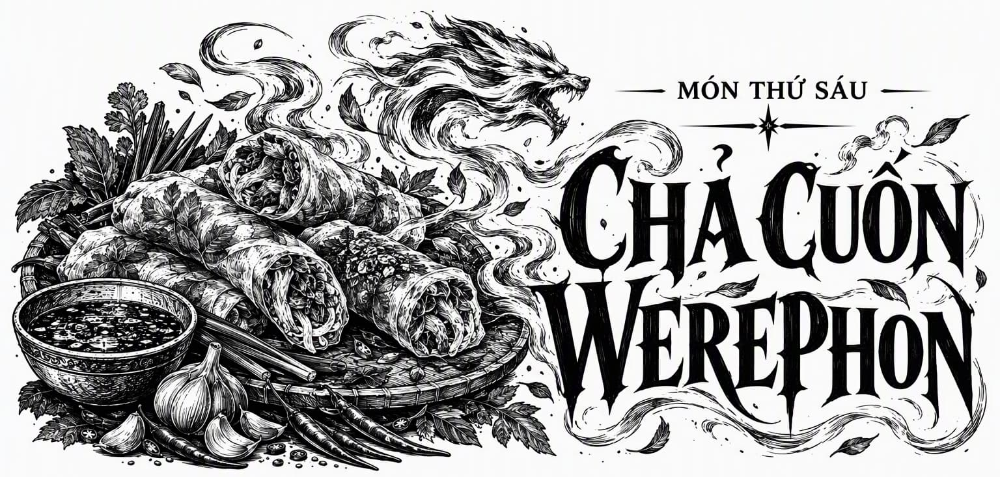

# Món Thứ Sáu • Bánh Cuộn Quái Thú Werephon

*Món Thứ Sáu • Bánh Cuộn Quái Thú Werephon*

*Một món ăn thịnh soạn mang đậm phong vị mộc mạc của đại ngàn phương bắc, bánh cuộn quái thú Werephon vừa hoàn hảo làm món khai vị nóng giòn, vừa đủ sức gánh vác vai trò một món chính no bụng. Khi phục vụ như món chính, hãy dọn kèm khoai tây chiên xóc gia vị thảo mộc nhẹ nhàng cùng một đĩa salad rau rừng tươi giòn để cân bằng độ béo ngậy đậm đà. Khi dùng làm món khai vị nhắm rượu, món bánh sẽ thăng hoa tuyệt đối nếu chấm cùng xốt mù tạt mật ong nồng đượm hoặc xốt tỏi aioli béo dịu. Dùng kèm với một vại bia men Ryespur ủ lạnh thì quả thực không còn gì sánh bằng.*

  **Nguyên liệu** (khẩu phần cho 2 - 4 người):

    - **Cho phần bột ngàn lớp puff pastry:** 
- 250g bột mì đa dụng thượng hạng
        
- 1 muỗng cà phê muối biển
        
- 280g bơ lạt hoặc bơ thực vật (xem lưu ý về Quy luật biến thể), để lạnh sâu và cắt hạt lựu nhỏ
        
- ½ cốc nước đá lạnh

      
- **Cho phần nhân xúc xích thảo mộc:** 
- 3 muỗng canh dầu ô liu nguyên chất, chia làm các phần
        
- 2 củ hành tây ngọt, thái hạt lựu nhỏ
        
- 2 muỗng canh hạt lanh xay nhuyễn
        
- ⅓ cốc nước lọc
        
- 400g đậu phụ zensufu (khoảng 1 khối tiêu chuẩn), ép kiệt và thấm ráo nước
        
- 2 cốc yến mạch cán vỡ
        
- 2 muỗng canh bột cà chua cô đặc
        
- 3 muỗng canh nước tương đậu nành lên men
        
- 3 muỗng canh bột rễ trời Skyroot
        
- 1 muỗng cà phê bột bạch đậu khấu đen nghiền mịn
        
- 2 muỗng canh si rô phong hoặc si rô táo cô đặc nguyên chất
        
- Muối biển và tiêu đen xay, gia giảm tùy khẩu vị
        
- 8 lá bánh tráng gạo mỏng

      
- **Cho phần phết mặt bánh và hoàn thiện:** 
- Bột mì đa dụng rắc áo chống dính
        
- 2 muỗng canh hạt lanh xay nhuyễn
        
- ⅓ cốc nước lọc
        
- 1 muỗng canh si rô phong

    

**Các bước thực hiện:**

    - Nhào bột ngàn lớp puff pastry theo kỹ thuật cán gấp lạnh truyền thống, bọc kín bằng màng bọc thực phẩm và ủ trong ngăn mát tủ lạnh qua đêm để các lớp bơ định hình chuẩn xác.

      
- Đun nóng 1 muỗng canh dầu ô liu trong chảo trên lửa vừa. Trút hành tây thái hạt lựu vào xào đều tay cho đến khi hành chuyển màu trong suốt và dậy mùi thơm ngọt tự nhiên, sau đó nhấc chảo ra để nguội về nhiệt độ phòng. Trút hành tây ra một chiếc âu lớn, giữ nguyên lớp dầu thơm còn đọng lại trong chảo để sử dụng cho công đoạn sau.

      
- Khuấy đều 2 muỗng canh hạt lanh xay nhuyễn cùng ⅓ cốc nước lọc trong một bát nhỏ, để yên trong khoảng 2 phút cho hợp chất tiết gel tạo thành hỗn hợp trứng hạt lanh sánh đặc.

      
- Trong âu lớn đựng hành tây xào, dùng tay bóp vụn khối đậu phụ zensufu, sau đó trút hỗn hợp trứng hạt lanh cùng toàn bộ các nguyên liệu làm nhân xúc xích còn lại vào (ngoại trừ lá bánh tráng). Nhào trộn thật kỹ cho đến khi khối nhân dẻo quánh, đồng nhất và ngấm sâu gia vị. Để hỗn hợp nghỉ trong 15 phút để yến mạch hút ẩm và liên kết chặt chẽ.

      
- Thấm ẩm nhẹ một lá bánh tráng gạo cho mềm dẻo, múc một phần nhân xúc xích đặt vào chính giữa theo chiều dọc. Dùng tay khô khéo léo cuộn chặt mép bánh tráng quanh phần nhân để định hình thành một thanh xúc xích thon dài có lớp màng bọc mỏng tang bao quanh. Lặp lại thao tác cho đến khi hoàn thành đủ 8 thanh xúc xích.

      
- Làm nóng lại chảo dầu hành trên mức lửa vừa lớn, đặt các thanh xúc xích vào áp chảo nhanh tay cho đến khi lớp màng bánh tráng se lại và chuyển màu vàng nâu nhạt thơm lừng. Nhấc ra ngay lập tức. *(Lưu ý: Không làm chín hoàn toàn phần nhân ở công đoạn này, mục đích chỉ là tạo lớp vỏ xém thơm và khóa chặt phong vị).* Để nguội.

      
- Làm nóng lò nướng trước ở nhiệt độ 200°C.

      
- Rắc một lớp bột mì mỏng lên mặt bàn thao tác sạch. Cán mỏng khối bột ngàn lớp rồi dùng dao sắc cắt thành 4 hình chữ nhật kích thước chuẩn 25 x 12 cm. Xếp các tấm bột theo chiều dọc sao cho cạnh ngắn nằm sát về phía người thao tác.

      
- Chuẩn bị một bát hỗn hợp trứng hạt lanh thứ hai theo tỷ lệ tương tự bước 3.

      
- Trong lúc đợi hỗn hợp hạt lanh keo đặc, xếp 2 thanh xúc xích nằm dọc song song lên chính giữa mỗi tấm bột ngàn lớp.

      
- Hòa 1 muỗng canh si rô phong vào bát trứng hạt lanh đặc để tạo thành hỗn hợp phết bánh thuần chay óng ả, sau đó dùng cọ mềm quét đều một lớp mỏng lên các mép viền của tấm bột.

      
- Lần lượt với từng tấm bột, nhẹ nhàng cuộn hai mép bột bên trái và bên phải phủ trùm lên thanh xúc xích, xếp chồng mép lên nhau ở chính giữa. Dùng đầu ngón tay ấn nhẹ dọc đường nối để niêm phong mép bột, khéo léo nắn vuốt để đòn bánh giữ nguyên hình trụ tròn căng mọng. Lật úp phần mép nối xuống dưới khay, dùng cọ quét đều toàn bộ phần hỗn hợp phết còn lại lên bề mặt từng đòn bánh để tạo màu vàng ươm khi nướng.

      
- Dùng dao lam hoặc dao bếp thật sắc cắt mỗi đòn bánh thành 3 phần bằng nhau. Xếp các miếng bánh lên khay nướng đã quét dầu chống dính và nướng ở nhiệt độ 200°C trong 25 phút. Nhớ xoay chiều khay nướng khi thời gian trôi qua được một nửa để bánh nở đều và vàng ruộm các mặt.

      
- Lấy khay bánh ra khỏi lò và để bánh nghỉ trên giá tản nhiệt trong 5 phút cho vỏ bánh định hình giòn xốp trước khi dọn ra thưởng thức.

    

**Hiệu ứng Sức bền ma thuật:**

    - Cường hóa Sức bền ma thuật liên tục trong 8 đến 9 giờ đồng hồ.

      
- Khai mở khả năng biến đổi dị hóa các bộ phận cơ thể tương ứng với đặc tính sinh học của một loài quái thú Emphon nhất định; mang lại những lợi thế thể chất bổ trợ tùy thuộc vào cấu trúc giải phẫu của loài quái thú được dung hợp, kéo dài liên tục từ 8 đến 9 giờ đồng hồ.

    

**Hiệu ứng Sự tăng cường phép thuật:**

    - Chưa xác định.

    

**Hiệu ứng Quy luật biến thể:**

    - Tùy thuộc vào chủng loại bơ thực vật hoặc tinh dầu thảo mộc được sử dụng trong quy trình nhào cán bột ngàn lớp, người thưởng thức sẽ trải qua những hình thái biến chuyển thể xác dị biệt tương ứng với các loài quái thú khác nhau.

    

**Hiệu ứng quái thú Emphon:**

    - Chưa xác định.