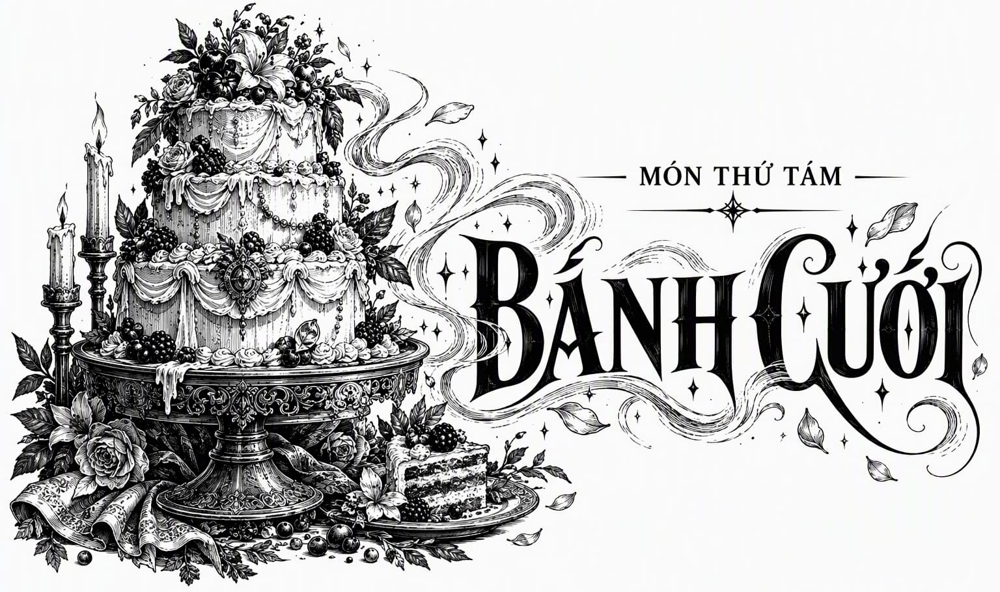

# Món Thứ Tám • Bánh Cưới

*Món Thứ Tám • Bánh Cưới*

*Trong một thế giới công bằng và tự do, sẽ chẳng có món tráng miệng nào tuyệt mỹ hơn thế, cũng chẳng có yến tiệc nào xứng đáng hơn cho khúc hoan ca khải hoàn. Món ăn này có thể hòa quyện trọn vẹn với muôn vàn phong vị mà chẳng cần đến bất kỳ món phụ nào đi kèm. Các bạn buộc phải hỏi Laven về công thức ấy. Bản thân tôi thì không tài nào ép nổi tâm trí mình học thuộc.*

  **Hiệu ứng Sức bền ma thuật Dự kiến:**

    - Thanh tẩy và loại bỏ hoàn toàn mọi tàn dư năng lượng ma thuật Endurium cùng Sức bền ma thuật ra khỏi cơ thể người thưởng thức

    

**Hiệu ứng Sức bền ma thuật Tăng cường:**

    - Chưa xác định

    

**Hiệu ứng Biến thể Khẩu vị:**

    - Chưa xác định

    

**Hiệu ứng Emphon:**

    - Tác dụng hoàn toàn tương đồng với cơ thể con người trên cả mười một giống loài quái thú Emphon được thử nghiệm