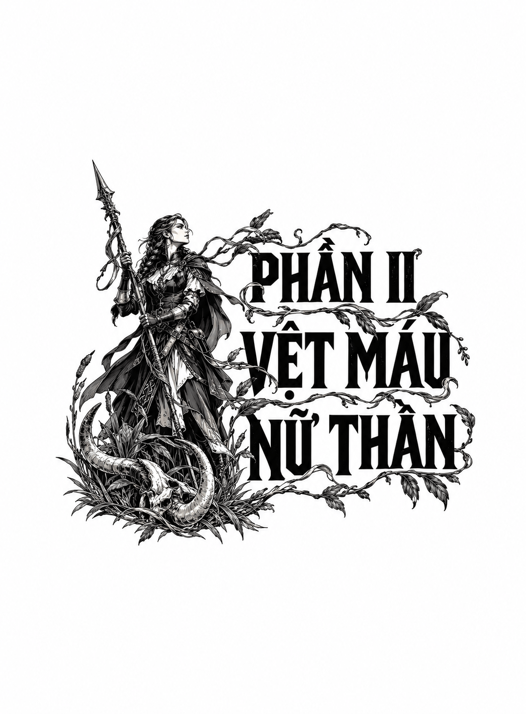

*PHẦN II: VỆT MÁU DƯỚI GÓT CHÂN NỮ THẦN*

# CHƯƠNG 9

Trong vô số khúc tụng ca và thi phẩm, luôn có những câu chuyện kể về các gia đình ly tán bởi chiến tranh, nạn đói, thủy quái hay dịch bệnh, và trong những tích truyện ấy, rốt cuộc luôn xuất hiện khoảnh khắc họ được đoàn tụ. Họ nhận ra nhau, cất tiếng gọi tên nhau trong niềm vỡ òa khôn xiết, ôm chầm lấy nhau, vừa khóc vừa cười khi bao năm tháng đằng đẵng cùng muôn dặm cách biệt bỗng chốc tan biến.

Thế nhưng giờ đây, khi nhìn em gái Fotia, người tôi đã không gặp suốt gần sáu năm trời, tất cả những câu chuyện kia dường như chỉ là một trò đùa cay đắng. Chúng tôi không lao về phía nhau, cũng chẳng nắm lấy tay nhau để xác nhận bằng da bằng thịt. Chúng tôi chỉ lặng lẽ nhìn đối phương, như hai kẻ xa lạ bị gượng ép vào cuộc tương phùng này.

Mà thực tế đúng là như vậy, tôi nhận ra. Suốt thời thơ ấu, tôi chưa từng thấy Fotia cưỡi ngựa, lại càng chưa từng thấy em thuần thục đến mức ấy. Tôi chẳng thể hiểu nổi bằng cách nào em học được kỹ năng đó, hay tại sao em lại có mặt ở chính nơi này, giữa muôn vạn chốn trên đời.

“Hử, sao cơ?” Trikao lên tiếng. “Cháu vừa nói gì thế?”

Fotia tiến một bước về phía chiếc bàn, nheo mắt nhìn tôi. “Anh… có màu xám,” em nói.

“G... gì cơ?” Tôi ngơ ngác. “Anh sao?”

“Làn da của anh. Nó màu xám. Em nghe nói một vài kẻ thuộc tầng lớp các người bị biến đổi màu da, nhưng… em không nghĩ mình sẽ…” Em ngập ngừng, rồi cất lời: “Sao anh lại ở đây, Din? Giữa bao nhiêu người mà em có thể mường tượng đang ngồi uống rượu cùng bác Trikao, em chưa bao giờ nghĩ người đó lại là anh.”

Tôi há hốc mồm nhìn em, trong đầu chỉ dội lại một ý nghĩ…

*Bác Trikao?* Đôi mắt Trikao đảo qua đảo lại bên dưới hàng lông mày trắng rậm rạp: “Ta đoán hai người… quen biết nhau? Không, không, ta nhận ra rồi… Hai người là thân thích sao? Có đúng vậy không?”

“Phải,” tôi chậm rãi đáp. “Thưa ngài, đúng là như vậy. Dù tôi đã không gặp em gái Fotia của mình một thời gian…”

“Năm năm,” em ngắt lời. “Và bốn tháng. Cộng thêm vài tuần nữa. Giờ em chẳng tính toán chi li nổi. Tâm trí em không dành cho chuyện đó.” Em nhìn tôi, một tia sáng lóe lên trong ánh mắt, nhưng đó chẳng phải tình thương hay niềm vui. “Em hỏi lại lần nữa. Anh đang làm gì ở đây, Din?”

Tôi ngượng ngùng hắng giọng: “Anh… đúng như ngài Trikao đã nói, anh đến đây để điều tra cái chết của cô gái nhà Burav.”

“Anh là kẻ đã tống giam Castus? Anh là người đến đây để treo cổ bạn em sao?”

“Anh không đến đây để treo cổ cậu ta,” tôi bực bội đáp. “Anh ở đây để…”

Tôi sững lại.

Bạn của em, nó vừa nói thế. Và lúc nãy Trikao đã nói với tôi điều gì?

*Ta không thân thiết với Castus. Nhưng con trai ta và vị hôn thê của nó lại rất thân với cậu ta. Giờ khi không còn nguy hiểm nữa, ta có thể cho gọi chúng về thị trấn.*

“Vị hôn thê…” tôi chậm rãi lặp lại.

Tôi quay sang nhìn em gái mình. Tôi thoáng thấy nét lo âu vụt qua gương mặt em, nhưng rồi lập tức bị thay thế bởi vẻ bướng bỉnh đầy quen thuộc.

“Em… sắp kết hôn sao?” Tôi sững sờ thốt lên. “Fotia, em đã đính hôn với con trai của người đàn ông này ư?”

Em hất cằm về phía tôi. “Phải,” em đáp. “Chết tiệt là đúng như vậy đấy, Din.”

Tôi cảm thấy mặt mình nóng bừng lên. “Em gái tôi sắp sửa cưới… một quý tộc ư? Thuộc gia tộc Armenta sao?”

Một khoảng lặng dài đầy gượng gạo bao trùm. Suốt cuộc điều tra này, tôi đã cẩn trọng lập nên gia phả của hai gia tộc lớn kia, nhưng chưa bao giờ ngờ rằng mình lại phải điền tên em gái ruột vào một nhánh họ ấy.

Trikao hắng giọng: “Tôi, ờ, xin phép để hai người có không gian riêng.” Ông đứng dậy, cúi đầu chào, dợm bước rời đi rồi chợt khựng lại. Ông nhanh chóng lùi lại một bước để cầm lấy ly rượu nhỏ như chiếc đê khâu của mình. “Thất lễ rồi,” ông thì thầm. Đoạn, ông quay lưng đi, để lại hai chúng tôi.

Fotia và tôi đăm đăm nhìn nhau. Rồi, mang theo luồng khí thế đầy thù địch, em ngồi xuống chiếc ghế đối diện tôi, vuốt ngược mái tóc đen ra sau tai, nở một nụ cười lạnh lẽo: “Vậy, chúng ta nên nói về chuyện gì đây, anh trai?”

“Làm sao…” Tôi lắp bắp. “Làm sao em…”

“Hôm nay anh khỏe không?” Fotia gợi ý. “Đó có phải là điều anh muốn hỏi em không?”

“C... cái gì cơ?”

“Ồ, cực kỳ tốt, Dinios ạ. Em đang có một buổi tối tuyệt vời đến không thể tuyệt vời hơn. Mùa mưa của anh thế nào rồi? Chúng ta còn những lời tán gẫu vô nghĩa nào để huyên thuyên nữa đây?” Đôi mắt em rực lên ngọn lửa giận dữ. “Nếu không thì làm sao chúng ta lấp đầy được khoảng vực sâu thăm thẳm của, mấy năm rồi nhỉ, ba năm trời im lặng hoàn toàn? Không một dòng tin tức, không một lời hé lộ về nơi anh đang ở, hay liệu anh có còn sống sờ sờ ra đó hay không?”

Tôi cảm thấy mặt mình nóng bừng lên. “Không hẳn là im lặng hoàn toàn,” tôi nói.

“Không ư?”

“Không! Anh vẫn gửi tiền về, và anh biết mọi người đều nhận được.”

“Ồ, *tiền bạc*,” Fotia khinh miệt thốt lên. “Phải đấy, ấm áp và thân tình làm sao! Thề có địa ngục, em còn chẳng biết anh có còn *sống* hay không nữa, Din, anh có biết điều đó không? Em đã thực sự nghĩ anh đã bỏ mạng ở đâu đó, và thứ gia đình mình nhận được sau cùng chỉ là khoản tiền tuất tử sĩ! Thế mà giờ đây anh lại đứng lù lù ở đây, lành lặn khỏe mạnh, vênh váo trong chiếc áo choàng xanh sang trọng, trò chuyện với những người em biết quá rõ, nhưng lại tỏ ra kinh ngạc đến tột cùng khi nhìn thấy em!”

“Thật nực cười.”

“Cái gì nực cười?”

“Tiền tuất tử sĩ của Đế quốc cao hơn nhiều so với khoản trợ cấp hằng tháng của anh. Nếu anh chết, gia đình sẽ được cấp đất đai, và tùy thuộc vào hoàn cảnh hy sinh của anh, còn có thêm những đặc quyền khác nữa.”

Fotia trừng mắt nhìn tôi. Tôi lập tức nhận ra đó là một câu trả lời cực kỳ ngu xuẩn.

Em giơ tay ra hiệu. Một người phục vụ của quán trọ vội vã chạy đến. “Cho một bình rượu sot ngọt,” em nói, “loại lớn. Tôi sẽ cần đến nó để chịu đựng hết cuộc trò chuyện này.”

“Anh đã,” tôi nói, chậm rãi ngồi xuống, “bị cuốn chặt vào công vụ của Đế quốc.”

“Làm cái gì? Anh có thể nói cho em biết không? Hay em lại chẳng nhận được câu trả lời nào như mọi khi?”

“Anh đang cố gắng giải thích cho sự im lặng của mình. Anh bận rộn làm nhiều việc tồi tệ cho Bộ Tư pháp và cố gắng thăng tiến, chỉ để có thể tiếp tục trả nợ cho cha.”

“Trong suốt ba năm? Anh bận rộn suốt *ba năm trời* sao?” Tôi há miệng, tự hỏi phải nói gì mới xoa dịu được em, rồi lại ngậm miệng lại.

“Em hiểu rồi,” em nói bằng giọng lạnh như băng. “Thế mà giờ đây anh lại đang có mặt trên Đồng bằng Tala. Và em thấy vẻ kinh ngạc vẫn chưa hề biến mất trên gương mặt anh. Vậy nên, em đoán anh chẳng hề biết em đang ở đây.” Em thở dài. “Anh có từng định bao giờ ghé qua nhà chúng ta khi ở đây không, anh trai? Để tìm em, dù chỉ một lần?”

Một lần nữa, tôi cảm thấy hai má mình nóng bừng. “Có một bức tường vành đai ngăn cách giữa nơi này và nhà.”

“Và anh có cả chứng thư đế quốc cơ mà! Việc ghé thăm đối với anh dễ như trở bàn tay.” Em bật ra một tiếng cười trầm. “Anh giống cha làm sao! Lúc nào cũng rời khỏi phòng, lách qua cánh cửa để trốn chạy vào những công việc kỳ quặc của mình.”

Những lời này đâm thấu vào lòng tôi. Tôi nhìn đi chỗ khác, đưa tay lên vuốt đầu. Tôi nhớ lại cuộc trò chuyện với Ana hôm nay về việc các bộ phận cơ thể cường hóa của mình đang “trưởng thành” dù tôi có muốn hay không, và cảm thấy một cơn giận dữ bùng lên nóng hổi trong lòng.

“Tại sao anh lại là kẻ phải hứng chịu sự khiển trách này?” Tôi nói. “Em có vẻ đã nhận được phần hời nhất trong cái thỏa thuận này rồi còn gì.”

“Em ư?”

“Ồ, rõ ràng quá rồi còn gì! Làn da của em vẫn giữ nguyên màu sắc từ thuở cha sinh mẹ đẻ. Và giờ đây, chẳng phải em đã đính hôn với một quý tộc địa phương sao? Với con trai của Trikao Armenta? Chết tiệt, Fotia, anh gần như tự hỏi…” Tôi buộc mình phải ngừng lại.

“Nói đi,” Fotia bảo.

“Anh có nói gì đâu.”

“Nhưng em biết anh *định* nói gì.”

“Anh cứ nghĩ mục đích cuối cùng của cuộc trò chuyện này,” tôi nói bằng giọng khá chua chát, “là để thấy chúng ta ít hiểu về nhau thế nào sau ngần ấy năm xa cách.”

Gã phục vụ quay lại với hai chiếc ly nhỏ và một bình rượu sot nồng đượm đến mức khi gã mở nắp, mắt tôi liền cay xè. Fotia nhanh chóng và điêu luyện rót một ly rồi nốc cạn, sau đó nhìn thẳng vào mắt tôi và nói:

“*Anh*, Dinios, định nói rằng em đã tìm thấy một nguồn *tiền* khác, đúng không? Sau khi chúng em đã vắt kiệt anh, lấy đi toàn bộ tiền lương của anh.”

Tôi lạnh lùng đón nhận ánh mắt của em.

“Chà. Đó chính xác là những gì bà ngoại đã nói khi anh ra đi. Đại loại như việc phải làm *người đàn ông của gia đình*. Gánh vác những gánh nặng gia tộc. Và cha, dĩ nhiên, chẳng nói một lời nào.”

Tôi tự rót cho mình một ly nhỏ và uống cạn.

“Là những người nhà Kol, chúng ta đã quá quen với sự túng quẫn tài chính rồi, Fotia. Thế nên, anh không thể không tự hỏi.”

“Thế thì anh là một điều tra viên tồi tệ, và anh chẳng biết cái quái gì cả, Din thân mến ạ. Bởi vì nếu biết, anh đã phải rõ rằng Trikao Armenta…”

“Ồ, ý em là *Bác* Trikao?”

Nụ cười trên môi em biến thành cái nhíu mày giận dữ. “Em rất kính trọng người đàn ông đó. Em sẽ không để anh chế giễu ông ấy đâu.”

Tôi phẩy tay ra hiệu cho em tiếp tục.

“Quyền thừa kế các trang trại của gia tộc Armenta không truyền qua ông ấy. Vì vậy, nó sẽ không được truyền lại cho Ippeas.”

“*Ippeas*,” tôi nói, nhấm nháp cái tên đó trong miệng. “Đó là chàng trai đó sao? Người tình của em à?”

“Đồ quái thối tha,” Fotia lẩm bẩm. Em lại rót tiếp một ly rượu nữa thật điêu luyện rồi nhanh chóng nốc cạn. “Anh không thể làm thế này, Din.”

“Làm gì cơ?”

“Anh không thể cứ thế nghênh ngang quay lại can thiệp vào chuyện của em, đóng vai một người anh cả cứng nhắc, thích phán xét. Nhất là sau ba năm hoàn toàn bặt vô âm tín!”

“Anh đoán em định bảo anh đó là tình yêu chứ gì,” tôi nói. “Bởi vì đó không thể là vì tiền. Nhất là khi cậu ta không được *thừa kế*. Nhưng chẳng phải chỉ riêng việc là thành viên của một gia tộc quý tộc địa phương đã đủ mang lại cho cậu ta khối tài sản và những đặc quyền mà ít ai tưởng tượng nổi rồi sao.” Nghe đến đó, một bóng tối u uất thoáng qua gương mặt em. “Có lẽ với vài người thì đúng là thế,” em nói. “Nhưng gia tộc Armenta thì không. Ít nhất là vào thời buổi này.”

Một khoảng lặng dài trĩu nặng bao trùm. Tôi xoay xoay chiếc ly thủy tinh nhỏ xíu trong tay, nhìn những cặn rượu màu tím sóng sánh xoay vòng. Tôi rót thêm cho mình một ly nữa, rồi chậm rãi rót cho cả em một ly.

Tôi liếc mắt quan sát em. Thật kỳ lạ làm sao khi được nhìn ngắm gương mặt ấy, giờ đây đã xinh đẹp và trưởng thành, nhưng lại đột ngột đong đầy một nỗi sợ hãi chân thực đến thế.

“Sao em lại ở đây, Fotia?” tôi hỏi. “Làm thế nào mà em lại tới nơi này, giữa biết bao bờ cõi của Đế quốc?”

Em thở dài thườn thượt rồi uống cạn. “Thú thật, em… em cũng không rõ nữa. Chúng em đã ở Lãnh hạt Daretana, sống lay lắt qua ngày. Hầu hết số tiền anh gửi về đều dùng để trả bớt các khoản nợ của cha. Phần còn lại thì đong gạo mua thức ăn. Cả nhà đã quá quen với những bữa ăn chỉ có đậu lăng. Rồi bà ngoại ngày một già yếu, bệnh tật đổ xuống nhiều hơn, chúng em cần người phụ giúp chăm nom bà.”

“Vậy là vẫn không đủ sao?” tôi nghẹn ngào. “Tất cả những gì anh gửi về cho gia đình… vẫn không *đủ* sao?”

“Làm sao đủ được với một bà lão già yếu, một người đàn ông hấp hối và ba đứa con gái đang tuổi ăn tuổi lớn. Nhất là Karatho và Ithipia, lúc đó chúng còn quá nhỏ.”

Tôi quay mặt đi chỗ khác, lòng tràn ngập sự bàng hoàng và cay đắng. Thật khốn khổ và vô vọng biết bao: tôi đã bán đi hàng thập kỷ cuộc đời mình, vậy mà cuối cùng vẫn chẳng thấm tháp vào đâu.

“Thế nên chúng em cần tiền,” Fotia tiếp tục, “lúc nào cũng túng quẫn như vậy. Nhưng Lãnh hạt Daretana đã thay đổi nhiều trong những năm anh đi biền biệt. *Sự an toàn hoàng kim do Bộ Quân đoàn mang lại*, giống như những lời tuyên cáo của Đế quốc vẫn thường rêu rao. Một chủ trại nuôi ngựa đã mua lại trang trại phía cuối con đường nhà mình. Ông ta nuôi chiến mã cho Bộ Quân đoàn và phục vụ cho các công trình ở tường biển. Một ngày nọ, chỉ để cho vui, em đã phụ ông ta thuần hóa những con chiến mã của mình.”

“Thuần hóa…?”

“Là khuất phục chúng. Dạy chúng quên đi bản tính hoang dã, tập cách để người ta cưỡi lên lưng. Đó vốn không phải là bản năng tự nhiên của loài ngựa. Chủ trại nuôi ngựa cần người giúp, và thậm chí còn dạy em cách thuần phục cả những con chiến mã hạng nặng. Ông ta là người có chút tiếng tăm. Một ngày nọ, có vị khách tìm đến xem bầy ngựa, vì nghe đồn những con giống của ông ta thuộc hàng vô song.”

“Velona Armenta?”

“Chính là bà ta. Người đứng đầu toàn bộ gia tộc. Bà ta vô tình nhìn thấy em đang cưỡi ngựa, nói rằng bà ta thích dáng vẻ của em, rằng bất kỳ con ngựa nào trông cũng oai phong hơn khi có em ngự trên lưng. Rồi bà ta hỏi liệu em có muốn đi cùng không, nếu bà ta mua trọn cả bầy ngựa đó. Chuyện xảy ra hai năm trước. Lúc ấy em đâu biết bà ta đang… đang phải chịu đựng nỗi đau khổ tột cùng, và có lẽ chỉ muốn tìm một người bầu bạn.”

Tôi nhẩm tính thời gian và chợt nhận ra: hai năm trước chính là thời điểm con gái của Velona, Sagma Armenta, treo cổ tự sát. Cái chết thứ hai trong số ba cái chết liên tiếp.

“Vậy… bà ta mua em về để… thay th…”

“*Không*,” Fotia nhanh chóng ngắt lời. “Em *không* phải là kẻ thay thế. Sagma là một tiểu thư khuê các vô cùng chuẩn mực. Em nghĩ Velona chỉ… muốn có một gương mặt mới mẻ bên cạnh mình. Bà ta thích ngắm em cưỡi ngựa, và thế là em trở thành một trong những người lùa gia súc của bà ta.”

“Em là… một *người lùa gia súc* cho *gia tộc Armenta* sao?”

“Không.” Em hếch mũi lên đầy kiêu hãnh. “Em là người lùa gia súc *giỏi nhất* của gia tộc Armenta.”

“Tay lăm lăm ngọn thương trên đồng cỏ? Lùa bầy bò urhosi chạy vòng quanh ư?”

“Và cả những thứ còn xấu xí hơn thế nữa.” Em cười, nụ cười thoáng nét hoang dã. “Làm kẻ lùa gia súc là một cuộc đời điên rồ. Hiếm khi em được ngủ dưới một mái nhà tử tế. Thường thì em cắm trại ngoài đồng hoang cùng đàn gia súc, giữa lũ muỗi mắt, bọ cánh cứng và lợn rừng. Nhưng dù sao nó vẫn tốt hơn cuộc sống trước kia của em. Hay đúng hơn là cuộc sống của chúng ta ngày trước ở Lãnh hạt Daretana, em đồ là vậy. Tất cả bị nhốt chung một chỗ.”

Một khoảng lặng u uất bao trùm. Cả hai chúng tôi đều nhấp một ngụm rượu sot, chẳng ai tìm được lời nào để nói sau câu chuyện ấy.

“Họ đã chuyển đi rồi, anh biết không,” em nói nhẹ tênh. “Nhờ tiền của em và của anh, chúng ta đã đưa họ ra khỏi Vành đai Ngoài để vào vành đai thứ ba ở đây.”

“Em đã làm thế sao?” tôi giật mình hỏi. “Chúng ta đã làm thế sao?”

“Vâng. Một thị trấn nhỏ tên là Rimula, cách đây khoảng một ngày đường cưỡi ngựa. Bà ngoại giờ đã có người hầu chăm sóc chu đáo. Ithipia và Karatho cũng đã có tiền mua những bộ váy thực sự.” Em dừng lại một chút. “Điều khó khăn nhất là phải bỏ lại Mẹ phía sau.”

Tôi đặt chiếc cốc xuống. Đã rất lâu rồi tôi không nghĩ đến điều ấy: ngôi mộ trong rừng, tấm bia nhỏ bằng đá hoa cương, và khóm hoa loa kèn peya chẳng hiểu sao lúc nào cũng nở rộ nơi đó.

“Anh có còn nhớ gương mặt Mẹ trông ra sao không, anh Din?” Fotia hỏi. “Em thì không. Tất cả những gì em có chỉ là phiến đá trong rừng kia, chẳng còn gì hơn thế. Dẫu vậy, thật… vô cùng khó khăn khi phải bỏ lại nơi ấy cho số phận định đoạt. Nhưng em nghĩ, suy cho cùng thì mọi thứ rồi cũng phải phó mặc cho số phận mà thôi.”

Tôi phải mất một lúc mới gượng dậy nổi sau cú đánh bất ngờ vào tâm can ấy. “Em đã trưởng thành thế này rồi sao,” tôi khẽ nói.

“Sự sợ hãi có đồng nghĩa với sự trưởng thành không anh?”

Tôi rót đầy ly của mình. “Ở Đế quốc này, có lẽ là vậy.”

Sau đó chúng tôi trò chuyện về nhiều thứ: về việc em đã gặp Ippeas ra sao: “Em đã đánh bại anh ấy trong một cuộc thi cưỡi ngựa. Mãi về sau anh ấy mới thú nhận lý do mình thua là vì mải ngắm nhìn em…”; về mối quan hệ của em với gia tộc Armenta: “Họ đối xử với em như thể em ở khoảng giữa của một kẻ hầu cận được ưu ái và, thật kỳ lạ, một người họ hàng xa bị lãng quên”; và về chính bà ngoại của chúng tôi: “Bà càng già thì cái tôi càng lớn, bà chỉ muốn nói về những đức hạnh của bản thân, những chiến thắng của riêng mình, và việc chẳng ai trên đời sánh bằng bà”.

Rồi em hỏi tôi về cuộc sống của tôi. Những câu trả lời của tôi rất miễn cưỡng và cộc lốc. Tôi bảo em rằng công việc của tôi vẫn ổn và dễ chịu, tuyệt nhiên không hề nhắc đến những chiếc đầu lâu bị chặt lìa, những cô gái bị mổ bụng, hay những ngày tôi phục vụ tại Thành Talagray, khi nỗi kinh hoàng trỗi dậy từ lòng biển sâu và cả bầu trời ngập tràn khói súng hỏa thương.

“Lời lẽ của anh thật lịch sự,” Fotia nói, “nhưng đằng sau đôi mắt anh ẩn chứa nhiều điều hơn thế, anh trai ạ.”

“Công việc của anh là một thứ xấu xí,” tôi lặng lẽ nói khi nhấp một ngụm rượu.

“Giờ em đã hiểu. Liệu ở đây mọi chuyện cũng sẽ tồi tệ như vậy sao, với Castus?”

“Nó đã tồi tệ rồi, Fo ạ.”

Em thở dài. “Đây không phải là cách em muốn chúng ta gặp lại nhau, anh trai! Bước ra từ bóng tối mưa phùn, đến đây để treo cổ bạn của em. Nhân danh địa ngục… anh sẽ treo cổ cậu ấy thật sao, Din?”

“Mọi bằng chứng đều hoàn toàn bất lợi cho cậu ta,” tôi nói. “Nhưng đó chính là điều anh muốn nói với em, em và…” Ippeas của em. “Bởi lẽ động cơ của Castus hết sức… kỳ quặc đối với chúng tôi. Chúng tôi đang nỗ lực để làm rõ điều đó.”

Em quan sát tôi rất kỹ. “Rất kỳ quặc, anh nói vậy sao?”

“Đúng vậy.” Tôi chớp mắt, chất rượu sot lúc này đã bắt đầu đè nặng lên đầu óc tôi, và cố nghĩ cách diễn đạt sao cho không quá nhiều mà cũng chẳng quá ít. “Ý anh là chúng anh hoàn toàn không thể đoán định nổi rốt cuộc động cơ đó là gì. Anh muốn trò chuyện với Velona Armenta để hỏi bà ấy về đứa con trai, và về những bất hạnh đã giáng xuống những đứa con khác của bà. Vẫn còn… à, còn nhiều điều cần hiểu rõ hơn ở đây. Yêu cầu này thật điên rồ, nhưng, em có thể giúp anh gặp bà ấy không, Fo?”

Fotia chậm rãi ghé sát lại, ánh mắt khóa chặt vào tôi. Em im lặng một hồi lâu.

“Gì thế?” tôi hỏi.

“Em không thể tin nổi,” em thì thầm.

“Không thể tin…”

“Anh không nghĩ là cậu ấy đã làm việc đó,” em nói. “Phải không?”

“Anh đâu có nói thế.”

“Anh không nói ra,” Fotia đáp. “Nhưng em có thể ngửi thấy điều đó từ anh. Mặt khác, nếu anh từng nói chuyện với Trikao, em biết chắc ông ta sẽ bảo rằng ông ta đời nào cho phép anh làm một việc như vậy. Bây giờ rất ít người được giáp mặt Velona, và ông ta bảo vệ bà ấy cực kỳ cẩn mật, đặc biệt là khi nhắc đến cái chết của những người con. Thế mà anh vẫn kiên trì. Anh sẽ chẳng tốn công tốn sức đến thế nếu đây chỉ là một buổi thẩm vấn qua loa đại khái. Anh kỳ vọng sẽ khai thác được điều gì đó trọng yếu từ bà ấy.”

“Đúng vậy, nhưng anh…”

“Nhưng quan trọng hơn cả,” em ngắt lời, nụ cười hoang dại trở lại trên môi, “em thừa hiểu anh, anh trai ạ. Anh còn nhớ dạo con cáo đẻ một đàn cáo con trong đống củi sau nhà chúng ta không? Rồi anh đi lại nghênh ngáo, rống lên rằng mình biết một bí mật lớn lao chỉ vì anh từng thấy chúng nô đùa, rồi nhất quyết không chịu nói cho mấy đứa em biết vị trí?”

“Anh đâu có làm thế. Anh có làm thế sao?”

“Lưng anh đang cứng đờ hệt như hồi đó đấy! Vẫn cái bản mặt ngớ ngẩn, tự mãn ấy! Trông cứ như thể anh đang ngậm một đồng talint trong miệng vậy. Cái bộ dạng diễn trò này thực sự có tác dụng với ai sao?”

Tôi nhìn thẳng vào mắt em. “Em có thể giúp anh nói chuyện với Velona Armenta không, Fo?”

“Còn tùy. Anh có nghĩ làm việc này sẽ giúp ích cho Castus không?”

“Có.”

“Bằng cách nào?”

“Anh không thể tiết lộ cho em điều đó.”

“Tại sao không? Và đừng có bảo là anh không thể…”

“Anh cũng không thể nói cho em biết lý do.”

“Đồ tồi. Đúng là đồ tồi tệ.”

“Có những hiểm họa cực kỳ khôn lường đang diễn ra đằng sau chuyện này, Fo,” tôi nói.

“Anh nghĩ em không biết điều đó chắc?” em vặn lại. “Em đã sống trong những hành lang ngập tràn tang thương suốt hai năm qua. Em đã dự đám tang của Gevma, và em đã tận mắt chứng kiến những gì Velona Armenta tự gây ra cho bản thân bà ấy.”

“Ý em là sao, tự gây ra cho bản thân?”

Em ngập ngừng. Rồi em nhìn qua vai tôi, nét mặt chợt trở nên nghiêm trọng. Em ợ lên một tiếng, nấc một cái rồi thì thào: “Ôi mẹ kiếp, lại tới nữa rồi,” đoạn xiêu vẹo đứng dậy.

Tôi cũng đứng dậy theo, chưa hiểu nỗi lo của em là gì, để rồi nhận ra bản thân đã khá say. Tôi quay người lại, nheo mắt nhìn qua màn mưa. Đột nhiên tôi cảm thấy thật khó phân biệt khung cảnh đêm lung linh trên những con phố đang cuồn cuộn dòng người, rồi nhận ra một kỵ sĩ khác đang tiến tới trên lưng một con chiến mã khác.

Người đàn ông khoác trên mình bộ giáp da dập nổi màu vàng của gia tộc Armenta, dù vậy, bộ giáp của anh ta được chế tác vô cùng tinh xảo. Khi anh ta nhảy phắt xuống khỏi con chiến mã và tháo mũ giáp ra, tôi nhận ra anh ta là một người đàn ông xứ Tala, không cao bằng tôi nhưng vóc dáng vạm vỡ và bè ngang hơn, với khuôn mặt chữ điền rộng bạnh, chòm râu rậm rạp cùng một vệt sẹo li ti tựa chòm sao vắt ngang một bên má kéo dài xuống phía bên trái cổ. Một người thô kệch nhưng có vẻ xởi lởi, tôi thầm nghĩ, dù lúc này tôi không thấy chút ác ý nào toát ra từ anh ta.

Song từ vóc dáng, chòm râu cho tới phong thái đĩnh đạc, đây rõ ràng là con trai của Trikao Armenta.

Ánh mắt anh ta dừng lại trên người Fotia, nét mặt chuyển sang vẻ giằng xé giữa nhẹ nhõm và bực bội. Anh ta lắc đầu, rảo bước tới và nói: “Fo, em nghĩ sao mà lại phi ngựa đi biệt tăm như thế, nhất là vào một đêm như…”

Anh ta khựng lại khi nhìn thấy tôi. Anh ta chớp mắt nhìn tôi một thoáng, đánh giá bộ quân phục tôi đang mặc, đoạn dán mắt vào mặt tôi rồi nhìn qua nhìn lại giữa tôi và Fotia. “Tôi… cái gì cơ?” anh ta thốt lên.

Fotia giơ ngón tay chỉ vào tôi, cất lời với giọng lè nhè thấy rõ: “Anh… anh trai em đấy. Din.”

Có vô vàn cách dở tệ để diện kiến người có triển vọng trở thành em rể tương lai của mình, song khi đứng chớp mắt dưới làn mưa, tôi không tài nào tưởng tượng nổi một cách thức nào tồi tệ hơn việc hội ngộ trong tình cảnh người nhà mình thì say xỉn, còn đối phương lại hoàn toàn chưa chuẩn bị tâm lý, đặc biệt là khi kẻ đang được đề cập tới xuất thân từ dòng dõi quý tộc, còn bạn lại đang điều tra người em họ của anh ta vì tội giết người.

Tôi lục lọi trong ký ức cách thức xoay xở với tình huống này nhưng chẳng tìm thấy gì. Giết chóc và giao tranh xem ra vẫn còn dễ dàng chán so với sự ngượng ngập đến chết người này.

“Fotia…” Ippeas Armenta chậm rãi cất lời. “À. Em say đấy à?”

“Không,” Fotia đáp, chân em khẽ lảo đảo. “Chà, không, không hẳn. Hoặc là có.”

Tôi thở dài. “Sao tất cả chúng ta không ngồi xuống nhỉ?”

Trong chừng mười phút nói năng lan man, tùy hứng sau đó, Fotia và tôi chật vật giải thích cho Ippeas về sự xuất hiện của tôi tại Lacanthim. Mọi chuyện bỗng chốc trở nên thật nhỏ mọn: giữa lúc cái chết và chiến tranh đang rình rập mảnh đất này, những cuộc cãi vã gia đình làm sao có thể coi là hệ trọng cho nổi?

“Vậy ra,” Ippeas chậm rãi lên tiếng sau khi nghe xong, “anh, Hiệu úy Kol…” Anh ta ngập ngừng, như thể đang ướm thử cái tên của người anh vợ tương lai, “…ở đây để cố ngăn gia tộc tôi và nhà Burav lao vào chiến tranh.”

“Đó đúng là một trong những nhiệm vụ của tôi.”

“Đó chắc chắn là việc khó khăn nhất rồi… Và anh ở đây để tìm cách xác định tội trạng của Castus. Dù rằng nghe thiên hạ đồn đại thì tội của cậu ta đã quá rõ ràng rồi…?”

“Nhưng anh ấy không nghĩ là do cậu ấy làm đâu, Ip,” Fotia chen vào. “Anh ấy nghĩ cậu ấy vô tội.”

“Tôi đâu có nói thế,” tôi vội vã đính chính.

Dẫu vậy, trong thâm tâm tôi không khỏi rùng mình ngượng ngùng: *Ip cơ đấy?*

“Sao cậu ta có thể vô tội được?” Ippeas nhìn tôi hỏi. “Ý tôi là, chẳng phải cậu ta đã chạy thục mạng ra khỏi phòng với người ngợm đầy máu me sao?”

“Tôi đâu có… nói rằng cậu ấy vô tội,” tôi đáp. “Nhưng tôi cũng không thể giải thích được những gì cậu ấy đã làm. Tôi muốn nghe câu chuyện từ cậu và Fotia về hành tung cũng như biểu hiện của Castus trong những ngày trước đó để thử tìm lời giải thích.” Tôi liếc nhìn Fotia. “Nếu cậu có thể kể.”

Ippeas chớp mắt đầy vẻ sầu não. Trong cử chỉ ấy, tôi thoáng thấy bóng dáng người cha của anh ta, nỗi buồn thảm khắc sâu đến mức như ngấm vào từng cử động. “Những gì bọn tôi biết… Chà. Em đã nói với anh ấy chưa, Fo?”

“Em chưa nói gì với anh ấy cả,” Fotia đáp, “và chuyện *đó* thì lại càng chưa.”

“Nói với tôi… chuyện gì?” tôi hỏi.

Ippeas thở dài. “Về mối tình vụng trộm của cậu ta.”

“À. Hai người biết chuyện giữa Castus và Zansay,” tôi nói.

“Phải. Trong ngần ấy người, Castus lại chọn đúng hai đứa tôi để trải lòng.” Ippeas liếc nhìn quanh quán rượu sot. “Nhưng giờ chúng ta phải nói khẽ thôi! Nếu cha tôi mà nghe thấy ai nhắc đến chuyện này, ông ấy sẽ chặt cái đầu chết tiệt của tôi mất.”

“Cậu có thể kể cho tôi nghe thêm gì về mối quan hệ đó không?”

“Chà, tôi biết chuyện đó thật điên rồ! Tôi biết họ gặp nhau mỗi tháng một lần. Nhưng cậu ta có mảy may lo lắng về chuyện sẽ xảy ra nếu họ bị phát hiện không? Có sợ nguy cơ bùng nổ chiến tranh gia tộc không? Không hề! Thay vào đó, cậu ta lại chỉ lo không biết phải tặng quà gì cho cô ta, bởi cô ta cũng giàu có chẳng kém gì cậu ta. Cậu ta dành toàn bộ thời gian rảnh rỗi chỉ để nghĩ ra mấy món quà ngớ ngẩn đem tặng. Mấy bó hoa cỏ, vài món trang sức lặt vặt, hay mấy trò bày tỏ tình cảm.” Một cái nhíu mày hậm hực thoáng lướt qua gương mặt anh ta. “Tôi đoán đó là những điều mà đám con dòng chính thường bận tâm lo nghĩ…”

“Và ngoài hai người ra, không còn ai khác biết chuyện này sao?” tôi hỏi.

“Không,” Ippeas đáp.

“Cậu có *chắc* không?”

“Tôi chắc chắn! Nếu có ai biết, lưng của cả hai đứa đã bị quất roi đến lột da xẻ thịt rồi! *Đặc biệt* là Castus. Gia đình chúng tôi đã phải trải qua biết bao biến cố, vậy mà cậu ta lại đi phản bội chúng tôi để qua lại với con gái kẻ thù sao?”

Tôi đắn đo xem nên hỏi gì tiếp theo. Điều tôi thắc mắc hơn cả là làm thế nào Zansay và Castus lại bị nhiễm mạng dẫn đường, rồi sau đó bị thao túng một cách tỉ mỉ đến thế để thực hiện vụ giết người. Thế nhưng, chẳng có cách nào dễ dàng để hỏi chuyện này mà không làm lộ việc hai người họ đã bị trúng độc, bởi điều đó sẽ kéo theo vô số câu hỏi mà tôi hoàn toàn không muốn trả lời.

Ippeas nói tiếp: “Cuối cùng, Castus đã lỡ lời để lộ rằng họ đang tính đường bỏ trốn, có lẽ là đến vùng hoang dã. Và đó là lúc tôi nhận ra…”

“Rằng cậu ấy thực sự yêu sâu sắc,” Fotia thở dài. “Bởi Castus vốn mê đắm cuộc sống nhung lụa êm ấm, bình thường sẽ chẳng bao giờ từ bỏ những thứ đó vì bất kỳ điều gì. Vậy mà vì cô ta…”

“Thật là một mớ hỗn độn cho tất cả chúng ta!” Ippeas nói. “Trong ngần ấy cô gái, cớ sao nhất định cứ phải là *cô ta* chứ? Thà cậu ta cố cưới lấy bức tượng chết tiệt của Đức bà Panus còn tốt hơn!”

Tôi nhìn Fotia, lòng đầy bối rối.

“Vị thánh của xứ Daljen,” em giải thích. “Tượng của bà ấy ở đằng kia, phía trong rừng.”

“Ồ,” Ippeas ngạc nhiên khựng lại. “Chẳng… chẳng lẽ anh trai em không…”

“Em đã nói với anh chuyện này rồi!” Fotia gắt lên. “Gia đình em không theo đạo! Em đã nói rõ điều này bao nhiêu lần rồi cơ chứ!”

“Em chưa từng nói,” Ippeas đáp, giọng cảm thấy bị xúc phạm. “Em hầu như chẳng bao giờ chịu nói về gia đình mình cả, Fo.”

Tôi cảm nhận được hai người họ sắp sửa sa đà vào một cuộc khẩu chiến quen thuộc nên đã giơ tay cắt ngang: “Có điều gì bất thường trong mối quan hệ đó không? Hoặc trong hành vi của cậu ta?”

“Ý anh là ngoài việc Cas luôn hành xử ngu xuẩn một cách nhạt nhẽo sao?” Fotia lên tiếng. “Không.”

“Đối với Castus, tôi nghĩ… Chà,” Ippeas nói. “Chuyện đó thậm chí còn vượt trên cả tình yêu. Không đơn thuần là bỏ trốn cùng một cô gái, mà đó còn là một cuộc trốn chạy thực sự.”

“Trốn chạy khỏi điều gì?” Tôi hỏi. “Khỏi lời nguyền mà tôi liên tục nghe người ta bàn tán sao?”

“Có lẽ vậy. Nhưng tôi cũng nghĩ cậu ta muốn trốn chạy khỏi ngôi nhà đó. Ý tôi là dinh thự của gia tộc tôi. Nơi đó giờ đây chẳng còn chút sinh khí nào. Tình trạng ấy đã kéo dài một thời gian rồi, kể từ sau cái chết của những người anh chị em họ của tôi.”

Giờ thì chúng tôi đã chạm đến mấu chốt của vấn đề.

“Chuyện của họ là thế nào?” Tôi hỏi. “Tôi chỉ biết rất ít về việc này. Cha của cậu thậm chí còn không thèm hé môi nửa lời về chủ đề đó.”

“Điều đó không làm tôi ngạc nhiên. Nhiều kẻ tin chắc rằng gia tộc chúng tôi đã phạm phải một tội ác bí mật nào đó nên mới chuốc lấy cơn thịnh nộ của số phận. Chuyện này đã gây cho cha tôi nỗi đau buồn khôn xiết.” Anh ta nhấp một ngụm nhỏ từ chiếc cốc của Fotia. “Người đầu tiên là Lyimo, anh họ lớn nhất của tôi. Anh ấy mất tích vào một buổi sáng cách đây ba năm. Người ta tìm thấy anh ấy chết đuối trong một mương nước ở vùng đất cực bắc của chúng tôi.”

“Không có dấu vết bạo lực nào sao?”

“Không,” anh ta nói. “Vào thời điểm đó, nhiều người nghĩ đó là do bàn tay của kẻ thù chúng tôi. Nhưng không phải. Thân thể của Lyimo vẫn nguyên vẹn, không một vết thương.”

“Anh ta có biểu hiện gì kỳ lạ trong những ngày trước đó không?”

“Không, hoàn toàn không. Anh ấy giống như một con công sặc sỡ, kiêu hãnh và luôn vui vẻ. Anh ấy vừa mới bước chân vào thị trường hôn nhân và rất thích thú khi được cung phụng bằng vô số quà cáp cùng sự ưu ái. Anh ấy thường xuyên say xỉn, nhiều hơn mức bình thường khá nhiều.”

“Nhưng anh ta không hề u uất hay lơ đãng?”

“Không, anh ấy không hề như vậy. Nhưng Sagma và Gevma… họ đã bị giày vò một cách khủng khiếp trong những ngày cuối đời.”

“Sagma là người đã treo cổ tự vẫn phải không?”

“Phải. Chị ấy đã treo cổ tự sát trong căn chòi nghỉ mát, nơi chị, Lyimo và tôi từng chơi đùa cùng nhau thời thơ ấu. Trước đó, chị đã bộc lộ một nỗi u sầu sâu sắc, một niềm buồn thẳm không thể cứu vãn. Tôi từng nghĩ chính cái chết của Lyimo đã giáng đòn mạnh mẽ đến chị như thế. Họ vốn rất thân thiết.” Lại một tiếng thở dài mệt mỏi vang lên. “Nhưng tôi nghĩ cái chết của Gevma mới là đòn giáng đau đớn nhất đối với chúng tôi, bởi lẽ khi ấy tất cả chúng tôi đều đã chịu đựng quá nhiều đau thương rồi.”

Đôi mắt tôi khẽ xao động khi lục tìm lại trong ký ức. “Đó là cậu bé bị ngựa chiến kéo lê, phải không?”

“Phải. Thằng bé ngã khỏi lưng một con chiến mã. Nhưng nó đã rơi vào trạng thái hoảng loạn và u sầu sâu sắc suốt nhiều tuần trước đó… Tôi biết nó không hề chợp mắt. Thằng bé cứ bước đi lảo đảo khắp các hành lang của dinh thự Aimafall như một bóng ma.”

“Đúng vậy,” Fotia khẽ nói. “Giống như một người bị bào mòn đến mức gầy gộc, đến mức anh tưởng như có thể nhìn thấu qua cả cơ thể cậu ta.”

Tôi nhíu mày suy ngẫm về điều này. Dường như không có bất kỳ điểm chung nào giữa ba cái chết đó: vụ thứ nhất là một vụ tự sát không hề có dấu hiệu u sầu; vụ thứ hai là tự sát trong u sầu; còn vụ thứ ba tuy mang nỗi u sầu tương tự, nhưng lại là một tai nạn tước đi mạng sống.

Có lẽ Ana đã đúng: đây rất có thể là sản phẩm của mạng dẫn đường kia, bởi chỉ có nó mới giải thích được lý do tại sao ngần ấy cái chết dị biệt lại tìm đến những con người khác nhau đến thế một cách nhanh chóng như vậy. Tôi nhẩm tính rằng việc điều kiện hóa một người để họ đơn thuần bước thẳng xuống một cái ao là điều dễ dàng, và lại càng dễ dàng hơn nếu điều kiện hóa bất kỳ hành vi nào khiến một kẻ mất mạng khi đang cưỡi trên lưng chiến mã.

Tuy nhiên, còn điểm thứ hai: làm thế nào người ta có thể điều kiện hóa một cô gái tự treo cổ chính mình? Hành động thắt nút thòng lọng, quấn sợi dây thừng vừa vặn như thế, rồi dựng một chiếc ghế để tự đá văng ra khỏi chân mình vốn chẳng phải chuyện đơn giản. Và suy cho cùng, một người chỉ có thể thực hiện hành vi này duy nhất một lần trong đời. Làm sao họ có thể điều kiện hóa cô ta để thực hiện nó?

“Anh thấy chưa?” Fotia thì thầm với Ippeas. “Đấy. Anh ấy tin chúng ta rồi. Anh ấy biết Castus vô tội.”

Tôi lườm em gái mình. “Anh sẽ cần nhiều hơn thế này.”

“Vậy anh cần gì?” Fotia hỏi.

“Anh cần nghe trực tiếp từ chính Velona Armenta.”

Ippeas nhăn mặt như thể anh ta vừa cắn phải một con sò điệp ươn. “Ôi… tôi ước anh đừng yêu cầu điều đó. Phu nhân Velona… không được khỏe.”

“Thế nào là *không được khỏe*?” Tôi hỏi.

Anh ta càu nhàu một lát. “Velona đang… phải vật lộn với nỗi đau mất đi những đứa con của mình.”

“Điều đó có thể hiểu được. Nhưng tôi cảm giác còn có điều gì đó hơn thế.”

Ippeas liếc nhìn Fotia. “Đây không phải là chuyện chúng tôi thường bàn tán bên ngoài Aimafall. Thực tế, việc nói về chuyện này bên ngoài lãnh địa gia tộc gần như là điều cấm kỵ.”

“Bởi ai?”

Anh ta lại nhăn mặt.

“Cha của cậu?” Tôi gợi ý.

“Phải. Ông ấy là tổng quản. Ông ấy bảo vệ lợi ích của gia tộc chúng tôi, nên…” Anh ta thở dài. “Phu nhân Velona dạo này suy nghĩ rất nhiều về chuyện thừa kế. Bà ấy *tin chắc* rằng có một… một thế lực nào đó trên thế gian này, có lẽ là chính những linh hồn Daljen cổ xưa, đang gieo rắc tai ương cho bà vì một lỗi lầm trong quá khứ.”

“Và việc bà ấy không được khỏe có liên quan gì đến… việc xua đuổi những linh hồn này sao?” Tôi hỏi, vẫn chưa hết hoang mang.

Ippeas nhìn chằm chằm xuống mặt bàn với vẻ giận dữ và không nói gì.

Cuối cùng, Fotia lên tiếng: “Không. Phu nhân Velona đang cố gắng sinh thêm người thừa kế cho dòng tộc của mình.”

Tôi trố mắt nhìn họ. Một khoảng lặng kéo dài đến nghẹt thở.

“Liệu… liệu pháp sinh sản sao?” Tôi ướm hỏi.

“Phải,” Ippeas miễn cưỡng đáp.

“Tôi… hiểu rồi,” tôi nói. “Và… Phu nhân Velona bao nhiêu tuổi rồi?”

“Hơn sáu mươi một chút,” Fotia nói.

“Và các liệu trình đó *cực kỳ* khắc nghiệt,” Ippeas nói. “Rất tàn phá thể xác, tâm trí và tinh thần của bà ấy. Nhưng bà ấy vẫn kiên trì.”

Tôi suy ngẫm về điều đó, lòng dấy lên một chút kinh hoàng. Bất chấp mọi thuật pháp của các chuyên gia thuộc Bộ Sinh dược khi can thiệp vào thân, lá và nhào nặn da thịt, việc kiểm soát khả năng sinh sản và tái tạo nòi giống vẫn là một thử thách khó khăn đến quỷ khốc thần sầu. Thay đổi bản tính của một sinh thể là một chuyện, nhưng thao túng phép màu hoài thai một sự sống *mới* lại là việc quá đỗi nhạy cảm, quá khó lường, đồng thời gây tổn hại quá lớn cho cả người mẹ lẫn đứa trẻ. Chỉ những kẻ cực kỳ, cực kỳ giàu có mới có thể chi trả nổi cho việc đó, mà tỷ lệ thành công vẫn vô cùng thảm hại, đi kèm với nguy cơ cao về đau đớn, bệnh tật và cái chết.

Ippeas giơ một tay lên. “Tôi không muốn bàn thêm về chuyện này nữa. Giờ tôi cũng chẳng biết được bao nhiêu về tình hình của dì tôi. Tôi… không được bà ấy ưu ái như những người khác.” Một nét u ám thoáng lướt qua gương mặt anh ta khi thốt ra những lời ấy. Tôi thầm ghi nhận chi tiết này. “Nhưng Fotia thì khác. Nếu anh thực sự nghĩ việc trò chuyện với bà ấy sẽ có ích, em ấy có thể giúp được đấy.”

“Em *có thể*, *phải đấy*,” Fotia nghiêm nghị nói. “Em sẽ nói với bà ấy rằng chính anh trai em đang điều tra vụ án của con trai bà. Điều đó có thể khiến bà sẵn lòng trò chuyện với anh. *Nếu* anh nghĩ việc đó thực sự giúp ích cho Castus, dĩ nhiên là thế.” Thật kỳ lạ làm sao khi nghe thấy em gái mình lại được kính nể đến thế trong một gia tộc quyền thế như vậy. “Anh thực sự nghĩ thế. Nếu em có thể giúp, anh sẽ rất biết ơn.”

“Em không thể hứa trước điều gì,” em nói. “Bà ấy có quý mến em, nhưng điều đó không có nghĩa là em có sức ảnh hưởng. Em vẫn chỉ là một kẻ lùa gia súc mà thôi.”

“Nếu ngày mai anh ghé qua Aimafall,” Ippeas trầm giọng nói, “chúng ta sẽ xem có thể sắp xếp được gì. Nhưng tôi vẫn không chắc việc nói chuyện với Velona có thể giải quyết được gì, trừ phi anh định hóa giải toàn bộ lời nguyền đang ám vào gia đình tôi.”

Khẽ nhíu mày, tôi mở chiếc túi tinh dầu khai tâm, rút lọ hương tử đinh hương ra hít một hơi sâu để khắc ghi cuộc trò chuyện này vào ký ức. Đó là một thói quen của tôi, nhưng khi ngước lên, tôi nhận ra cả hai đang nhìn mình bằng ánh mắt đầy lo âu và bối rối. Chỉ trong một khoảnh khắc ngắn ngủi, từ một người đồng hành tin cậy, tôi đã hóa thành một thực thể hoàn toàn khác biệt trong mắt họ. Tựa như một chú cá heo bơi bên cạnh đàn cá thông thường, chúng tôi có thể tìm thấy những điểm tương đồng, nhưng rõ ràng tôi vẫn thuộc về một thế giới hoàn toàn khác.

Tôi hắng giọng. “Tôi xin cảm ơn hai người vì điều này,” tôi nói. “Tôi xin phép cáo lui và sẽ báo cáo lại toàn bộ sự việc với cấp trên của mình.”

“Anh muốn đi sao?” Fotia ngạc nhiên hỏi. “Nhưng chúng ta vừa mới ngồi xuống cùng nhau mà.”

“Em muốn trò chuyện xã giao vào lúc này sao?” tôi hỏi. “Ngay sau khi chúng ta vừa bàn về những cái chết và nỗi đau buồn như thế?”

“Thì chúng ta có thể nói về chuyện khác mà,” em bực bội đáp.

“Được thôi.” Tôi nhìn Ippeas. “Các điều kiện để cậu kết hôn với em gái tôi là gì?”

“Din!” Fotia phẫn nộ kêu lên.

“Tôi biết các hợp đồng hôn nhân của giới quý tộc rất khác so với dân thường,” tôi tiếp tục. “Tôi rất muốn biết những điều khoản nào sẽ được áp dụng cho cuộc hôn nhân của hai người.”

“C... của tôi sẽ còn lâu mới phức tạp đến thế,” Ippeas nói, gương mặt lại đỏ ửng lên. “Vì tôi không thuộc gia tộc chính.”

“Được rồi. Vậy thì nó sẽ đơn giản. Thế tại sao hai người vẫn chưa kết hôn?”

Giờ đến lượt họ rơi vào im lặng ngượng ngùng. Fotia lườm tôi đầy giận dữ.

“Hai người vẫn chưa quyết định ngày cưới sao?” tôi hỏi gặng.

“Chưa!” Fotia bực bội nói. “Và đó là một chủ đề nhạy cảm đấy!”

Tôi nhìn thẳng vào Ippeas. “Cậu đang đùa giỡn tình cảm của em gái tôi đấy à?”

“Din!” Fotia gắt lên. “Chết tiệt thật chứ!”

“Không,” Ippeas nói. “Nhưng…”

“Nhưng sao?”

“Ồ, Hiệu úy Kol, tôi không muốn cô ấy gả cho tôi trong hoàn cảnh hiện tại của mình!” Ippeas nói. “Tôi không phải con trưởng. Ở đây tôi chẳng khác nào một gã lùa gia súc. Tôi phụng sự một gia tộc mà trong mắt nhiều người dường như đã bị nguyền rủa. Và ngay cả khi chúng tôi không bị nguyền rủa, chúng tôi vẫn đang vướng vào mối thâm thù huyết hải với gia tộc Burav, khi mà nhiều kẻ đang công khai mong muốn chiến tranh nổ ra. Tôi… tôi muốn chờ đợi, để cố gắng cải thiện vị thế của mình.” Anh ta nhìn tôi. “Tôi không nghĩ đó là một yêu cầu quá vô lý. Liệu anh có thể mở lời đề nghị ai đó gắn chặt cuộc đời họ vào mình, khi mà tương lai của bản thân quá đỗi ảm đạm và bấp bênh?”

Tôi quan sát họ: một Ippeas chân thành và mâu thuẫn một cách trần trụi; một Fotia đau đớn và quẫn bách khôn cùng. Thật kỳ lạ làm sao khi nghe một quý tộc nói về hoàn cảnh của mình theo cái cách mà biết bao thường dân vẫn thường dùng để than thở về số phận.

“Tôi… nói thật là tôi không biết,” cuối cùng tôi lên tiếng. “Tôi chưa từng nghĩ đến chuyện đó. Thăng Hoa Thể Đế quốc không kết hôn.”

“Không ư?” Ippeas hỏi.

“Thường là không. Chúng tôi không thể sinh con, và cũng không sống thọ. Chẳng mấy ai lại khao khát một cuộc hôn nhân như thế.”

Ngay lập tức, bầu không khí gượng gạo bao trùm chiếc bàn lại xoay chuyển một lần nữa, tựa như một cơn gió đổi chiều. Cả Ippeas và Fotia đều bồn chồn dịch chuyển trên ghế.

“Tôi, à, tôi hiểu rồi,” Ippeas nói. Anh ta mở miệng định nói thêm gì đó, nhưng rồi chỉ ho khan một tiếng rồi im lặng.

Tôi đứng dậy. “Tôi xin phép cáo lui,” tôi nói một cách cứng nhắc. “Bạn của hai người vừa gặp phải một bi kịch, còn tôi lại là một kẻ ngoài cuộc quấy rầy. Ngày hôm nay như vậy là đã quá đủ mệt mỏi rồi.” Tôi giơ tay lên ngăn lại khi Fotia đứng dậy và mở miệng định nói. “Dĩ nhiên anh sẽ gặp lại em vào ngày mai, Fo. Nhưng anh cảnh báo trước, anh có khả năng sẽ đi cùng cấp trên của mình. Và dù bây giờ em thấy anh có vẻ kỳ lạ, thì bà ấy còn kỳ dị hơn gấp bội.”

“Em không quan tâm đến chuyện đó,” em nói. “Nhưng sau đó em có còn được gặp lại anh nữa không? Em sẽ không để anh lại biến thành một bóng ma đối với em thêm một lần nào nữa đâu, chết tiệt thật!”

Tôi cố gắng mỉm cười. “Anh sẽ ám em dài dài. Hãy hy vọng đó là sự ám ảnh duy nhất xảy ra ở nơi này.”

Đó là một câu đùa nhạt nhẽo và nhanh chóng tan biến ngay khi vừa thốt ra. Tôi đặt xuống vài đồng talint trả tiền rượu, rồi rời đi để trở về quán trọ của mình.

Tôi lê bước trở về trong bùn lầy, tiếng mưa gõ nhịp liên hồi trên vai, và trong hộp sọ tôi, những ký ức đang điên cuồng gào thét đòi chen chân vào. Thế nhưng, không giống như những ký ức được khắc ký hoàn hảo, được bảo tồn nguyên vẹn từng giây đang trôi nổi trong đầu tôi, đây là những ký ức nhạt nhòa, đẫm mồ hôi và chỉ còn nhớ được một nửa, nhưng lại trĩu nặng sắc thái cùng cảm xúc, bởi chúng thuộc về khoảng thời gian trước khi tôi bị biến đổi thể xác.

Mùi trà thảo mộc thơm nồng vào mỗi buổi sáng. Tiếng cười đùa và thì thầm của các em gái tôi ở phòng bên cạnh. Gia đình nhà cáo từng sống dưới lán củi, những con cáo non ghé mắt nhìn mấy anh em tôi bằng đôi mắt xanh lục sáng ngời. Và nghi thức thắp đèn vào Đêm Trước Tháng Ba, những chiếc đèn bằng đồng lớn, chạm trổ hoa văn tinh xảo mà bà ngoại tôi vô cùng trân quý, bà luôn khăng khăng chúng phải được treo thật chuẩn xác trước khi châm lửa.

*Ta muốn chúng phải được treo thật cao,* bà thường bảo các gia nhân của chúng tôi như thế.

“Treo chúng lên thật cao để người ta có thể nhìn thấy từ đằng xa! Nếu chúng ta đã muốn xa hoa, ta muốn thiên hạ phải biết điều đó, chết tiệt thật!”

Sắc cam nhạt trên những vạt áo choàng của bà. Ánh lấp lánh màu mận chín của viên thạch anh tím đính trên chiếc nhẫn bà đeo. Mùi dung dịch hóa chất bà dùng cho mái tóc để rẽ ngôi chuẩn xác đến thế. Thật kỳ lạ làm sao khi có quá nhiều ký ức về bà dội về trong tôi vào lúc này, tại nơi chốn xa xôi này.

Nhưng trên hết thảy, tôi nhớ cách bà đứng sừng sững bên trên khi tôi tập viết những con chữ đầu đời.

Tôi thường quỳ trên tấm thảm lót trước tờ giấy da, cây bút lông run rẩy giữa các ngón tay trước khi cố gắng, có lẽ là lần thứ mười hai, nắn nót tạo hình các ký tự tiêu chuẩn của đế quốc bằng bút mực. Khả năng đọc viết của tôi khi ấy vô cùng tồi tệ. Dù tôi có tập trung và nghiến răng cố gắng đến thế nào, mỗi nét bút hạ xuống vẫn cứ gượng gạo, vụng về, không thể đọc nổi. Bà ngoại tôi đứng sừng sững phía trên, đôi mắt sáng quắc đầy giận dữ khi bà quát lên: “Ngươi có biết các ngón tay của mình hoạt động thế nào không, thằng ranh? Mắt ngươi có nhìn thấy tờ giấy không hả? Tại sao ngươi không thể làm được việc này? Ta thú thật, ta không tài nào hiểu nổi! Thứ yếu đuối gì đang tồn tại trong đầu ngươi thế hả?”

Bà rồi cũng nguôi giận, rốt cuộc thì lần nào cũng thế. Rồi sau đó, khi tôi đã cất những cây bút lông và đốt những tờ giấy da viết hỏng trong lò sưởi, mới là lúc tôi lẩn trốn lên những căn phòng phía trên lầu, lắng nghe tiếng cọ rít khi kéo cánh cửa tủ quần áo ra.

Bóng tối ẩm mốc đầy vỗ về. Cảm giác mơn trớn từ những bộ y phục bị lãng quên của mẹ đang treo lủng lẳng, chạm khẽ vào cổ khi tôi ôm chặt hai đầu gối trước ngực. Và rồi, cuối cùng, là vị mặn chát đến xót xa của những giọt nước mắt.

Có một lần, tôi nhớ lại, khi tôi đang thu mình trong tủ quần áo, có tiếng gõ cửa vang lên, và một giọng nói cất lên: “Din? Din, anh có ở đó không? Anh có sao không?”

Fotia. Giọng em hồi đó nhỏ nhẹ làm sao. Em gái tôi hỏi liệu tôi có ở đó không, tôi có cần giúp đỡ gì không. Nhưng tôi không trả lời, thay vào đó lại trốn sâu hơn vào giữa những lớp quần áo. Khi em gái tôi mở cửa và ghé mắt nhìn vào trong, tôi nín thở chờ đợi, cho đến khi em rời đi mà không nói một lời.

Tôi tự hỏi khi đứng dưới màn mưa: *Tại sao tôi lại trốn tránh em? Tại sao tôi lại chán ghét việc bị nhìn thấy?* Ngay cả bây giờ, khi nhiều năm đã trôi qua, tôi vẫn không có câu trả lời.

*Không,* tôi tự nhủ khi sải bước. *Không, không, mày sẽ không nghĩ về những chuyện như thế nữa. Không phải lúc này.*

Tôi liền thu hẹp thế giới của mình lại: chỉ còn con đường này, và tôi đang bước đi trên đó. Tất cả những thứ còn lại đều có thể khóa chặt, cất đi và lãng quên trên một kệ sách bám đầy bụi bặm nào đó trong tâm hồn tôi.
