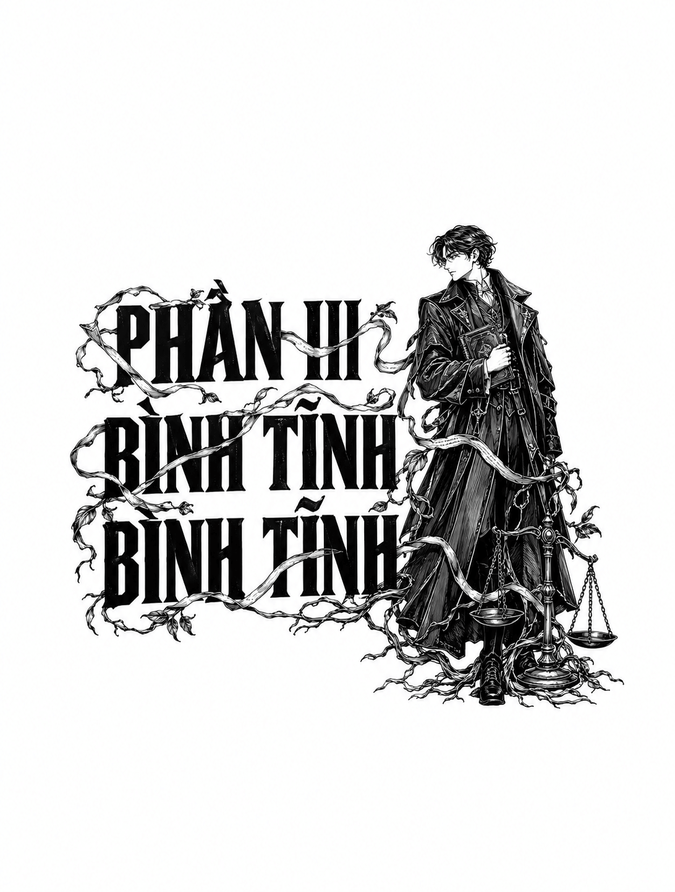

*PHẦN III: BÌNH TĨNH, BÌNH TĨNH*

# CHƯƠNG 15

Phải mất gần như cả đêm để khống chế đám cháy tại trang viên Burav. Tôi dốc hết sức mình cùng mọi người chuyền tay nhau từng xô nước lẫn bùn cặn múc từ con suối gần dinh thự chính. Khói bám dày trên vai, quấn chặt lấy cổ và làm chúng tôi ngột ngạt, nhưng xung quanh chỉ có những lời động viên khẽ khàng, tuyệt nhiên không một tiếng oán thán. Tay và lưng tôi đau nhức, mặt mũi đen nhẻm muội than, nhưng tất cả vẫn cật lực làm việc vì ngôi nhà vẫn còn âm ỉ cháy. Cuối cùng, công việc dập lửa cũng chuyển từ dập tắt sang khoanh vùng cô lập: tòa nhà coi như đã bị thiêu rụi hoàn toàn cùng mọi thứ bên trong, và giờ đây chúng tôi phải ngăn ngọn lửa lan rộng.

Vài người khẽ khàng trò chuyện trong lúc làm việc, chia sẻ những tin tức nhặt nhạnh được. Không ai biết đám cháy bắt đầu ra sao, cũng như ai đã thoát ra ngoài và ai đã bỏ mạng. Tuy nhiên, những người trong hàng chuyền nước cùng tôi đều đồng tình rằng ngọn lửa bùng lên từ bên trong ngôi nhà. Điều này khiến mọi người trao nhau những ánh nhìn u sầu và ngờ vực.

Bình minh len lỏi qua bầu trời mây khói cuồn cuộn. Tôi thoáng thấy Thủ lĩnh Seriv đang rảo bước cùng các lính chấp pháp của mình, gương mặt ông hốc hác hơn bao giờ hết. Là người thuộc lực lượng giữ gìn hòa bình của tổng, nhiệm vụ xử lý đám cháy đổ dồn lên vai ông. Việc ông rời khỏi tâm đám cháy cho thấy ông nhận định ngọn lửa đã nằm trong tầm kiểm soát.

Tôi rời hàng chuyền nước, tiến lại gần ông và hỏi thăm tình hình.

“Lửa sẽ không lan rộng nữa đâu, thưa ngài,” ông nói bằng giọng khàn đặc, rè rè. “Nhưng thiệt hại thì đã rồi. Ngôi nhà giờ đây chẳng khác nào một cái vỏ rỗng.”

“Có nhân chứng nào không?” Tôi hỏi. “Hay người sống sót?”

“Có một số người đã thoát ra ngoài, nhưng… chúng tôi vẫn chưa quản lý họ theo quy trình một vụ án, thưa ngài. Chưa rõ ai từ đâu tới hay họ đã nhìn thấy những gì.”

“Nếu ngài đồng ý, tôi sẽ thu xếp phân loại họ,” tôi nói.

Tôi tập hợp các lính chấp pháp của ông lại và ra lệnh, yêu cầu họ xác định vị trí của gia nhân và người nhà trong dinh thự. Các sĩ quan ghé sát lại gần tôi, bàn tay lấm lem tàn tro khum quanh tai để nghe rõ hơn giữa tiếng bàn tán xôn xao của đám đông. “Chúng ta phải lập danh sách thống kê xem ai đã được tìm thấy và ai chưa,” tôi nói với họ. “Những ai từng được nhìn thấy ở bên trong, và những ai chắc chắn đang ở bên ngoài. Nếu tìm thấy bất kỳ ai thoát ra từ ngôi nhà, chúng ta cần hỏi xem họ có thấy ngọn lửa bắt đầu bùng lên từ đâu không, và nếu có thì ở thời điểm nào, xung quanh đó có những ai. Tôi nói có rõ không?”

Các lính chấp pháp mẫn cán thực hiện nhiệm vụ, tỏa đi dò hỏi đám đông đang vây quanh đống đổ nát hoặc những người đang làm việc trong hàng chuyền nước. Dù mất một khoảng thời gian, một nhóm người sống sót nhem nhuốc muội than, vừa đi vừa khóc lóc, dần được tập hợp lại. Cảnh tượng đó khiến tôi không khỏi bận lòng, bởi hầu hết họ đều mặc gia phục người hầu. Tôi không thấy bất kỳ dấu hiệu nào của tầng lớp quý tộc: không bộ phận cấy ghép nâng cấp, không y phục sang trọng, hay dù chỉ một chiếc nhẫn ấn triện.

Khi chúng tôi thẩm vấn những người sống sót, một câu chuyện dần hé lộ, nhưng lại mơ hồ và hỗn loạn. Không một gia nhân nào nhìn thấy ngọn lửa bùng phát ra sao. Ý kiến về nơi phát hỏa cũng có nhiều bất đồng, dù nhiều người quả quyết rằng lửa phải bắt đầu từ tầng một hoặc tầng hai, bởi những người từ tầng ba trở lên chỉ nhận ra hỏa hoạn khi liếc qua cửa sổ và thấy ánh lửa bập bùng chiếu xuống thảm cỏ bên dưới. Nhưng các gia nhân đoan chắc với tôi rằng *tất cả* thành viên gia tộc Burav đều có mặt, vì đêm đó Burilis Burav cử hành nghi lễ tưởng niệm cho con gái mình.

“Và… và các viên chức của ngài đang tập hợp những người sống sót lại sao?” một gia nhân run rẩy hỏi tôi đầy ngập ngừng khi tôi tra hỏi gã.

“Chúng tôi đang cố gắng làm điều đó, đúng vậy,” tôi trả lời gã.

“Nhưng tôi không thấy ai trong gia tộc ở đây cả,” gã lầm bầm. “Không một ai! Có phải họ đều đã mất tích rồi không? Liệu có phải *tất cả* người nhà Burav thực sự đã bỏ mạng, chỉ trong một đêm duy nhất?”

Thời gian trôi đi, những giờ khắc bị che mờ bởi khói và tro tàn. Giọng nói của mọi người đều trở nên khàn đặc và đứt quãng, đôi mắt ai cũng đẫm lệ và đỏ ngầu. Mặt trời nhô lên, mang sắc đỏ thẫm kỳ dị đầy bất an. Khi vầng thái dương chật vật thoát khỏi đường chân trời mù mịt khói bụi, tôi cũng hoàn thành việc lập danh sách đầy đủ các thành viên đại gia đình Burav có mặt trong vụ hỏa hoạn, vừa vặn kịp lúc để gạch tên gần như tất cả bọn họ vào diện mất tích, được cho là đã chết.

Kyuli Burav, em gái Burilis: biến mất. Slakav Burav, em họ Burilis: biến mất. Orman Burav, cháu trai Burilis: biến mất. Orti Burav, vợ Orman: biến mất. Daqi Burav, cô của Burilis: biến mất. Dường như hầu hết gia tộc đã nghỉ lại trong dinh thự đêm đó, và không một ai được tìm thấy trong buổi sáng mù mịt khói này. Khi vị tro tàn tràn ngập trong cổ họng, tôi cố không tự hỏi liệu mảnh than vụn nào tôi vừa nuốt phải có từng là xương cốt của một người nhà Burav hay không.

Cuối cùng, Thủ lĩnh Seriv bước ra từ làn khói dày đặc, mang theo tin tốt đầu tiên tôi được nghe suốt cả đêm: “Chúng tôi đã tìm thấy một người, thưa ngài. Cuối cùng cũng có một người nhà Burav sống sót.”

“Một người trong số họ đã thoát ra được sao?” tôi hỏi. “Là ai?”

“Cậu trẻ Jalin, con trai Burilis. Cậu ta đã nhảy ra từ cửa sổ tầng hai. Kẻ tội nghiệp đó lao thẳng xuống thảm cỏ.”

Mắt tôi khẽ nheo lại khi nhớ về cậu thiếu niên đó: chừng mười tám tuổi, mảnh khảnh và đầy lo âu, luôn co rụt người mỗi khi cha cậu nổi lôi đình trên đường phố trước Quán trọ Mắt Mèo. Hàng ria mép của cậu hầu như chẳng khác nào vệt lông tơ mịn, và cổ tay có vẻ quá yếu ớt để nâng đỡ chiếc nhẫn ấn triện thô kệch, to bản đang đeo.

“Cậu ta thế nào rồi?” tôi hỏi.

“Không ổn lắm. Cơ thể cậu ta bị bỏng một nửa, gãy một chân và một xương đòn. Các y sĩ đã đưa cậu ta đi điều trị cùng những người sống sót khác. Họ đánh giá cơ hội sống sót của cậu ta khá cao. Tuy nhiên, họ sẽ phải cho cậu ta dùng thuốc mê để tiến hành cấy ghép các mảnh ghép sinh học chữa lành phù hợp. Những người còn lại của gia tộc Burav…” Thủ lĩnh Seriv lắc đầu. “Không một dấu vết. Tất cả gia nhân đều báo cáo rằng người nhà Burav đều ở trong dinh thự vào thời điểm hỏa hoạn xảy ra. Nhưng không một ai nhìn thấy dấu vết của họ sau khi ngọn lửa bùng lên. Như vậy là có khoảng mười bốn thành viên quý tộc mất tích, nếu tình huống tồi tệ nhất xảy ra. Chúng tôi không hề biết có bao nhiêu gia nhân đã thiệt mạng, bởi số lượng của họ đông hơn thế rất nhiều. Tôi e rằng chúng ta sẽ không thể biết được con số chính xác cho đến khi sàng lọc xong đống tro tàn đổ nát này…” Ông ấy ngoảnh lại nhìn đống đổ nát đen kịt. “Việc đó sẽ mất rất nhiều thời gian.”

Tôi cùng ông ấy quan sát ngôi nhà. Tôi chưa từng được chiêm ngưỡng trang viên của gia tộc Burav khi nó còn nguyên vẹn, nhưng từ những gì còn sót lại, nơi đây từng là một công trình vĩ đại và kiên cố, được dựng từ những sợi Dây leo Fretvine bện chặt đến mức phải tốn tới ba phát hỏa thương bánh xe mới hòng phá vỡ. Phần lớn khung cấu trúc tòa nhà vẫn đứng vững, thế nhưng các gian phòng bên trong, nếu không muốn nói là toàn bộ nội thất, đều đã bị thiêu rụi.

“Tôi sẽ không cho người của mình tiến vào trong,” Seriv nói. “Ít nhất là cho đến khi chúng tôi mời được một kỹ sư của Bộ Công binh tới xác nhận cấu trúc đã an toàn.”

“Vậy thì phải mất hàng ngày trời,” tôi nói, “trước khi chúng ta biết chính xác chuyện gì đã xảy ra.”

“Nhưng chẳng phải chúng ta đã biết rồi sao?” Seriv khàn giọng nói. “Tôi đã luôn lo sợ về một cuộc chiến giữa các gia tộc quý tộc. Thế mà giờ đây, chúng ta lại đứng ở đây, chứng kiến một gia tộc có lẽ đã bị xóa sổ hoàn toàn.” Ông ấy quay sang nhìn tôi, những nếp nhăn trên khuôn mặt hằn lên vệt muội than đen kịt bám đầy. “Và việc này lại xảy ra ngay sau khi con gái của họ bị sát hại. Không thể là trùng hợp được, thưa ngài, phải không?”

Tôi lặng im nhìn những làn khói cuộn ra từ các khung cửa sổ một hồi lâu. “Tôi muốn lập danh sách tất cả những gia nhân đang mất tích,” tôi khàn giọng nói.

“Ngài đang tìm kiếm điều gì sao, thưa ngài?”

“Nhân chứng. Chắc chắn phải có một đôi mắt sống sót nào đó đã nhìn thấy điều gì đó hữu ích.”

Phải mất thêm hai tiếng đồng hồ nữa, giả thuyết của tôi mới được chứng minh là đúng: một trong những cô hầu bếp được tìm thấy đang dưỡng sức trong chuồng ngựa. Cô ta ho sặc sụa, uống hết ngụm nước này đến ngụm nước khác dù phần lớn đều bị nôn ra ngay sau đó, có lẽ vì ngộ độc khói.

Mắt tôi khẽ nheo lại khi tôi và Seriv tiến đến gần. Tôi lục tìm trong ký ức những kinh nghiệm từng có với các y sĩ. “Bà cần bảo cô ấy dừng việc đó lại,” tôi nói với người phụ nữ lớn tuổi đang cúi người bên cạnh cô gái.

“Ch... cháu gái tôi đang bệnh, thưa ngài,” người phụ nữ phẫn nộ đáp. “Nó đang khát khô cả cổ. Tôi sẽ thật tàn nhẫn nếu không cho nó uống nước.”

“Cô ấy sẽ không thể giữ được nước trong dạ dày cho đến khi được điều trị sinh học,” tôi ôn tồn giải thích. “Tôi sẽ cho gọi y sĩ đến chăm sóc cô ấy ngay lập tức. Còn bây giờ, tôi nghe nói cô ấy bảo đã nhìn thấy điều gì đó vào đêm qua?”

Cô hầu bếp gật đầu, gương mặt nhợt nhạt như sữa mới vắt. “Vâng, thưa ngài. Có… có một gã đàn ông ở đây đêm qua. Hắn đứng bên ngoài, lảng vảng quanh phía bắc dinh thự. Tôi đã nhìn thấy hắn, thưa ngài.”

Tôi cúi người xuống cho tầm mắt ngang bằng với cô ta. “Vào lúc nào?”

“Tôi không biết, thưa ngài. Tôi chỉ biết chuyện đó xảy ra trước khi nghi lễ tưởng niệm tiểu thư Zansay diễn ra. Nhưng tôi thấy hắn lén lút trên bãi cỏ. Hắn nép sát vào bờ dậu cây cảnh như thể đang lẩn trốn. Chuyện đó…” Cô ta ho lên một tràng dữ dội. “…kỳ lạ lắm.”

“Cô có nhìn rõ diện mạo của hắn không?”

“Có, thưa ngài. Chính điều đó mới khiến tôi thấy thật kỳ lạ. Vì ban đầu hắn di chuyển rón rén như một kẻ trộm đang mò vào, nhưng khi tiến lại gần dinh thự, hắn đột nhiên sải bước đi thẳng về phía cửa dành cho gia nhân. Rồi hắn dừng lại, đăm đăm nhìn vào các ô cửa sổ và cánh cửa, như thể đang đợi ai đó, hoặc… không chắc liệu mình có muốn đi tiếp hay không. Hắn đứng trơ ra dưới ánh đèn một lúc khá lâu.” Cô gái nuốt nước bọt. “Đó là một người đàn ông Lãnh hạt Tala. Trẻ, vạm vỡ, có râu, ăn mặc như kẻ lùa gia súc hay thợ làm đồng. Tôi không nhớ được gì thêm nữa, thưa ngài. Tôi xin lỗi.”

“Những gì cô cung cấp đã quá đủ rồi. Hắn làm gì sau khi đứng ở đó?”

“Hắn chậm rãi bước về phía cửa gia nhân. Nhưng… tôi không hề nghe thấy tiếng mở cửa, thưa ngài. Hắn đi theo con đường dành cho người làm, mà cổng gia nhân thì được phong tỏa bằng cổng dây leo, phải có đúng chìa khóa dược chất mới vào được. Thế nên tôi mới nghĩ có lẽ hắn là bạn của gia nhân nào đó, được cho chìa khóa để đến viếng tiểu thư Zansay. Nhưng hắn không hề gõ cửa hay bước vào trong, hoặc nếu có thì tôi cũng không nghe thấy. Sau đó tôi thấy hắn chạy xộc trở lại theo con đường đó, và ngay sau đấy tôi nghe thấy tiếng tri hô có cháy.”

“Hắn đã đi về phía lối đi dành cho gia nhân? Quay trở lại phía cổng?”

“Vâng, thưa ngài. Rồi khói bắt đầu tràn vào cuồn cuộn… tôi ngất đi. Ai đó đã xông vào phá cửa, tôi nghĩ là một người chăn ngựa. Họ bế tôi lên, và… điều tiếp theo tôi biết là mình đang nằm trên thảm cỏ bên ngoài, ho sặc sụa. Đó là tất cả những gì tôi biết, thưa ngài.”

Tôi cảm ơn lời khai của cô gái rồi sải bước ra xa vài bước cùng Seriv. Tôi nói: “Hãy gọi y sĩ đến chăm sóc cho cô ấy. Sau đó, tôi cần người của ông lục soát lối đi dành cho gia nhân xem có vết tích qua lại nào không.”

Ông ấy thở dài. “Tôi e là chúng ta có một cuộc tìm kiếm trên diện rộng phía trước đấy, thưa ngài. Đối tượng chúng ta cần truy tìm là một người đàn ông Tala, dáng vẻ như thợ làm đồng, lảng vảng quanh đây trước thời điểm giữa đêm.” Ông ấy liếc nhìn tôi. “Mọi hạng người đều có thể làm việc cho các đại gia tộc, nhưng… tôi phải nói rằng một thợ làm đồng người Tala thì có khả năng cao là hầu hạ cho gia tộc Armenta hơn, thưa ngài.”

“Chúng ta chưa có bằng chứng để nghi ngờ gia tộc Armenta, Seriv. Ông biết điều đó mà.”

“Tôi biết chứ, thưa ngài. Nhưng dân thường thì đâu cần bằng chứng. Một câu chuyện thêu dệt là quá đủ rồi.”

Tôi thở dài, cảm ơn ông ấy rồi vội vã rời đi tìm Ana khi mặt trời bắt đầu nhô lên trên bầu trời.

Tôi tìm thấy bà đang ngồi trên lối đi chính trong khu vườn thuộc trang viên Burav, lưng khom xuống, tựa mình giữa vô số đóa hoa đang độ tỏa hương khoe sắc. Khi tôi lại gần, bà cất tiếng gọi: “Dáng đi của cậu có vẻ mệt mỏi đấy, Din!”

“Ở khoảng cách này mà bà cũng nhận ra tiếng bước chân của tôi sao, thưa Trưởng quan?”

“Cách xa một phần tư dặm ta cũng nhận ra đấy, nhóc. Lại đây báo cáo đi.”

Tôi đứng trước mặt bà, hít một hơi rồi bắt đầu báo cáo, thuật lại toàn bộ những gì tôi đã chứng kiến và tất cả những điều Seriv đã nói với tôi. Khi tôi dứt lời, bà vươn tay ra, nhẹ nhàng nắm lấy cọng của một bông hoa gần đó, ký ức Khắc Ký khẽ nhắc nhở tôi rằng đó là hoa *diamdouni*, và những ngón tay trắng bệch của bà mần mò bò ngược lên cho đến khi chạm tới nhụy hoa. Ngón trỏ của bà cẩn trọng thăm dò từng cánh hoa, tựa như con ong đang mải miết tìm kiếm mật ngọt.

“Một buổi sáng ảm đạm,” Ana lên tiếng. “Nhưng ta nhận thấy, dinh thự vẫn chưa sụp đổ hoàn toàn đúng không?”

“Đúng vậy. Nó vẫn đứng vững.”

“Hừm. Sợi dây leo của nó bền chắc chứ? Cậu có thấy vết xơ tước nào không?”

“Góc này thì không, thưa bà.”

“Ta nghi đó là dây leo Covoli. Nổi tiếng chịu nhiệt kháng lửa.”

“Burilis Burav, vốn từng là thành viên Bộ Sinh dược lại vừa là sĩ quan Viện Orbiis với hiểu biết sâu rộng về môi trường, nhiều khả năng đã chọn nó làm vật liệu kiến tạo an toàn nhất cho gia tộc mình. Vậy nên… cậu cứ thong thả mà đưa ra suy luận.”

Tôi ảm đạm gật đầu. “Vụ cháy không phải do tai nạn.”

“Ồ, chắc chắn là không rồi. Dây leo Covoli chẳng đời nào để ngọn lửa bùng phát nhanh đến mức khiến cả gia đình không kịp trở tay! Phải có tác nhân hóa chất can thiệp, một… một hợp chất nào đó. Thứ gì đó tương tự như dầu Phalm, dù nếu là dầu Phalm thì ngay cả ngôi nhà này cũng chẳng còn, bởi thứ ấy thừa sức thiêu rụi cả xác Thủy Quái Leviathan thành tro bụi.”

“Liệu chúng ta có khả năng truy vết hóa chất đó không, thưa bà? Xem ai quanh đây đã mua hoặc đánh trộm nó?”

“Ta e là khó,” bà khinh khỉnh đáp. “Suy nghĩ chút đi, nhóc! Hầu hết đất đai của lãnh hạt này được khai phá bằng cách nào?”

“À,” tôi chợt ngộ ra. “Họ đã đốt dọn khu rừng cổ…”

“Chính xác! Đã nhiều năm họ không còn đốt phá quy mô lớn như trước, nhưng ta chẳng ngạc nhiên chút nào nếu tìm thấy cả chục thùng hóa chất độc hại nằm xó xỉnh bụi bặm trong cái lán tiều tụy nào đó quanh đây. Rồi giờ đây chúng ta lại có thêm một gã người Tala lén lút lẻn vào khu đồn điền! Sự việc đó sẽ thổi bùng lên ngọn lửa thị phi có khi còn nguy hiểm chẳng kém ngọn lửa đã thiêu rụi căn nhà kia. Nhưng cô phụ bếp của cậu *chưa hề* nói rằng kẻ lén lút người Tala đó không kẹp vài thùng hóa chất dưới nách như gã cửu vạn ở quán rượu, đúng không?”

“Cô ấy không nói vậy, thưa bà. Đúng hơn là cô ấy bảo gã trông vô cùng hoảng hốt bồn chồn khi tiến lại gần.”

Ana rủa thầm một tiếng rồi chìm vào im lặng suy tư.

Tôi dõi mắt nhìn về phía bộ khung xám xịt, cháy đen của dinh thự gia tộc Burav. Xa xa có tiếng ai đó đang khóc nức nở, gào xé tên một người. Dựa vào nhịp điệu dồn dập và sự tuyệt vọng trong tiếng gọi, người kia vẫn chưa được tìm thấy.

“Tôi e rằng,” tôi lên tiếng, “bây giờ chúng ta đã có thể loại trừ khả năng Burilis Burav là hung thủ.”

“Thế sao?” bà gạt đi. “Ta thì chẳng dám ngạo mạn suy đoán bất kỳ điều gì đâu, Din! Hãy luôn cẩn trọng trước tàn tích của một vụ cháy, *đặc biệt* là trong một cuộc điều tra án.” Bà giơ một ngón tay lên. “Đang có người hỏi tìm cậu đấy. Ta nghe thấy tiếng rồi, họ sẽ tới đây ngay thôi. Nhưng trước khi cậu đi, ta muốn xem xét lại một chi tiết mà ta đã lỡ bỏ qua tối qua: những đốm sáng cậu bảo đã nhìn thấy trong rừng. Chúng ta chưa có cơ hội bàn kỹ về nó.”

“Vâng, thưa bà?”

“Cậu đã nhìn thấy chúng ở đâu? Nói cho ta *chính xác* vị trí! Mặc dù độ cao địa hình của vùng đất này tương đối đồng đều, nhưng nó không hoàn toàn phẳng lỳ.”

Tôi làm theo lời bà, miêu tả chính xác vị trí mà tôi đã bắt gặp những quầng sáng nhấp nháy ấy.

Vẻ mặt bà đanh lại nghiêm trọng. “Cậu có thể diễn tả lại cách chúng đã chớp nháy không?”

“Bà cho rằng đó không phải thứ ánh sáng ma quái,” tôi nói, “mà là một mật mã? Một tín hiệu?”

“Đúng vậy! Rõ ràng là thế! Ít nhất đó là điều ta *nghi vấn*.”

“Nhưng nguồn sáng đó phát ra từ sâu trong lòng khu rừng. Làm sao có ai tiếp cận được nơi thâm sơn cùng cốc đó chứ, thưa bà?”

“À, ta làm sao mà biết được hả nhóc!” bà bực dọc nói. “Chỉ cần cho ta biết nó đã nhấp nháy thế nào thôi!”

Tôi hít một hơi thật sâu rồi khơi gợi lại ký ức, mô tả chi tiết độ dài của từng nhịp nháy sáng, và cách nó chập chờn run rẩy ngay sau đó. Khi tôi nhìn lại Ana, gương mặt bà đã nhăn lại trong suy tư.

“Cảm ơn cậu,” bà khẽ rầm rì đầy thỏa mãn. “Điều đó cho ta rất nhiều thứ để suy ngẫm đấy.”

“Đó là mật mã sao, thưa Trưởng quan? Nó có nghĩa là gì?”

“Thoạt nhìn thì chỉ là một mớ hỗn độn vô nghĩa. Nhưng… đó là một sự vô nghĩa đầy chủ ý. Cậu phải cho ta thêm thời gian để nghiên cứu nó. Còn về ngôi nhà và đống tro tàn kia… ta lại chẳng mấy lạc quan! Hãy tưởng tượng xem, tất cả những bí mật đều đã hóa thành than vụn, rồi thành bụi đất. Điều đó làm ta đau lòng quá. Lẽ ra có biết bao điều để đọc vị ở đó! Thế nhưng, ngay cả lúc này, một bức tranh toàn cảnh vẫn đang dần hiện ra.” Bà liếm một ngón tay, quệt đầu ngón lên vệt muội than bám trên trán mình rồi đưa lên miệng nếm thử. “Seriv nói đúng. Chuyện này có cảm giác đã được sắp đặt.”

Có tiếng bước chân dồn dập trên sỏi đá, một lính chấp pháp trẻ tuổi vội vã chạy dọc theo lối mòn về phía chúng tôi. “Hiệu úy Kol? Tôi có tin nhắn từ Thủ lĩnh gửi cho ngài. Chúng tôi đã tìm thấy một nhân chứng.”

“Nhân chứng cho việc gì?”

“Cho việc ngọn lửa đã sát hại gia tộc Burav thế nào, thưa ngài.”

Người đàn ông ngồi co rúm giữa làn khói và sương mù, hai tay ôm chặt tách trà *clar*, toàn thân run rẩy bần bật. Chòm râu của gã bị lửa sém nham nhở từng mảng, khuôn mặt và đôi bàn tay cũng bị bỏng nặng, nhưng các y sĩ đã kịp thời bôi thuốc mỡ và đắp các mảnh ghép sinh học để chữa trị. Khi gã uống trà, tôi nhận thấy đồng tử gã giãn rộng. Tôi đoán họ đã cho gã dùng thuốc an thần, có lẽ là *katapra*. Tôi chỉ có thể khai thác thông tin từ gã trong khoảng một giờ đồng hồ trước khi thuốc phát huy tác dụng hoàn toàn.

Gã tự giới thiệu tên mình là Kiva Kozder, từng là người hầu cận của Orman Burav, cháu trai Burilis. Tôi lập tức chú ý đến việc gã dùng thì quá khứ khi nhắc đến chủ nhân của mình.

“Tôi đã hầu hạ chủ nhân suốt mười một năm,” gã tiếp tục bằng giọng khàn đục. “Và tôi… tôi cầu nguyện ngài ấy sẽ tìm thấy ánh mặt trời và những cánh hoa nở rộ trên đồng cỏ ở thế giới bên kia.”

“Vậy ra ông ta đã chết?” Tôi hỏi. “Anh chắc chắn chứ?”

Kozder nhắm nghiền mắt lại và gật đầu.

Tôi hít một hơi thật sâu từ chiếc lọ tinh dầu khai tâm của mình. Hương hoa tử đinh hương tỏa ra thật yếu ớt; tôi tự nhủ có lẽ mũi mình đã bị khói làm cho tê liệt bớt. “Anh có thể kể cho tôi nghe chuyện gì đã xảy ra không?”

“Tôi chỉ nhìn thấy một phần thôi,” gã khẽ nói. “Chỉ một phần thôi. Nhưng…” Gã nhấp một ngụm trà. Ngay lập tức, đôi bàn tay gã bớt run rẩy hơn. “Trưởng tộc Burilis triệu tập toàn thể gia tộc có mặt để thực hiện các nghi thức tưởng niệm cho con gái mình, cô gái Zansay tội nghiệp. Ông ấy hy vọng thi thể của cô sẽ sớm được bàn giao, và phong tục của chúng tôi là phải nhanh chóng đưa cô vào lăng mộ. Họ định tôn vinh cô bằng rượu vang và ánh đuốc, theo… theo đúng nghi thức của điện thần Bero. Ngài có biết về nghi thức này không, thưa ngài?”

Tôi gật đầu, cố gắng kìm nén sự sốt ruột. Điện thần Bero rất được sùng bái trong cộng đồng người Kurmini. Tôi hoàn toàn không ngạc nhiên khi biết nhà Burav không thờ phụng rừng Daljen như nhà Armenta.

“Toàn bộ gia tộc đều có mặt,” Kozder nói. “Họ đều đã đến.”

“Tổng cộng có bao nhiêu người?”

“Có mười ba người hiện diện, thưa ngài.”

Tôi cau mày. “Chúng tôi được báo là có mười bốn người thuộc gia tộc Burav đều có mặt tại dinh thự. Có ai vắng mặt không?”

“Chà… đ... đúng vậy. Đúng thế. Jalin không có ở đó. Hoặc ít nhất là lúc đầu thì không.”

“Chuyện đó có bất thường không?”

“Kh... không. Cậu ấy đau đớn khôn nguôi trước sự ra đi của em gái mình. Hơn nữa, Jalin… vốn không hòa thuận với những người còn lại trong gia đình.”

Tôi nhướng mày nhìn gã.

“Nhưng không đến mức muốn sát hại tất cả bọn họ!” Gã thốt lên, vẻ mặt bàng hoàng. “Cậu ấy phải quằn quại dưới áp lực của đứa con trai duy nhất trong nhà. Cậu ấy lại chán ghét việc buôn bán gia súc, và nhiều người cho rằng cậu ấy quá yếu đuối để gánh vác việc đó. Nhưng cậu ấy có ở đó, thưa ngài, ngay trong dinh thự, chỉ là cậu ấy đến sau. Cậu ấy không thể nào là kẻ sát nhân được.”

“Những nghi lễ đó được tổ chức ở đâu?”

“Tại đại sảnh yến tiệc ở tầng hai. Nơi đó từng là ngôi điện đáng tự hào nhất,” gã nói. “Vào những đêm quang mây, tầm nhìn từ đó đẹp không đâu bằng. Người ta bảo rằng… tổ chức ở đó là phải đạo và thỏa đáng, bởi Zansay hẳn sẽ rất yêu thích khung cảnh ấy. Bọn họ bắt đầu các nghi lễ cầu hồn cho cô ấy khi đêm đã về khuya. Bọn họ xướng danh cầu xin ban phúc từ Okovpir, vị thần của những cây cầu và những con đường, để dẫn lối cho cô ấy sang bên kia thế giới. Sau đó… là Guldeniv, vị thần của đồng cỏ và những đóa hoa. Và rồi đáng lẽ… đáng lẽ bọn họ phải kết thúc bằng việc cầu nguyện thần Kyun, vị thần thái dương. Nhưng…”

“Nhưng sao?”

“Nhưng rồi tất cả bọn họ đều bất động, thưa ngài,” gã thì thào.

“Ai cơ?”

“Tất cả bọn họ. *Toàn bộ* bọn họ. Người nhà Burav, từ dòng chính đến dòng thứ. Cho tới đám gia nhân, từ người hầu phòng, thị đồng cho đến quản gia. Tất cả bọn họ… đều dừng khựng lại.” Cậu ta nuốt nước bọt đánh ừng ực. “Những kẻ đang cầm hũ rượu, ly bạc hay đĩa thức ăn đều buông tay để chúng rơi thẳng xuống sàn. Những kẻ đang ngồi thì bật dậy. Một vài người đang ở các phòng khác cũng bước vào căn sảnh đó rồi đứng khựng lại. Bọn họ đứng đó, mỗi người nhìn về một hướng khác nhau. Rồi bọn họ chẳng làm gì nữa cả. Tôi cảm tưởng như mình sắp phát điên. Tôi lên tiếng gọi bọn họ, chạm vào bọn họ, lay mạnh bọn họ. Tôi hỏi rốt cuộc có chuyện gì đang xảy ra, liệu bọn họ có sao không. Ngay cả cô bạn tôi, cô hầu gái Qurban, cô ấy cũng không nhúc nhích, không trả lời. Cô ấy chỉ trừng trừng nhìn thẳng về phía trước, hơi thở nhẹ tới mức gần như không tồn tại. Mọi thứ cứ như thể tôi hoàn toàn không xuất hiện ở đó. Rồi… rồi tôi ngửi thấy mùi khói,” Kozder thì thầm. “Khói bốc lên ngùn ngụt, xộc lên từ phía cầu thang.”

“Vậy là đám cháy bắt nguồn từ *phía dưới* chỗ các người?”

“Tôi… tôi đoán là vậy,” cậu ta thì thào. “Sức nóng khủng khiếp ập đến, và… tôi thấy những lưỡi lửa liếm qua bậc cầu thang, rồi tôi bắt đầu gào lên. Tôi lôi kéo người nhà Burav, cố gắng kéo bọn họ chạy đi, nhưng bọn họ không hề dịch chuyển. Nhưng…” Cậu ta lại nuốt ực một cái. “…khi tôi tiến lại gần, tôi… tôi mới nhận ra chính bọn họ cũng đang gào khóc.”

“*Người nhà Burav* cũng gào khóc ư? Ý cậu là sao?”

“Âm thanh đó rất khẽ, thưa ngài. Như một lời thì thầm. Giống như bọn họ đang gào thét trong giấc ngủ. Nhưng tôi có thể nghe thấy nó phát ra từ cơ thể bọn họ, một thứ âm thanh… thứ âm thanh khe khẽ, kinh hãi tột cùng. Thật kinh hoàng. Giống như những đứa trẻ đang khóc thét trong cơn mộng mị!”

Tôi nhăn mặt khi cậu ta nhắc đến giấc mơ. “Rồi sau đó chuyện gì xảy ra?”

“Rồi… cậu chủ Jalin lao vào.”

“Lao vào từ đâu? Hãy nói chính xác cho tôi biết, làm ơn.”

“Tôi không chắc lắm, nhưng… tôi tin là từ gian phía bắc. Đó là nơi đặt phòng ngủ cũ của cậu ấy, và cũng là phòng của Zansay. Cậu ấy nghe thấy tiếng tôi gào khóc nên chạy vào và nhìn thấy tôi. Rồi cậu ấy ngơ ngác nhìn quanh, bàng hoàng. Cậu ấy nhìn thấy khói. Cậu ấy sặc khói và bảo tôi mau chạy đi. Tôi đáp mình sẽ không bỏ lại họ, không bỏ lại gia đình cậu ấy, nhưng cậu ấy bảo sẽ ở lại cố cứu họ. Cậu ấy đẩy tôi qua những dãy hành lang mà cậu ấy vừa chạy tới, và… lần cuối cùng tôi nhìn thấy, cậu ấy đang cố lôi cha mình ra ngoài. Rồi khói độc và ngọn lửa bùng lên. Tôi lảo đảo tháo chạy xuống tầng trệt, ra đến tận ngoài trời. Lúc đó tôi bất tỉnh vì đã hít phải quá nhiều khí độc.”

“Anh không thấy Jalin Burav thoát ra ngoài sao?”

“Tôi không thấy, thưa ngài. Tôi cứ tưởng cậu ấy đã chết trong đám cháy. Nhưng cậu ấy đã cứu mạng tôi, điều đó tôi chắc chắn. Tôi… tôi hy vọng thiếu gia sẽ sớm bình phục. Tôi sẽ cảm ơn cậu ấy ngay khi có thể.”

“Bây giờ tôi sẽ hỏi anh một chuyện rất kỳ quặc,” tôi nói. “Anh có nghe thấy tiếng nhạc nào không? Hay có thấy ai thổi sáo, hoặc tạo ra bất kỳ âm thanh kỳ lạ nào không?”

Gã nhìn chằm chằm vào tôi. “Tôi… k... không? Tôi không nghĩ là mình có…”

“Cảm ơn anh. Anh làm việc ở dinh thự này lâu chưa?”

“Tôi đã nói rồi mà,” gã đáp, giọng thoáng chút bất bình, “rằng tôi đã hầu hạ Orman Burav suốt mười một năm qua! Nhưng… tôi có xin nghỉ phép phần lớn thời gian trong tháng trước.”

“Vậy sao? Vì lý do gì?”

“Mẹ tôi bị bệnh. Chủ nhân đã cho phép tôi ở nhà chăm sóc bà cho đến khi bà bình phục.”

“Anh rời đi và quay trở lại dinh thự vào thời gian nào?”

Gã đưa cho tôi những mốc ngày cụ thể, và tôi cẩn thận ghi chép lại. “Có gia nhân nào khác trong đại tiệc xin nghỉ không? Hay rời khỏi dinh thự giống như anh không?”

“Tôi không biết. Chắc là không đâu. Chúng tôi đều là những gia nhân tận tụy. Sao ngài lại hỏi điều này, thưa ngài?”

Tôi phớt lờ câu hỏi của gã và tiếp tục gặng hỏi, liệu gã có thấy kẻ nào đột nhập, có phát hiện ánh đèn lạ trong rừng, hay nhận ra bất kỳ biểu hiện bất thường nào ở người nhà Burav hoặc đám gia nhân hay không. Hoang mang, gã đều lắc đầu trước tất cả những điều đó, cho đến khi tôi đề cập đến giấc ngủ của họ.

“Thật lạ khi nghe ngài hỏi điều này,” gã nói. “Vì… đúng vậy, tôi có nhớ mang máng một việc như thế. Bản thân Lão gia Burilis từng nhắc rằng ông ấy dạo này không ngủ trọn giấc. Cả cô của ông ấy, bà Daqi, cũng vậy. Và… cả cô Qurban bạn tôi nữa.”

“Họ có nói lý do tại sao không?” tôi dồn hỏi. “Phải chăng họ đã *nằm mơ*?”

“Phải! Đúng vậy, họ đã… Họ nói rằng mình gặp phải những cơn ác mộng tồi tệ nhất. Mơ thấy mình bị mắc kẹt ngay trong dinh thự này. Không thể cử động, không thể rời đi. Tại sao? Sao ngài lại biết chuyện này?”

“Khi nào?” tôi dồn hỏi sắc lạnh. “Họ than phiền về việc này từ khi nào?”

“Thì… ngay sau khi tôi trở về. Như thể một bóng đen đã bao trùm lên toàn bộ dinh thự kể từ lúc tôi vắng mặt.”

“Còn anh có nằm mơ thấy gì không?”

“Không, thưa ngài. Tôi lại phải hỏi, tại sao chứ? Điều này rốt cuộc có ý nghĩa gì?”

Tôi cảm ơn gã rồi giao gã cho các y sĩ. Rồi tôi đứng yên tại chỗ, đăm đăm nhìn dinh thự xám xịt như tro tàn vẫn dâng tràn hơi nóng cùng khói mù, không khí xung quanh chao đảo những vệt tro đen lơ lửng.

*Những giấc mơ, và những tiếng gào xé câm lặng.*

Tôi hít một hơi sâu, vẫy tay ra hiệu cho Thủ lĩnh Seriv rồi kéo ông ấy sang một bên.

“Cử ngay một kỵ sĩ hỏa tốc đến cơ sở Viện Orbiis tại Lacanthim,” tôi thở dài. “Tìm Chỉ huy Tauri. Lúc này có lẽ ông ta đã hoàn tất việc khám nghiệm tử thi Zansay Burav rồi. Tôi cần đưa ông ta đến đây ngay lập tức.”

Seriv nhắm nghiền mắt lại. “Rõ rồi. Vậy ra đúng là do mạng dẫn đường đó.”

“Không thể bàn cãi,” tôi đáp. “Có kẻ đã lây nhiễm và thao túng tâm trí toàn bộ một dinh thự, bao gồm cả gia nhân lẫn dàn người làm. Câu hỏi đặt ra lúc này là: bằng cách nào, và còn những ai khác nữa?”
