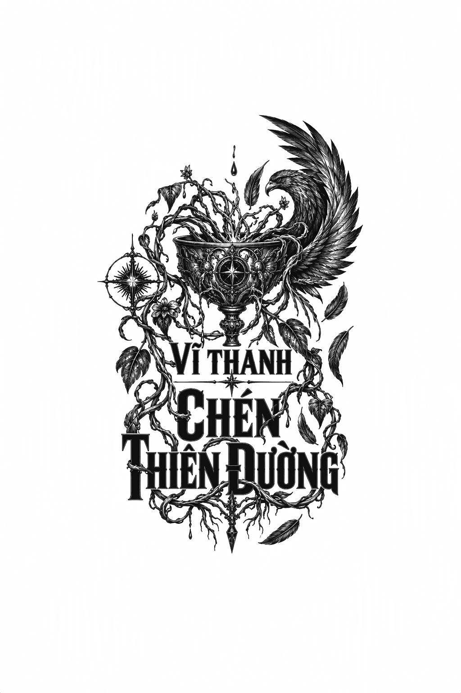

*VĨ THANH: CHÉN THIÊN ĐƯỜNG*

# CHƯƠNG 34

Tôi và Tauri ngồi im lặng trong bầu không khí ảm đạm khi cỗ xe ngựa rầm rầm lăn bánh về phía bắc, băng qua những đồng cỏ của vùng Lacanthim. Điều này cũng dễ hiểu, bởi bầu không khí u uất và tĩnh mịch đã bao trùm toàn bộ lãnh địa suốt những ngày qua, kể từ khi Trikao bị lột mặt nạ. Từ những người lùa gia súc lão luyện nhất cho đến những cô tớ gái dọn dẹp máng mổ ở xưởng lột da, bất kỳ ai làm việc trong ngành chăn nuôi lúc này cũng đều cảm thấy bất an sâu sắc về tương lai phía trước. Chỉ trong vòng một tuần, cả hai đại gia tộc thống trị ngành chăn nuôi đều đã sụp đổ, đẩy tất cả vào cảnh hỗn loạn không lối thoát. Ngay cả Ana dường như cũng bị ảnh hưởng. Dù bình thường bà luôn tỏ ra hoàn toàn thờ ơ trước nỗi đau của kẻ khác, nhưng khi chúng tôi tiến về phía khu rừng, một luồng khí u uẩn dường như đã xâm chiếm lấy bà, khiến bà ngồi im phăng phắc, không hề gật gù hay đung đưa như mọi khi.

Thế nhưng, suốt những ngày qua, tôi đã tìm thấy một ốc đảo bình yên bên Tauri. Luật lệ nghiêm cấm việc các quan chức trong cùng một bộ ngành tư thông với nhau, nhưng những mối tơ duyên giữa các bộ ngành khác nhau lại thường được ngầm nhắm mắt làm ngơ. Trong khi tất cả chúng tôi quay cuồng dọn dẹp đống đổ nát khổng lồ do Jalin Burav và Trikao Armenta để lại: từ việc tẩy rửa mạng dẫn đường khỏi các giếng nước, cho đến việc áp dụng các liệu pháp chữa trị của Bộ Sinh dược lên những người bị nhiễm bệnh, dù chúng có ghê rợn và tàn nhẫn đến đâu; tôi vẫn tìm thấy sự an ủi trong vài khoảnh khắc ngắn ngủi bên người ấy. Tôi nhâm nhi những tách trà pha dược liệu kỳ lạ của người ấy ngay trong phòng ngủ, mỉm cười bâng quơ và lắng nghe những câu chuyện tán gẫu của người ấy, trong khi thế giới Lacanthim vẫn cuộn trôi bên ngoài cửa sổ, và hộp sọ tôi dần sạch bóng những mầm nấm độc.

Dù vậy, một tiếng nói vẫn vang lên từ sâu thẳm trong tôi, không phải từ ký ức, mà chỉ là trải nghiệm tích tụ, thầm thì: *Những điều này chẳng bao giờ tồn tại vĩnh viễn.* Và tôi đã đáp lại: *Chẳng có gì là vĩnh cửu cả.*

Chúng tôi trao nhau một nụ cười nhẹ khi cỗ xe tiếp tục lăn bánh, nhưng rồi nụ cười ấy cũng mau chóng vụt tắt trước nhiệm vụ đang chờ đợi phía trước.

Tauri hắng giọng: “Vậy thì, thưa Học sĩ Dolabra, chúng ta đang hướng về đâu đây? Ý tôi là ngoài khu rừng ra.”

“Ưm?” Ana ơ hờ đáp. “À, phải rồi. Chà! Hãy nhớ lại xem, khi ông lần đầu truy lùng Jalin Burav qua khu rừng bị biến dạng, ông đã tìm thấy cậu ta bên một đài phun nước cũ kỹ, đổ nát trong tàn tích Daljen, một đài phun nước đã cạn khô suốt nhiều thế kỷ.”

“Đúng vậy. Tôi đã kiểm tra rất kỹ nhưng không tìm thấy chút hơi ẩm nào, cũng như không thấy dấu vết của mạng dẫn đường.”

“Dĩ nhiên rồi. Nhưng hãy nhớ lại rằng ông cũng đã tìm thấy cuốc, xẻng và những công cụ tương tự trong phòng thí nghiệm thô sơ của Burilis Burav! Tôi tin rằng ông ta đã *đào* xuống để tìm kiếm mạng dẫn đường.”

“Tôi cũng từng đoán vậy. Nhưng chúng tôi không thấy bất kỳ dấu vết khai quật nào xung quanh đó cả.” Ông nheo mắt. “Bà nghĩ mình biết ông ta đã đào ở đâu sao?”

“Tôi biết chứ. Tôi tin rằng nếu ông quay lại đài phun nước, rồi đi *thẳng* về hướng bắc - đông bắc, ông sẽ tìm thấy địa điểm đó.”

“Sao bà lại chắc chắn đến thế?” Tauri hỏi.

“Đoán thôi, thưa Chỉ huy,” Ana đáp. “Nhưng là một sự suy đoán dựa trên cơ sở tri thức vững chắc. Và tôi tin nó sẽ dẫn chúng ta tới vô số sự thật.”

Tauri nhíu mày, nhưng có vẻ chấp nhận câu trả lời đó.

“Bà sẽ làm gì trong lúc chúng tôi đi tìm những sự thật đó, thưa Trưởng quan?” Tôi hỏi. “Bà sẽ chỉ ngồi chờ trong xe ngựa sao?”

“Chà, ta chắc chắn không có ý định tham gia chuyến thám hiểm cùng các cậu đâu, các chàng trai. Thay vào đó, ta hy vọng các cậu có thể thả ta xuống đền thờ Đại sư Gaddar. Nơi đó hơi chệch khỏi lộ trình một chút, nhưng ta có thể đợi các cậu ở đó để suy ngẫm về tất cả những gì đã xảy ra tại nơi này.”

Tauri dường như phải chật vật kìm nén sự bực bội trước những thói kỳ quặc của Ana, nhưng rồi ông thở dài và mỉm cười với tôi: *“Tôi không hẳn là người có quyền phán xét khi nói đến những sự lập dị. Vậy nên tôi sẽ chịu đựng bà ấy. Và cả cậu nữa, tôi đoán thế.”*

Tôi mỉm cười đáp lại. Dù tôi, cũng giống như những người lùa gia súc ở vùng này, không biết tương lai rồi sẽ ra sao, tôi vẫn tìm thấy niềm an ủi khi biết những niềm vui nào đang chờ đón mình trong vài ngày tới.

Sự mãn nguyện trong tôi chợt tắt lịm khi chúng tôi rẽ vào lối mòn dẫn đến đền thờ Đại sư Gaddar. Giờ đây, hiếm có người hành hương nào còn bước đi trên những bậc thềm rợp bóng âm u ấy. Có lẽ sự đồng lõa và sụp đổ của gia tộc Armenta, những người sùng đạo nhất trong số những hộ vệ rừng Daljen, đã dập tắt đức tin của những người khác. Nhìn bóng dáng Ana bước vào khu rừng biến dạng, lối đi phía trước trống trải hun hút, những tán cây run rẩy trong gió, một luồng khí lạnh lẽo đến gai người chạy dọc sống lưng tôi.

“Ngài có chắc là không muốn tôi đi cùng không, thưa Trưởng quan?” Tôi hỏi, kéo chiếc mặt nạ của Viện Orbiis lên che mặt. “Tôi có thể đỡ ngài đến một chỗ ngồi.”

“Ta vẫn có thể đi lại khá tốt nhờ lắng nghe,” bà nói, khẽ xua tay với tôi. “Nếu không, ta đã chẳng thể cắm cây thương đó vào lưng Trikao! Ta cũng có thể chịu đựng được bầu không khí nơi đây. Nó không xúc phạm đến linh hồn ta như đối với nhiều người khác. Đi đi, và hãy báo cáo lại cho ta mọi điều cậu tìm thấy, nhóc ạ.”

Lúc này, nét mặt bà thoáng cứng lại. Đó là một nỗi u sầu cẩn trọng và dè dặt, tựa như một người đang chờ đợi lời chẩn đoán bi quan từ y sĩ về bệnh tình của người thân yêu.

“Ngài biết rõ có gì trong những cánh rừng đó, thưa Trưởng quan,” tôi nói.

“Ồ? Ta biết sao?”

“Phải. Vậy tại sao ngài không nói thẳng cho tôi biết?”

“Bởi vì cậu ta cần phải tận mắt chứng kiến,” bà nói. “Và cậu cũng thế.” Bà bắt đầu rảo bước xuống lối mòn, vẫy tay ra hiệu xung quanh. “Nhưng ta sẽ nói cho cậu biết, đó là một ngôi mộ, Din ạ. Mà thực ra, toàn bộ Đế quốc này là một ngôi mộ, và cả lịch sử cũng vậy. Quá nhiều năm tháng trôi qua, quá nhiều cái chết. Chúng ta sống trong những ngôi mộ, bên trong những ngôi mộ, và chồng chất lên những ngôi mộ. Câu hỏi đặt ra là: làm thế nào để tìm đường thoát ra?”

Đường ranh giới không gian ấy vẫn mang lại cảm giác bất an không kém gì lần trước, dù trong chuyến đột kích này, chúng tôi đã phần nào chắc chắn rằng con đường phía trước không có kẻ địch mai phục. Tauri dẫn đầu, tay giơ cao chiếc lư hương như một kẻ lữ hành đêm muộn đang dò dẫm trong sương mù. Tôi dán chặt mắt vào những lọn tóc vàng của ông ấy, cố gắng phớt lờ sự run rẩy của những chiếc lá, tiếng răng rắc của cành cây, và trên hết là những góc cạnh phân mảnh kỳ dị của những thân cây nhợt nhạt.

Một điều Tauri từng nói giờ đây cứ đè nặng trong tâm trí tôi: *Thật kỳ lạ làm sao khi bị cuốn trôi vào một tạo tác được nhào nặn bởi một trí tuệ mà ta không cách nào thấu hiểu! Việc đó chẳng khác nào quan sát một bức thảm thêu rồi cố hình dung ra chiếc khung cửi đã dệt nên nó, để rồi rốt cuộc chỉ nhận lại sự bất lực hoàn toàn trước thực tại.*

Tâm trí tôi cứ vương vấn mãi nơi những câu từ ấy. Quá khứ của Đế quốc vẫn luôn cự tuyệt chúng tôi. Sẽ ra sao nếu ngày hôm nay, nó không còn khước từ nữa, mà lại dang rộng vòng tay đón chúng tôi vào lòng?

Sau nhiều dặm đường băng qua những rặng cây, những tàn tích đổ nát và những bức tượng kỳ dị ẩn hiện trong vòm lá, chúng tôi đã quay trở lại đài phun nước. Xác của Jalin Burav vẫn nằm bên cạnh đó, dù lúc này đã bắt đầu phân hủy, thế nhưng tốc độ phân rã không hề nhanh như một tử thi thông thường ở các môi trường khác. Có lẽ khu rừng bị biến dạng này đã ngăn chặn các loại vi khuẩn thối rữa thông thường. Tôi thầm đọc một lời cầu nguyện cho cậu ấy, rồi chúng tôi tiếp tục tiến về hướng bắc - đông bắc.

Đúng như những gì Học sĩ Ana đã nói, trong vòng chưa đầy nửa dặm, chúng tôi đã chạm trán một hố sâu lớn được đào sâu hoắm xuống lòng đất, với chiếc thang gỗ dẫn thẳng vào cõi thâm u của nó. Cả hai chúng tôi đều nhìn chằm chằm vào cái hố, như thể nó có thể bất thình lình chồm lên vồ lấy chúng tôi như một con rắn độc.

“Chính là chỗ này,” Tauri trầm ngâm. “Ngay phía sau khúc quanh của sườn đồi! Nếu chúng ta cứ đi lang thang vô định, chắc chắn đã vấp phải nó rồi.”

“Chúng ta leo xuống chứ, thưa Chỉ huy?”

Ông ấy định dợm bước, rồi chợt khựng lại và nhìn về hướng bắc - đông bắc. “Nơi… nơi này. Liệu có phải là sự trùng hợp ngẫu nhiên?”

“Ý ngài là sao?”

“Thì đấy, Din… nếu cậu vạch một đường thẳng tắp từ cái giếng đến Địa điểm Biến dạng, nó… nó sẽ đi xuyên qua ngay chính chỗ này.”

Một khoảng lặng bao trùm.

“Chúng ta có muốn tiếp tục không?” Tôi hỏi.

Tauri không đáp. Ông ấy tháo chiếc bán mặt nạ ra, tròng chiếc mũ bảo hộ vào rồi cố định chặt trên đầu. Kế đó, ông ấy nâng cao chiếc đèn sâu mai, khom người thật thấp rồi leo xuống. Tôi cũng đội chiếc mũ bảo hộ của mình lên và bám theo sau. Đường hầm chật hẹp và ẩm ướt đến mức chẳng mấy chốc mồ hôi đã túa ra đầm đìa trên trán tôi, khiến chiếc áo sơ mi dính chặt vào lưng và ngực. Đáng sợ hơn cả là sự mù mịt về những gì đang chờ đợi phía trước: khi Tauri bò đi trước, tôi chỉ có thể nhìn thấy những vệt sáng chập chờn từ chiếc đèn sâu mai của ông ấy, những mảng tường hầm gồ ghề uốn lượn tựa như những dải xương sườn, ngoài ra chẳng còn gì khác.

“Chúng ta đang đi đâu thế này?” Tôi thì thầm với Tauri. “Ngài đã có sẵn bản đồ trong đầu rồi, đúng không?”

“Đúng vậy,” Tauri miễn cưỡng đáp. “Nhưng tôi hy vọng mình đã sai.”

“Tại sao?”

“Bởi vì… chúng ta vẫn đang hướng về phía bắc - đông bắc. Đường hầm này từng là nơi dẫn nước cho đài phun nước đằng kia. Tôi tin rằng nó đã bị sập ở một đoạn nào đó phía sau chúng ta, chặn đứng dòng chảy. Nhưng nơi nó dẫn đến…” Ông ấy khẽ cựa mình trong bóng tối. “Tôi nghĩ nó sẽ đưa chúng ta thẳng tới Địa điểm Biến dạng.”

“Chúng ta đang đi vào cái nút thắt đen ngòm dưới lòng đất đó sao? Đến nơi đó chắc chắn là điên rồ rồi sao?”

Phải, nhưng… tôi nghĩ Burilis Burav từng đến đó một lần. Và ông ta vẫn sống sót trở về. Nơi đó chắc hẳn phải an toàn. Tôi không thể đoan chắc, và lúc này cũng không muốn cố tìm hiểu làm gì. Bóng tối này dường như đang đòi hỏi tôi phải giữ im lặng.

Tôi không rõ chúng tôi đã bò, leo và trườn qua đường hầm đó bao lâu. Có lẽ là hàng dặm đường, thậm chí là hàng chục dặm. Thế rồi Tauri đột ngột giảm tốc độ và thở dài đầy kinh ngạc. Tôi nghe tiếng ông ấy thì thầm: “Nó kết thúc rồi! Nhưng… nhưng liệu có thể…”

Ông ấy bước về phía trước, tiến vào một khoảng không gian rộng lớn hơn. Tôi bám gót theo sau, nheo mắt nhìn qua những thấu kính thủy tinh của chiếc mũ bảo hộ khi ông ấy nâng cao chiếc đèn sâu mai lên.

Một hồ nước ngầm tối tăm trải rộng ra trước mắt chúng tôi, bề ngang dễ chừng đến hai dặm. Chẳng có dấu hiệu nào của ánh sáng ngoại trừ ngọn đèn trên tay Tauri. Tôi ngước nhìn lên và chỉ lờ mờ nhận ra những bức tượng đá được xếp đặt phía trên đầu chúng tôi, tựa như những đấng thiêng liêng đang canh giữ dòng nước thánh. Nhiều pho tượng bưng chén; những bức khác lại cầm bình rót, gáo múc, hoặc bát lớn. Gương mặt của chúng bị bụi bặm cùng đất cát tơi xốp che khuất, và nhiều bức tượng đã ngập một nửa trong đống tàn tích vụn vỡ từ một vụ sụp đổ xưa cũ phía trên. Tôi không thể nào hiểu nổi ai đã tạc nên chúng, hay vì cớ gì những người thợ điêu khắc ấy lại từng đặt chân tới chốn này. Da gà tôi nổi khắp người, và một ý nghĩ điên rồ luồn lách vào tâm trí tôi: *Nơi này sinh ra là để mặc cho bóng tối ngự trị, không hơn không kém.*

Tauri chỉ xuống dưới: “Nước đang động.”

Tôi nhìn theo và thấy ông ấy nói đúng: có những gợn sóng lăn tăn trên mặt nước, một chuyển động xoáy nhè nhẹ, như thể có thứ gì đó đang cựa quậy bên dưới.

“Tại sao nước lại động?” Tauri hỏi. “Hồ này được tiếp nước từ một con suối sao? Hay là có thứ gì đó bên trong?”

Chúng tôi lùi lại, lo sợ một sinh vật kinh hãi nào đó có thể trồi lên tấn công mình, bởi lẽ, cũng giống như mọi thần dân Đế quốc mẫn cán khác, chúng tôi sợ nhất là những vùng nước sâu. Thế nhưng chẳng có thứ gì xuất hiện cả. Nhịp điệu của những gợn sóng vẫn tiếp diễn, như thể mặt hồ này đang nhận nước từ một dòng suối nhỏ róc rách chảy vào từ tận đằng xa.

Tauri thò tay vào túi hành lý, rút ra một dải giấy da đã qua xử lý rồi nhúng xuống dòng nước.

Ngay lập tức, nó chuyển sang màu cam.

Chúng tôi nhìn nhau, tiếng thở dồn dập sau lớp mũ giáp kín.

“Tôi phải biết nhiều hơn nữa,” ông ấy cất giọng nghẹn lại.

“Chúng ta đã biết nó bắt nguồn từ đâu rồi,” tôi nói. “Chẳng lẽ bấy nhiêu vẫn chưa đủ sao?”

“Không. Tôi nhất định phải biết. Tôi có những hoài nghi, nhưng tôi… tôi phải biết tường tận, Din à.” Ông ấy cầm lấy chiếc đèn lồng rồi bắt đầu bước dọc theo bờ đá quanh mép hồ.

Càng đi xa, những gợn sóng lăn tăn lại càng mạnh mẽ hơn. Chúng tôi vẫn không thấy mảy may một chút ánh sáng nào. Chỉ có bức tường đá bên cạnh, những pho tượng đá trên đầu, và cái giếng đá đen khổng lồ sừng sững vượt lên trên tất cả, đỉnh giếng vốn đã bị phong kín bởi những công trình của Đế quốc Khanum từ những ngày tháng xa xăm ngoài tầm ký ức.

Rồi tôi nghe thấy Tauri thì thào: “Tôi nghe thấy tiếng động rồi. Ngay đằng trước thôi!”

Ông ấy giương cao ngọn đèn, và cả hai chúng tôi cùng dõi mắt nhìn.

Chúng tôi nhìn rất lâu, chờ cho mắt mình thích nghi với bóng tối.

Rồi chúng tôi trông thấy họ.

Khoảng mười mấy bóng người đang đứng bên bờ hồ. Họ cầm những cây sào dài sẫm màu và khuấy đảo tầng nước sâu, tựa như những người chèo thuyền đáy bằng đang điều khiển thuyền qua những con kênh nông. Họ khuấy động dòng nước, đẩy tới đẩy lui, tới rồi lại lui, từng động tác đều ăn khớp hoàn hảo theo một nhịp điệu đồng nhất, như thể tất cả chỉ là một màn trình diễn đã được tôi luyện kỹ càng, diễn ra ngay tại chốn này, giữa màn đêm đen đặc tuyệt đối nơi đáy cùng của thế giới.

Và họ đã chết. Rõ ràng là như vậy. Da thịt của họ xám ngoét và đen sạm, khô héo một cách kinh hoàng, nhiều chỗ co rút lại chỉ còn trơ xương và dây chằng. Thế nhưng hộp sọ, mắt và khuôn mặt của họ, nếu như họ thực sự còn những thứ đó, đều đã chìm nghỉm trong một vương miện nấm khổng lồ đang kỳ nở rộ, với những cuống nấm vĩ đại vươn cao tới mười sải tay. Những cuống nấm đung đưa theo từng chuyển động của họ, như thể đang khiêu vũ cùng họ, say sưa trong bầu không khí tối tăm, tĩnh mịch của chốn bị lãng quên u ám này.

“Ôi, quỷ tha ma bắt,” Tauri thì thầm. “Ôi, nhân danh Thánh Điện…”

“Sao lại có thể như thế này?” Tôi nghe thấy chính giọng mình cất lên. “Làm sao mà…”

“Lũ nấm giữ cho người chết tiếp tục phục dịch,” Tauri lẩm bẩm. “Điều đó chúng ta đã biết. Nhưng là trong bao lâu? Bao lâu rồi?”

Ông ấy nói hai từ cuối hơi quá lớn, và chúng dội vang vào khoảng không sâu thẳm.

Rồi một chuyển động mới xuất hiện phía bên kia làn nước.

Có một bóng người ngồi phía sau, một kẻ mà chúng tôi chưa từng nhìn thấy: một thực thể xám xịt, lặng câm và bất động, đang khom người trên một loại nhạc cụ nào đó, vương miện cuống nấm của nó vươn cao vượt lên trên tất cả. Nó bừng tỉnh, rướn người về phía trước và thực hiện một động tác như thể đang gảy những sợi dây của một cây đàn hạc một cách đầy nghệ thuật, dù tôi không thể nhìn rõ nhạc cụ đó trong bóng tối nhập nhoạng.

Những âm điệu len lỏi qua bóng đêm, cao vút, kỳ dị và ma mị khôn cùng. Cả đời tôi chưa từng nghe thấy thứ âm thanh nào tương tự như thế.

Nghe thấy tiếng nhạc, một trong những kẻ khuấy nước khựng lại. Rồi, bằng những chuyển động chậm chạp phát ra tiếng cọt kẹt, nó đặt cây sào xuống, nhặt một chiếc chén đá từ đống đổ nát và múc đầy thứ nước đen ngòm. Sau đó, nó bắt đầu bước dọc theo mép đá về phía chúng tôi, dáng điệu trang nghiêm và bệ vệ, tựa như một tư tế đang thực hiện nghi lễ hiến tế theo mùa.

“Tauri,” tôi nói, giọng run rẩy, “nó đang tiến về phía chúng ta.”

Giọng Tauri còn run rẩy hơn nữa khi ông ấy đáp lại: “Din. Nhìn xuống dưới đi. Nhìn xuống ngay đi.”

Tôi làm theo lời ông ấy. Ông ấy đang cầm chiếc đèn ngay sát phía trên mặt nước tối sẫm. Ở đó, chỉ cách mặt nước đục ngầu khoảng năm sải tay, là một đống xương cốt khổng lồ, nhiều đến mức trải dài hun hút xuống tận đáy sâu như những triền cát. Và từ hình dáng của chúng, với vô số hộp sọ, hốc mắt trống hoác và những chiếc răng khấp khểnh, tất cả đều là xương người.

Tiếng chân của sinh vật đó kéo lê sột soạt trên mặt đất khi nó tiến lại gần chúng tôi. Tiếng nước nhỏ giọt tong tỏng từ chiếc chén bị sánh ra ngoài.

“Tauri!” Tôi thì thầm khản đặc. “Chúng ta phải đi thôi!”

Chúng tôi cùng nhau tháo chạy theo con đường cũ, lách vào đường hầm và bò tiếp vào bóng tối. Thế nhưng khi đang bò, tôi dám thề rằng mình đã nghe thấy tiếng da thịt khô khốc của xác chết cọ xát vào đá ngay phía sau, như thể sinh vật kia vẫn đang truy đuổi chúng tôi, cố công dâng chiếc chén của nó lên tận môi chúng tôi.

Chúng tôi thoát ra ngoài đống đổ nát, thở dốc và kiệt sức. Cả hai đều không thể thốt nên lời trước những gì mình vừa chứng kiến. Giống như phần lớn những thứ thuộc về nơi này, giống như chính khu rừng kia, nó đã khuất phục chúng tôi. Chúng tôi chẳng thể nào bàn luận về nó, cũng như một con chim én không bao giờ có thể thấu hiểu hết mọi luồng gió trên bầu trời.

Chúng tôi bắt đầu cuộc hành trình dài quay trở lại qua những đống đổ nát để tới căn lều bỏ hoang của gia tộc Burav. Đâu đó trên đường đi, tôi nhận ra mình đang cười một cách điên cuồng, không thể ngăn nổi những tiếng cười sằng sặc bật ra khỏi vành môi.

“Có chuyện gì thế?” Tauri hỏi. “Cậu cười cái gì vậy?”

“Meris Chamhali Ayonias!” Tôi hét lên.

“Cái gì? Đó là cái gì?”

“Ngài không nhớ sao? Bà ấy nói đó là tên gọi của Địa điểm Biến dạng của các ngài. Chén nung của thiên giới, nơi ngự trị của những tạo vật phụng sự vĩnh cửu mang hình hài thiên sứ! Thế nhưng trông họ có giống thiên sứ chút nào trong mắt ngài không?”

Tôi vẫn tiếp tục cười, không thể đẩy lùi sự điên rồ đang bủa vây lấy tâm trí. Tauri trố mắt nhìn tôi, đôi mắt ông ấy giãn to vì kinh hoàng. Rồi ông ấy túm lấy cổ áo tôi, ra sức lay mạnh cho đến khi lý trí của tôi quay trở lại. Chúng tôi cùng nhau bước tiếp ra khỏi thành phố đổ nát, quay trở lại ranh giới run rẩy của cánh rừng.

Khi chúng tôi thoát ra ngoài, đối mặt với những đồng bằng nhấp nhô của vùng Lacanthim, cả hai gần như đã bật khóc vì nhẹ nhõm. Tôi giật phăng chiếc mũ giáp của mình rồi ném nó đi thật xa, sau đó quỵ xuống nền đất, cố gắng kìm nén ham muốn lột phăng cả đôi ủng để vứt bỏ chúng đi. Tôi không muốn giữ lại bất kỳ phần nào trên cơ thể mình từng tiếp xúc gần với những dòng nước đen tối kia.

Tauri quỳ rạp giữa đám cỏ cao, thở dốc. Rồi ông ấy nhìn tôi: “Chuyện đó là thật, đúng không?”

“Là thật,” tôi khàn giọng đáp. “Và tôi sẽ không bao giờ quên được nó, dù tôi có khao khát điều đó đến thế nào đi chăng nữa.”

Ông ấy im lặng một hồi lâu, thật lâu. “Tôi… tôi từng nói với cậu rằng mạng dẫn đường phải thối rữa trong những dòng nước đầy rẫy tử thi để học cách chế ngự tâm trí. Nhưng… nhưng tôi chưa từng…”

“Đó là sự nô dịch,” tôi nhổ nước bọt đầy khinh bỉ.

Ông ấy đổ sụp xuống trảng cỏ, đôi mắt mở to trừng trừng, đôi môi run rẩy.

“Một tội ác còn tồi tệ hơn cả kiếp nô lệ,” tôi nói. “Bởi ít nhất thì những kẻ nô lệ còn có cái chết để giải thoát. Còn những người đó, ngay cả đặc ân ấy cũng bị tước đoạt.”

“Din…” Tauri thì thầm.

“Người Daljen từng là những bậc thầy của các khu vườn quả. Bộ tộc Khanum đã gieo trồng mọi nguồn lương thực và dưỡng chất cho Đế quốc cổ đại. Thế nhưng ai là kẻ thu hoạch những mùa màng này? Ai là kẻ cày cấy đất đai, lao dịch cực nhọc để vắt kiệt nguồn sống từ lòng đất?” Tôi cố kìm nén một tràng cười điên dại khác đang chực trào. “Có lẽ đó là điều tất yếu. Chúng ta coi bầy mèo drokha ngoài đồng và đàn gia súc là những sinh vật hạ đẳng. Vậy thì có gì đáng ngạc nhiên khi phát hiện ra người Daljen xưa kia cũng nhìn nhận những kẻ phàm trần như tôi và ngài bằng con mắt tương tự?”

Một khoảng lặng kéo dài bao trùm khi chúng tôi ngồi cùng nhau trên thảm cỏ, vật lộn với những điều ghê tởm mà mình vừa chứng kiến. Rồi đột nhiên, Tauri hét lên một tiếng và lao vào tôi, đè nghiến tôi xuống đất rồi túm lấy cổ áo tôi mà giật mạnh. “Và họ miễn nhiễm với nó!” ông ấy gầm lên vào mặt tôi. “Có đúng thế không?”

“C... cái gì cơ?” tôi hỏi.

“Người Khanum và người Daljen!” ông ấy gào lên. “Họ không thể bị sai khiến, không thể bị thuần hóa! Bởi chính tạo vật của họ!” Ông ấy kéo tôi lại gần, đôi mắt long lên thứ ánh sáng của sự phẫn nộ xen lẫn nỗi kinh hoàng tột độ. “Cậu đã biết bà ta là thứ gì từ bao lâu rồi? Hay chính cậu cũng không hề biết?”

Tôi không trả lời.

“Bà ta không hề bị mê hoặc bởi tiếng sáo,” ông ấy rít lên qua kẽ răng. “Không phải vì sáp nhét trong tai hay bất kỳ trò ngớ ngẩn nào tương tự. Mà là vì bà ta vượt xa khỏi… Chẳng phải vậy sao?”

Ông ấy đẩy mạnh tôi ngã rạp xuống rồi lùi lại, thở dốc, gương mặt đỏ bừng.

“Tauri…”

“Câm miệng!” ông ấy hét lên. “Đừng nói gì cả! Đừng…” Ông ấy ngoảnh mặt đi nơi khác. “Và cũng đừng bám theo tôi! Tôi… tôi ước gì mình chưa từng gặp cậu, Kol! Khốn kiếp thật, khốn kiếp cả đôi mắt của cậu nữa!”

Tôi lặng người nhìn theo bóng dáng Tauri sải bước dài qua những trảng cỏ, hướng về phía cỗ xe ngựa đỗ ở đằng xa. Tôi dõi mắt nhìn cỗ xe bắt đầu chuyển bánh, cuốn lên một đám bụi mù mịt. Chiếc xe thu nhỏ dần thành một chấm nhỏ rồi biến mất hoàn toàn, và ông ấy đã đi khuất.
