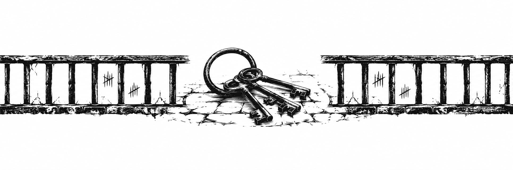

<h2 class="h2-1 text-center" align="center" id="ch2">PHẦN MỘT</h2>

Vì dạo này tôi hiếm khi ra ngoài, tôi dành phần lớn thời gian ngồi trên một trong những chiếc ghế bành để đọc lại sách. Chỉ gần đây tôi mới bắt đầu hứng thú với phần lời tựa. Các tác giả sẵn sàng nói về bản thân, giải thích lý do vì sao họ viết cuốn sách. Điều này khiến tôi ngạc nhiên: chẳng phải ở thế giới đó, việc truyền đạt lại kiến thức đã thu nạp là điều phổ biến hơn ở thế giới mà tôi từng sống sao? Họ thường có vẻ cảm thấy cần phải nhấn mạnh rằng họ viết sách không phải vì sự kiêu ngạo, mà vì có ai đó đã yêu cầu, và họ đã suy nghĩ rất lâu trước khi nhận lời. Thật kỳ lạ làm sao! Điều đó cho thấy con người thời đó không hề khao khát học hỏi, và việc muốn truyền đạt kiến thức lại là điều cần phải cất lời xin lỗi. Hoặc họ giải thích lý do tại sao họ thấy việc xuất bản một bản dịch mới về Proust là phù hợp, bởi những nỗ lực trước đó, dẫu đáng khen ngợi đến đâu đi nữa, vẫn còn thiếu sót điểm này hay điểm khác. Nhưng tại sao phải dịch trong khi việc học các ngôn ngữ khác và đọc trực tiếp bất cứ thứ gì mình muốn hẳn là rất dễ dàng? Những điều này khiến tôi hoàn toàn bối rối. Quả thực, tôi vô cùng dốt nát: rõ ràng là tôi còn biết ít hơn về những vấn đề này so với những gì tôi từng nghĩ. Các tác giả bày tỏ lòng biết ơn đối với những người đã dạy dỗ họ, những người đã mở ra cánh cửa dẫn đến lĩnh vực kiến thức này hay lĩnh vực kiến thức khác, và vì tôi hoàn toàn không hiểu họ đang nói gì, nên tôi thường đọc những lời này với một mức độ dửng dưng nhất định. Nhưng đột nhiên vào ngày hôm qua, mắt tôi nhòa lệ; tôi nghĩ đến Anthea và bị nhấn chìm bởi một nỗi đau buồn dữ dội. Tôi có thể hình dung ra chị ấy, đang ngồi bên mép nệm, đầu gối khép sang một bên, kiên nhẫn khâu vá bằng sợi chỉ tạm bợ làm từ tóc tết cứ đứt liên tục, thỉnh thoảng dừng lại để nhìn tôi với vẻ kinh ngạc, nhanh chóng nhận ra sự dốt nát của tôi và dạy cho tôi những gì chị biết, rồi xin lỗi vì những điều đó quá ít ỏi, để rồi tôi cảm thấy một cơn co thắt dữ dội trong lòng và bắt đầu nức nở. Chưa bao giờ trong đời tôi khóc. Có một cơn đau trong lồng ngực mạnh mẽ chẳng kém gì cơn đau của khối u ung thư trong bụng tôi, và tôi, người vốn chẳng còn cất lời vì chẳng có ai để nghe, bắt đầu gọi tên chị ấy. Anthea! Anthea! Tôi hét lên. Tôi không thể tha thứ cho chị vì đã vắng bóng, vì đã để cho cái chết cướp mất chị, giật chị khỏi vòng tay vụng về của tôi. Tôi tự trách bản thân vì đã không níu giữ chị lại, vì đã không hiểu rằng chị không thể gắng gượng được nữa. Tôi tự nhủ rằng mình đã bỏ rơi chị vì bản tính lạnh lùng, như tôi vẫn thế suốt cả cuộc đời, như tôi sẽ thế khi chết đi, và vì thế tôi không thể ôm lấy chị ấm áp, và rằng trái tim tôi đã đóng băng, vô cảm, và tôi đã không nhận ra rằng mình đang tuyệt vọng.

Chưa bao giờ tôi suy sụp đến thế. Tôi dám thề là điều đó không thể xảy ra với mình; tôi từng nhìn thấy những người phụ nữ run rẩy, khóc lóc và la hét, nhưng tôi vẫn dửng dưng trước bi kịch của họ, chỉ là nhân chứng cho những bộc phát mà tôi không thể hiểu nổi, vẫn giữ im lặng ngay cả khi tôi làm những gì họ yêu cầu để giúp đỡ họ. Phải thừa nhận rằng, tất cả chúng tôi đều bị cuốn vào cùng một vở kịch quá đỗi mạnh mẽ, bao trùm đến mức tôi chẳng hề hay biết bất cứ điều gì không liên quan đến nó, nhưng tôi đã từng nghĩ rằng mình rất khác biệt. Và giờ đây, nức nở không ngừng, tôi buộc phải thừa nhận quá muộn màng, quá đỗi muộn màng, rằng tôi cũng từng yêu, rằng tôi có khả năng đau khổ và suy cho cùng tôi vẫn là một con người.

Tôi cảm thấy nỗi đau này sẽ không bao giờ nguôi ngoai, rằng nó đã tóm lấy tôi vĩnh viễn, rằng nó sẽ ngăn cản tôi chuyên tâm vào bất kỳ điều gì khác, và rằng tôi đang mặc kệ cho nó làm thế. Tôi nghĩ đó chính là thứ mà người ta gọi là bị dằn vặt bởi sự ăn năn. Tôi sẽ không thể đứng dậy, suy nghĩ, hay thậm chí nấu nổi bữa ăn cho mình, và tôi sẽ cứ thế để bản thân từ từ tàn tạ. Tôi đang nếm trải một thứ khoái cảm bệnh hoạn khi tưởng tượng ra cảnh mình đầu hàng trước sự tuyệt vọng, thì nỗi đau thể xác lại quay trở về. Nó đến đột ngột và nhói buốt đến mức kéo tôi ra khỏi nỗi đau tinh thần. Tôi thấy sự chuyển đổi đột ngột từ nỗi đau này sang nỗi đau kia thật buồn cười, và thế là tôi, một kẻ vốn dĩ chẳng bao giờ cười, lại đang oằn mình trong cơn đau đớn quằn quại mà bật cười.

Khi cơn đau dịu xuống, tôi tự hỏi liệu trước đây mình đã từng cười bao giờ chưa. Những người phụ nữ thường hay cười, và tôi tin rằng đôi khi mình cũng đã hòa cùng tiếng cười đó, nhưng tôi không chắc chắn lắm. Lúc đó tôi nhận ra rằng mình chưa bao giờ suy nghĩ về quá khứ. Tôi sống trong một hiện tại vĩnh cửu và tôi đang dần quên đi câu chuyện đời mình. Ban đầu, tôi nhún vai tự nhủ rằng đó chẳng phải là mất mát lớn lao gì, vì chẳng có chuyện gì từng xảy ra với tôi cả, nhưng chẳng mấy chốc tôi đã bị sốc trước suy nghĩ đó. Rốt cuộc, nếu tôi là một con người, câu chuyện của tôi cũng quan trọng chẳng kém gì câu chuyện về Vua Lear hay Hoàng tử Hamlet mà William Shakespeare đã nhọc công kể lại chi tiết. Tôi đưa ra quyết định hầu như không kịp nhận ra: tôi sẽ làm điều tương tự. Qua nhiều năm, tôi đã học được cách đọc trôi chảy; việc viết thì khó hơn nhiều, nhưng tôi chưa bao giờ chùn bước trước những trở ngại. Tôi thực sự có giấy và bút chì, mặc dù tôi có lẽ chẳng còn nhiều thời gian. Giờ đây, khi tôi không còn đi thám hiểm nữa, chẳng có công việc nào gọi mời tôi nữa, nên tôi quyết định bắt đầu ngay lập tức. Tôi đi vào kho lạnh, lấy ra phần thịt mà tôi sẽ ăn sau đó rồi để nó rã đông, để khi cơn đói ập đến, thức ăn của tôi sẽ sẵn sàng nhanh chóng. Sau đó, tôi ngồi xuống chiếc bàn lớn và bắt đầu viết.

Khi tôi viết những dòng này, câu chuyện của tôi đã khép lại. Mọi thứ xung quanh tôi đều ngăn nắp và tôi đã hoàn thành nhiệm vụ cuối cùng mà tôi tự đặt ra cho mình. Tôi chỉ mất đúng một tháng, và đó có lẽ là tháng hạnh phúc nhất trong cuộc đời tôi. Tôi không hiểu điều đó: xét cho cùng, những gì tôi đang mô tả chỉ là sự tồn tại kỳ lạ của tôi, thứ vốn chẳng mang lại cho tôi mấy niềm vui. Phải chăng có một sự thỏa mãn trong nỗ lực hồi tưởng mang lại sự nuôi dưỡng cho chính nó, và những gì người ta nhớ lại lại ít quan trọng hơn hành động nhớ lại? Đó là một câu hỏi khác sẽ không có lời đáp: tôi cảm thấy như thể mình được tạo nên từ không gì khác ngoài điều đó.

Nhớ lại cho tận cùng quá khứ, tôi vẫn luôn ở trong căn hầm ngầm này. Có phải đó là điều họ gọi là ký ức không? Trong một vài dịp hiếm hoi khi những người phụ nữ sẵn sàng kể cho tôi nghe về quá khứ của họ, những câu chuyện của họ tràn ngập các sự kiện, những cuộc ra vào, đàn ông… nhưng tôi lại bị thu gọn đến mức gọi ký ức là cảm giác tồn tại ở cùng một nơi, với cùng những con người và làm cùng những việc, nói cách khác, là ăn, bài tiết và ngủ. Suốt một thời gian rất dài, những ngày tháng cứ thế trôi qua, ngày nào cũng giống như ngày trước đó, rồi tôi bắt đầu suy nghĩ, và mọi thứ đã thay đổi. Trước đó, chẳng có gì xảy ra ngoài sự lặp lại của những cử động y hệt nhau, và thời gian dường như đứng yên, ngay cả khi tôi láng máng nhận thức được rằng mình đang lớn lên và thời gian đang trôi đi. Ký ức của tôi bắt đầu từ sự giận dữ của mình.

Hiển nhiên là tôi không có cách nào biết được mình bao nhiêu tuổi. Những người khác đã trưởng thành từ lâu trong khi tôi có vẻ vẫn ở độ tuổi tiền dậy thì. Nhưng sự phát triển của tôi dừng lại ở đó: tôi bắt đầu mọc lông dưới nách và vùng mu, ngực tôi lớn lên một chút, rồi mọi thứ chững lại. Tôi chưa bao giờ có kinh nguyệt. Những người phụ nữ bảo tôi thật may mắn, rằng tôi sẽ không phải bận tâm về việc ra máu và những biện pháp phòng ngừa để không làm vấy bẩn nệm. Tôi sẽ được tha khỏi cái nhiệm vụ tẻ nhạt hàng tháng là giặt giũ những tấm giẻ rách mà họ phải nhét giữa hai chân mình hết sức có thể, bằng cách ép chặt các cơ đùi lại với nhau, vì họ chẳng có gì để giữ chúng ở đúng vị trí, và tôi sẽ không phải chịu đựng những cơn đau quặn bụng như rất nhiều thiếu nữ khác. Nhưng tôi không tin họ: hầu như tất cả họ đều có kinh nguyệt, và làm sao người ta có thể cảm thấy đặc quyền khi không có thứ mà tất cả mọi người đều có chứ? Tôi cảm thấy họ đang lừa dối mình.

Hồi đó, tôi không tò mò về mọi thứ, và cũng không nảy sinh ý định hỏi xem ý nghĩa của kinh nguyệt là gì. Có lẽ bản chất tôi là người trầm tính, dù sao đi nữa, câu trả lời cho những câu hỏi hiếm hoi của tôi thực sự không lấy gì làm khích lệ cho lắm. Thường thì những người phụ nữ sẽ thở dài và quay mặt đi, nói rằng “Kể cho cháu nghe thì có ích gì chứ?”, điều đó khiến tôi cảm thấy mình đang làm phiền hoặc làm họ khó chịu. Tôi chẳng có chút manh mối nào, và tôi cũng không gặng hỏi thêm. Mãi cho đến tận sau này Anthea mới giải thích cho tôi nghe về kinh nguyệt. Chị bảo tôi rằng không có người phụ nữ nào được học hành nhiều; họ là những nữ công nhân nhà máy, nhân viên đánh máy hay nhân viên bán hàng, những từ ngữ chưa bao giờ có ý nghĩa nhiều đối với tôi, và họ cũng chẳng hiểu biết hơn tôi là bao. Mặc dù vậy, khi tôi thực sự tìm hiểu ra, tôi cảm thấy họ đã không thực sự nỗ lực để dạy bảo mình. Tôi vô cùng tức giận. Anthea nói rằng tôi không hoàn toàn sai và cố gắng giải thích lý do của họ. Tôi có thể sẽ quay lại vấn đề này sau, nếu tôi nhớ ra, nhưng vào thời điểm mà tôi muốn viết ra đây, tôi đang rất phẫn nộ. Tôi cảm thấy mình đang bị coi thường, như thể tôi không có khả năng hiểu được câu trả lời cho những câu hỏi ít ỏi mà tôi đặt ra, và tôi quyết định sẽ không thèm quan tâm thêm chút nào đến những người phụ nữ đó nữa.

Lúc nào tôi cũng cáu kỉnh, nhưng tôi không hề hay biết điều đó, bởi vì tôi không biết những từ ngữ để diễn tả tâm trạng. Những người phụ nữ cứ tất bật ngược xuôi, bận rộn với một vài hoạt động thường ngày nhưng chẳng bao giờ mời tôi tham gia cùng họ. Tôi thường ngồi xổm xuống và quan sát bất cứ thứ gì có thể nhìn thấy. Ngẫm lại thì, hầu như chẳng có gì cả. Họ ngồi trò chuyện, hoặc, cứ hai lần một ngày, họ chuẩn bị bữa ăn. Dần dần, tôi chuyển sự chú ý sang những tên lính gác, những kẻ cứ đi đi lại lại không ngừng bên ngoài lồng sắt giam giữ của chúng tôi. Bọn chúng luôn đi theo nhóm ba người, cách nhau vài bước chân, quan sát chúng tôi, và chúng tôi thường giả vờ phớt lờ sự hiện diện của chúng, nhưng tôi bắt đầu tò mò. Tôi nhận thấy có một tên khác biệt: cao hơn, mảnh khảnh hơn và, như tôi nhận ra sau một thời gian, trẻ tuổi hơn. Điều đó khiến tôi bị mê hoặc. Trong những khoảnh khắc vui vẻ hơn, những người phụ nữ thường nói chuyện về đàn ông và tình yêu. Họ khúc khích cười và trêu chọc tôi khi tôi hỏi có chuyện gì mà buồn cười thế. Tôi xâu chuỗi mọi thứ mình biết: những nụ hôn được trao trên môi, những cái ôm ấp, liếc mắt đưa tình với ai đó, chạm chân dưới gầm bàn, rồi đến tầng trời thứ bảy, trời đất ơi! Xét đến việc tôi chưa bao giờ nhìn thấy bất kỳ bầu trời nào và chẳng có chút ý niệm gì về tầng trời thứ nhất hay bất kỳ tầng trời nào ở giữa, tôi không bận tâm đến nó nữa. Họ cũng thường phàn nàn về sự tàn bạo. Chuyện đó rất đau đớn, đàn ông chẳng quan tâm gì đến phụ nữ, họ khiến phụ nữ mang thai rồi chuồn mất, và nói rằng: “Làm sao tao biết đó là con tao chứ?” Đôi khi những người phụ nữ tuyên bố rằng đó chẳng phải mất mát gì lớn lao, và lúc khác họ lại bắt đầu khóc. Nhưng định mệnh đã sắp đặt sẵn là tôi phải giữ mình trinh trắng. Một ngày nọ, tôi lấy hết can đảm để gạt bỏ cơn giận dữ sang một bên và gặng hỏi Dorothy, người ít đáng sợ nhất trong số hai phụ nữ lớn tuổi.

“Tội nghiệp cháu ghê!”

Và, sau vài tiếng thở dài, bà thốt ra câu trả lời quen thuộc:

“Cháu biết thì có ích gì chứ, vì chuyện đó đâu thể xảy ra với cháu?”

“Bởi vì cháu muốn biết!” tôi gầm lên, chợt hiểu ra tại sao điều đó lại quan trọng đối với mình đến vậy.

Bà không thể hiểu nổi tại sao lại có người muốn thứ tri thức chẳng đem lại chút ích lợi gì cho họ, và tôi chẳng thể moi được gì từ bà. Chắc chắn rằng tôi sẽ chết đi mà chưa từng được chạm vào, và ít nhất tôi cũng muốn thỏa mãn sự tò mò của mình. Tại sao tất cả họ lại quyết tâm giữ im lặng đến vậy? Tôi tự an ủi bản thân rằng dẫu sao thì đó cũng chẳng phải bí mật gì sất, bởi vì tất cả họ đều biết. Phải chăng vì muốn tô điểm thêm cho nó nên họ mới từ chối kể cho tôi nghe, hay muốn ban cho nó ánh hào quang của một viên ngọc quý hiếm? Bằng cách giữ im lặng, họ đang tạo ra một đứa con gái chẳng biết gì và sẽ coi họ như những kẻ canh giữ một kho báu. Phải chăng họ chỉ giấu giếm tôi để có thể vờ như bản thân không hoàn toàn bất lực? Đôi khi họ tuyên bố rằng đó là vì sự e thẹn, nhưng tôi thấy rõ mồn một rằng giữa họ với nhau chẳng có chút e thẹn nào sất. Họ thì thầm, cười khúc khích và đầy vẻ suồng sã. Tôi sẽ chẳng bao giờ làm tình, họ cũng chẳng bao giờ được làm tình nữa: có lẽ điều đó khiến chúng tôi bình đẳng với nhau và họ đang cố tự an ủi bằng cách tước đoạt ở tôi thứ duy nhất mà họ có thể.

Thường thì vào buổi tối, trước khi chìm vào giấc ngủ, tôi hay nghĩ về người lính gác trẻ. Tôi dựa vào chút ít mà bản thân có thể đoán được: trong một kiếp sống khác, hắn đã đến ngồi bên cạnh tôi, đề nghị tôi khiêu vũ và nói cho tôi biết tên của hắn. Tôi sẽ có một cái tên để nói cho hắn biết, và chúng tôi sẽ trò chuyện. Sau đó, nếu chúng tôi cảm mến nhau, chúng tôi sẽ đi dạo tay trong tay. Có lẽ tôi sẽ chẳng thấy hắn thú vị cho lắm: hắn là người duy nhất trong số sáu tên cai ngục của chúng tôi không già nua lom khom, và có lẽ tôi đã tỏ ra dễ dãi vì chưa từng gặp bất kỳ thanh niên nào khác. Tôi cố tưởng tượng ra cuộc trò chuyện của chúng tôi trong một quá khứ mà tôi chưa từng biết đến: Ngày mai trời có đẹp nữa không? Anh đã thấy bầy mèo con ở nhà bên chưa? Em nghe nói dì của anh sắp đi nghỉ mát đấy… nhưng tôi chưa bao giờ thấy mèo con và hoàn toàn chẳng có lấy một khái niệm gì về thời tiết đẹp, điều đó đặt dấu chấm hết cho mộng tưởng của tôi. Rồi tôi nghĩ đến chuyện hôn hít, tưởng tượng cái miệng của người lính gác trẻ chính xác nhất có thể. Nó khá rộng, với đôi môi mỏng và được khắc họa rõ nét; tôi không thích đôi môi dày mà một số phụ nữ ở đây có. Tôi hình dung môi mình áp sát vào môi hắn: có lẽ còn điều gì khác mà tôi cần phải biết, bởi vì tôi chẳng cảm thấy gì đặc biệt cả.

Nhưng rồi vào một buổi tối nọ, thay vì chìm vào giấc ngủ vì nỗi buồn chán khi phải cố tưởng tượng ra một nụ hôn sẽ chẳng bao giờ diễn ra, tôi chợt nhớ ra rằng những người phụ nữ từng nói về các cuộc thẩm vấn, họ bảo rằng họ ngạc nhiên vì chưa từng có cuộc thẩm vấn nào xảy ra cả. Tôi thêu dệt thêm từ những gì ít ỏi mà họ đã kể: tôi tưởng tượng ra cảnh lũ lính gác đến lôi cổ một người phụ nữ đi, bắt cô ta đi trong tiếng thét gào và nỗi kinh hoàng tột độ. Đôi khi, người phụ nữ đó không bao giờ trở lại nữa, đôi khi cô ta bị ném trở lại giữa chúng tôi vào buổi sáng hôm sau, khắp người đầy vết bỏng, thương tích, rên rỉ, và không phải lúc nào cũng sống sót. Tôi tự nhủ: “À há! Nếu có những cuộc thẩm vấn, hắn sẽ đến bắt tôi đi và tôi sẽ rời khỏi căn phòng nơi tôi đã sống từ thuở chào đời. Hắn sẽ lôi tôi qua những hành lang vô định, và rồi điều gì đó sẽ xảy ra!”

Tâm trí tôi hoạt động nhanh đến khó tin: chàng trai đang thúc giục tôi bước đi với dáng vẻ tận tụy hết mình vì công việc, nhưng một khi chúng tôi rẽ qua góc khuất tầm nhìn, anh liền dừng lại, quay sang nhìn tôi, mỉm cười và nói: “Đừng sợ.” Và rồi anh ôm chầm lấy tôi, một cảm giác vô tận trào dâng trong tôi, một cơn bùng nổ ngập tràn, một luồng sáng phi thường vỡ òa bên trong tôi. Tôi không thể thở nổi, rồi tôi lại thở được, bởi vì khoảnh khắc đó ngắn ngủi đến tuyệt vọng.

Sau đó, tâm trạng của tôi thay đổi. Tôi không còn cố thuyết phục những người phụ nữ kể cho mình nghe bí mật của họ nữa; tôi đã có bí mật của riêng mình. Cơn bùng nổ ấy hóa ra rất khó để tái tạo lại. Tôi phải tự bịa ra những câu chuyện ngày càng dài dòng và rắc rối hơn nhưng khốn khổ thay, tôi chưa từng trải nghiệm lại cơn bùng nổ đó thêm lần thứ hai liên tiếp, trong khi tôi hằng mong ước nó có thể kéo dài hàng giờ liền. Tôi muốn cảm nhận cảm giác ấy suốt ngày đêm, đung đưa đầy mê đắm, giống như những thảm cỏ hiếm hoi trên bình nguyên được vuốt ve bởi làn gió nhẹ thổi rười rượi suốt nhiều ngày liền, nhưng mãi về sau tôi mới được nhìn thấy.

Tôi giờ đây dồn toàn bộ thời gian cho nhiệm vụ tạo ra cơn bùng nổ. Tôi phải bịa ra những hoàn cảnh đặc biệt khi chúng tôi chỉ có hai người, hoặc ít nhất là bị cô lập giữa những người khác, đối mặt với nhau, và rồi, sau bao dằn vặt, tôi có được niềm vui sướng tột độ khi thấy vòng tay anh ôm lấy mình. Trí tưởng tượng của tôi phát triển. Tôi phải rèn luyện kỷ luật nghiêm ngặt, vì tôi không thể mơ cùng một câu chuyện hai lần: sự bất ngờ là tối quan trọng, như tôi nhận ra sau nhiều lần cố gắng tái hiện cử chỉ tinh tế đã đưa tôi thăng hoa, mà không cảm thấy chút rung động nào. Điều này cực kỳ khó khăn bởi vì tôi đồng thời là người sáng tác ra câu chuyện, người kể chuyện và thính giả đang ngóng chờ cú sốc của điều bất ngờ. Nhớ lại, tôi ngạc nhiên vì mình đã xoay sở vượt qua biết bao chướng ngại vật! Hãy tưởng tượng trí tưởng tượng của tôi phải hoạt động nhanh đến mức nào để ngăn tôi biết trước điều gì sẽ xảy ra để rồi bản thân bị bắt quả tang trong ngỡ ngàng! Lần đầu tiên tôi tưởng tượng ra cuộc thẩm vấn, tôi chưa bao giờ bịa chuyện trước đó, tôi thậm chí còn không biết điều đó là khả thi. Tôi hoàn toàn bị cuốn theo nó, vừa kinh ngạc trước một hoạt động hoàn toàn mới mẻ vừa kinh ngạc trước chính câu chuyện đó. Rồi tôi nhanh chóng thành thạo nó, giống như một kẻ điều khiển chuỗi chuyện tưởng tượng. Tôi có thể biết nếu nó khởi đầu tồi tệ hoặc nếu nó đang tiến vào ngõ cụt, thậm chí có thể quay lại từ đầu để thay đổi tiến trình sự việc. Tôi đi xa đến mức tạo ra những nhân vật xuất hiện thường xuyên, thay đổi từ câu chuyện này sang câu chuyện khác, và trở thành những người bạn cũ. Tôi rất hài lòng với họ, và mãi cho đến tận bây giờ khi tôi có thể đọc sách thì tôi mới nhận ra họ khá hạn hẹp.

Tôi cần phải bịa ra những câu chuyện ngày càng phức tạp: tôi nghĩ rằng sâu thẳm bên trong có một phần trong tôi biết mình muốn gì từ chúng và phản đối; tôi phải tự bắt quả tang chính mình không phòng bị. Đôi khi tôi phải duy trì điều đó trong vài tiếng đồng hồ, để ru ngủ thính giả nội tâm của mình vào một cảm giác an toàn giả tạo để cô ấy bị mê hoặc bởi niềm vui lắng nghe, tận hưởng câu chuyện và hạ thấp phòng tuyến của mình. Sau đó là khoảnh khắc kỳ diệu, ánh mắt của chàng trai, bàn tay anh đặt lên vai tôi và sự ngây ngất tràn ngập toàn bộ con người tôi. Sau đó, tôi mới có thể chìm vào giấc ngủ. Có lẽ, khi dừng câu chuyện lại, tôi đang làm thất vọng một thính giả nội tâm, kẻ thích câu chuyện hơn là sự hỗn loạn, đó là lý do tại sao cô ấy luôn kéo dài nó và sẵn sàng tước đoạt của tôi để kéo dài niềm vui của chính mình. Đôi khi, giữa chừng, tôi cố gắng tranh luận với cô ấy: “Tôi mệt rồi, tôi muốn đi ngủ, hãy để tôi đi đến cơn bùng nổ, tôi sẽ tiếp tục vào ngày mai.” Nhưng vô ích, cô ấy không để mình bị lừa.

Những người phụ nữ nhận ra rằng tôi đã thay đổi. Họ quan sát tôi một lúc, thấy tôi lúc nào cũng ngồi thu lu, đầu gối khép chặt, cằm tì lên đôi tay đan vào nhau, và tôi đoán là mình có một ánh mắt ngẩn ngơ. Tôi hoàn toàn phớt lờ, bởi vì tôi chẳng bận tâm đến họ nữa, và tôi đã ngạc nhiên khi Annabel đến chất vấn tôi.

“Em đang làm gì thế?”

“Đang suy nghĩ,” tôi đáp.

Điều đó làm Annabel bối rối. Chị nán lại thêm một chút, chờ tôi nói thêm điều gì đó, rồi đi truyền đạt câu trả lời của tôi cho những người khác. Họ tranh cãi một lúc, và Annabel quay lại.

“Về chuyện gì?”

Toàn bộ cơn giận dữ của tôi trỗi dậy.

“Khi em hỏi các chị xem người ta làm gì khi làm tình, các chị không chịu nói cho em biết, và giờ các chị lại mong em phải kể cho các chị nghe những gì đang diễn ra trong đầu mình chứ gì! Các chị giữ bí mật của mình đi, nếu điều đó làm các chị vui, nhưng đừng hòng mong em kể bí mật của em cho các chị!”

Chị cau mày rồi quay lại với những người khác. Lần này, cuộc tranh luận kéo dài hơn. Tôi chưa từng thấy họ nói chuyện lâu và nghiêm túc đến thế, thường thì họ sẽ phá lên cười sau mười phút. Rõ ràng là tôi đã khơi mào thứ gì đó mới mẻ trong tâm trí họ. Sau đó, một người phụ nữ khác đứng dậy và tiến lại phía tôi. Đó là Dorothy, người lớn tuổi nhất và được tôn trọng nhất. Ngay cả tôi cũng không ghét bà. Bà ngồi xuống và nhìn chằm chằm vào tôi. Sự hiện diện của bà khiến tôi vô cùng khó chịu bởi vì bà đang cắt ngang tôi tại một thời điểm cốt lõi trong câu chuyện, thứ vốn đã kéo dài từ rất lâu: tôi sắp bị giam một mình trong một phòng giam và vừa nghe lõm được vài từ về người lính gác thay ca ban đêm mà tôi có mọi lý do để tin rằng đó chính là chàng trai. Làm sao tôi có thể tiếp tục trước mặt người phụ nữ lớn tuổi đang im lặng nhìn chằm chằm vào tôi này đây? Ít nhất tôi có thể cố gắng không mất tầm nhìn về tình huống: tôi đang đơn độc, hụt hơi và sợ hãi, và tôi có thể nghe thấy tiếng nói cùng tiếng vũ khí va vào nhau ở hành lang. Tôi không biết chuyện gì đang xảy ra và cảm thấy sợ hãi trước bầu không khí khẩn trương và náo động. Tôi cố gắng tạm dừng khung cảnh trong tâm trí trong lúc quan sát Dorothy, người cũng đang quan sát tôi. Tôi tự nhủ rằng nếu cơn bùng nổ không sớm xảy ra, tôi sẽ phải tìm ra ý nghĩa nào đó từ tình huống này. Nhưng quái lạ là tôi có thể tưởng tượng ra cái gì để nuôi sống thế giới tĩnh lặng mà chúng tôi đang sống, những người phụ nữ bị giam cầm trong bao nhiêu năm trời đến nỗi họ đã mất đi mọi ý niệm về thời gian?

“Vậy là, cháu có một bí mật,” Dorothy cuối cùng cũng lên tiếng.

Tôi không trả lời, bởi vì đó không phải là một câu hỏi thực sự. Tôi nhận ra bà đang cố làm tôi mất tinh thần bằng ánh mắt nặng trĩu và sự im lặng của mình. Đã từng có một thời gian, trước khi tôi tìm thấy thế giới nội tâm nơi tôi tự giải trí cho mình, khi tôi vẫn còn tò mò và dễ bảo, khi đó tôi chắc chắn sẽ bị uy hiếp. Tôi sẽ tự hỏi mình đã làm sai điều gì để đáng bị soi mói thế này, và tôi sẽ sợ hãi hình phạt. Nhưng giờ đây tôi biết mình nằm ngoài tầm với của họ: các hình phạt chẳng bao giờ hơn việc bị bỏ rơi, bị loại khỏi những cuộc trò chuyện vô bổ, phù phiếm về những chuyện chẳng đâu vào đâu, và đó là tất cả những gì tôi muốn để có thể tiếp tục theo đuổi bí mật của mình trong yên bình.

Vì tôi không phản ứng gì, Dorothy bèn cau mày.

“Ta đã nói chuyện với cháu. Lịch sự tối thiểu là phải đáp lời chứ.”

“Cháu chẳng có gì để nói cả. Họ bảo với bà là cháu có bí mật. Bà lại bảo với cháu là họ nói với bà điều đó. Vậy thì sao nào?”

“Ta muốn nghe những điều đó.”

Tôi bắt đầu phì cười, khiến chính tôi cũng ngạc nhiên chẳng kém gì bất kỳ ai khác. Tôi vốn quen với việc tôn trọng mong muốn của những người phụ nữ lớn tuổi, đặc biệt là các bậc trưởng thượng nắm giữ nhiều quyền lực nhất, nhưng mọi thứ đã thay đổi bởi vì tôi không còn nhìn thấy bất kỳ cơ sở nào cho thứ quyền lực đó nữa. Tôi chợt nhận ra rằng họ hoàn toàn chẳng có chút quyền lực nào trong tay. Tất cả chúng tôi đều bị nhốt vào lồng sắt giam giữ theo cùng một cách, chẳng rõ lý do vì sao, bị canh chừng bởi những tên cai ngục, những kẻ hoặc vì khinh miệt hoặc vì đang tuân theo mệnh lệnh nên chẳng thèm nói chuyện với bất kỳ ai trong số chúng tôi. Bọn chúng chưa bao giờ bước chân vào lồng sắt giam giữ này. Chúng luôn đi thành nhóm ba người, ngoại trừ lúc đổi ca thì chúng tôi nhìn thấy sáu tên một lúc, nhưng chúng chẳng hề nói chuyện với nhau. Đến giờ ăn, một trong hai cánh cửa đôi lớn mở ra, một tên đàn ông đẩy chiếc xe đẩy tiếp tế dọc theo khoảng trống giữa lồng sắt giam giữ và bức tường, trong khi một tên khác mở khóa cửa sập đưa thức ăn để chuyển đồ ăn qua cho chúng tôi. Bọn chúng sẽ chẳng thèm trả lời các câu hỏi của chúng tôi và từ lâu chúng tôi cũng đã thôi không hỏi han gì nữa rồi. Những người phụ nữ lớn tuổi cũng bất lực chẳng khác gì những người trẻ tuổi. Họ đã tự chiếm lấy một thứ quyền lực tưởng tượng, một thứ quyền lực chẳng có giá trị gì, một sự đồng thuận ngầm tạo nên một hệ thống phân cấp vô nghĩa, bởi vì chẳng có bất kỳ đặc quyền nào mà họ có thể ban phát hay tước đoạt. Thực tế là tất cả chúng tôi đều đứng trên một vạch xuất phát hoàn toàn bình đẳng.

Tôi ngồi yên lặng trong vài giây, ghi nhận những thực tế quen thuộc đó bỗng chốc trở thành những phát hiện chấn động, rồi nhìn thẳng vào mắt Dorothy.

“Bà muốn nghe những bí mật của cháu,” tôi nói, “nhưng tất cả những gì bà có thể làm chỉ là thông báo cho cháu biết mong muốn của bà mà thôi.”

Tôi chú ý ghi nhận hiệu ứng mà những lời nói của mình gây ra cho Dorothy: lúc đầu, khi thấy tôi sắp sửa đáp lời, vẻ mặt bà ra điều đắc ý, chắc hẳn bà nghĩ rằng mình đã khuất phục được tôi. Sau đó, bà lắng nghe và lĩnh hội ý nghĩa của những gì tôi đang nói, nhưng bà bàng hoàng đến mức nghĩ rằng bản thân đã hiểu sai ý.

“Ý cháu là gì?”

“Cứ ngẫm lại mà xem,” tôi nói. “Ý cháu chính xác là những gì cháu vừa nói.”

“Cháu có nói gì đâu!”

“Cháu đã nói là cháu sẽ không kể cho bà nghe những bí mật của cháu. Bà bảo với cháu là bà muốn biết chúng. Điều đó chẳng có gì là mới mẻ với cháu cả, cháu đã biết thừa điều đó từ trước rồi. Bà cứ nghĩ rằng bà chỉ cần nói cho cháu biết bà muốn gì là cháu sẽ phải tuân theo.”

Đó quả thực là những gì Dorothy đang nghĩ.

“Đó mới là lẽ phải,” bà khăng khăng.

“Tại sao chứ?”

Dorothy tỏ ra lúng túng. Tôi nhận thấy bà không hề suy nghĩ về câu hỏi của tôi, bà quá sốc trước việc tôi dám đặt ra câu hỏi đó. Bà đã thừa hưởng một truyền thống mà tôi không hề thuộc về: khi một người phụ nữ lớn tuổi bảo một người phụ nữ trẻ tuổi trả lời, người trẻ tuổi phải tuân theo. Bà chưa bao giờ nghi ngờ điều đó, nhưng tôi, người lớn lên trong hầm ngầm, chẳng có lý do gì phải tuân thủ cả. Sau một lát:

“Ý cháu là sao khi hỏi ‘tại sao’?”

“Tại sao cháu phải trả lời? Tại sao bà lại nghĩ điều đó là hiển nhiên cơ chứ?”

Ánh mắt Dorothy dao động. Bà cố gắng suy nghĩ, nhưng bà vốn chẳng quen làm việc đó. Bà trông có vẻ bối rối và bám víu lấy ý đầu tiên xuất hiện trong đầu:

“Cháu thật là xấc láo,” Dorothy nói, tỏ vẻ nhẹ nhõm vì tìm được một lời giải thích cho những lời lẽ khó hiểu mà tôi vừa thốt ra, chắc mẩm rằng chừng đó là đủ để quay trở lại những thói quen thông thường, những quy chuẩn xã giao và những điều sáo rỗng.

“Bà đúng là một kẻ ngốc,” tôi đáp trả, nhen nhóm trong niềm xác tín mới tìm thấy. “Và cuộc trò chuyện này thật nhảm nhí. Bà tưởng mình có quyền lực nhưng bà cũng giống như phần còn lại của chúng ta, bị đẩy vào cảnh nhận phần ăn từ tay kẻ thù và chẳng có cách nào trừng phạt cháu nếu cháu chống lại bà. Vì bọn chúng cấm mọi thứ quyền lực khác ngoài quyền lực của chúng, bà không thể đánh cháu cũng như không thể bắt cháu chịu đói. Tại sao cháu phải nghe lời bà cơ chứ?”

Lần này thì rõ ràng là Dorothy chẳng lọt tai một chữ nào từ những gì tôi đang nói. Tôi nghĩ thà bà điếc quách đi còn hơn. Dorothy lẩm bẩm, cựa quậy một lúc, rồi ra hiệu cho hai người phụ nữ trẻ hơn đến đỡ mình đứng dậy, mặc dù thực tế là bà hoàn toàn có thể tự xoay sở mà không cần sự giúp đỡ. Dorothy quay trở lại vị trí quen thuộc của mình ở đầu kia của lồng sắt giam giữ. Những người phụ nữ khác nhìn chằm chằm vào bà đầy chăm chú, không dám đặt ra bất kỳ câu hỏi nào. Dorothy nhắm nghiền mắt lại để tạo ấn tượng rằng mình đang suy ngẫm, rồi chìm vào giấc ngủ.

“Là do bà ấy đã già,” những người trẻ tuổi lên tiếng. “Một thử thách như thế là quá sức đối với một người phụ nữ ở độ tuổi của Dorothy.”

Họ lại tiếp tục rôm rả trò chuyện và tôi quay trở lại với câu chuyện của mình. Tôi lại trở về căn phòng giam u ám nơi tôi bị giam giữ biệt lập. Tôi không hề bị thương tích, lính gác luôn cẩn trọng không bao giờ dùng đến bạo lực. Tôi co ro trong một góc phòng, sợ hãi tột cùng, và tư thế nhục nhã đó khiến tôi bàng hoàng. Ngồi xổm và run rẩy, liệu điều đó có xứng đáng với một kẻ vừa đối đầu với một trong những người phụ nữ được kính trọng nhất trong lồng sắt giam giữ, nhìn thẳng vào mắt bà và bảo rằng bà là một kẻ ngốc hay không? Dorothy đã phải cạn lời. Tôi cảm thấy một luồng run rẩy tuyệt vời chạy dọc sống lưng. Đó có lẽ là niềm vui trí tuệ đầu tiên của tôi. Trong phòng giam tưởng tượng của mình, tôi phải đứng thẳng lên, và giờ đây, tôi phải mỉm cười và thách thức bọn chúng. Thật khó để tập trung vào câu chuyện, tôi đã rất tận hưởng trận chiến nhỏ mà mình vừa trải qua, và tôi muốn tận hưởng dư vị của nó, thế nhưng nó lại không gây ra cơn bùng nổ bởi vì người lính gác trẻ không phải là một phần trong đó, thế nên tôi đành gọi lại kỷ luật nội tâm để trở về với thế giới riêng của mình.

Nếu những người phụ nữ có chút khôn ngoan nào, họ đã để mọi chuyện dừng lại ở đó. Vẫn có thể giả vờ như không có chuyện gì xảy ra và tránh một cuộc chiến không cân sức. Tôi đã nhận ra rằng mình mạnh mẽ không kém gì họ và việc không chia sẻ một bí mật, vốn là thứ ai cũng có thể nắm giữ miễn là không có sự tra tấn, ngay lập tức khiến bí mật ấy trở nên vô giá đến vô cùng. Hiểu biết của họ về chủ đề tình yêu đã từng có vẻ là đối tượng khao khát tối thượng đối với tôi khi họ từ chối chia sẻ nó với tôi. Giờ đây, tôi khinh thường sự tầm thường của họ, tôi tự nhủ rằng trong những thời điểm khác, tôi đã có được thứ mình muốn từ chàng trai đầu tiên bước đến. Khi đòi hỏi điều đó từ những người phụ nữ, tôi đang ban cho họ một đặc quyền mà họ chưa bao giờ có, và điều đó chỉ càng làm nổi bật sự thiếu hiểu biết của tôi. Nhưng giờ đây khi sự tò mò của họ đã trỗi dậy, đến lượt họ cảm thấy bị loại trừ và khinh miệt. Tôi đã tìm thấy cơn bùng nổ để an ủi bản thân: họ vẫn bực bội và bất lực, chỉ được nuôi dưỡng bởi sự bứt rứt đang gặm nhấm. Họ bắt đầu theo dõi tôi.

Theo dõi ư? Có tới bốn mươi người chúng tôi sống trong căn phòng ngầm rộng lớn đó, nơi không ai có thể che giấu bản thân trước những người khác. Cứ cách năm mét, những cột trụ lại nâng đỡ phần trần vòm và các thanh chắn phân tách khu vực sinh hoạt của chúng tôi với những bức tường, để lại một lối đi rộng thênh thang ở khắp xung quanh dành cho lính gác đang rảo bước không ngừng nghỉ. Không ai có thể thoát khỏi sự săm soi và chúng tôi đã quen với việc giải quyết nhu cầu tự nhiên trước mặt nhau. Ban đầu, theo lời họ kể lại cho tôi, những ký ức của tôi đã không còn lưu lại xa đến thế, những người phụ nữ cảm thấy khó chịu nhất, họ từng nghĩ đến việc tạo ra một bức tường người để che chắn cho người phụ nữ đang phóng uế, nhưng lính gác đã cấm điều đó, bởi vì không một người phụ nữ nào được phép che khuất tầm nhìn. Khi tôi đi tiểu tiện, tôi thấy hoàn toàn tự nhiên khi đến ngồi lên bệ xí và tiếp tục cuộc trò chuyện của mình, trong những dịp hiếm hoi tôi tham gia trò chuyện. Những người phụ nữ lớn tuổi nguyền rủa giận dữ, phàn nàn về sự mất nhân phẩm khi bị hạ xuống trạng thái của loài động vật. Nếu điều duy nhất phân biệt chúng ta với loài động vật là việc chúng ta ẩn nấp để đại tiện, thì việc làm con người thực ra chẳng bấu víu vào đâu, tôi nghĩ vậy. Tôi chưa bao giờ tranh cãi với những người phụ nữ đó, thực ra tôi đã thấy họ ngu ngốc rồi, nhưng tôi chưa từng đúc kết nó rõ ràng như vậy.

Khi tôi nghĩ lại về điều đó bây giờ, tôi mới ghê tởm làm sao khi hóa ra mình lại là một đứa ngạo mạn khó ưa! Tôi đã vô cùng tự hào và chìm đắm trong cảm giác tìm thấy một sự tiêu khiển mà tôi cho là phi thường. Tôi có cảm giác như thể mình đang bị một đám đông săn đuổi, trong khi tất cả chúng tôi đều là những tù nhân bất lực như nhau. Bị cô lập do tuổi đời còn trẻ và những ràng buộc áp đặt lên chúng tôi, có lẽ cũng giống như những người khác, tôi cần tạo ra một ảo tưởng để giúp mình đối phó với sự khốn khổ. Tôi hoàn toàn không biết gì cả. Giờ đây khi tôi không còn khả năng đi thám hiểm nữa, tôi suy ngẫm rất nhiều, nhưng vì không có ai để trò chuyện, những suy nghĩ của tôi nhanh chóng bắt đầu quay vòng trong vô định. Đó là lý do tại sao việc viết chúng ra lại thú vị: tôi nhận ra chúng khi chúng tái diễn và tôi không lặp lại chúng nữa.

Khi Dorothy tỉnh dậy và tìm đủ sức mạnh để kể lại cuộc trò chuyện của chúng tôi cho những người khác nghe, bà đã không nói với họ rằng tôi đã gọi bà là kẻ ngốc. Nhưng bất chấp những nỗ lực của bà nhằm không làm tổn hại đến hình ảnh của bản thân, bà vẫn chẳng học hỏi được gì từ bí mật của tôi và không thể che giấu được thực tế đó.

“Một bí mật! Một bí mật! Nó lấy quyền gì mà giữ bí mật trong một tình huống thế này?”

Anthea, người thông minh nhất trong số những người phụ nữ, lập tức hiểu ra rằng điều quan trọng không phải là nội dung thực sự của bí mật, mà là việc sống dưới sự soi mói liên tục của những người phụ nữ khác, người ta vẫn có thể tuyên bố mình có một bí mật và được tin là thật. Điều này có vẻ quá phức tạp để những người phụ nữ có thể hiểu được và họ gạt Anthea sang một bên bằng một cử động bực bội, đòi hỏi phải ép tôi khai ra bằng được bí mật đó.

“Chúng ta phải ép nó. Bắt nó phải nói ra.”

“Các người định làm thế bằng cách nào?”

Carol, người nông nổi nhất và dễ kích động nhất, liền sấn sổ đứng ngay trước mặt tôi và với một giọng điệu đe dọa ra lệnh cho tôi phải lên tiếng.

“Kẻo có chuyện đấy!”

“Kẻo có chuyện gì cơ?” tôi cười ồ lên.

Carol có một cử chỉ bạo lực và thật quá rõ ràng là cô ta đang nghĩ đến việc tát tôi. Quá rõ ràng đến mức những tên lính gác, vốn chưa từng rời mắt khỏi chúng tôi, đã nhìn thấy cô ta cùng lúc với tôi, và chúng tôi nghe thấy tiếng ngọn roi da của cai ngục vụt chát chúa. Chúng tôi biết rằng bọn chúng không nhắm những đòn roi đó vào chúng tôi, và những ngọn roi chỉ quất trong không khí ở hành lang xung quanh lồng sắt giam giữ, nhưng âm thanh đó luôn khiến chúng tôi sợ hãi và Carol giật nảy mình. Không một người phụ nữ nào thực sự nhớ nổi mình từng bị đánh, nhưng sau đó Anthea đã kể cho tôi nghe về điều đó. Chắc hẳn chuyện đó đã xảy ra trong khoảng thời gian mờ mịt của những ngày đầu tiên chúng tôi bị giam cầm, đến mức nỗi sợ hãi sâu sắc như vậy đã bám rễ vào tâm trí chúng tôi. Chưa từng có ai dám bất tuân ngọn roi da của cai ngục, và đôi khi những người phụ nữ vẫn mô tả những vết thương rớm máu do roi da hằn lên làn da trần, cùng với cơn đau nhói kéo dài nhiều ngày trời. Một vài người phụ nữ mang những vết sẹo dài trắng bệch. Quá hoảng sợ, Carol lùi lại, và tôi dành cho cô ta một nụ cười mỉa mai. Tôi đang giằng xé giữa sự thôi thúc muốn chế giễu cô ta trong im lặng, biến những tên lính gác thành đồng minh của mình, với mong muốn giải thích cho cô ta hiểu về sự ngu ngốc và bất lực của bản thân, thì Anthea can thiệp. Anthea tiến lại gần Carol, người đang run lẩy bẩy vì tức giận và sợ hãi, rồi ra hiệu cho cô ta rời đi.

“Thôi nào, chẳng ích gì đâu,” Anthea nói rất khẽ.

Một cơn run rẩy chạy dọc cơ thể Carol, tôi cứ ngỡ cô ta sắp lao vào vòng tay Anthea, nhưng chúng tôi quá hiểu rằng việc chạm vào nhau là bị cấm, và Carol cúi gằm mặt xuống.

“Đi nào,” Anthea lặp lại.

Họ rời đi cùng nhau. Tôi lại ngồi xuống, đầu gối gục vào ngực, cảm thấy nhẹ nhõm vì cuối cùng cũng được yên thân, nhưng tôi không thể nào thả hồn vào câu chuyện của mình được nữa. Sự việc vừa rồi đã làm tôi giật mình hoảng hốt. Tôi bồn chồn đứng ngồi không yên và không tài nào tập trung lại được. Tôi đứng dậy đi về phía những người phụ nữ đang gọt vỏ rau củ và ngỏ ý muốn giúp một tay. Nhưng tôi vụng về quá nên họ đâm ra bực mình.

“Ôi, biến đi chỗ khác chơi đi!” một người trong số họ nói.

“Chơi với ai cơ chứ?”

Tôi là người nhỏ tuổi nhất, người duy nhất vẫn còn là một đứa trẻ khi chúng tôi bị giam cầm. Những người phụ nữ vẫn luôn đinh ninh rằng tôi rơi vào nhóm họ chỉ là do nhầm lẫn, rằng trong cơn hỗn loạn tôi đã bị đưa nhầm sang phía này mà chẳng ai nhận ra. Một khi các lồng sắt giam giữ đã bị khóa chặt, có lẽ chúng sẽ chẳng bao giờ mở lại nữa. Đôi khi, những người phụ nữ ấy bảo rằng chắc chìa khóa đã bị thất lạc, và rằng dẫu lính gác có muốn đi chăng nữa, bọn chúng cũng không tài nào thả chúng tôi ra nổi. Tôi nghĩ đó chỉ là một lời nói đùa, nhưng tôi đã quên bẵng đi cho đến tận bây giờ, và giờ thì đã quá muộn để kiểm chứng.

Alice, người phụ nữ vừa đuổi tôi đi, có vẻ ngượng ngùng. Chị nhìn tôi với ánh mắt đượm buồn, có lẽ chị thấy thương hại tôi và không đồng tình với những người phụ nữ đang cố gắng ép tôi phải nhả ra bí mật của mình.

“Đúng thế thật, tội nghiệp con bé. Một thân một mình.” Chị nhìn tôi bằng ánh mắt đầy thông cảm, và điều đó làm tôi dịu lại đôi chút. Những người phụ nữ ấy vốn chẳng mấy khi tử tế với tôi. Tôi đoán rằng vào thời điểm đó, họ căm ghét việc tôi vẫn còn sống sót ở đây trong khi họ hoàn toàn mù tịt về số phận những đứa con gái của chính mình. Thảm họa kinh hoàng giáng xuống đầu chúng tôi có lẽ đã lý giải cho thái độ của họ, chẳng một ai thèm bận tâm đến tôi hay tìm lấy một chút nỗ lực nhỏ nhoi để an ủi tôi cả. Nhưng biết đâu điều đó vốn là bất khả thi thì sao? Mẹ ruột của tôi không ở cạnh chúng tôi và chúng tôi chẳng hề hay biết điều gì đã xảy ra với những người khác. Chúng tôi đều đinh ninh rằng có lẽ tất cả họ đều đã thiệt mạng. Tôi đã lục lọi lại ký ức về quãng thời gian ấy, tôi tưởng như mình nhìn thấy họ đang đung đưa và rên rỉ, khóc lóc và run lẩy bẩy vì khiếp sợ. Không một ai thèm nhìn lấy tôi và tôi căm ghét họ. Tôi từng nghĩ điều đó thật bất công, để rồi sau đó tôi hiểu ra rằng, khi chỉ có một mình và chìm trong sợ hãi, sự giận dữ chính là vũ khí duy nhất của tôi chống lại nỗi kinh hoàng.

Tôi rời xa Alice và đi đến ngồi xuống một lần nữa, đôi chân khoanh lại dưới thân, nhưng tôi hoàn toàn không thể nối lại mạch suy tưởng của mình. Tôi thấy chán ngấy. Do chẳng có trò giải trí nào khác, tôi bắt đầu quan sát họ. Hôm đó, chúng tôi được phát hành tỏi tây và thịt cừu cắt khúc thô. Vừa rửa rau củ, những người phụ nữ vừa lớn tiếng cãi nhau về cách họ sẽ nấu chúng như thế nào. Tôi chưa bao giờ bận tâm nhiều đến những gì mình ăn, thứ theo quan điểm của tôi chẳng có gì là ngon hay dở, trừ khi tôi vẫn thấy đói sau khi cái đĩa đã nhẵn thính, nhưng điều đó hiếm khi xảy ra vì tôi vốn kém ăn. Lắng nghe tiếng họ huyên náo, tôi không khỏi kinh ngạc, người ta nhìn vào sẽ tưởng họ đang có trong tay sự lựa chọn giữa vô vàn công thức nấu ăn và đủ loại gia vị khác nhau, trong khi thực tế họ chỉ có vỏn vẹn ba cái nồi lớn và một ít nước. Chẳng bao giờ có sự lựa chọn nào khác ngoài việc luộc chín rau củ. Chúng tôi ăn chúng vào bữa trưa và phần nước luộc dùng làm súp vào bữa tối. Đôi khi, thức ăn bổ sung được mang đến vào buổi chiều, vài ký mì ống, hoặc rất hiếm khi là khoai tây, chẳng có gì để người ta có thể thỏa sức tưởng tượng cả. Đây có lẽ là cách họ kể chuyện cho nhau nghe, họ làm tất cả những gì có thể. Họ nói, và tôi đã nghe thấy điều đó hàng trăm lần nhưng chẳng mảy may chú ý, rằng nước canh sẽ có vị khác nhau tùy thuộc vào việc cho thịt vào trước hay rau củ vào trước, rằng người ta cũng có thể nấu riêng từng nguyên liệu, thái nhỏ lá tỏi tây, hoặc cô đặc nước dùng để món ăn đậm đà hơn. Họ tất bật chuyện trò với nhau. Đây là lần đầu tiên tôi chú ý lắng nghe, và tôi ngạc nhiên trước việc họ có quá nhiều điều để nói, cùng với niềm say mê khi họ lặp đi lặp lại một ý hệt nhau theo mười cách khác nhau cốt để che giấu sự thật rằng họ đã chẳng còn chút gì để nói với nhau từ rất lâu rồi. Nhưng con người ta cần phải cất tiếng nói, nếu không họ sẽ đánh mất đi phần người của mình, như tôi đã nhận ra trong suốt những năm tháng qua. Và dần dần, tôi bắt đầu cảm thấy thương hại những người phụ nữ ấy, những kẻ vẫn kiên quyết tiếp tục sống, giả vờ như mình đang bận rộn hoạt động và đưa ra các quyết định ngay trong nhà tù nơi họ bị giam cầm vĩnh viễn, nơi mà cái chết là sự giải thoát duy nhất, nhưng liệu bọn chúng có mang những cái xác đi không, và là nơi họ thậm chí chẳng thể tự tay giết chết lẫn nhau.

Tôi bỗng thấy mình đang ngẫm nghĩ về hoàn cảnh của chúng tôi. Cho đến khoảnh khắc đó, tôi vẫn đơn thuần chịu đựng nó mà không hề suy nghĩ về nó, như thể đó là một trạng thái tự nhiên. Liệu chúng ta có bao giờ thắc mắc tại sao mình lại buồn ngủ vào ban đêm, hay cảm thấy đói khi thức dậy không? Tôi biết, và những người khác cũng biết, rằng tự sát là một trong những điều bị cấm tuyệt đối. Ban đầu, một số phụ nữ tuyệt vọng hơn hoặc chủ động hơn đã thử dùng dao hoặc dây thừng, và điều đó cho thấy những tên lính gác đang canh chừng chúng tôi sát sao nhường nào, bởi họ lập tức nghe thấy tiếng ngọn roi da của cai ngục vụt qua không khí. Những tên gác là những tay thiện xạ xuất sắc, vươn tới mục tiêu từ khoảng cách xa, chém đứt những chiếc thắt lưng mà phụ nữ định dùng làm dây treo cổ, hoặc giật phăng con dao được mài giũa thô sơ khỏi bàn tay đang cầm nó. Bọn chúng muốn đảm bảo rằng chúng tôi vẫn còn sống, điều đó khiến những người phụ nữ tin rằng bọn chúng muốn sử dụng chúng tôi cho một mục đích nào đó, rằng đã có sẵn những kế hoạch. Họ tưởng tượng ra đủ thứ chuyện, nhưng chẳng có chuyện gì từng xảy ra cả. Chúng tôi được cho ăn uống, không phải là quá hào phóng, điều đó khiến những ai quá béo phải sụt cân, và chúng tôi thực ra chẳng thiếu thốn thứ gì. Chúng tôi phải nấu bữa ăn của mình trong những chiếc nồi khổng lồ và trả lại hai con dao cùn khi đã gọt xong rau củ. Thỉnh thoảng, chúng tôi được phát cho vài khúc vải để may quần áo. Chúng được cắt may thô sơ vì chúng tôi không có kéo và phải xé vải hết sức cẩn thận. Tôi vừa viết cách đây một lát rằng chẳng có chuyện gì xảy ra cả, nhưng điều đó không hoàn toàn đúng: sự xuất hiện của những mảnh vải đã tạo ra một sự phấn khích lớn. Chúng tôi biết chiếc váy nào đã rách nát không thể cứu vãn, và chiếc váy nào vẫn có thể tận dụng lại, rồi chúng tôi sẽ bắt tay vào những tính toán phức tạp để có thể tận dụng tối đa tấm vải bông mới. Chúng tôi phải tính đến số lượng chỉ đi kèm với nó; đôi khi có những mảnh vải thừa nhưng chúng tôi chẳng có gì để khâu chúng lại với nhau. Một ngày nọ, Dorothy nảy ra ý tưởng dùng tóc làm chỉ. Bà nhớ lại rằng, từ rất lâu về trước, tóc đã từng được dùng để thêu thùa. Anna và Laura có mái tóc dài nhất, và chúng tôi đã dùng tóc của họ cho những lần thử nghiệm đầu tiên. Những lần đó đều thất bại vì tóc bị đứt. Sau đó, có người gợi ý bện vài sợi tóc lại với nhau và chúng tôi đã đạt được một mức độ thành công nhất định: các mũi khâu không giữ được lâu, nhưng bù lại có rất nhiều tóc để làm lại từ đầu.

Lính gác không phát cho chúng tôi băng vệ sinh hay giấy vệ sinh, điều mà những người phụ nữ phàn nàn rất nhiều. Tôi không hề có ký ức gì về việc từng sử dụng cả hai thứ đó, thế nên tôi xoay sở rất tốt với nước máy, vốn có số lượng vô cùng dồi dào, và vì tôi không có kinh nguyệt, nên tôi không phải bận tâm về việc phải xử lý chỗ máu đó như thế nào. Những người phụ nữ thu gom từng mẩu vải vụn nhỏ nhất và dùng chúng trong kỳ kinh nguyệt, sau đó giặt thật kỹ bằng nước, bởi vì chúng tôi nhận được rất ít xà phòng, loại xà phòng màu đen và lỏng loãng, và chúng tôi phải để dành nó để tắm rửa cơ thể.

Sự thiếu vắng hoạt động thể chất gần như tuyệt đối này lẽ ra đã khiến chúng tôi suy yếu, nhưng chúng tôi tự ép mình tập thể dục mỗi ngày, đây là điều chán ngắt nhất trên đời, nhưng ngay cả tôi cũng chịu đựng nó vì tôi nhận ra điều đó là cần thiết. Thỉnh thoảng có một hoặc hai người phụ nữ bị ốm: một chiếc nhiệt kế được đưa kèm trong số vật tư cung cấp và ngọn roi da của cai ngục ra hiệu rõ ràng rằng chị ấy phải đo thân nhiệt của mình. Thuốc men sẽ được chuyển đến nếu chị ấy bị sốt. Dường như chúng tôi có sức khỏe khá tốt. Tính cả thức ăn lẫn hệ thống chiếu sáng và sưởi ấm liên tục, chúng tôi hẳn đang tiêu tốn của ai đó hoặc thứ gì đó rất nhiều tiền, nhưng chúng tôi chẳng biết tại sao bọn chúng lại phải nhọc công đến thế. Trong cuộc sống trước đây của họ, những người phụ nữ từng làm việc, sinh con và làm tình. Tất cả những gì tôi biết là những điều đó được coi trọng rất lớn. Vậy mà ở đây chúng tôi dùng để làm gì chứ?

Tôi cảm thấy bất ngờ trước những suy nghĩ của chính mình. Đột nhiên, bí mật bị chối bỏ với tôi và bí mật mà tôi không muốn chia sẻ dường như chẳng có mấy giá trị khi đặt lên bàn cân so sánh với bí mật của những tên lính gác: chúng tôi đang làm gì ở đây, và tại sao chúng tôi lại được giữ cho sống sót?

Tôi bước tới chỗ Anthea, người từ trước đến nay luôn là người ít tỏ thái độ thù địch nhất với tôi. Chị mỉm cười với tôi.

“Nào, cháu đến để kể cho tôi nghe bí mật của cháu à?”

Tôi nhún vai đầy khó chịu.

“Đừng có ngốc nghếch như những người khác,” tôi nói. “Hãy nhìn họ kìa. Họ đang giả vờ, họ cư xử như thể họ vẫn còn chút quyền kiểm soát đối với cuộc sống của mình và đưa ra những quyết định trọng đại về việc nên nấu loại rau nào trước. Rốt cuộc chúng ta đang làm cái gì ở đây thế?”

Anthea tỏ ra cảnh giác. “Ý cháu là gì?”

“Chúng ta thậm chí không thể nói về điều đó! Chị cứ dành thời gian để tự lừa dối bản thân rằng mình biết mọi thứ, và chị đang lợi dụng tôi, một kẻ chẳng biết gì sất, để củng cố niềm tin về sự vượt trội của chị! Chẳng một ai có nổi một manh mối tại sao chúng ta lại bị giám sát cẩn mật đến thế và chị thì sợ hãi không dám nghĩ về điều đó.”

“Đừng lúc nào cũng đánh đồng chúng tôi thành một hội như thế.”

“Thôi được, thế thì chúng ta nói về chị đi. Trả lời tôi bằng chính suy nghĩ của chị đi. Nếu như chị có suy nghĩ nào.”

Chúng tôi không được phép đánh nhau, nhưng nếu chúng tôi nói chuyện điềm tĩnh và không để nét mặt làm lộ ra sự giận dữ, chúng tôi hoàn toàn có thể trao đổi những lời lẽ sắc bén.

“Nói về chuyện đó thì được ích gì chứ? Nó chẳng làm thay đổi được điều gì đâu.”

“Chị lại bắt đầu cái thói ngốc nghếch đó nữa rồi! Cứ như thể nói chuyện chỉ để làm cho mọi việc xảy ra vậy. Nói chuyện chính là sự tồn tại. Nhìn kìa: họ biết điều đó đấy, họ nói chuyện hàng giờ liền về những chuyện chẳng đâu vào đâu.”

“Nhưng liệu việc nói chuyện có dạy cho chúng ta biết điều gì về việc chúng ta đang làm ở đây không? Cháu cũng chẳng có chút manh mối nào hơn tôi hay bất kỳ ai khác trong số chúng ta đâu.”

“Đúng thế, nhưng tôi sẽ biết chị nghĩ gì, chị sẽ biết tôi nghĩ gì, và có lẽ điều đó sẽ châm ngòi cho một ý tưởng mới, và khi đó chúng ta sẽ có cảm giác như mình đang cư xử giống con người hơn là những cỗ máy vô tri.”

Anthea đặt mảnh vải đang khâu bằng tóc tết xuống và đan hai tay lên đầu gối.

“Đó là việc cháu làm khi ngồi một mình với đôi mắt nhắm nghiền, suy nghĩ về chúng tôi phải không?”

“Tôi làm theo ý mình muốn. Đừng cố moi bí mật của tôi ra, tôi không phải đứa ngốc nghếch dễ bị lừa phỉnh đâu.”

Anthea bật cười.

“Cháu hẳn là thông minh lắm nhỉ! Cháu sẽ có một tương lai tuyệt vời đấy!”

“Chúng ta chẳng còn tương lai nào nữa. Tất cả những gì chúng ta có thể làm là giải trí bằng cách trò chuyện với nhau.”

“Cháu chế giễu cuộc tranh luận về mớ rau củ, nhưng những gì cháu đề xuất cũng vô nghĩa chẳng kém.”

Tôi bắt đầu cười. Thật vô cùng thú vị khi có một người thông minh như mình để trò chuyện cùng.

“Tôi thấy chủ đề này thú vị hơn. Chúng ta có biết tại sao bọn chúng lại nhốt chúng ta vào lồng sắt giam giữ này không?”

“Không.”

“Hay những người khác đang ở đâu không?”

“Nếu có lý do thì chúng ta cũng không biết đó là gì. Vì chúng ta đang ở đây và vẫn được giữ cho sống sót, chúng ta nghĩ rằng hẳn phải có những người khác còn sống đâu đó, nhưng chẳng có bằng chứng nào cả, và như thế lại hay. Chẳng ai có chút ý niệm nào về việc thế lực nào đang đứng sau tất cả chuyện này. Hoàn toàn không có lấy một manh mối. Bọn chúng đã vây bắt những người lớn tuổi, và chắc chắn cháu có mặt ở đây là do nhầm lẫn. Ban đầu, chà, không hẳn là ban đầu, bởi vì có một khoảng thời gian vẫn mờ mịt trong tâm trí mọi người, nhưng sau đó, từ thời điểm ký ức của chúng ta trở nên rõ ràng hơn, chúng ta biết rằng mình từng suy nghĩ suốt ngày. Bọn chúng có thể đã giết cháu, nhưng bọn chúng không giết, hoặc bắt cháu đi, đưa cháu đến nơi khác, nếu có những nhà giam khác giống nơi này, nhưng khi đó sự xuất hiện của cháu sẽ mang lại tin tức, và điều duy nhất chúng ta chắc chắn là bọn chúng không muốn chúng ta biết bất cứ điều gì. Chúng tôi đi đến kết luận rằng bọn chúng để cháu lại đây vì bất kỳ quyết định nào cũng có thể bị phân tích, và việc bọn chúng thiếu quyết đoán cho thấy điều duy nhất bọn chúng muốn chúng ta biết, đó là chúng ta không được phép biết gì cả.”

Chưa từng có người phụ nữ nào nói chuyện với tôi dài đến thế. Tôi cảm nhận được rằng Anthea đã truyền đạt lại cho tôi mọi điều chị biết, và tôi trải qua một cảm giác hơi choáng váng nhưng lại khá dễ chịu. Nó gợi cho tôi nhớ mơ hồ về cơn bùng nổ và tôi tự hứa với bản thân sẽ xem xét liệu mình có thể đưa nó vào một trong những câu chuyện của mình hay không.

“Chị có thể kể cho tôi điều gì khác nữa không?”

“Không có gì.”

Anthea thở dài và cầm lại kim chỉ, máy móc kiểm tra món đồ của mình.

“Và chúng ta sẽ mãi mãi chẳng khôn ngoan hơn được chút nào. Chúng ta sẽ chết, từng người một, khi tuổi già chiến thắng chúng ta. Dorothy có lẽ sẽ là người đầu tiên, bà ấy bị bệnh tim. Trông Dorothy phải hơn bảy mươi tuổi rồi. Tôi nghĩ mình chưa đến bốn mươi tuổi; vì không có các mùa, chúng ta không thể theo dõi thời gian được. Cháu sẽ là người cuối cùng.”

Anthea nhìn chằm chằm vào tôi một lúc lâu mà không nói một lời nào. Vì dạo gần đây tôi đã vận dụng trí tưởng tượng của mình rất nhiều, tôi có thể đoán được suy nghĩ của Anthea: một ngày nào đó, tôi sẽ chỉ có một mình trong căn phòng xám xịt khổng lồ. Vào buổi sáng, một tên lính gác sẽ đưa phần ăn cho tôi, tôi sẽ nấu nó trên bếp điện nhỏ, rồi tôi sẽ ăn, ngủ và chết một mình, mà chẳng hiểu được số phận của chúng tôi hay tại sao nó lại giáng xuống đầu chúng tôi nữa. Tôi sợ đến cứng cả người.

“Chẳng có gì chúng ta có thể làm được sao?”

“Không có ai trong số chúng ta là chưa từng nghĩ đến việc tự sát, nhưng bọn chúng ra tay quá nhanh. Cháu không được thử thắt cổ đâu: vặn một mảnh vải thành sợi thừng và ngay khoảnh khắc cháu bắt đầu buộc nó vào các thanh chắn, bọn chúng sẽ xuất hiện ở đó. Mary, người đang ngồi đằng kia nói chuyện với Dorothy, từng cố gắng nhịn ăn đến chết: bọn chúng đã đuổi theo chị ấy bằng ngọn roi da của cai ngục và quấy rầy chị ấy cho đến khi chị ấy từ bỏ. Cháu biết những con dao bọn chúng đưa cho chúng ta rồi đấy: chúng hoàn toàn cùn. Chúng chỉ vừa đủ dùng để cạo cà rốt thôi, và chúng ta không được phép cố gắng mài sắc chúng. Có một lần, từ rất lâu rồi, Alice, một trong những người phụ nữ tuyệt vọng nhất, đã thuyết phục một phụ nữ khác siết cổ mình. Chuyện đó xảy ra vào ban đêm, sau khi bọn chúng đã vặn nhỏ đèn. Chúng tôi cứ nghĩ lính gác đi lại tuần tra tự động, bị đánh lừa bởi sự bất động của chúng ta: nhưng bọn chúng theo dõi chúng ta quá sát sao mọi lúc, đến mức bọn chúng nhận ra điều gì đang xảy ra và những tiếng roi quất vang lên.”

“Bọn chúng không bao giờ động chạm đến chúng ta.”

“Có lúc bọn chúng đã làm thế, đã từng có những vết thương rất lâu lành. Chúng tôi không biết tại sao bọn chúng lại dừng lại. Chẳng có ích gì khi nổi loạn cả. Chúng ta chỉ phải đợi cho đến khi mình chết thôi.”

Anthea tiếp tục công việc may vá. Chị đang chắp nối những phần ít mòn nhất của một chiếc váy để làm ra thứ gì đó. Khi nghĩ lại về điều đó, tôi tự nhủ rằng độ dài của những mảnh vải đó gần như là quá mức: trời trong hầm rất nóng và chúng tôi hoàn toàn có thể sống mà không cần mặc quần áo. Tôi hình dung ra hai bệ xí ở trung tâm căn phòng. Vì chúng tôi có tới bốn mươi người, hầu như lúc nào cũng có một người phụ nữ ngồi đó giải quyết nhu cầu cá nhân của mình, và tôi cảm thấy khó mà tin được rằng bọn chúng cho phép chúng tôi che thân chỉ để thỏa mãn sự ý tứ của mình. Tôi quan sát Anthea và chợt nhận ra rằng vì tôi sẽ là người cuối cùng, tốt hơn hết là tôi nên học may vá. Trừ khi những người phụ nữ đã chết để lại quần áo cho tôi, và những món đồ mặc lại đó sẽ đủ dùng cho tôi cho đến tận cùng.

Tôi cảm thấy buồn. Tôi luôn căm ghét những bạn cùng phòng của mình vì sự thờ ơ của họ đối với tôi và tôi chưa bao giờ dành dù chỉ một suy nghĩ cho họ. Khi mới đến đây, họ đã chìm đắm trong nỗi sợ hãi và tuyệt vọng của chính mình, còn tôi vẫn cứ cô độc, một đứa trẻ sợ hãi bị bao quanh bởi những người phụ nữ đang khóc lóc. Khi chết đi, họ sẽ lại một lần nữa bỏ rơi tôi. Sự giận dữ trào dâng trong lòng tôi. Hóa ra họ đã suy nghĩ về hoàn cảnh của chúng tôi, họ đã tự hỏi về điều đó từ rất lâu rồi, và họ luôn gạt tôi ra khỏi những cuộc thảo luận của họ. Anthea là người đầu tiên chịu khó nói chuyện với tôi. Tôi đã thấy cuộc trò chuyện của chúng tôi rất thú vị và đã quyết tâm lắng nghe chị ấy, suy nghĩ, và quên đi việc suốt nhiều năm qua chị ấy đã phớt lờ tôi giống như những người khác.

“Sao hôm nay chị lại nói chuyện với em thế?”

Anthea có vẻ sững sờ.

“Nhưng em mới là người đến bắt chuyện với chị cơ mà,” Anthea nói. “Em lúc nào cũng lủi thủi một mình, cứ như thể không muốn hòa nhập với chúng chị vậy.”

Tôi định nói với Anthea rằng họ vẫn luôn ngừng nói chuyện mỗi khi tôi đến gần, nhưng bỗng nhiên tôi cảm thấy mệt mỏi rã rời. Có lẽ tôi không quen trò chuyện lâu đến thế. Anthea thấy tôi ngáp.

“Họ sắp vặn nhỏ đèn rồi đấy. Chúng ta chuẩn bị đi ngủ thôi. Mai nói chuyện tiếp nhé.”

Tất nhiên là tôi chẳng tài nào chợp mắt được. Tôi muốn tiếp tục câu chuyện mà Annabel đã ngắt quãng vào đúng lúc tôi đang ở trong một phòng giam chờ đợi người lính gác trẻ xuất hiện, nhưng tôi không thể tập trung nổi. Thường thì khi tự kể chuyện cho mình nghe, tôi sẽ hoàn toàn không màng đến những gì diễn ra xung quanh, thế nhưng tối hôm đó, những tiếng bước chân qua lại của các phụ nữ đang sắp xếp nệm, những lời thì thầm cùng sự tĩnh lặng đang dần buông xuống lại làm gián đoạn mạch suy nghĩ của tôi. Tôi ngẫm nghĩ về những năm tháng, về nỗi đau buồn, về những người chồng đã khuất, về những đứa con mà họ không bao giờ được gặp lại nữa, và tôi tự hỏi về người mẹ của chính mình, vì chắc chắn là tôi phải có một người mẹ. Tôi không thể nhớ nổi bà. Tôi chỉ biết rằng hẳn đã từng có một người mà tôi gọi là mẹ, và người ấy không có mặt ở hầm ngầm này. Bà đã chết rồi sao? Tôi nhẩm lại những gì ít ỏi nghe được về thảm họa ấy, vốn chỉ đọng lại trong vài từ ngữ: những tiếng thét, cảnh chen lấn hỗn loạn, màn đêm và nỗi kinh hoàng ngày một lớn dần. Họ nghĩ rằng có lẽ họ đã ngất đi, đôi khi là ngất đi mấy lần, và mọi chuyện đã diễn ra rất nhanh. Ngẫm nghĩ lại, tôi đi đến kết luận rằng lời giải thích đó vẫn chưa đủ. Có tới bốn mươi con người chúng tôi chẳng có điểm gì chung, trong khi trước đó mỗi người phụ nữ đều có một gia đình, có cha mẹ, anh chị em, bạn bè: chỉ có một sự sàng lọc vô cùng tỉ mỉ mới có thể đưa những kẻ hoàn toàn xa lạ lại gần nhau như vậy. Điều này đã được Anthea xác nhận vào ngày hôm sau.

“Thử nghĩ xem công việc đồ sộ đến nhường nào chứ: bọn chúng đã đảm bảo rằng không ai trong chúng ta quen biết bất kỳ ai khác. Bọn chúng bắt chúng ta từ bốn phương tám hướng, thậm chí từ nhiều quốc gia khác nhau, kiểm tra kỹ lưỡng để chắc chắn định mệnh không vô tình ném hai người họ hàng hay hai người bạn bị chia cắt bởi hoàn cảnh lại với nhau.”

“Tại sao chứ? Bọn chúng đang tìm kiếm điều gì?”

“Chúng chị suýt phát điên khi cứ gặng hỏi câu hỏi y hệt như thế. Hồi đó em còn quá nhỏ, em không thể hiểu được, và em cứ cuộn tròn người lại dưới đất, chẳng chịu trả lời khi chúng chị nói chuyện với em.”

“Em không nhớ chuyện đó.”

“Chúng chị từng nghĩ em sẽ không qua khỏi. Vì chúng ta không được phép chạm vào nhau nên chẳng ai có thể bế hay ôm ấp em, hay cố gắng dỗ dành em, thậm chí là ép em ăn. Chúng chị tưởng em sắp chết đến nơi rồi, thế nhưng, rất chậm chạp, em bắt đầu cử động trở lại. Em lê la đến gần đĩa thức ăn vào những bữa cơm và nuốt được vài miếng. Rồi, tự nhiên, chúng chị thành thói quen không bao giờ nhắc lại những ký ức ít ỏi của mình trước mặt em nữa, vì nghĩ rằng điều đó không tốt cho em. Và rồi, dần dần, chúng chị cũng chán ngấy việc nhắc lại chúng với nhau. Chẳng ích gì cả. Cứ hỏi đi hỏi lại những câu hỏi y hệt, theo cùng một cách, suốt bao nhiêu năm trời, rồi em cũng sẽ thấy chán ngán thôi.”

“Và các chị cứ sống thế này thôi sao, với chỗ rau củ của mình, chẳng có chút tương lai nào?”

“Chỉ có cái chết mà thôi,” chị gắt lên. “Chúng ta không thể tự sát, nhưng rồi chúng ta cũng sẽ chết. Chúng ta chỉ việc chờ đợi thôi.”

Tôi chưa bao giờ nghĩ về hoàn cảnh của chúng tôi rõ ràng đến thế. Trong những câu chuyện của tôi, luôn có những sự kiện xảy ra: còn trong cuộc đời tôi, sẽ chẳng bao giờ có bất kỳ điều gì diễn ra cả. Tôi nhận ra rằng chị nói đúng và những bí mật của tình yêu chẳng dính dáng gì đến tôi hết. Có lẽ họ đã giả vờ biết nhiều hơn tôi bởi vì họ chẳng biết gì về những điều cốt yếu cả. Tôi láng máng ngờ rằng đám đàn ông đã không chịu khuất phục như đám phụ nữ: nhưng vì tôi sẽ chẳng bao giờ chạm trán với một người đàn ông nào, thì sự khác biệt đó có ý nghĩa gì chứ? Chính là những thiếu nữ ở một thời đại khác mới phải được chuẩn bị cho đêm tân hôn của họ, tôi tự nhủ với bản thân như vậy.

Ngày hôm đó trôi qua có vẻ rất ngắn ngủi, và tôi cho là do chiều sâu trong những suy nghĩ của mình. Khi ánh đèn mờ đi, chúng tôi phải trải bốn mươi chiếc nệm mà chúng tôi dùng để ngủ xuống. Không đủ chỗ, chúng gần như chạm sát vào nhau, và mỗi buổi sáng chúng tôi lại chất đống chúng lên cao ba hoặc bốn lớp để có chỗ đi lại và ngồi lên đó. Tôi duỗi người nằm xuống và cố gắng bắt lại mạch câu chuyện của mình, nhưng lại không tài nào làm được, tâm trí tôi trống rỗng và có một cảm giác đau đớn ngập tràn trong lồng ngực.

“Nhắm mắt lại đi,” người phụ nữ nằm cạnh tôi nói. “Đừng để bọn chúng thấy em chưa ngủ.”

Đó là Frances, một trong những phụ nữ trẻ tuổi hơn, một trong những người chưa từng cười nhạo tôi.

“Tại sao chứ?”

“Em không nhận thấy điều gì sao? Ai nhìn vào cũng tưởng em vừa ở hành tinh khác đến. Bọn chúng không cho phép chúng ta thức đâu. Nếu bọn chúng thấy em mở mắt, bọn chúng sẽ gọi em ra chỗ mấy thanh chắn và bắt em uống thuốc đấy.”

“Gọi ư? Nhưng bọn chúng có bao giờ nói chuyện với chúng ta đâu!”

“Ồ có chứ! Bằng ngọn roi da của cai ngục!”

Tôi hiểu ý chị muốn nói gì. Rất hiếm khi có một người phụ nữ nào dám cãi lời, nhưng khi điều đó xảy ra, ngọn roi da của cai ngục sẽ quất chát chúa ngay bên cạnh chị ấy, cho đến khi chị ấy chịu làm theo đúng mệnh lệnh. Lính gác vô cùng tàn nhẫn, bọn chúng vung ngọn roi da với độ chính xác tuyệt đối, có thể quất liền tù tì hai mươi nhát ngay sát tai một người nào đó, và nếu người bọn chúng nhắm đến vẫn chống cự, thì thế nào cũng có người khác phải chịu khuất phục. Khi Alice, người mà bọn chúng từng bắt phải ăn, định tự thắt cổ bằng chiếc váy xoắn lại thành sợi thừng, Claudia đã chùn tay lao đến cởi nút thắt và chấm dứt mối đe dọa kinh hoàng về cái chết, thứ luôn được hứa hẹn nhưng chưa bao giờ thực thi. Tôi nhắm nghiền mắt lại.

“Điều gì cứ ngăn cản em không cho ngủ thế?” Frances hỏi.

“Làm sao để chị chợp mắt được vậy?”

Chị không trả lời. Tôi nghẹn ngào vì những tiếng nấc. “Chúng ta có được khóc không? Mà không phải uống thuốc ấy?”

“Không đâu, tốt hơn là em nên tự kiềm chế đi.”

Rồi có một điều kỳ lạ xảy ra trong tôi, tôi muốn cảm nhận vòng tay chị ôm lấy mình và điều đó diễn ra quá đột ngột, quá bất ngờ đến mức tôi không cưỡng lại nổi. Tôi lao vào vòng tay chị trước khi kịp nhận ra mình đang làm gì.

“Dừng lại!” chị thì thầm với vẻ kinh hãi.

Và ngọn roi da của cai ngục vụt qua ngay trên đầu tôi. Tôi lùi lại trong nỗi sợ hãi tột cùng. Đây là lần đầu tiên nó nhắm vào tôi. Tôi vẫn thấy rùng mình mỗi khi nghĩ đến điều đó. Tôi cuộn tròn người lại, thở hổn hển như thể vừa mới chạy xong.

Chạy ư? Tôi chưa từng chạy bao giờ!

Tôi thừa biết rằng chúng tôi không được phép chạm vào nhau và vì từ trước đến nay tôi chưa từng biết điều gì khác biệt nên tôi coi đó là một điều hiển nhiên. Luồng cảm xúc vừa trải qua đã tạo ra trong tôi những khái niệm mơ hồ: nắm tay, đi dạo tay trong tay, ôm lấy nhau, những từ ngữ ấy là một phần trong vốn từ vựng của tôi, chúng mô tả những cử động mà tôi chưa từng thực hiện. Một buổi đi dạo ư? Tôi có lẽ nhớ về những thảm cỏ hay những mùa trong năm, bởi vì những từ ngữ ấy mang âm hưởng vô cùng xa xôi, một âm vang mờ nhạt rồi nhanh chóng lụi tàn. Tôi biết rõ những bức tường xám bong tróc, những thanh chắn cách đều mười lăm centimet, cùng những tên lính gác tuần tra đều đặn tiến ra lùi lại xung quanh chu vi lồng sắt giam giữ.

“Bọn chúng muốn gì ở chúng ta?” tôi lại hỏi. Chị nhún vai.

“Tất cả những gì chúng ta biết chỉ là những điều bọn chúng không muốn.”

Chị quay đi và rõ ràng cuộc trò chuyện đã chấm dứt. Anthea là người phụ nữ đầu tiên nói chuyện với tôi trong một khoảng thời gian dài, có lẽ chị cũng sẽ là người duy nhất chăng?

Tôi tập trung nhắm chặt mắt lại với hy vọng cuối cùng mình sẽ chìm vào giấc ngủ. Lần đầu tiên, tôi hiểu ra rằng mình đang sống ở ngay tận cùng của sự tuyệt vọng. Tôi đã tự cách ly bản thân khỏi điều đó vì tin rằng do cay đắng, nhưng bất chợt tôi nhận ra rằng do sự cẩn trọng, và tất cả những người phụ nữ này, những người sống mà không hề biết ý nghĩa sự tồn tại của mình, đều đã phát điên. Dù đó là lỗi của họ hay không, họ đã phát điên vì hoàn cảnh đưa đẩy, họ đã mất đi lý trí bởi vì chẳng còn điều gì trong cuộc đời họ có ý nghĩa nữa.

Tôi không biết mình bao nhiêu tuổi. Vì tôi không có kinh nguyệt và ngực hầu như phẳng lì, một số người phụ nữ nghĩ rằng tôi chưa đầy mười bốn tuổi, suýt soát mười ba tuổi, nhưng Anthea, người lý trí hơn những người khác, cho rằng tôi phải tầm mười lăm hoặc mười sáu tuổi.

“Chúng ta không biết mình đã ở đây bao lâu. Nhìn chiều cao của em, em không còn là một đứa trẻ nữa, và một số người trong chúng ta đã ngừng hành kinh từ lâu rồi. Anna còn trẻ, em ấy không có nếp nhăn nào cả, chị cũng vậy, mọi người vẫn nói thế. Không phải thời kỳ mãn kinh đã làm chúng ta héo mòn, mà chính sự tuyệt vọng đã làm thế.”

“Vậy đàn ông rất quan trọng sao?”

Chị gật đầu.

“Đàn ông có nghĩa là em đang sống, con ạ. Chúng ta là gì, khi không có tương lai, không có con cái? Những mắt xích cuối cùng trong một chiếc xích đã đứt.”

“Vậy cuộc sống đã mang lại niềm vui lớn lao đến thế ư?”

“Em có quá ít ý niệm về việc có một vận mệnh là như thế nào nên em không thể hiểu được cảm giác bị tước đoạt như chúng ta đang chịu đựng đâu. Hãy nhìn cách chúng ta sống xem: chúng ta biết mình phải cư xử như thể trời sáng, bởi vì bọn chúng vặn đèn sáng hơn, sau đó bọn chúng đưa thức ăn cho chúng ta và đến một thời điểm nhất định, ánh đèn sẽ mờ đi. Chúng ta thậm chí còn không chắc chắn liệu bọn chúng có bắt chúng ta sống theo chu kỳ hai mươi bốn giờ hay không. Làm sao chúng ta có thể đo lường thời gian chứ? Bọn chúng đã đẩy chúng ta vào sự bất lực hoàn toàn.”

Giọng chị vô cùng gay gắt và chị cứ trân trân nhìn thẳng về phía trước. Một lần nữa, tôi lại muốn khóc. Tôi cuộn tròn người lại thành một khối.

“Em bị làm sao thế?”

Đột nhiên, giọng chị trở nên dịu dàng và du dương đến mức tôi run lên như thể đang được vuốt ve. Ít nhất thì tôi cho rằng cảm giác ấy có thể được mô tả như vậy: một thứ cảm giác tuyệt diệu chạy dọc qua người tôi, ngọt ngào đến mức làm tôi hoảng sợ. Tôi càng cuộn người chặt hơn nữa.

“Em không muốn nói chuyện nữa,” tôi bảo Anthea. “Em đã hạnh phúc hơn khi chưa hiểu gì cả, khi em ghét tất cả các chị vì các chị giữ bí mật cho riêng mình. Các chị chẳng có bí mật nào cả. Các chị chẳng có gì hết, và cũng chẳng có gì để mà có cả.”

“Em nghĩ tụi chị có những bí mật gì nào?”

Tôi không còn cảm thấy nhục nhã vì sự dốt nát của mình nữa, bởi vì tôi đã chạm đến một thứ hiểu biết quá nặng nề để có thể chịu đựng.

“Cách các chị làm tình, bằng cái gì, chuyện gì xảy ra, tất cả những thứ đó. Hết người này đến người khác kể cho nhau nghe những câu chuyện từ quá khứ, bóng gió xa xôi rồi cười ồ lên, thế rồi lại ngậm miệng im bặt khi em đến gần. Em cứ tưởng đó là điều quan trọng, nhưng hóa ra tất cả đều vô nghĩa.”

“Tội nghiệp con,” Anthea nói, dịu dàng và buồn bã đến mức tôi bật khóc nức nở.

Bọn chúng có lẽ dung thứ cho việc khóc lóc, miễn là chúng tôi thổn thức trong im lặng và không gây ra náo động; ngọn roi da của cai ngục không vụt xuống.

Một ít thức ăn được mang tới và có một chút náo động nhỏ. Khi chúng tôi cảm thấy đói lần thứ hai kể từ buổi sáng, chúng tôi liền bảo rằng đó là buổi tối. Chúng tôi nấu bất cứ thứ gì có sẵn, chúng tôi ăn, và ngay sau đó đèn mờ đi. Những người phụ nữ nói rằng, trước thảm họa, con người thường ăn ba bữa một ngày, vào buổi sáng, buổi trưa và buổi tối, nhưng chúng tôi chỉ cảm thấy đói hai lần trong mỗi chu kỳ thức giấc và chúng tôi không chắc mình có đang sống theo cùng một chiếc đồng hồ như trước đây hay không. Đó là một trong những cuộc tranh luận cứ lặp đi lặp lại mãi, nhưng lại cứ quay vòng tròn bởi vì chẳng có gì thay đổi cả. Phải chăng chúng tôi cần ít thức ăn hơn vì chúng tôi không phải làm việc, và hai bữa một ngày là đủ rồi? Phải chăng cơ thể chúng tôi đã quên đi những thói quen cũ đến mức chúng tôi có thể ngủ sau mỗi tám hoặc mười tiếng? Nhưng, liệu chúng tôi có biết mình ngủ trong bao lâu không? Có lẽ bọn chúng bắt chúng tôi thức tám tiếng và chỉ cho chúng tôi những đêm dài bốn tiếng, hay sáu tiếng? Lính gác được thay phiên ở những khoảng thời gian không tương ứng với nhịp sống của chúng tôi, đôi khi vào giữa ngày, đôi khi vào ban đêm, hoặc hai lần trong một ngày. Tôi đang quan sát bọn chúng, thu thập chút ít kiến thức ít ỏi mà mình có, thì tôi nhận ra rằng người lính gác trẻ có đôi mắt xanh chắc đã vắng mặt: đột nhiên, tôi nhìn thấy anh ta đang bước đi tuần tra dọc theo chiều dài của lồng sắt giam giữ, và tôi nhận ra rằng mình đã không nghĩ về anh ta hay tự kể cho mình nghe bất kỳ câu chuyện nào trong vài ngày qua. Anh ta trông vẫn đẹp trai như ngày nào.

Tôi đi lấy đĩa thức ăn của mình và ngồi xuống cạnh Anthea.

“Đẹp trai, xinh đẹp, em đoán đó là những từ ngữ từ thời trước, từ thời mà mọi thứ còn diễn ra đúng nghĩa?” tôi hỏi Anthea.

Chị nhìn tôi một lúc, rồi quay đi hướng khác.

“Chị từng rất xinh đẹp,” chị nói. “Chị không biết bây giờ mình còn thế không, chị cần một chiếc gương. Tóc chị đã điểm bạc, nhưng điều đó không có nghĩa là chị già, những người phụ nữ trong gia đình chị bạc tóc sớm. Ký ức của chị rối tung lên, chị nghĩ mình đã hai mươi tám tuổi vào năm bọn chúng giam giữ chúng ta. Lúc đầu, chị vẫn nhọc công chải chuốt mái tóc của mình, và chị rất buồn khi mất đi những chiếc lược.”

Anthea nói bằng giọng thì thầm, như thể đang nói một mình, nhưng tôi biết chị đang nói với tôi.

“Và rồi chiếc váy của chị sờn rách. Đó là một chiếc váy mùa hè xinh xắn, rất hợp thời trang, có diềm xếp nếp, bằng thứ vải mỏng manh không bền lâu cho lắm. Chị là một trong những người đầu tiên mặc những loại áo chùng mà chúng ta tự làm này. Giờ đây, chẳng còn chiếc váy nào từ thời trước sót lại, thậm chí chẳng còn mảnh vải vụn nào, tất cả đều đã rách tơi tả đến sợi cuối cùng. Em không thể tưởng tượng chúng trông như thế nào đâu.”

“Trở nên xinh đẹp, đó là vì đàn ông sao?”

Tôi gần như chắc chắn là thế, nhưng thỉnh thoảng tôi nghe những người phụ nữ nói khác đi.

“Đúng vậy. Một số phụ nữ nói rằng đó là vì bản thân chúng ta. Rốt cuộc thì chúng ta có thể làm gì với nó chứ? Chị có thể yêu bản thân mình dù chị có bị gù lưng hay què quặt, nhưng để được người khác yêu thương, chị buộc phải xinh đẹp.”

“Em có xinh đẹp không?”

Tôi thấy Anthea mỉm cười, nhưng nụ cười ấy thật day dứt.

“Có,” chị nói. “Có chứ. Em có lẽ đã là một trong những cô gái xinh đẹp nhất vì em sẽ không có cái vẻ mặt hờn dỗi, giận dữ đó. Em sẽ cười, em sẽ trêu chọc những chàng trai.”

“Thỉnh thoảng em vẫn trêu chọc người lính gác trẻ,” tôi thốt lên.

Điều này tôi vừa mới hiểu ra.

Khi tôi tự kể những câu chuyện cho mình nghe, tôi luôn đến ngồi sát các thanh sắt trong lồng sắt giam giữ, ở phía mà người lính gác trẻ đi lại tuần tra. Anh ta bước đi chậm rãi, theo dõi sát sao những gì đang diễn ra trong lồng sắt giam giữ, như anh ta vẫn luôn làm. Ngồi xổm xuống, đối diện với anh ta, tôi giữ nguyên vẻ bất động, dõi theo anh ta bằng đôi mắt mình. Tôi ngắm nhìn anh ta, và bởi vì anh ta nhìn thấy mọi thứ, anh ta không thể không biết rằng tôi đang chăm chú nhìn anh ta. Chỉ là một cô gái, ngồi đó, khoác trên mình chiếc áo chùng không rõ hình dáng. Tóc tôi dài và tôi buộc nó gọn gàng ở sau gáy; ngoài điều đó ra, tôi chẳng có chút ý niệm nào về việc trông mình ra sao. Tôi thậm chí còn không biết mắt mình màu gì cho đến khi Anthea nói cho tôi biết, sau đó, và tôi hoàn toàn không hiểu việc trở thành một trong những cô gái xinh đẹp nhất có ý nghĩa gì. Tôi không hề nghĩ đến chuyện không một người phụ nữ nào còn xinh đẹp nữa: họ sạch sẽ, chúng tôi giữ lại ít xà phòng được cấp để rửa cơ thể và mái tóc của mình, thứ lúc nào cũng sạch sẽ. Hầu hết chúng tôi đều có mái tóc dài, bởi vì chúng tôi chẳng có gì để cắt nó cả. Chúng tôi cũng chẳng có dụng cụ nào để cắt móng tay, những thứ luôn bị gãy khi chúng quá dài, và chúng tôi trông thật buồn rầu, ngoại trừ những lúc bùng lên những trận cười khúc khích vì căng thẳng. Tôi không biết mình mang biểu cảm gì khi nhìn người lính gác trẻ: tôi hoàn toàn bị cuốn hút, tôi dồn hết tâm trí vào đôi mắt. Anh ta chưa bao giờ nhìn tôi: tôi chắc chắn rằng anh ta biết tôi đang trừng trừng nhìn anh ta không dứt và điều đó khiến anh ta cảm thấy lúng túng.

“Em muốn làm cho anh ta mất đi sự bình tĩnh.”

“Để làm gì chứ?” Anthea ngạc nhiên hỏi.

“Em không biết. Để có quyền lực đối với anh ta. Bọn chúng có ngọn roi da của cai ngục và bọn chúng bắt chúng ta làm những gì bọn chúng muốn, vốn chẳng là gì cả. Bọn chúng cấm đoán mọi thứ. Em muốn anh ta cảm thấy bứt rứt, lo lắng, sợ hãi, không thể phản ứng lại. Chúng ta chưa từng bị cấm ngồi và nhìn chăm chú cơ mà.”

“Có lẽ bọn chúng sẽ cấm điều đó. Bọn chúng cấm những gì bọn chúng thích mà.”

“Thế thì bọn chúng đang thừa nhận sự tồn tại của em. Nếu chị làm một việc bị cấm, thì hành động đó mới là mục tiêu bị nhắm đến. Nếu chị làm một việc không bị cấm, và bọn chúng nhúng tay vào, thì thứ thu hút sự chú ý không phải là hành động đó, mà chính là bản thân chị.”

Chị là người thông minh nhất trong số những người phụ nữ, nhưng tôi đã nắm bắt được một điều gì đó mà chị chưa từng nghĩ tới, vậy nên ít nhất tôi cũng thông minh bằng chị! Một cảm giác râm ran tuyệt diệu chạy dọc cơ thể tôi và tôi mỉm cười với chị.

“Bọn chúng nuôi bốn mươi người phụ nữ chúng ta, giữ ấm cho chúng ta và cấp vải để may quần áo. Đối với bọn chúng, chúng ta không có tên, bọn chúng đối xử với chúng ta như thể chẳng có sự khác biệt nào giữa người phụ nữ này với người phụ nữ khác. Nhưng em là chính em. Em không phải là một phần bốn mươi của cả bầy đàn, không phải là một con bò giữa những con bò khác. Em sẽ nhìn chằm chằm vào anh ta cho đến khi anh ta cảm thấy xấu hổ.”

Tôi tự ngạc nhiên trước sự táo bạo của chính mình. Trong suốt nhiều năm, chúng tôi đã ở đây, rơi vào cảnh hoàn toàn bất lực, bị truất phế, thậm chí bị tước đoạt cả những công cụ để tự kết liễu đời mình, bài tiết ngay dưới ánh đèn chói lọi, trước mặt những người khác, trước mặt bọn chúng: và tôi lại muốn làm cho một tên lính gác phải xấu hổ, rồi còn nghĩ rằng mình đã tìm ra cách để làm điều đó.

“Đừng hé răng nửa lời với ai cả. Em không muốn những người phụ nữ biết chuyện gì đang xảy ra. Họ sẽ thay đổi thái độ, họ không thể tránh khỏi điều đó, và những gì em đang làm sẽ mất đi toàn bộ sức mạnh.”

“Giả sử tất cả chúng ta đều bắt đầu nhìn chằm chằm vào bọn chúng thì sao, liệu bọn chúng có càng xấu hổ hơn không?”

“Bọn chúng sẽ chẳng còn cảm thấy xấu hổ chút nào nữa.”

Những suy nghĩ này đến với tôi cùng sự chắc chắn rực rỡ và tôi cảm thấy hoàn toàn tin tưởng vào chúng. Chúng xuất phát từ đâu? Tôi vẫn không có ý niệm gì, tôi chỉ biết rằng mình đã thu nhận được niềm vui lớn lao từ những gì đang diễn ra trong tâm trí mình.

“Điều mà ai ai cũng làm thì sẽ trở thành vô nghĩa. Đó chỉ là một thói quen, một tập tục, chẳng ai biết nó bắt đầu từ khi nào, họ chỉ lặp lại nó máy móc. Nếu em muốn làm anh ta khó chịu, em phải là người duy nhất nhìn chằm chằm vào anh ta.”

Anthea trầm ngâm suy nghĩ. Tôi không chắc chị hoàn toàn hiểu tôi; tôi bị thúc đẩy bởi một uy quyền không thể chối cãi và không gì có thể ngăn cản tôi được nữa.

“Em không biết tất cả những điều này có thể dẫn đến đâu,” tôi nói với chị, “nhưng đó chính là điều thú vị: trong sự tồn tại vô lý của chúng ta, em đã phát minh ra một điều bất ngờ.”

Chị nhẹ nhàng gật đầu.

“Cứ làm đi,” chị nói. “Và chị sẽ tiếp tục suy nghĩ về điều đó.”

Và tôi lại trở về vị trí của mình, ngồi khoanh chân, đôi mắt dán chặt vào người lính gác trẻ.

Liệu hắn thực sự đẹp trai hay tôi chỉ thấy hắn đẹp trai vì hắn là người đàn ông duy nhất không già? Bản thân tôi, người biết quá ít điều và không thể nhớ nổi thế giới ngoài kia là gì, vẫn nhận ra những dấu hiệu của tuổi tác. Tôi đã thấy tóc chuyển sang màu xám, rồi màu trắng, những vết đốm xuất hiện, chứng hói đầu đe dọa những người phụ nữ lớn tuổi nhất, những nếp nhăn, làn da khô, các thớ thịt chùng xuống, gân cốt suy yếu, lưng còng xuống. Người lính gác trẻ có làn da trong trẻo, bước đi uyển chuyển giống như tôi biết bước đi của mình, mặc dù không gian dành cho tôi để thử nghiệm nó rất chật hẹp; hắn đứng thẳng và trẻ trung giống như tôi. Tôi thấy điều đó thật lạ lùng: chẳng lẽ không còn đủ những người đàn ông lớn tuổi hay sao? Có lẽ tất cả bọn họ đều đã chết rồi ư? Hoặc là bọn chúng không biết phải làm gì với những người đàn ông trẻ tuổi? Bọn chúng không thể nghĩ ra thêm công việc nào để giao cho họ nữa và thế là phái họ đến đi lại tuần tra giữa những thanh sắt của lồng sắt giam giữ và bức tường hay sao? Trước đây chưa từng có những người lính gác trẻ tuổi nào cả, tôi tự nhủ, và tim tôi bắt đầu đập loạn nhịp. Hắn đã ở đây bao lâu rồi? Tôi có cảm giác rằng mình đã không nhận ra hắn ngay lập tức, tôi đã không đếm từng ngày, tôi không biết mình bắt đầu bịa ra những câu chuyện từ khi nào bởi vì tôi không có điểm mốc nào để tham chiếu. Trừ khi tôi nhầm, nếu sự hiện diện của hắn là mới đây thôi, thì lần đầu tiên sau nhiều năm, một điều gì đó đã thay đổi. Phía bên kia những bức tường, ở cái thế giới bên ngoài hoàn toàn bị che khuất khỏi chúng tôi ngoại trừ thức ăn chúng tôi ăn và thứ vải bọn chúng cấp cho chúng tôi, những sự kiện đã xảy ra và những biến cố đó có tác động đến chúng tôi. Lính gác từ trước đến nay vẫn luôn lớn tuổi đến mức chúng tôi không nhận ra bọn chúng già đi. Tôi vốn là một bé gái khi mới đến đây, giờ đây tôi đã là một phụ nữ, một trinh nữ vĩnh viễn, nhưng là một người trưởng thành bất chấp bộ ngực chưa phát triển và tuổi dậy thì bị đình trệ của tôi: tôi đã lớn lên, cơ thể tôi đã ghi lại sự trôi qua của thời gian. Những người phụ nữ lớn tuổi chẳng thay đổi gì hơn so với những tên lính già, tóc họ đã chuyển sang màu trắng, nhưng điều đó diễn ra chậm đến mức hầu như không thể nhận thấy. Tôi đã từng là chiếc đồng hồ sống của họ: ngắm nhìn tôi, những người phụ nữ ấy ngắm nhìn thời gian của chính họ trôi qua. Có lẽ đó là lý do tại sao họ không thích tôi, có lẽ chính sự tồn tại của tôi đã khiến họ phải khóc. Người lính gác trẻ không phải là một đứa trẻ khi hắn đến đây, hắn cao lớn, với mái tóc dày, và trên khuôn mặt hắn không có một nếp nhăn nào. Khi hắn bộc lộ những dấu hiệu héo mòn đầu tiên, khi đó tôi sẽ chạm vào làn da của chính mình để xem liệu bản thân có đang già đi hay không. Hắn cũng sẽ là một chiếc đồng hồ, chúng tôi sẽ cùng nhau già đi với tốc độ như nhau. Tôi có thể quan sát hắn và đánh giá xem mình còn lại bao nhiêu thời gian dựa vào độ linh hoạt trong bước đi của hắn.

Vì vậy, đã có một sự thay đổi. Đâu đó, một quyết định đã được đưa ra có ảnh hưởng đến chúng tôi, một quyết định mà chúng tôi có thể đánh giá được tác động của nó: một trong những người đàn ông lớn tuổi đã biến mất, có lẽ hắn đã chết, và đã được thay thế. Liệu điều này có lọt khỏi sự chú ý của những kẻ thống trị cuộc sống chúng tôi hay không, liệu bọn chúng có không bận tâm đến việc cung cấp cho chúng tôi một thông tin, hay bọn chúng đã lơi lỏng sự cảnh giác?

Tôi không rời mắt khỏi những tên lính gác. Bọn chúng luôn đi theo nhóm ba người, đi qua đi lại dọc theo hành lang. Bọn chúng im lặng. Khi đi ngang qua nhau, ánh mắt bọn chúng không hề chạm nhau nhưng tôi có ấn tượng rằng bọn chúng quan sát nhau chặt chẽ không kém gì cách bọn chúng quan sát chúng tôi. Giới chức trách chắc hẳn đã sợ rằng bọn chúng sẽ chống lại mệnh lệnh, hoặc rằng bọn chúng sẽ nói chuyện với chúng tôi. Một lần nữa, tôi lại có một khoảnh khắc bừng sáng nhận thức, tôi hiểu tại sao bọn chúng phải đi theo nhóm ba người: điều đó ngăn chặn mọi sự đồng lõa. Bọn chúng không được phép có những cuộc trò chuyện riêng tư, những thứ có thể truyền đạt điều gì đó cho chúng tôi; bọn chúng buộc phải duy trì vai trò của những kẻ cai ngục đầy nghi kỵ suốt mọi lúc mọi nơi.

Hai tên lính gác đang làm nhiệm vụ cùng với người lính gác trẻ đã ở đó từ rất lâu rồi. Trong những năm đầu tiên, những người phụ nữ từng cố gắng bắt chuyện với lính gác, đưa ra các yêu sách hoặc lay động lòng trắc ẩn của bọn chúng, nhưng không gì có thể phá vỡ được sự thờ ơ tàn nhẫn ấy. Sau đó, họ từ bỏ và hành xử như thể họ không thể nhìn thấy lính gác, như thể họ đã xua đuổi sự hiện diện đó khỏi tâm trí mình, hoặc như thể chính những tên lính ấy là những thanh sắt mà những người phụ nữ đã trở nên quen thuộc đến mức họ không còn va phải nữa. Không ai tưởng tượng rằng bọn chúng cảm thấy bị tổn thương dù chỉ một chút, nhưng lòng tự trọng của các tù nhân vẫn được bảo toàn nguyên vẹn. Họ không còn phàn nàn với lính gác hay coi sự điềm tĩnh của bọn chúng là một sự xúc phạm. Và điều đó càng làm cho ánh nhìn của tôi, người đang ngồi hoàn toàn bất động, trở nên có sức mạnh hơn bao giờ hết.

Tôi đã ngừng tự kể chuyện cho mình nghe: ngắm nhìn người lính gác, tôi đang tạo ra một câu chuyện. Tôi cần sự kiên nhẫn, tôi chẳng có gì khác để cho đi cả. Tôi không biết mình đã trải qua bao nhiêu chu kỳ thức giấc theo cách này. Tôi đã suy nghĩ rất nhiều, và điều đó xuất hiện trong đầu tôi rằng chúng tôi nên ngừng nói về ngày và đêm, mà hãy nói về chu kỳ thức và ngủ. Sự chắc chắn của tôi ngày càng lớn hơn: chúng tôi không sống theo chu kỳ hai mươi bốn giờ. Khi đèn được vặn nhỏ lại, không ai cảm thấy mệt mỏi cả: những người phụ nữ nói rằng đó là vì họ chẳng có việc gì để làm. Có lẽ họ đúng, nhưng tôi không biết làm việc là như thế nào. Niềm tin của tôi xuất phát từ việc liên tục quan sát người lính gác trẻ. Đội lính gác thay ca không đến khi chúng tôi thức dậy, vào các bữa ăn, khi chúng tôi đi ngủ hay khi chúng tôi di chuyển, mà là ở giữa những khoảng thời gian đó, theo những khoảng cách không đều đặn. Cửa chính sẽ mở hé một phần, ba người đàn ông đi đi lại lại xung quanh lồng sắt giam giữ sẽ hội tụ lại, và đôi khi tất cả bọn chúng sẽ rời khỏi phòng khi ca trực tiếp theo bước vào; vào những lúc khác, chỉ có một hoặc hai tên được thay thế. Liệu có mối liên hệ nào giữa thời gian biểu của bọn chúng và của chúng tôi không? Làm thế nào tôi có thể đo lường được sự trôi qua của thời gian? Những chỉ báo duy nhất tôi có chính là nhịp sinh học của cơ thể mình.

Anthea dạy tôi rằng trái tim luôn đập với cùng một tốc độ, từ bảy mươi đến bảy mươi tư lần một phút ở một người khỏe mạnh.

Tôi bắt đầu đếm.

Tôi đã học được rất ít. Ba mươi, bốn mươi, năm mươi, bảy mươi, tám mươi, tôi phải sắp xếp các chục trong tâm trí mình, nhưng rồi tôi nhận ra mình không thuộc bảng cửu chương và hầu như không biết làm phép chia. Nếu như, trong khoảng thời gian từ lúc bọn chúng bật đèn sáng trưng cho đến lúc lính gác đổi ca, khi người lính gác trẻ bắt đầu làm nhiệm vụ, tim tôi đã đập bảy nghìn hai trăm lần, điều đó sẽ tạo ra một trăm phút. Đó chỉ là vấn đề nhân con số bảy mươi hai của Anthea với một trăm, nhưng những gì tôi có lại là ba nghìn hai trăm hai mươi, hoặc năm nghìn không trăm mười hai! Tôi bất lực trong việc thực hiện các phép toán cần thiết. Tập trung và đếm thì rất hay đấy, nhưng tôi không thể sử dụng được các con số mà mình thu được.

“Chị có thể dạy em làm toán không?” tôi hỏi Anthea.

“Không có bút và giấy sao?”

Chị giải thích:

“Chúng chị không phải là những kẻ nhẫn tâm như em nghĩ, và chúng chị đã thảo luận rất nhiều về việc học tập của em. Dạy em đọc ư? Bằng cái gì, và đọc cái gì? Việc đếm số là có thể thực hiện được đến một mức độ nào đó, nhưng chỉ để tính nhẩm và chúng chị không thể cho em thấy các phép tính số học. Em sẽ không biết cách đọc một con số. Helen và Isabel đã dạy em bảng cửu chương, nhưng chắc là em đã quên vì em không bao giờ dùng đến chúng. Hơn nữa, khi em nhận ra đó không phải là một trò chơi, em đã từ chối, điều đó làm em cáu kỉnh. Chúng chị không thể ép buộc em và chúng chị không thể phạt em, bởi vì có lính gác. Chúng chị không thể làm cho em muốn học những thứ mà em cho là vô nghĩa, và cuối cùng, chúng chị thực sự không thấy có nhu cầu đó. Tám lần tám, rồi sao nữa? Em tìm thấy sáu mươi tư cái gì ở đây? Việc dạy em bất cứ điều gì có ý nghĩa nào không?”

Tôi biết đọc là gì, nhưng tôi chưa bao giờ nhìn thấy bất cứ thứ gì được viết ra. Nhiều nhất là tôi đã hiểu khái niệm về các chữ cái, về hình dạng của chúng, về các từ ngữ. Những người phụ nữ đã nói về sách vở và các nhà thơ.

“Nếu có ngày nào đó chúng ta thoát ra ngoài, em sẽ trở nên ngốc nghếch.”

“Nếu có ngày nào đó…”

Anthea nhìn chằm chằm vào tôi và tôi cảm nhận được những hình ảnh đang chạy qua tâm trí chị, những thứ mà tôi hoàn toàn không biết gì. Tất nhiên, tôi chắc chắn đã nhìn thấy mặt trời, cây cối, ngày và đêm, nhưng tôi không hề có chút ký ức nào. Mặc dù tôi có thể đoán được những gì lấp đầy ánh mắt nội tâm của Anthea, tôi không thể hình dung ra những thứ đó.

“Chị e rằng không có cơ hội nào cho điều đó đâu, con ạ,” Anthea nói sau một lúc. “Nhưng đúng là nếu điều đó xảy ra, em sẽ có thể chỉ trích chúng chị vì đã là những người thầy rất tồi tệ, và chúng chị sẽ rất vui mừng trước những lời chỉ trích của em.”

Tôi nhìn những người phụ nữ: họ vừa được nhận rau củ, và đang bận rộn như thường lệ, cố gắng tìm ra cách mới để nấu bắp cải và cà rốt khi tất cả những gì họ có chỉ là nước và muối. Họ có vẻ không ngu ngốc lắm, bởi vì tôi hiểu rằng, không có gì trong cuộc đời mình, họ đã chớp lấy chút ít ỏi xuất hiện và tận dụng nó tốt nhất, khai thác sự kiện nhỏ nhất để nuôi dưỡng tâm hồn đang khao khát của họ.

“Hôm qua, giữa khoảng thời gian đèn sáng trưng và lúc người lính gác trẻ đến, nói cách khác là khi bọn chúng đổi ca, trái tim em đã tạo ra ba nghìn hai trăm hai mươi nhịp đập, và hôm nay là năm nghìn không trăm mười hai. Khoảng thời gian đó dài bao lâu vậy?”

Tôi thấy Anthea há hốc miệng vì kinh ngạc.

“Cái gì? Em đã đếm chúng sao?”

“Nó có thể giúp đo lường thời gian.”

Người lính gác trẻ đi đi lại lại chậm rãi dọc theo chiều dài của lồng sắt giam giữ, hai tên lính kia bước theo sau anh ta vài bước. Bọn chúng không bao giờ rời xa nhau, không bao giờ đi cạnh nhau. Trong khi nói chuyện với Anthea, tôi vẫn dán mắt vào con mồi của mình: anh ta chưa một lần nhìn về phía tôi.

“Nếu em đã đếm, thì việc chị có thể làm ít nhất là cố gắng tính toán lại,” Anthea nói. “Đã lâu lắm rồi chị mới làm việc đó! Nhưng làm sao chị biết nhịp tim của em đập nhanh thế nào đây?”

“Chị đã cho em biết tốc độ bình thường là bao nhiêu rồi mà.”

“Đúng, nhưng mỗi người có một mức độ khác nhau, và làm sao chị biết nhịp tim của em có ở mức bình thường hay không? Thậm chí chị còn không bắt mạch cho em được vì chúng ta không được phép chạm vào nhau.”

“Em có thể tự bắt mạch, em làm rồi đây. Em sẽ nói ‘tích tắc’ theo từng nhịp đập. Chị hãy đem so sánh với nhịp tim của chính mình, điều đó sẽ cho chúng ta một điểm khởi đầu.”

Nhịp tim của tôi chậm hơn của Anthea.

“Em còn trẻ. Có lẽ em ở gần mức trung bình hơn chị; tim chị trước đây đập khá nhanh. Làm sao chúng ta phân biệt được chứ?”

“Đơn vị đo có không chính xác thì có hề gì? Điều chính yếu là phải có một đơn vị. Cứ lấy con số bảy mươi hai đi.”

“Không. Đằng nào chúng ta cũng không thể chắc chắn, thôi thì chị sẽ chia cho bảy mươi. Như thế dễ hơn, mà ngay cả vậy, chị cũng chẳng dám chắc mình sẽ không bị lú lẫn.”

Anthea im bặt, đôi mắt thẫn thờ và bắt đầu lẩm bẩm. Tôi lắng nghe chị mà không rời mắt khỏi những tên lính gác và lồng sắt giam giữ.

“Ba nghìn hai trăm hai mươi chia cho bảy mươi được bốn mươi sáu. Ít nhất thì chị nghĩ là vậy. Thật ngạc nhiên khi nó lại chia chẵn. Chị sẽ tính lại từ đầu.”

Một trong những tên lính gác già nhìn chằm chằm vào tôi suốt hai hoặc ba giây.

“Đúng vậy, chắc chắn là bốn mươi sáu rồi. Để chị thử năm nghìn không trăm mười hai.”

Những tên lính gác đã kịp hoàn thành một vòng tuần tra trước khi Anthea tính xong.

“Bảy mươi mốt hoặc bảy mươi hai, vẫn có số dư.”

“Vậy tính ra là bốn mươi sáu phút sau khi chúng ta thức dậy, hay là bảy mươi mốt hoặc bảy mươi hai phút?”

“Bốn mươi sáu phút, hoặc một tiếng mười một hay mười hai phút.”

Anthea vô cùng phấn khích.

“Thật kỳ lạ! Bốn mươi sáu phút và một tiếng mười hai phút thì có mối liên hệ gì với nhau chứ?”

Tôi hoàn toàn bối rối.

“Trước đây chúng ta thường làm việc bảy hoặc tám tiếng một ngày, tùy thuộc vào công việc của mình là gì,” chị giải thích. “Chúng ta sẽ bắt đầu vào cùng một thời điểm mỗi ngày, hoặc mọi người làm việc theo ca, để đảm bảo tính liên tục. Nhưng chúng ta chưa bao giờ có sự chênh lệch hai mươi lăm hay hai mươi sáu phút từ ngày này sang ngày khác cả. Điều đó có ý nghĩa gì chứ?”

Chị đang ám chỉ đến một lối sống mà tôi chẳng biết gì sất, và tôi chỉ còn cách lắng nghe chị.

“Cứ tiếp tục đếm đi. Hãy đếm số lần vào ngày mai.”

Ngày mai ư? Nhưng đó có phải là ngày mai theo nghĩa thông thường trước đây không?

Thành tựu đầu tiên này đã truyền cho tôi sự tham vọng. Tôi tự nhủ rằng nhịp tim không phải là nhịp điệu duy nhất, và tôi bắt đầu lắng nghe cơ thể mình. Tôi biết rằng hiện tượng kinh nguyệt xảy ra cứ sau hai mươi tám ngày và tôi cảm thấy buồn vì mình không có chỉ báo đó, nhưng tôi đã quan sát những biến đổi trong sự thèm ăn của bản thân. Thỉnh thoảng, tôi rất đói khi thức dậy, và có cảm giác như phải mất một thời gian dài bữa ăn mới được dọn ra. Chúng tôi cứ đinh ninh rằng bọn chúng cho chúng tôi ăn vào những thời điểm cố định, nhưng tôi nhận ra điều đó hoàn toàn sai lầm. Giữa hai bữa ăn, có khi ba tiếng trôi qua, có khi lại năm tiếng. Khi tôi đếm được khoảng mười lần, dường như người lính gác trẻ xuất hiện vào những thời điểm khác nhau. Tôi sẽ không liệt kê những con số mà tôi thu thập được mặc dù tôi nhớ chúng rất rõ, bởi vì đó chính là ngày tháng năm sinh của những suy nghĩ trong tôi. Anthea thấy chúng kỳ lạ đến mức chị tự hỏi liệu các mốc thời gian đó có hoàn toàn ngẫu nhiên hay không. Nhưng người lính gác trẻ hầu như chưa bao giờ ở lại quá sáu tiếng, theo nhịp tim của tôi. Khi hắn xuất hiện, trông hắn thật tươi tắn và khỏe khoắn, qua việc quan sát hắn, tôi đã trở nên quen thuộc với hắn, nhưng vào cuối ca trực, hắn lộ ra những dấu hiệu mệt mỏi nhỏ nhặt. Bước đi của hắn vẫn giữ được sự linh hoạt, hắn ngẩng cao đầu: tôi không thể nói chính xác điều gì đã cho thấy sự mệt mỏi đó. Có phải hắn tái đi một chút chăng? Ánh mắt bớt sắc bén hơn ư? Hay các chuyển động của hắn chậm lại dù chỉ một chút? Tên lính gác thay ca luôn bắt đầu làm việc vào những thời điểm không trùng với giờ ăn và giờ ngủ của chúng tôi. Tôi thấy điều đó thật kỳ lạ.

“Điều này cho chúng ta một manh mối,” tôi nói với Anthea. “Thời gian của bọn chúng không giống với thời gian của chúng ta. Thực tế là chúng ta và lính gác đang sống cùng nhau: chẳng phải sẽ rất tự nhiên nếu chúng ta tuân theo cùng một nhịp sinh hoạt hay sao?”

Tôi nhận ra chị vẫn chưa hiểu được lý lẽ của tôi.

“Khi một trong những tên lính gác không xuất hiện trong bảy hoặc tám tiếng, có lẽ là vì hắn đã đi ngủ. Nhưng những khoảng thời gian đó không bao giờ trùng với thời gian ngủ của chúng ta. Em sẽ phải canh chừng, để ghi nhớ vào tâm trí những khoảng thời gian bọn chúng vắng mặt.”

Anthea có vẻ hoang mang, rồi cau mày và gật đầu.

“Hai nhịp thời gian khác nhau thì có thể có ý nghĩa gì chứ?”

“Chị mới là người từng biết đến thế giới thực. Em chẳng thể hiểu nổi điều gì.”

Chị bảo tôi rằng bản thân chị cũng chẳng thể tìm ra ý nghĩa nào trong chuyện này. Chị không thể kết nối hai vấn đề lại với nhau và chị cảm thấy đã đến lúc nên thổ lộ mọi chuyện với những người phụ nữ khác.

“Chị không thể suy nghĩ thêm được nữa. Mọi thứ quá phức tạp, chị không thể tiếp thu hết tất cả các dữ kiện này. Chúng ta phải chia sẻ những gì mình đã khám phá được, và hỏi xem những người khác nghĩ gì.”

Hiển nhiên là tôi không mấy hài lòng, nhưng tôi nhận ra Anthea đang gặp rắc rối vượt quá tầm kiểm soát và tôi đã đồng ý với chị. Anthea bắt đầu thực hiện việc đó thông qua những cuộc trò chuyện nhỏ đầy kín đáo: chị kéo một hoặc hai người phụ nữ sang một bên, cảnh báo rằng chị sắp kể cho họ nghe một điều đáng ngạc nhiên, và yêu cầu họ giữ nét mặt thật thản nhiên để không làm lính gác chú ý. Ý nghĩ bị kinh ngạc bởi cuộc sống mà chúng tôi đang trải qua vốn dĩ đã gây ra sự xôn xao, và Anthea nhanh chóng trở nên thành thạo trong việc trấn an họ. Trong những năm đầu tiên, họ đã học cách kiềm chế bản thân, rồi với sự đơn điệu đến mức vô lý của những ngày tháng trôi qua, họ chẳng còn gì để mà kiềm chế nữa. Thông báo về một điều gì đó mới mẻ đã đẩy họ vào một trạng thái cuống cuồng. Ban đầu, bản thân sự mới lạ ấy ít gây sốc hơn là sự thật về sự tồn tại của nó. Họ nói: “Không thể nào!” và rồi họ chùng xuống. Anthea đã nghĩ ra các kỹ thuật. Chị bắt đầu bằng cách nói: “Hãy giữ bình tĩnh. Tiếp tục làm những gì các chị đang làm,” gọt một củ rau, hoàn thành khâu vá bằng tóc tết, tết tóc cho nhau, có quá ít việc để làm, “mà không làm thay đổi tốc độ của mình. Để làm được điều đó, các chị cần phải ý thức được tốc độ của mình, của các chuyển động của mình.” Khi nghe điều này, những người phụ nữ tất nhiên cảm thấy tò mò, nhưng chỉ ở mức độ vừa phải. Vì chúng tôi sống dưới sự giám sát, ý nghĩ giữ vẻ mặt vô cảm nhanh chóng được thấu hiểu, và họ làm theo mệnh lệnh của Anthea mà không gặp chút khó khăn nào. Tin tức lan truyền rằng một điều phi thường đang diễn ra và trên hết là họ tuyệt đối không được để lộ bất kỳ điều gì. Đối với tôi có vẻ như nếu có một chút xôn xao phấn khích nhỏ nhoi đi chăng nữa, thì nó cũng đủ kín đáo để lọt khỏi sự chú ý của lính gác. Những người phụ nữ từng tíu tít trò chuyện vui vẻ về mọi thứ khi chẳng có gì để bàn tán, và dường như không có bất kỳ sự thay đổi nào xảy ra. Họ điểm lại những gì họ biết về thế giới trước kia, và nhận ra rằng họ đã quên đi rất nhiều thứ. Hầu hết họ đều không được học hành cao cho lắm, và đã sống một cuộc sống lặng lẽ lo toan cho gia đình, con cái, việc mua sắm và việc nhà. Tôi không nghĩ họ có nhiều thứ để mà quên. Họ bắt đầu ngẫm nghĩ, tâm trí họ đã trở nên tê dại và họ thấy việc đó thật khó khăn.

Họ chẳng thể nghĩ ra được điều gì.

Trong khi đó, tôi vẫn tiếp tục đếm. Dần dần, tôi đã có thể đếm tự động, trong lúc đang trò chuyện hoặc đang ăn, và chẳng mấy chốc là trong cả giấc ngủ của mình. Tôi thức dậy với một con số trong đầu; thoạt đầu, nó có vẻ khó tin. Tôi hoài nghi, rồi sau đó bị thuyết phục. Anthea nói với tôi rằng tôi đã phát triển một năng lực có lẽ không đến mức phi thường như thế, đơn giản là chưa từng có ai cần đến nó trước đây mà thôi.

Tôi đếm từng nhịp đập của trái tim mình, và chẳng mấy chốc tôi thấy mình phải đối mặt với những con số khổng lồ thách thức cả khả năng tính nhẩm. Với bảy mươi hai nhịp đập một phút, một giờ tương đương với hơn bốn nghìn hai trăm nhịp, và đến cuối ngày tôi đã đạt đến con số hơn năm mươi nghìn. Nó không còn nằm trong tầm kiểm soát nữa. Thế nên tôi đã tìm ra một kỹ thuật khác: tôi đếm đến bảy mươi hai rồi trong đầu đánh dấu cộng một. Tôi bắt đầu lại và đánh dấu cộng hai, nhưng tôi sợ bị nhầm lẫn với hai thang đo khác nhau này. Khi đó, một người phụ nữ sẽ bước đến và đóng vai trò như một chiếc bàn tính: tôi sẽ nói một, chị ấy sẽ ghi nhớ điều đó, rồi tôi sẽ nói hai. Chị ấy nhanh chóng trở nên thừa thãi bởi vì tôi không hề mắc bất kỳ sai sót nào. Tôi nhận thấy mình đang theo dõi các con số chính xác. Dần dần, tôi không còn cần phải phát ra thành tiếng các con số nữa. Một cơ chế nào đó đã rơi đúng vào vị trí bên trong tôi và tự động cảnh báo tôi sau mỗi bảy mươi nhịp. Tôi đã trở thành chiếc đồng hồ sống của họ.

Những ngày của chúng tôi kéo dài từ mười lăm đến mười tám giờ, với những khoảng biến động ngẫu nhiên. Từ khoảnh khắc ánh sáng bị vặn nhỏ xuống, mà chúng tôi gọi là sự bắt đầu của màn đêm, khoảng sáu tiếng trôi qua trước khi chúng tôi bị đánh thức. Đó là cách chúng tôi xác định được rằng mình đang sống theo một chiếc đồng hồ nhân tạo. Chúng tôi cần phải hiểu tại sao.

Emma đưa ra giả thuyết điên rồ nhất.

“Chúng ta không ở trên Trái Đất. Chúng ta đang ở trên một hành tinh quay mười sáu tiếng rưỡi một vòng.”

“Làm sao chúng ta đến được đây?”

“Làm sao chúng ta chui được vào hầm ngầm này?” tôi hỏi.

Không một ai có lấy một chút ý niệm nào, điều đó khiến tôi vô cùng kinh ngạc.

Tôi từng cho rằng việc mình thiếu vắng ký ức là do bản thân còn quá nhỏ tuổi và do trạng thái sốc của những người phụ nữ mà Anthea đã mô tả cho tôi, thế nhưng những người khác cũng chẳng biết nhiều hơn tôi là bao. Rõ ràng là cuộc sống vẫn diễn ra như bình thường, thì đột nhiên, vào giữa một đêm vốn bắt đầu như bao đêm khác, đã có những tiếng thét, ngọn lửa, một cuộc giẫm đạp hỗn loạn, những thứ mà tôi, người từ trước đến nay chỉ sống trong sự yên tĩnh của hầm ngầm, hoàn toàn không thể mường tượng nổi.

“Đã có những loại thuốc lạ tác động lên não bộ và tạo ra những ký ức giả,” Emma nói.

Anthea không bị thuyết phục bởi điều này. Đã có đủ loại tin đồn chưa được kiểm chứng, những câu chuyện về việc tẩy não, kỹ thuật di truyền hoặc những cỗ máy robot tinh vi đến mức bị nhầm lẫn với con người.

“Thực tế là dường như không ai trong chúng ta có bất kỳ ký ức mạch lạc nào có thể giúp chúng ta chắp vá lại những gì đã xảy ra. Chúng ta thậm chí còn không biết liệu có một cuộc chiến tranh nào xảy ra hay không,” Dorothy nói. “Tôi chỉ có thể gợi lại những hình ảnh mơ hồ: tôi nhìn thấy ngọn lửa, mọi người chạy tứ tán về mọi hướng, và tôi nghĩ mình bị trói lại và sợ hãi. Nó kéo dài trong một thời gian rất dài. Tôi vẫn sợ hãi, nhưng thậm chí chẳng còn bất kỳ hình ảnh nào nữa.”

“Chà, tôi thậm chí còn chẳng thể kể cho chị nghe nhiều đến thế,” Annabel nói. “Đó là cuộc sống thường ngày của tôi, và rồi một dạng hoảng loạn mà tôi vẫn luôn khiếp sợ khi phải trải qua một lần nữa. Sau đó, tôi ở đây, nằm trên một chiếc nệm và mọi thứ có vẻ hoàn toàn bình thường.”

“Chiến tranh không diễn ra như thế. Sẽ có bom đạn và còi báo động không kích.”

“Không hề có chiến tranh. Ít ra là không phải ở nơi chúng ta ở. Tất nhiên, đó là những thời điểm biến động, nhưng những người có học thức đã nói rằng chúng ta đã không sống trong hòa bình từ rất lâu rồi.”

“Chúng ta đã bị một quốc gia khác xâm lược.”

“Hoặc là người Sao Hỏa!”

Họ vẫn sẵn sàng bật cười như mọi khi và tôi bắt đầu hiểu rằng điều đó không xuất phát từ sự ngu ngốc hay tuyệt vọng, mà là một phương tiện để sinh tồn.

“Vậy tại sao bọn chúng lại đưa chúng ta đến một hành tinh khác? Chúng ta có thể có ích gì cho bọn chúng chứ?”

“Rõ ràng là chẳng có ích gì sất,” một người khác ngắt lời. “Chúng ta vẫn ở trên Trái Đất. Mười lăm hay hai mươi năm trước, không, ít hơn, có thể nhận ra khi nhìn đứa trẻ, khi chúng ta bị giam giữ, đã từng có một mục đích nào đó, bọn chúng giữ chúng ta lại để dự phòng cho việc gì đó. Và rồi một hồ sơ bị thất lạc, các nhân viên hành chính đảm bảo rằng không ai phát hiện ra, và bọn chúng tiếp tục canh gác chúng ta cũng như duy trì sự sống cho chúng ta, nhưng chẳng có ai chịu trách nhiệm về chúng ta cả. Chúng ta là kết quả của một sự tắc trách hành chính.”

“Nhưng mười sáu tiếng! Điều đó không giải thích được khoảng thời gian mười sáu tiếng!”

“Và thật nực cười khi chúng ta không thể tìm ra bất kỳ quy luật nào trong lịch trình của lính gác. Ký ức của tôi về trước kia khá mơ hồ, nhưng tôi chắc chắn rằng chúng ta đã làm việc theo giờ giấc cố định. Thậm chí chúng ta còn phải bấm thẻ chấm công nữa cơ.”

“Một lần, chỉ một lần duy nhất kể từ khi em đếm, người lính gác trẻ đã ở lại gần mười một tiếng đồng hồ liền, đi qua đi lại xung quanh lồng sắt giam giữ. Đến cuối buổi, trông anh ta có vẻ phờ phạc và tái nhợt, nhưng anh ta không hề phàn nàn. Em chưa bao giờ thấy anh ta tỏ ra thiếu kiên nhẫn cả,” tôi nói.

Những cuộc trò chuyện của chúng tôi cứ xoay quanh những chủ đề này, lặp đi lặp lại trên cùng một lối mòn. Những nỗ lực nhớ lại những năm đầu bị cầm tù đều không mang lại kết quả gì. Rõ ràng là những người phụ nữ đã từ từ thoát khỏi màn sương mù nội tâm để rồi nhận ra bản thân đã quen với cuộc sống kỳ lạ mà họ đang trải qua. Không hề có bất kỳ dấu hiệu nào về một cuộc nổi dậy cả. Họ từng có chồng, người tình và con cái. Do quá sợ hãi khi phải nghĩ về họ vì điều đó quá đau đớn, họ đã quên hầu hết mọi thứ. Nhưng họ không cố bắt tôi phải im lặng, bởi vì họ cảm thấy kinh hoàng khi nhận ra bản thân đã đánh mất đi lịch sử của chính mình. Anthea dần trở nên tin rằng họ đã bị chuốc thuốc.

“Hãy nhìn chúng ta xem, hãy nhìn cách chúng ta sống xem. Chúng ta đã bị tước đoạt mọi thứ làm nên con người mình, nhưng chúng ta đã tự tổ chức lại, chị đoán là để sinh tồn, hoặc bởi vì khi là con người, người ta không thể kìm chế được điều đó. Chúng ta đã đặt ra những quy tắc mới với những gì còn sót lại, chúng ta phát minh ra một bộ quy tắc ứng xử. Người lớn tuổi nhất rót súp vào bát, chị giám sát việc may vá, khi có việc để làm, Annabel đứng ra hòa giải những ai cãi cọ, và chúng ta hoàn toàn không biết mọi thứ đó đã hình thành như thế nào. Chắc hẳn chúng ta đã sống trong một giấc mơ suốt một thời gian dài và khi tỉnh dậy, chúng ta đã thích nghi được với hoàn cảnh rồi.”

“Thế còn chuyện khi Alice muốn tự sát và Claudia đã ngăn chị ấy lại thì sao?”

“Đó là một ký ức nổi bật giữa tất cả sự hỗn độn đó. Không ai biết chuyện đó xảy ra vào lúc nào.”

Tôi đã đếm được bốn tháng rồi. Chúng tôi quyết định không còn bận tâm đến lịch trình vô chính phủ mà lính gác áp đặt lên chúng tôi nữa, trái tim tôi sẽ đóng vai trò là chiếc đồng hồ sống của họ. Vào một buổi tối, khi ánh đèn được vặn mờ đi, chúng tôi quyết định rằng lúc đó là mười một giờ, và kể từ khoảnh khắc đó, tôi sẽ đếm các ngày là hai mươi bốn giờ, giống như trước đây. Đôi khi, khi chúng tôi đang giữa bữa trưa, lặng lẽ ăn những món rau luộc không mấy ngon miệng, một người phụ nữ sẽ hỏi tôi mấy giờ rồi và tôi sẽ trả lời:

“Hai giờ sáng.”

Điều đó thắp lại tinh thần nổi loạn trong tâm trí đã trở nên trì trệ của họ. Chúng tôi có thời gian của riêng mình, thứ không có điểm gì chung với thời gian của những kẻ đã giam giữ chúng tôi; chúng tôi đã tìm lại được phẩm chất của một con người. Chúng tôi không còn đồng điệu với lính gác nữa. Phía bên trong song sắt, trái tim mạnh mẽ, đều đặn được nuôi dưỡng bởi sự phẫn nộ thời tuổi trẻ của tôi đã trả lại cho chúng tôi lãnh thổ của chính mình; chúng tôi đã thiết lập được một khu vực tự do. Những trò đùa mới xuất hiện. Khi cửa sập đưa thức ăn mở ra lần thứ hai và chúng tôi được cho vài ký mì ống, nếu lúc đó là tám giờ sáng theo nhịp đập trái tim tôi, thể nào cũng có một người phụ nữ nói rằng:

“A! Bữa sáng đây rồi!”

Hoặc, nếu đó là nửa đêm:

“Buổi biểu diễn kết thúc rồi, chúng ta hãy đi ăn tối ở thị trấn thôi.”

Và chúng tôi sẽ cười khúc khích không ngừng. Tôi cũng cười, bây giờ tôi nhớ lại, bởi vì tôi đã ngừng coi những người phụ nữ là kẻ thù kể từ khi tôi bắt đầu trao cho họ những gì tôi có thể: thời gian. Tôi chưa quên người lính gác trẻ, và khi đến ca trực của anh ta, tôi tiếp tục quan sát anh ta, ngồi sát vào song sắt, hy vọng rằng một ngày nào đó anh ta sẽ sơ hở và đưa ra một dấu hiệu nào đó cho thấy anh ta đã chú ý đến tôi, nhưng điều đó đã không xảy ra. Tôi vẫn tự hỏi liệu đó là do kỷ luật, hay thực sự anh ta không hề bị ấn tượng bởi thực tế là có một người phụ nữ, lúc nào cũng là tôi, chưa từng rời mắt khỏi anh ta dù chỉ một khoảnh khắc. Tôi không tự bịa ra thêm câu chuyện nào nữa.

Tôi đã tạo ra điều mới mẻ duy nhất có thể có trong cuộc sống tĩnh lặng của chúng tôi. Trong lúc ánh nhìn của tôi dán chặt vào người lính gác trẻ, không ai làm phiền tôi cả. Nếu họ làm vậy, điều đó sẽ thu hút sự chú ý vào tôi. Điều đó để lại cho tôi rất nhiều thời gian để suy ngẫm. Tôi bắt đầu sợ rằng, một lần nữa, chúng tôi sẽ lại trở nên cùn mòn bởi thói quen. Tôi có cảm giác rằng một số cuộc thảo luận không còn khơi gợi được nhiều hứng thú nữa, và một số phụ nữ bắt đầu ngáp ngắn ngáp dài khi chúng tôi cố gắng một lần nữa tìm hiểu lý do đằng sau sự chênh lệch thời gian. Họ rên rỉ rằng chúng tôi đang tự vắt kiệt sức lực vì những chuyện vô nghĩa, rằng chúng tôi sẽ chẳng tìm ra lời giải thích nào đâu, rằng mọi thứ đều mang tính tùy tiện. Tôi tự nhủ rằng nếu nhiệt huyết của họ phai nhạt, tôi sẽ lại bắt đầu căm ghét họ và cảm thấy cô đơn, trong khi lẽ ra tôi đang tận hưởng niềm vui. Họ sẽ quay trở lại với những trò đùa gạt tôi ra ngoài và tôi sẽ lại nổi giận. Nhưng Anthea nghĩ tôi đã sai và họ thực sự đã tỉnh giấc. “Thậm chí điều đó còn nguy hiểm nữa,” chị nói thêm. “Chị sợ rằng lính gác sẽ nhận ra và chuốc thuốc chúng ta một lần nữa. Chúng ta sẽ chìm trở lại vào trạng thái vô cảm, chúng ta sẽ nửa sống nửa chết mà thậm chí còn không nhận ra điều đó. Chị không thể tưởng tượng được điều gì nhục nhã hơn thế.”

Không thể tránh khỏi, đi kèm với ký ức là nỗi đau. Ngồi đối mặt nhau, họ tìm thấy sự dũng cảm để đối chiếu những mảnh ký ức ít ỏi của mình. Họ cố gắng đào bới quá khứ qua những cuộc trò chuyện dài tìm đường lách qua các chướng ngại vật. Họ chiến đấu chống lại chứng mất trí nhớ vốn có thể mang lại sự nhẹ nhõm, và chống lại nỗi sợ hãi. Họ lắng nghe nhau chăm chú, và khi một người có ý tưởng, chị ấy cắt ngang lời người phụ nữ đang nói, vội vàng tuôn ra trước khi kịp quên mất. Nhưng họ vẫn duy trì một sự kín đáo nhất định như một lớp bảo vệ chống lại những giọt nước mắt có thể đánh động đến lính gác. Tôi không còn bị gạt ra ngoài lề nữa. Tôi đã giành được vị trí của mình giữa họ, dù tất cả những gì tôi có thể làm chỉ là lắng nghe.

Nhưng điều này không kéo dài lâu, bởi vì đột nhiên, một biến cố lớn đã xảy ra.

