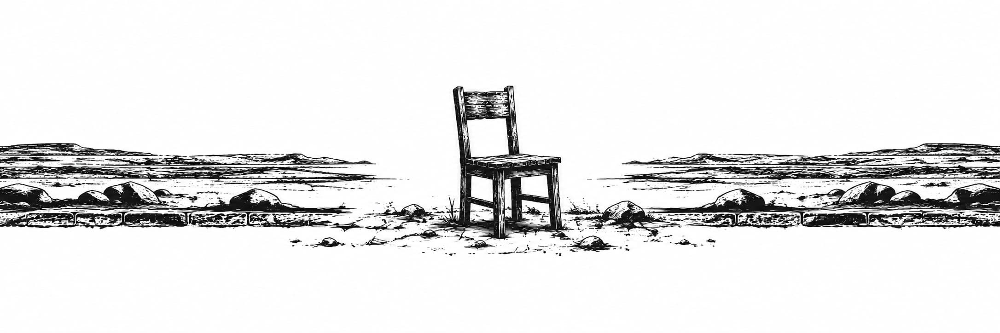

<h2 class="h2-1 text-center" align="center" id="ch3">PHẦN HAI</h2>

Tôi phải mô tả sự kiện ấy thật chi tiết, điều mà tôi thấy rất khó khăn bởi sự bàng hoàng và kinh ngạc. Mọi chuyện xảy ra đúng lúc lính gác đang mở cửa sập đưa thức ăn để chuyển đồ ăn vào cho chúng tôi. Xoong chảo vẫn luôn được để ở bên trong lồng sắt giam giữ, chúng tôi xếp chúng thành chồng cạnh mấy cái bồn rửa, nhưng chúng tôi phải đưa lại những chiếc đĩa qua các khe song sắt sau mỗi bữa ăn. Thức ăn thường được chở đến trên những chiếc xe đẩy tiếp tế lớn, và chúng tôi phải dùng tay nhặt lấy rồi xếp vào các thùng chứa, một công việc vừa khó chịu lại vừa vất vả. Ở tận cùng căn phòng, phía bên kia song sắt, một cánh cửa kim loại lớn trượt mở ra một khoảng nhỏ, lập tức khơi dậy sự tò mò của chúng tôi. Hôm nay bọn chúng sẽ cho chúng tôi thứ gì? Chúng tôi sẽ có thể làm gì với nó? Hai tên lính gác tiến về phía cánh cửa, vừa kéo chiếc xe đẩy tiếp tế, trong khi tên thứ ba tiếp tục quan sát chúng tôi với ngọn roi da của cai ngục sẵn sàng trên tay. Trước hết, chúng tôi phải lấy chiếc muôi múc canh, bốn mươi chiếc thìa và những con dao cùn dùng để gọt rau củ. Hôm ấy có cà rốt và thịt bò cắt thành những miếng lớn, và những người phụ nữ lập tức bắt đầu tranh cãi xem nên nấu chín toàn bộ số cà rốt hay giữ lại một ít để ăn sống. Cả khoai tây nữa, khiến chúng tôi vô cùng mừng rỡ, vì đó là một món hiếm hoi. Những người phụ nữ bảo rằng thật kỳ lạ, bởi trong thế giới cũ, khoai tâyrất rẻ và là một loại thực phẩm vô cùng giàu dinh dưỡng đến mức, theo Anthea, một người có thể duy trì sức khỏe chỉ bằng cách ăn mỗi khoai tây. Nhưng chúng tôi thấy lượng thức ăn vẫn không đủ, ngay cả đối với khẩu phần ăn vốn dĩ rất ít ỏi của những người phụ nữ không phải làm việc và chẳng có gì để làm trên thực tế, thế nên niềm vui ấy chẳng kéo dài được bao lâu. Một tên lính gác nhét chiếc chìa khóa vào ổ của cửa sập đưa thức ăn. Ngay tại khoảnh khắc chính xác đó, một tiếng động vang lên lớn đến rợn người.

Tôi chưa từng nghe thấy bất cứ âm thanh nào như thế, nhưng những người phụ nữ đều đứng sững lại bởi họ nhận ra đó là tiếng còi báo động. Đó là một tiếng tru liên hồi, chói tai đến thủng màng nhĩ. Tôi chết sững và có lẽ tôi đã đánh mất khái niệm thời gian lần đầu tiên kể từ khi tôi có được khả năng đếm nhịp thời gian. Những người phụ nữ đang ngồi liền bật dậy, những ai đang đứng ở khu vực song sắt để nhận đồ ăn thì lùi phắt lại. Tên lính gác buông thõng chùm chìa khóa, để mặc chúng cắm nguyên trong ổ khóa rồi quay người lại đối mặt với những tên khác. Bọn chúng nhìn nhau trong chốc lát, rồi tất cả cùng lao vụt về phía lối ra chính, đẩy toang cánh cửa đôi ra, điều mà bọn chúng chưa từng làm trước đó, và chạy vụt ra ngoài.

Bọn chúng chạy ra ngoài. Lần đầu tiên kể từ khi chúng tôi bị giam cầm, những người phụ nữ chúng tôi hoàn toàn đơn độc trong hầm ngầm.

Đối với tôi, cú sốc ban đầu nhanh chóng qua đi. Tôi lao tới, luồn tay qua các song sắt, vặn nốt chiếc chìa khóa và rút nó ra cùng với cả chùm chìa khóa. Tôi đẩy cửa sập đưa thức ăn và nó bật mở. Tôi lùi lại, hai bàn tay siết chặt, bởi vì tôi đang cầm thứ quý giá nhất trên đời. Chiếc đồng hồ sống của tôi đã khởi động trở lại và tôi có thể nói rằng chúng tôi đã đứng đó hơn một phút, trân trân nhìn cánh cửa mở toang, vẫn chưa thể tiếp thu nổi chuyện gì đã xảy ra. Cú sốc khiến tôi mất hết hơi thở và tôi đang thở dốc. Tôi lấy lại bình tĩnh, nắm lấy các thanh song sắt và lao quacửa sập đưa thức ăn để mở khóa cửa của lồng sắt giam giữ. Có khá nhiều chìa khóa trên vòng treo, tôi đã phải thử qua hai cái mới tìm đúng chiếc phù hợp. Vì chưa từng sử dụng chìa khóa bao giờ, tôi lóng ngóng một hồi, nhưng cuối cùng tôi cũng mở được cánh cửa lồng sắt giam giữ. Những người phụ nữ nhìn tôi, chân chôn chặt xuống nền đất. Trông họ như thể không tài nào hiểu nổi chuyện gì đang diễn ra.

“Nào,” tôi hét lên. “Ra ngoài đi!”

Rồi tôi chạy thục mạng đến cánh cửa kia. Tôi hoàn toàn không biết mình sẽ tìm thấy gì ở đằng sau đó. Nó chỉ cách đó có vài mét, khiến tôi tự hỏi liệu mình có đụng độ lũ lính gác hay không, liệu tôi có đang đâm đầu vào hiểm nguy hay không, nhưng tôi tự nhủ rằng những người phụ nữ sẽ đến ứng cứu nếu cần thiết, và bốn mươi người phụ nữ đang phẫn nộ sẽ thừa sức đối phó với vài tên lính gác, dẫu cho bọn chúng có mang theo vũ khí đi chăng nữa. Tôi bước qua cánh cửa đang mở, và thấy mình đang đứng trong một hành lang rộng lớn, vắng lặng. Hai bên là những cánh cửa dẫn vào những căn phòng mà tôi hoàn toàn không biết gì về chúng.

Người phụ nữ đầu tiên đến nhập hội với tôi là Anthea, và ngay sát phía sau chị là Dorothy, người từng thẩm vấn tôi. Cả hai đều mang chung một biểu cảm hoài nghi ngỡ ngàng. Họ cất tiếng nói, nhưng lời nói của họ đã bị át đi bởi tiếng còi báo động liên hồi, và tôi không thể hiểu nổi họ đang nói gì. Tôi nhận ra là mình cũng đang lên tiếng, tôi nói rằng đám lính gác không còn ở đây nữa, rằng bọn chúng đã bỏ đi, bọn chúng đã chuồn mất, và những điều đại loại thế. Tôi cứ lặp đi lặp lại mãi một câu nói ấy, tựa như đang thốt lên một sự thật khó tin cần phải được nhắc lại nhiều lần để tự thuyết phục chính mình. Chúng tôi kiên trì với cuộc trò chuyện vô vọng ấy trong vài giây, rồi tiếng còi chợt tắt ngấm, như thể bị bóp nghẹt bởi chính tiếng ồn của nó.

“Bọn chúng đi rồi,” tôi nói.

Dorothy gật đầu. Anthea đồng thanh lặp lại:

“Bọn chúng đi rồi.”

Chúng tôi hoang mang đến mức chỉ biết đứng chôn chân ở đó, hoàn toàn lạc lối. Rồi từng người một, những người phụ nữ khác xuất hiện, thoạt đầu còn ngập ngừng, nhưng sau đó, khi họ trấn an nhau, họ bắt đầu xô đẩy, chen chúc lấp đầy hành lang vốn quá chật hẹp để chứa tất cả chúng tôi. Tôi lùi lại, bước vào một trong các căn phòng và quan sát xung quanh. Tôi nhìn thấy một chiếc bàn lớn, vài cái ghế và mấy chiếc tủ. Tất nhiên, vào thời điểm đó, tôi chưa biết tên của tất cả những thứ ấy; tôi nhìn thấy những vật thể mà mình không nhận ra khi luồn lách thật nhanh qua giữa chúng, bởi vì tôi đã thoáng thấy một cánh cửa khác ở phía bên kia căn phòng. Nó cũng đang mở và dẫn đến cầu thang.

Hôm nay tôi gọi đó là cầu thang cứ như thể vào lúc ấy, tôi đã biết nó là gì và mình đang tìm kiếm thứ gì. Trên thực tế, chúng tôi thậm chí còn không chắc chắn rằng mình đang ở dưới lòng đất. Những người phụ nữ nghĩ vậy vì không có cửa sổ nào cả. Tôi chưa bao giờ đặt chân đến chân cầu thang, nhưng tôi đã nghe nói về chúng và lập tức nhận ra đây là gì. Tôi chạy vụt lên vài bậc rồi quay lại gọi thừa thãi, bởi vì Anthea và Dorothy đã đi theo tôi. Họ thận trọng hơn tôi; sau này họ kể lại rằng họ rất sợ lính gác thình lình xuất hiện, và trước khi đi theo tôi, họ đã hét lên với những người phụ nữ rằng họ có thể phải chiến đấu, và những người phụ nữ đã đáp rằng họ sẵn sàng chịu chết nếu cần thiết, nhưng họ sẽ không bao giờ quay lại lồng sắt giam giữ. Tôi không còn nghĩ đến họ nữa. Tôi lao vút lên cầu thang bất chấp; tôi chạy với một thứ hưng phấn tột độ, một sự say sưa giống hệt cảm giác mà tôi không còn có thể tự khơi gợi bằng cách bịa ra những câu chuyện một khi đã thoát khỏi sự cô lập và bắt đầu trò chuyện vớinhững người khác. Tôi được thúc đẩy bởi một xung lực mạnh mẽ đến mức nếu một tên lính gác xuất hiện vào khoảnh khắc đó, dù hắn có cao lớn gấp đôi tôi đi nữa, tôi cũng sẽ xô ngã và dẫm đạp hắn dưới chân; tôi bị chi phối bởi một niềm vui cuồng nhiệt chẳng màng đến điều gì khác. Tôi leo lên mà không hề hụt hơi, không chút mệt mỏi, dù tôi chưa từng bước quá hai mươi bước chân trên một đường thẳng. Tôi bay vút lên các bậc thang hệt như trong những giấc mơ sau này, những giấc mơ mà tôi từng nghe những người phụ nữ miêu tả, nơi bạn bay bổng và lướt đi giống như loài chim mà chẳng bao lâu nữa tôi sẽ ngắm nhìn bị cuốn đi bởi các luồng không khí, lướt trôi nhẹ tênh, nhảy múa hàng giờ trong chập choạng hoàng hôn, y như cách tôi đang nhảy múa lên từng bậc thang, không trọng lượng, lơ lửng, trong một cuộc đi lên đầy phấn khích hướng tới cõi vô định chưa từng dám mơ tới, thế giới bên ngoài, thế giới không phải là lồng sắt giam giữ; và tôi chẳng màng suy nghĩ, chỉ còn lại một cảm giác rung động tận xương tủy cuốn phăng tôi đi, và có lẽ cả những hình ảnh đang chạy đua trong tâm trí, hoặc đơn giản là những từ ngữ trào dâng để đón lấy những hình ảnh sắp xuất hiện: bầu trời, màn đêm, đường chân trời, mặt trời, ngọn gió, và rất nhiều, vô số từ ngữ đã tích tụ qua nhiều năm tháng đang hối hả thúc giục tôi. Ồ! Lần đầu tiên tôi bước lên cầu thang ấy! Khi nghĩ về điều đó, khóe mắt tôi ngấn lệ và tôi cảm thấy thôi thúc ấy, đợt sóng khải hoàn ấy. Tôi nghĩ rằng mình sẵn sàng đánh đổi mười hai năm giam cầm để được trải nghiệm lần bước lên kỳ diệu ấy, sự chắc chắn tuyệt vời đã khiến tôi nhẹ bẫng đến mức bay vút qua một trăm bậc thang trong một hơi thở, không dừng lại, và tôi đang cười.

Bỗng nhiên, tôi thấy mình đã ở trên đỉnh. Tôi đang đứng ở nơi mà sau này chúng tôi gọi là căn chòi lối vào hầm, gồm ba bức tường và một cánh cửa cũng đang mở, với bình nguyên trải dài trước mắt. Tôi chồm tới trước và nhìn ngắm. Đó chính là thế giới.

Đó là ban ngày. Bầu trời mang màu xám, nhưng không phải là màu xám vô tri của những bức tường hầm ngầm. Những khối mây lớn với sắc độ tinh tế nhẹ nhàng trôi trong làn gió nhẹ. Tôi nhận ra chúng là những đám mây; chúng phớt màu ngọc trai, được chiếu sáng từ phía sau bởi mặt trời. Một cảm xúc kỳ lạ nghẹn ngào dâng lên trong lồng ngực tôi, điềm tĩnh và tinh tế hơn nhiều so với sự phấn khích bồng bột đã nâng bước tôi lên cầu thang. Tôi ước mình có thể nán lại, nhưng còn quá nhiều thứ khác phải khám phá. Trời đang lất phất mưa. Định mệnh thật khéo trêu ngươi khi bắt chúng tôi trồi lên vào một ngày mưa. Sau này, chúng tôi nhận ra mưa rất hiếm vào mùa này. Tôi bước tới trước, ngẩng mặt và giơ tay đón lấy thứ độ ẩm phi thường này, thứ mà tôi từng nghe kể nhưng chưa bao giờ có thể tưởng tượng nổi. Vài giọt nước rơi xuống tay và tôi liếm chúng, say mê. Chiếc váy của tôi nhanh chóng đẫm nước và cơn gió, dù nhẹ nhàng đến mấy, cũng dán chặt nó vào đùi, và tôi thấy điều đó thật tuyệt vời.

“Chúng ta đang ở đâu thế?” một giọng nói vang lên sau lưng tôi.

Đó là Dorothy đang thở hồng hộc, được Anthea đỡ lấy. Cả hai nhìn quanh, và tôi cũng vậy. Chẳng có gì ngoài một bình nguyên nhấp nhô nhẹ nhàng kéo dài đến tận chân trời, từ đầu này sang đầu kia.

“Chúng ta đang ở bên ngoài,” tôi đáp, bật cười. “Và không có lấy một tên lính gác nào cả. Bọn chúng đi hết rồi.”

“Chúng ta ở rất xa thị trấn, chẳng có chút dấu hiệu nào của nhà cửa cả. Tôi vẫn luôn nghĩ rằng mình phải ở gần một thành phố lớn nào đó,” Anthea nói.

Dorothy cau mày.

“Tôi chưa từng thấy cảnh này bao giờ. Bình nguyên này rộng lớn quá, nó cứ trải dài mãi. Chúng ta không ở đất nước của tôi, ở đó lúc nào cũng nhìn thấy núi non.”

Anthea có vẻ bối rối và lo lắng đến mức tôi cảm thấy thương hại chị ấy.

“Thì sao chứ?” tôi nói. “Điều quan trọng nhất là chúng ta đang ở bên ngoài, được tự do, và không có lính gác.”

Những người phụ nữ khác bắt đầu bước ra, thở hổn hển và lảo đảo, còn tôi và mọi người dịch ra xa căn chòi lối vào hầm để nhường chỗ. Chẳng mấy chốc, tất cả đều đã ở đó, ngơ ngác nhìn xung quanh, cố gắng tìm hiểu xem mình đang ở đâu, hết người này đến người khác lặp lại rằng họ chưa từng thấy cảnh tượng nào như thế, gần như hoảng sợ khi phải ở một nơi xa lạ đến vậy. Tôi không thể hiểu tại sao họ lại không vui mừng hết lòng trước phép màu được ra ngoài trời, được giải thoát khỏi lồng sắt giam giữ, được nhìn thấy bầu trời và cảm nhận gió mưa. Họ đã khao khát điều đó suốt cả cuộc đời, nhưng giờ đây khi đã có được nó, họ lại không nhận ra. Có lẽ, khi một người đã trải qua một cuộc sống đời thường có ý nghĩa, họ sẽ không bao giờ có thể quen với sự kỳ lạ. Đó là điều mà tôi, kẻ chỉ trải qua sự phi lý, chỉ có thể phỏng đoán.

“Tôi sợ lắm,” Annabel nói.

Họ chụm lại với nhau, một nhóm người nhỏ bé và run rẩy giữa một vùng đất vô danh. Sau sự quen thuộc của lồng sắt giam giữ, bốn mươi người phụ nữ bám chặt lấy nhau, lạc lõng trước sự tĩnh lặng bao la mà từ đó chẳng có gì tỏa ra.

“Lỡ bọn chúng quay lại thì sao?”

Tôi nhận ra họ đang cố tìm lý do để biện minh cho nỗi sợ của mình. Mọi người đảo mắt quan sát xung quanh; tất cả những gì chúng tôi thấy chỉ là bình nguyên đá sỏi nơi chẳng có gì chuyển động ngoài những khóm cỏ thưa thớt đang khẽ lay động trong gió.

“Chúng ta không được ở lại đây, chúng ta phải rời đi, phải trốn thôi,” Annabel nói.

“Đi đâu cơ chứ?” Frances lầm bầm. “Chẳng có gì cả. Không một tòa nhà, không một nơi trú ẩn, không một con đường, chỉ có…”

Chị nhìn vào công trình nhỏ mà chúng tôi vừa chui lên.

“Chỉ có căn chòi lối vào hầm này, ở giữa chốn hoang vu.”

“Chúng ta lạc mất rồi,” một giọng nói vang lên.

Có tiếng thì thầm với những câu nói dang dở, câu này tiếp lời câu trước đang bỏ lửng, lời nói của họ va đập và chồng chéo lên nhau. Tôi bỗng nổi cơn thịnh nộ.

“Thế thì quay lại dưới đó đi! Lồng sắt giam giữ vẫn còn ở dưới kia kìa, nếu các người sợ ra ngoài đến thế!”

“Ồ, cô bé và cái thói…” Annabel bực bội đáp trả.

Chị khựng lại giữa chừng. Tôi nghĩ rằng chị định nói là sự xấc xược, hoặc tính nổi loạn, nhưng Annabel nhanh chóng nhận ra rằng tôi nói đúng, rằng việc hoảng loạn này sẽ chẳng đưa họ đi đến đâu cả. Tôi cũng cố kìm nén bản thân, bởi tôi cảm nhận được một cuộc tranh cãi đang chớm nở, và điều đó sẽ tạo cho họ một lối thoát để xả nỗi lo âu rồi quay sang chống lại tôi. Anthea, người vẫn giữ được vẻ bình tĩnh, đã lên tiếng bênh vực tôi.

“Đứa trẻ nói đúng đấy. Chúng ta phải suy nghĩ và tự tổ chức lại. Tôi không hiểu lũ lính gác đã đi đâu, hay tại sao bọn chúng lại biến mất, và tôi cũng đang sợ đây. Bọn chúng rời khỏi hầm ngầm chưa lâu mà chẳng hề có lấy một dấu vết nào của bọn chúng.”

“Mười một phút,” tôi nói thêm, “kể từ lúc còi báo động hú lên, có lẽ lâu hơn một chút, vì có lúc tôi đã quên mất thời gian. Chúng ta mất mười một phút để mở cửa, đi ra ngoài và leo lên các bậc thang.”

“Mười một phút ư? Với trực thăng hoặc máy bay hạng nhẹ, đó là khoảng thời gian dư dả để bọn chúng biến khỏi tầm mắt, tôi đoán thế. Nhưng còn chúng ta thì sao? Chúng ta không thể biến mất như thế được. Để đi đến đằng kia, tới tận chân trời, chúng ta sẽ mất nguyên hai hoặc ba tiếng đồng hồ đi bộ. Nếu bọn chúng định quay lại và tóm lấy chúng ta, chúng ta sẽ bị bắt trong chốc lát thôi.”

“Không phải tôi,” Annabel nói. “Tôi thà chết chứ không quay lại đâu. Bọn chúng có tiêm thuốc bao nhiêu tùy thích đi chăng nữa, tôi chắc chắn mình có thể biến liều thuốc được định lượng cẩn thận nhất thành một thứ độc dược chí mạng.”

“Tôi cũng vậy,” Greta nói. “Tôi sẽ ngừng thở. Chắc chắn đó là vấn đề ý chí thôi, tôi tin là người ta có thể bắt tim mình ngừng đập.”

Những lời đó củng cố thêm quyết tâm của họ, họ bắt đầu đồng thanh: “Tôi cũng vậy”, “Tôi cũng thế”. Sự nổi loạn đang nhen nhóm, rõ ràng là lần này, họ sẽ không bị đánh úp bất ngờ như những gì từng xảy ra trong quá khứ, rằng họ sẽ không để bản thân bị cuốn theo các sự kiện như những sinh vật sợ hãi bị dắt đến lò mổ, bởi vì họ không thể hình dung nổi cái lò mổ ấy. Họ vươn người đứng thẳng lên và ngắm nhìn phong cảnh lạ lẫm. Họ đặt bàn chân vững chãi hơn xuống mặt đất, và những nụ cười đã xuất hiện.

“Trời đang mưa,” Frances nói.

Chị đưa tay ra hứng những hạt mưa giống như tôi từng làm rồi đưa lên môi. Sau đó, chị sờ lên tóc và má mình.

“Tôi ướt sũng rồi. Tôi đã quên mất cảm giác này thế nào. Đã lâu lắm rồi…”

“Hơn mười hai năm,” Greta nói. “Nhìn xem đứa trẻ đã lớn thế nào rồi kìa.”

Họ quay sang nhìn tôi, chiếc đồng hồ sống của họ, và trân trân nhìn tôi trong im lặng suốt một hồi lâu, rồi họ tản ra đôi chút. Họ cúi xuống và chạm tay vào mặt đất. Một vài người nhặt những viên đá lên để lộ lớp đất khô và xám ngắt, bởi nước mưa chưa ngấm xuống sâu. Annabel liếm ướt ngón trỏ rồi giơ lên cao để xem gió đang thổi theo hướng nào.

“Những đám mây rất nhẹ. Chắc là đang giữa ngày, có thể thấy mặt trời đang ở trên cao. Nếu nó di chuyển theo hướng thông thường, thì gió đang thổi từ phía tây tới.”

“Đương nhiên rồi, bởi vì trời đang mưa. Gió tây lúc nào cũng mang theo mưa mà.”

“Ở đất nước của chị thì có thể, nhưng chúng ta đâu có ở đất nước của chị.”

“Ồ không! Phải có đồi núi và rừng cây chứ!”

Điều đó khiến họ bật cười. Họ cần phải giải tỏa bớt sự căng thẳng.

“Thật kỳ lạ, chẳng có con chim nào cả. Lũ chim đi trú ẩn ở đâu khi trời mưa vậy?” Greta hỏi, người từ trước tới nay chỉ sống ở thành phố.

“Nhưng chúng trú ẩn ở đâu được cơ chứ? Chẳng có lấy một bóng cây nào trong tầm mắt, chỉ có vài bụi cây lùn.”

“Và những hòn đá,” Dorothy nói. “Chẳng thể trồng trọt được gì ở nơi này đâu. Tôi chưa từng thấy thứ đất nào cằn cỗi đến thế.”

“Dù sao thì, chúng ta cũng có gì để trồng đâu.”

Câu nói ngắn ngủi đó lơ lửng trong không trung một giây, như thể tâm trí họ đang nắm bắt nó, thăm dò nó rồi lại đặt sang một bên để tính sau. Nhưng nó để lại một âm vang:

“Chúng ta phải chuẩn bị chút thức ăn thôi,” Greta nói. “Đã đến giờ ăn rồi, mà chị thì đang đói. Thật buồn cười, vì ở dưới kia, chị chưa từng cảm thấy đói bao giờ.”

Thức ăn nằm trong hầm, trên chiếc xe đẩy tiếp tế. Một cơn rùng mình lan qua nhóm phụ nữ khi nghĩ đến việc chúng tôi phải quay ngược xuống dưới đó nếu muốn ăn.

“Làm sao mà nấu nướng được chứ? Tôi chẳng thấy cách nào nấu được cả!”

“Thì sao chứ? Chúng ta vẫn phải ăn, dù cho thịt có là đồ sống đi nữa!”

“Tôi sẽ không xuống dưới đó đâu. Tôi thà chết đói còn hơn,” Annabel tuyên bố.

Một lần nữa, họ xích lại gần nhau, vai kề vai, tìm kiếm sự an ủi từ sự tiếp xúc ấy, tôi đoán thế. Phải có người xuống dưới, và dĩ nhiên, đó là tôi. Có lẽ vì tôi không nhớ bất kỳ thế giới nào khác ngoài nhà tù này, nên tôi là kẻ ít sợ hãi nhất. Khi họ cụm lại với nhau, tôi không nhập hội, cứ thế đứng tách ra khỏi nhóm, và ánh mắt họ đổ dồn về phía tôi. Tôi hiểu ý, bèn mỉm cười với họ:

“Đương nhiên rồi,” tôi nói. “Cháu sẽ xuống.”

Tôi không chần chừ, lập tức bước thẳng về phía căn chòi lối vào hầm. Họ đi theo sau cách đó vài mét, như thể muốn tiếp thêm sức mạnh cho tôi để làm điều mà họ vốn vô cùng sợ hãi, và tôi thấy nhẹ nhõm vì chân tôi chợt khựng lại khi tới bậc thềm. Lỡ như lũ lính gác quay lại thì sao? Liệu đám phụ nữ có chống trả nổi không? Thoáng chốc, tôi mường tượng ra một cuộc thảm sát kinh hoàng, tưởng tượng cảnh mình quay lên và bắt gặp một đống xác chết cùng lũ lính gác đang nhe răng cười chờ đợi, lăm lăm vũ khí trong tay. Tôi tự xốc lại tinh thần, bởi tôi không muốn làm kẻ hèn nhát, rồi bước xuống cầu thang. Kể từ đó, tôi đã quay lại nơi này hàng trăm lần, đó là một trong số ít những thứ tôi không hề đếm, và lần nào cũng khó chịu y như thế, hệt như đang bước vào một cái bẫy có thể sập xuống bất cứ phút nào. Khi ở một mình, tôi hình thành thói quen chặn cửa căn chòi lối vào hầm bằng vài hòn đá: thật ngớ ngẩn, ổ khóa thì gỉ sét, chốt cửa thì kẹt cứng, và gió chẳng bao giờ đủ mạnh để xê dịch cánh cửa gỗ nặng nề ấy, nhưng làm vậy khiến tôi thấy yên tâm hơn.

Tôi lao xuống một trăm bậc thang nhanh nhất có thể, nhưng hết sức cẩn trọng vì trước giờ tôi chưa từng bước đi trên cầu thang bao giờ và sợ ngã, rồi tôi chạy dọc hành lang để rồi đối mặt với vấn đề bê những chiếc nồi khổ lớn, cà rốt, thịt, và cảnước nữa. Tôi nhận ra mình sẽ phải đi lại vài chuyến và việc này có lẽ vượt quá sức chịu đựng của tôi. Nửa tiếng trước, tôi đã phấn khích đến độ lao vút lên trên mà chẳng cảm thấy mệt mỏi chút nào, nhưng giờ đây tôi đang thở dốc, thấy chóng mặt và hai chân run lẩy bẩy. Tôi tính toán rằng trước mắt mình chỉ cần mang một chuyến đã, thế là tôi chất đầy thịt vào một cái nồi. Khi đi được nửa quãng đường lên, tôi chạm mặt Anthea đang đi xuống.

“Chị cứ nghĩ em không thể tự mình lo xuể.”

“Chị nói đúng đấy, nhiều quá sức. Hơn nữa, chúng ta mới chỉ nghĩ đến nồi niêu, thịt và rau củ, nhưng ta còn cần cả nước để uống, để nấu ăn, và cả đĩa nữa chứ.”

“Và chúng ta phải nhóm lửa nữa. Ở trên kia, họ đang nhặt đá và cành cây khô, nhưng bằng cách nào ta đốt lửa đây?”

Chúng tôi quyết định sẽ mang những thứ tôi đã thu gom lên trước rồi sau đó sẽ quay lại khám phá các căn phòng.

Về sau, chúng tôi đã suy ngẫm rất nhiều về những gì mình phát hiện được, nhưng một lần nữa, chúng tôi chẳng bao giờ tìm ra được một lời giải thích mạch lạc nào. Không có khu ngủ nghỉ dành cho lính gác, cũng chẳng có chiếc giường nào cả, điều khiến Anthea vô cùng ngạc nhiên. Vậy ra bọn chúng không ngủ ở đây sao? Hay bọn chúng rời đi mỗi buổi chiều tối rồi sáng hôm sau lại quay lại? Bọn chúng đã đi đâu?

“Bọn chúng biến mất chỉ trong vòng mười một phút,” Anthea lầm bầm. “Và chúng ta chẳng tìm thấy chút dấu vết nào của bọn chúng. Tôi không chắc một chiếc trực thăng bình thường lại có thể bay nhanh đến thế.”

Các ngăn kéo chứa đủ loại dụng cụ: búa, đinh, tuốc nơ vít, tất cả những thứ mà tôi phải học cách sử dụng, cùng với dao và rìu, những thứ sẽ vô cùng hữu ích. Anthea vô cùng phấn khích khi tìm thấy bốn chiếc ba lô lớn, và chị giải thích chúng dùng để làm gì. Rồi tôi chỉ cho chị thấy một chồng hộp nhỏ. Chúng chứa những que diêm, giải quyết xongvấn đề nhóm lửa thế nào. Nhưng quan trọng nhất, chúng tôi phát hiện ra những kho dự trữ lương thực khổng lồ. Đầu tiên là những chồng đồ hộp khiến Anthea hét lên vì sung sướng; chị đọc các nhãn mác và xướng tên từng món ăn với sự nhiệt tình khiến tôi phải phì cười: dưa cải muối, đậu nướng, pa tê và cả những loại rau củ mà tôi chưa từng nếm thử bao giờ. Sau đó, chúng tôi mở cửa kho lạnh âm năm mươi độ chứa đầy thịt đông lạnh và gia cầm, cùng những bao tải cà rốt, tỏi tây, cần tây và củ cải. Nhờ vậy, chúng tôi sẽ chẳng gặp chút khó khăn gì trong việc sinh tồn.

“Chị không thể tính toán được tất cả số này sẽ dùng được trong bao lâu, nhưng ngay cả với số lượng bốn mươi người chúng ta, chị thấy chừng này dư sức duy trì qua nhiều năm đấy.”

Chị gọi tên mọi thứ mình nhìn thấy và đầu óc tôi chẳng mấy chốc đã quay cuồng với biết bao điều mới học được. Chị hẳn đã tiếp tục khám phá thêm hàng giờ đồng hồ nữa, nhưng tôi bảo chị rằng chúng ta phải quay lại với những người khác đang chờ. Chúng tôi quay trở lại mang theo thịt, đồ hộp, rất nhiều khoai tây và diêm. Mấy người phụ nữ nhóm lửa bằng những cành cây khô được xếp giữa những hòn đá lớn.

“Dorothy chắc mẩm thế nào em cũng tìm thấy diêm cho xem,” Greta nói. “Đàn ông lúc nào chẳng có diêm.”

Chúng tôi lại xuống dưới để lấy nước. Lần này, hai người phụ nữ khỏe mạnh hơn đi cùng chúng tôi.

Trận mưa đã ngớt và những đám mây tan đi trong lúc thức ăn đang được nấu. Mặt trời nhô lên cao giữa bầu trời, điều đó có nghĩa là, theo lời mấy người phụ nữ, đó là thời điểm giữa ngày. Chúng tôi ăn bữa ăn đầu tiên ấy trong những nhóm nhỏ quây quần bên đống lửa, trong khi ở trong lồng sắt giam giữ, mỗi người phụ nữ trước đây đều tự lấy phần ăn của mình và ngồi bất cứ đâu. Thức ăn rất dồi dào và lần đầu tiên, trong các nồi vẫn còn thừa lại một ít, điều đó khiến mấy người phụ nữ đùa cợt:

“Chúng ta sẽ béo lên mất!”

“Sau nhiều năm ăn kiêng ngặt nghèo thế này, chúng ta sẽ mất hết công sức!”

Mãi về sau họ mới giải thích cho tôi hiểu tại sao họ lại thấy điều đó buồn cười đến thế. Kỳ lạ thay, những người phụ nữ giờ đây cười dễ dàng đến vậy lại chưa hề đùa cợt kể từ lúc trốn thoát. Tôi lúc nào cũng nghiêm nghị và chẳng thay đổi chút nào. Tôi cho rằng họ đã bị choáng ngợp bởi những cú sốc liên tiếp.

“Mấy giờ rồi hả em?” Greta hỏi tôi.

Và tôi ngạc nhiên khi nghe chính mình trả lời rằng bây giờ là mười giờ đêm. Mới hơn ba tiếng trôi qua kể từ lúc còi báo động réo lên, và vào khoảnh khắc đó, chúng tôi chưa thức được bao lâu. Thế nên quả thực là chúng tôi đã không tuân theo chu kỳ thức và ngủ thông thường.

“Em nên chỉnh lại đồng hồ của mình đi,” Anthea bật cười.

“Làm sao em biết bắt đầu từ đâu ạ?”

“Chúng ta sẽ ngắm hoàng hôn chiều nay. Lấy đó làm mốc khởi đầu và nói cho chúng ta biết bao nhiêu tiếng đã trôi qua vào hoàng hôn ngày mai đi. Từ hoàng hôn này sang hoàng hôn khác là cả một ngày, phải không?”

“Tôi không biết,” Dorothy nói. “Chẳng phải nó phụ thuộc vào thời điểm trong năm sao?”

Họ lao vào một cuộc tranh cãi hỗn độn vượt quá tầm hiểu biết của tôi. Ngày dài ra vào mùa hè, ngắn lại vào mùa đông, nhưng từ hoàng hôn này sang hoàng hôn khác thì luôn là hai mươi bốn tiếng, đúng không nhỉ? Không ai trong số họ hoàn toàn chắc chắn, thậm chí cả Anthea, người thông minh nhất. Tôi sớm ngừng lắng nghe họ. Dù sao đi nữa, sớm muộn gì đêm cũng sẽ buông xuống: chúng tôi sẽ định qua đêm ở đâu đây?

Tất nhiên, không đời nào có chuyện quay lại ngủ trong nhà tù, và ý nghĩ ở lại gần căn chòi lối vào hầm chẳng hấp dẫn cho lắm. Tôi đã quan sát hành trình của mặt trời và có ấn tượng rằng chúng tôi còn vàitiếng nữa trước khi trời tối. Tôi đề nghị đi xuống lấy thức ăn và chăn mền, rồi rời đi nơi khác. Nhưng theo hướng nào? Làm sao chúng tôi có thể đoán trước được bọn chúng sẽ xuất hiện từ hướng nào khi chẳng có lấy một dấu hiệu nào của đường sá? Hơn nữa, bọn chúng đã rời đi bằng cách nào? Anthea bảo rằng không có chiếc giường nào trong các căn phòng cả. Điều này châm ngòi cho một loạt câu hỏi mới dồn dập, nhưng Dorothy đã đánh hơi thấy sự hỗn loạn sắp sửa bùng phát và nhắc nhở mấy người phụ nữ về điều mà bà coi là vấn đề cốt yếu: nếu chúng tôi đồng ý rời đi, chúng tôi phải quyết định đi về hướng nào. Vậy chúng tôi nên quyết định thế nào đây? Anthea chỉ tay về phía nam: theo hướng đó có một khoảng trũng nhỏ trên mặt đất có thể che giấu chúng tôi.

Mấy người phụ nữ lo lắng rất nhiều về việc lính gác quay lại, nhưng bọn chúng chẳng bao giờ xuất hiện nữa. Phải mất một thời gian dài họ mới giũ bỏ được nỗi sợ hãi, và tôi không thể thực sự hiểu tại sao họ lại không được trấn an sớm hơn. Lính gác đã biến mất trong chớp mắt, không để lại chút dấu vết nào, như thể bọn chúng bay hơi vậy. Bọn chúng từ hư vô xuất hiện và giờ đây đã quay trở lại nơi đó, và tôi ít ngạc nhiên hơn những người khác, những kẻ từng sống trong một thế giới nơi mọi thứ vốn dĩ phải có ý nghĩa. Nhưng tôi chỉ biết đến sự phi lý, và điều đó nghĩ lại đã khiến tôi trở nên khác biệt sâu sắc với họ, như tôi dần dần nhận ra. Chúng tôi đã được tự do.

Thực chất, chúng tôi chỉ vừa chuyển sang một nhà tù mới.

Anthea và tôi đã thực hiện vài chuyến đi xuống để lấy mọi thứ chúng tôi cần. Mấy người phụ nữ đợi chúng tôi bên ngoài căn chòi lối vào hầm và đỡ lấy đống đồ đạc trên tay chúng tôi, rồi chúng tôi lại lập tức quay xuống dưới đó. Đến chuyến thứ ba, họ tóm lấy hai người chúng tôi, vừa mừng rỡ vừa hào hứng.

“Lại đây mà xem! Lại đây mà xem! Nhìn xem chúng ta vừa làm được gì này!”

Cách chỗ chúng tôi ngồi ăn vài bước chân là một bụi cây, không quá rậm rạp nhưng khá cao. Họ đã nhổ bật gốc những bụi cây ở giữa, cào xước cả tay mình, và vắt những tấm chăn lên các bụi cây xung quanh. Chúng tôi đã mang lên hai cây xẻng mà họ dùng để đào một cái hố. Tôi không hiểu nổi.

“Đây là nhà vệ sinh,” họ hào hứng thông báo.

“Chúng ta lại được làm con người rồi,” Dorothy tuyên bố. “Chúng ta có thể giải quyết chuyện đó riêng tư, khuất khỏi tầm mắt.”

Tôi đã quen với nhà vệ sinh trong lồng sắt giam giữ, và tôi không lập tức hiểu được niềm vui của Anthea. Đã có những giọt nước mắt đọng lại trong mắt chị. Chị bước tới công trình dã chiến đó, dừng lại, mỉm cười và hỏi:

“Có ai ở trong đó không?”

Tất cả họ đều bật cười.

“Không, trống rồi, chị vào đi.”

“Lối này này,” một trong số những người phụ nữ lên tiếng, vén một tấm chăn lên để lộ ra lối vào.

Anthea bước vào, buông tấm chăn phía sau xuống và đứng lặng ở đó một lát. Khi xuất hiện trở lại, chị bảo tôi rằng đến lượt em rồi.

Những lời phàn nàn của những người phụ nữ về việc phải bài tiết ở nơi công cộng đã dạy cho tôi rất nhiều điều, và cuối cùng tôi cũng trân trọng tầm quan trọng của dịp ấy. Tôi cảm nhận được rằng mình đang được mời gọi tham gia vào đời sống của quá khứ, vào thế giới mà họ vẫn thường cùng nhau nhắc đến và giờ đây tôi nhận ra họ không còn muốn gạt tôi ra ngoài nữa, dẫu bản thân tôi đã biết rõ rằng mình sẽ chẳng bao giờ bước chân vào được thế giới ấy. Thế là tôi bước về phía khu vực nhỏ được che bằng những chiếc chăn trong lúc họ nín thở dõi theo. Tôi có thể thấy họ đang trao cho mình một thứ gì đó vô cùng quý giá, và sự thiếu hào hứng của bản thân khiến tôi cảm thấy bứt rứt.Tôi vén tấm vải thô và cứng nhắc sang một bên, bước qua rồi thả nó rũ xuống như cũ. Ngay lập tức, một cảm giác lạ lùng trùm lấy tôi. Tim tôi đập thình thịch, đầu óc quay cuồng. Tôi đảo mắt nhìn quanh: tôi chỉ thấy những cành cây gai góc và những nếp gấp của những chiếc chăn màu nâu tạo thành bức bình phong ngăn cách giữa tôi và những người còn lại. Tôi rùng mình. Nhưng chẳng mấy chốc tôi đã hiểu ra: đây là lần đầu tiên trong đời tôi thấy mình hoàn toàn đơn độc. Không một người phụ nữ nào có thể nhìn thấy tôi, và tôi cũng không nhìn thấy bất kỳ ai trong số họ. Tôi thấy điều đó thật phiền nhiễu. Tôi cứ đứng đó ngây người ra, ngẫm nghĩ về hoàn cảnh của mình. Tôi khám phá ra sự cô độc về thể xác, một điều vô cùng bình thường đối với tất cả những người khác, nhưng lại là thứ mà tôi chưa từng trải nghiệm bao giờ. Nó lập tức hấp dẫn tôi.

May mắn thay.

Tôi đã sử dụng cái hố, nhưng tôi cảm thấy không thoải mái vì phải đứng dạng chân, cơ thể khom gập nửa người, trong một tư thế lạ lẫm mà tôi thấy cực kỳ bất tiện. Tôi thấy thật may vì không ai nhìn thấy mình trong tư thế đó, trong khi trước đây tôi chưa từng cảm thấy xấu hổ khi bài tiết trước mặt những người phụ nữ khác, hồn nhiên ngồi chễm chệ trên bệ xí. Sau đó, tôi cầm lấy chiếc xẻng để lấp phân lại theo đúng chỉ dẫn, nhưng tôi lại thấy bứt rứt vì thiếu nước để rửa sạch và thầm mong mình không bị dây bẩn. Rồi tôi bước ra ngoài. Sau này, Anthea đã dạy cho tôi cách sử dụng một nắm lá cây.

Greta và Frances đã vượt qua nỗi sợ hãi khi phải đi xuống lại hầm ngầm và đi cùng chúng tôi trong vài chuyến khi những người phụ nữ chuẩn bị các bọc đồ. Mỗi người chúng tôi đều buộc thắt bốn góc chăn lại để làm thành một dạng túi xách đựng đồ hộp, thịt và nhiều thứ khác mà chúng tôi nghĩ sẽ có ích. Chúng tôi lên đường. Ba chiếc nồi lớn đựng đầy nước được chia cho mỗi chiếc hai người phụ nữ mang, và chúng tôi thay phiên nhau, đổi ca liên tục để đảm bảo những người mang nước không bị mệt rồi vấp ngã, làm đổ sạch cả ra ngoài. Chúng tôi mất hơn một tiếng đồng hồ để chuẩn bị. Khi đoàn người rời đi, mặt trời dường như đã đi được ba phần tư bầu trời, và chúng tôi hy vọng mình sẽ có đủ thời gian để đến chỗ vùng trũng trước khi trời tối.

Anthea, tôi và hai người phụ nữ đã giúp chúng tôi đều rất mệt. Chúng tôi đã leo lên leo xuống cầu thang hơn mười lần, sau những năm tháng mà chúng tôi chẳng phải đi bộ quá mười mét theo một đường thẳng, mà ngay cả khi ấy, những bước đi cũng phải được đo đạc cẩn thận vì không được phép chạy. Những người khác nhận ra điều đó và giúp mang một phần đồ đạc hộ chúng tôi. Khi Dorothy chú ý thấy tôi đang bước đi lảo đảo, bà liền hỏi xem có ai chịu mang hộ bọc đồ giúp cháu không. Sau lần đó, chuyện ấy không bao giờ lặp lại với tôi nữa, chẳng mấy chốc tôi đã trở thành người khỏe nhất, có lẽ vì tôi là người trẻ nhất. Dù thế nào đi nữa, tôi cũng là người dễ thích nghi nhất, có lẽ vì tôi chưa từng biết đến bất kỳ điều gì khác và không hề mang nặng những nỗi niềm tiếc nuối.

Chúng tôi đi dép quai hậu hở mũi, thứ làm cản trở bước tiến của chúng tôi vì những hòn sỏi nhỏ cứ lọt qua các lỗ hổng, làm chân chúng tôi đau nhức và khiến cả nhóm phải đi tập tễnh. Một vài người phụ nữ định đi chân đất, nhưng rồi lại thấy làm vậy dễ bị trầy xước. Chính Laura là người đã nảy ra ý định xé những dải vải từ chiếc váy của mình ra để quấn quanh bàn chân. Chẳng mấy chốc tất cả chúng tôi đều làm theo gương Laura.

Trên đỉnh đồi, chúng tôi dừng lại để nhìn về phía sau. Không một bóng động tĩnh trong khung cảnh mênh mông, khô cằn ấy. Chúng tôi tiếp tục lên đường, ngoái lại nhìn phía sau thường xuyên, và ngay khi căn chòi lối vào hầm khuất khỏi tầm mắt, chúng tôi liền muốn dừng chân, nhưng Greta, người có đôi mắt cực kỳ tinh tường, cho biết chị đoán dưới kia có nước vì chị tưởng mình nhìn thấy những vệt sáng lấp lánh giữa các lùm cây. Tôi đã đi với tầm mắt cúi gằm xuống đất, liên tục cố gắng không làm bản thân bị thương bất chấp lớp tất dã chiến. Tôi ngẩng đầu lên, nhưng dù sau này tôi sẽ nhận ra mình có thị lực cực tốt, lúc ấy tôi hoàn toàn chẳng biết một dòng sông chảy qua những bụi cây trông sẽ như thế nào. Viễn cảnh có nước đã vực dậy tinh thần của chúng tôi và chúng tôi quyết định đi tiếp. Greta đã không đoán sai, và nửa giờ sau, chúng tôi đặt các bọc đồ xuống, cởi váy ra rồi chạy về phía làn nước nông, mát lạnh.

Tôi yêu buổi tắm đầu tiên đến mức nghĩ mình chẳng bao giờ muốn bước lên nữa. Tôi nằm dài dưới lòng suối, để mái tóc bồng bềnh trôi trong dòng nước suốt một thời gian dài. Tôi suýt nữa thì chìm vào giấc ngủ nếu một lát sau không bắt đầu cảm thấy lạnh.

Chúng tôi cứ ngỡ mình đã quá mệt để có thể thấy đói, nhưng một khi đã tắm rửa và nghỉ ngơi xong, chúng tôi thực sự đã nhóm một ngọn lửa. Củi gỗ cháy rất nhanh, chẳng mấy chốc đã thành than hồng và những người phụ nữ làm một loại lưới bằng dây thép để nướng thịt trên đó. Lần đầu tiên trong đời, tôi được ăn một món không phải luộc. Nó ngon tuyệt vời, tôi có cảm giác như mình chẳng bao giờ muốn ngừng ăn. Thực ra, hình như tôi đã chìm vào giấc ngủ khi miệng vẫn còn đầy thức ăn!

Tôi bừng tỉnh giữa đêm. Tôi vô cùng kinh ngạc: trời tối đen như mực! Với đôi mắt mở thao láo, tôi hầu như chẳng thể nhìn thấy bàn tay của chính mình. Bầu trời là một khối đen kịt và khá đáng sợ, như thể nó chực sụp xuống, và tôi phải mất rất lâu mới nhận ra rằng một lần nữa trời lại kéo mây vô cùng dày đặc.

Tôi cảm thấy ngột ngạt và cố trấn an bản thân bằng cách nhớ lại những gì các phụ nữ từng kể về các vì sao ở rất xa, những chòm sao và các thiên hà. Nhưng rồi một nỗi lo âu khác lại ập đến: cảm giác về một khoảng không vô tận, chứng chóng mặt, và nỗi sợ rơi xuống trong bóng tối kỳ lạ này, cứ xoay vòng mãi trong hư vô. Tôi cuộn tròn người lại như để tự bảo vệ mình, và nhận ra rằng mình đang nằm sátvào một người phụ nữ khác, rằng tôi đang chạm vào người ấy. Điều đó khiến tôi giật mình và theo bản năng, tôi dịch chuyển ra xa vì ngọn roi da của cai ngục, nhưng rồi tôi sực nhớ rằng chẳng còn lính gác nào nữa. Dẫu vậy, tôi vẫn không thích tiếp xúc với một cơ thể con người khác, và tôi nhẹ nhàng né ra. Đó là lần duy nhất tôi trải qua cái thôi thúc đã đẩy tôi vào vòng tay Frances đêm hôm đó. Ai đó đã đắp một chiếc chăn lên người tôi, và tôi thấy điều đó thật lạ lẫm và cảm động.

Tôi nằm im giữa những người phụ nữ, những người bạn đồng hành trong đời, đang ngủ say khắp xung quanh. Một cơn gió nhẹ làm xào xạc những chiếc lá, và tôi lắng nghe âm thanh mới mẻ này. Tôi đang ở trong một thế giới khác, và mọi thứ đều lạ lẫm. Kể từ buổi sáng hôm đó, tôi đã liên tục học hỏi không ngừng. Tôi cảm thấy một niềm hạnh phúc dâng trào: dù chuyện gì xảy ra đi nữa, tôi đã rời khỏi hầm ngầm, và cũng như những người khác, tôi biết mình thà chết còn hơn quay lại đó. Ngay lúc này, tôi đã không thể hiểu nổi làm thế nào mình từng chịu đựng được cuộc sống ở dưới đó. Tôi tự nhủ rằng nếu nó không giết chết những người phụ nữ, thì đó là vì con người ta không thể chết vì buồn bã.

Tôi nhìn mặt trời mọc. Bầu trời nhạt dần trong tầm mắt tôi, những mây mù tản đi và trời sáng hẳn, thoạt đầu là màu xám, rồi chuyển sang sắc vàng khi mặt trời lên cao hơn. Tôi nghe tiếng chim hót, và nhìn thấy vài con chim đang bay cao trên bầu trời. Dần dần, những người phụ nữ thức dậy. Họ trông có vẻ ngạc nhiên, như thể màn đêm đã khiến họ quên mất rằng mình đã trốn thoát. Rồi họ cười vang và gọi nhau. Chúng tôi xuống sông để rửa ráy và khi đi sâu hơn để khám phá, chúng tôi bắt gặp một khúc sông đủ sâu để bơi lội. Anthea ôm lấy tôi dưới nước, chị muốn dạy tôi bơi ếch, nhưng tôi vô cùng hoảng sợ. Tôi không thể làm theo các hướng dẫn của chị và bị trầy xước đầu gối vào đá. Nhưng dẫu sao, tôi cũng giữ được người nổi trên mặt nước và rất thích thú khi được thả trôitheo dòng nước nhẹ nhàng. Sau đó, chúng tôi ăn thức ăn trong vài hộp đồ hộp. Những người phụ nữ nhóm một ngọn lửa và gom được rất nhiều than hồng, rồi đặt khoai tây lên trên để luộc. Chúng tôi dành phần lớn ngày đầu tiên ấy theo cách này, ăn uống vì niềm vui thích và lại xuống sông tắm giặt, hết lần này đến lần khác, thảnh thơi dưới ánh mặt trời không quá gay gắt. Thế nhưng chúng tôi vẫn bị ám ảnh bởi nỗi sợ lính gác, và chúng tôi quyết định rằng hai hoặc ba người trong số chúng tôi sẽ luôn canh gác cẩn thận căn chòi lối vào hầm từ trên đỉnh đồi. Đến lượt mình, tôi nói rằng mình không cần ai đi cùng. Tôi có cảm giác rằng mình sẽ tận hưởng việc ở một mình.

Đến tối, những câu hỏi lại bắt đầu trồi lên: chúng tôi đang ở đâu? Chúng tôi sẽ làm gì?

Đây có phải là Trái Đất không?

Họ hỏi tôi khoảng thời gian từ hoàng hôn này đến hoàng hôn tiếp theo là bao lâu: theo chiếc đồng hồ sống của tôi thì vừa đúng hơn hai mươi hai tiếng rưỡi. Rõ ràng điều đó chẳng chứng minh được điều gì, bởi vì chúng tôi hoàn toàn không biết nhịp đập tim của tôi thực chất là bao nhiêu. Không ai trong số những người phụ nữ từng thấy một vùng hoang mạc đá cằn cỗi như vậy trong một khí hậu ôn hòa đến thế, nhưng tất cả họ đều thừa nhận rằng họ không đi lại nhiều và trong cuộc sống trước đây, họ chẳng bận tâm lắm đến địa lý. Hiểu biết của họ chỉ giới hạn trong môi trường xung quanh ngay sát và một vài tuyến đi dạo gần quê nhà của họ. Tất nhiên, họ từng xem phim quay ở những xứ sở chưa từng đặt chân tới, nhưng Trái Đất quá rộng lớn! Thật kỳ lạ khi thảm thực vật lại thưa thớt đến vậy: vài cụm cây nhỏ quen thuộc như sồi thường xanh, hoàng dương và thông rụng lá, nhưng ôi trời, họ thấy thật khó nhớ, cùng một loại cỏ bất thường. Chẳng có loài hoa dại nào, điều đó chẳng có nghĩa lý gì, vì có lẽ chưa phải mùa của chúng. Họ bị ấn tượng bởi sự vắng bóng của côn trùng nhưng không thể suy luận ra được nhiều điều từ đó. Địa hình thoai thoải trải dài về phía chân trời với những đợt sóng nhấp nhô kéo dài nhưng nếu gọi là đồi núi thì hơi phóng đại. Nhưng làm thế nào chúng tôi có thể đối phó với ý nghĩ rằng đây không phải là Trái Đất?

“Chúng ta phải tìm một thị trấn,” họ quyết định.

Nhưng nhỡ đâu các thị trấn thuộc về lính gác thì sao? Nhỡ đâu chúng tôi bị bắt lại thì sao? Có vô số tranh luận, hóa ra lại thành công cốc, bởi thực tế là chúng tôi chẳng bao giờ tìm thấy thị trấn nào cả. Chúng tôi không vội di chuyển: niềm vui được ở ngoài trời, tắm dưới sông và ăn uống thỏa thích khiến chúng tôi đâm ra lười biếng, và chúng tôi dành vài ngày liền để bàn tán vẩn vơ mà những niềm vui khác nhau đã nhanh chóng làm gián đoạn.

Tôi không còn cảm thấy sự thù địch dữ dội như trước; cơn giận của tôi đã dịu xuống. Không còn sôi sục trong hận thù và tìm cách soi mói khuyết điểm của các bạn đồng hành, tôi nhận ra rằng họ rất khó theo đuổi một mạch suy nghĩ trong thời gian dài, hay đi đến tận cùng của một lập luận. Anthea là người duy nhất có khả năng làm được điều đó. Một số điều chị nói khiến tôi nhận ra rằng việc họ không thể suy nghĩ rành mạch là hậu quả của việc bị chuốc thuốc trong một thời gian dài. Có lẽ bản thân tôi đã có thể khôn ngoan hơn và suy nghĩ thấu đáo hơn khi, về sau, tôi thấy mình chỉ có một mình. Chẳng hạn, tôi đã không nghĩ đến việc, sau khi tìm thấy con đường, phải đi theo cả hai hướng của nó. Điều đó chỉ vừa mới đến với tôi gần đây, khi tôi không còn có thể làm thế nữa. Hơn nữa, học thức của họ không lấy gì làm cao: họ là những phụ nữ mà trước những sự kiện bí ẩn này, đã lo việc gia đình và nuôi dạy con cái, hoặc nếu có đi làm, thì là nhân viên cửa hàng, bồi bàn và nhân viên thu ngân, những công việc dần dần được giải thíchcho tôi. Chỉ có Anthea là từng học hành: từng làm nhân viên đánh máy trong vài năm, chị đã quay lại trường cao đẳng để trở thành y tá và vừa tốt nghiệp ngay trước khi chúng tôi bị giam giữ. Chị đã quên đi rất nhiều thứ. Những người phụ nữ khác thiếu tầm nhìn xa và kém tổ chức. Họ nhanh chóng chìm vào nề nếp máy móc; họ chưa bao giờ phát triển những kỹ năng mà họ không cần đến. Nhìn chung, điều đó không thay đổi, và Dorothy, Anthea cùng tôi nhanh chóng gánh vác trách nhiệm về sự tồn tại của chính mình.

Tôi từng căm ghét Dorothy bởi vì bà đã thâu tóm quyền lực hoàn toàn chỉ nhờ vào tuổi tác, nhưng tôi bắt đầu tôn trọng bà khi thấy bà là người đầu tiên nghĩ đến những vấn đề cốt tử. Mỗi khi đám phụ nữ bắt đầu tranh luận rồi lạc đề, Dorothy lại khéo léo ngắt lời họ và đưa ra một gợi ý hữu ích. Tôi thấy rằng uy quyền của bà xuất phát từ sự khôn ngoan, nhưng tôi không có ý định chờ đợi mệnh lệnh từ bà. Tôi thích làm theo cách của bà và suy tính trước. Sau vài ngày, chúng tôi nhận ra rằng mình đã dùng hết một nửa số lương thực dự trữ.

“Chúng ta phải quay lại lấy thêm thức ăn,” bà nói, “và lập danh sách những thứ ở dưới đó. Sau đó, chúng ta sẽ quyết định xem nên ở lại đây hay rời đi.”

Trong tâm trí bà, từ “chúng ta” đó vẫn chỉ gồm Anthea và bà, nhưng tôi biết nó sẽ sớm bao gồm cả tôi.

Khoảng mười lăm người phụ nữ đi cùng Anthea và tôi. Họ không định xuống hầm, mà sẽ giúp mang vác tất cả những gì chúng tôi mang lên. Người ta cũng gợi ý rằng họ nên canh gác, điều mà tôi cho là vô nghĩa. Tôi đã nói điều đó với Anthea.

“Em có thể đúng,” chị đáp. “Nhưng chị cũng sẽ thấy yên tâm hơn nếu có người canh chừng ở trên miệng hầm. Không thể biết trước được điều gì. Chúng ta chẳng có chút manh mối nào về lý do tại sao bọn chúng rời đi, hay bằng cách nào, nên chúng ta không thể chắc chắn rằng bọn chúng sẽ không quay lại.”

Điều đó hợp lý. Thật bất khả thi để dự đoán điều gì có thể xảy ra trong một thế giới mà người ta không rõ luật lệ.

Thế là chúng tôi quay ngược bước chân về phía căn chòi lối vào hầm và, khi đến gần hơn, chúng tôi rơi vào im lặng. Tôi vốn chưa bao giờ là người nói nhiều, nhưng tôi đã quen sống giữa tiếng râm ran đều đặn của những câu chuyện phiếm, và giờ đây tất cả những gì có thể nghe thấy chỉ là tiếng sỏi lạo xạo dưới đôi giày của chúng tôi.

“Nếu chúng ta phải đi bộ, chúng ta sẽ cần những đôi giày tốt hơn,” Anthea nhận xét. “Những đôi xăng-đan này sẽ trụ không quá hai ngày đâu.”

Trong lúc vội vã rời đi, chẳng ai để ý đến những căn phòng mà chúng tôi vừa lao qua, nhưng tôi nghĩ mình nhớ là đã nhìn thấy những đôi bốt khá giống với loại mà lính gác thường đi.

“Vấn đề là chúng ta có tới bốn mươi người!” Greta thốt lên. “Khi đi chân trần, lòng bàn chân của các chị sẽ chai lại, thế nên có lẽ chúng ta nên…”

Nhưng chị không nói hết câu và chẳng ai bắt đầu chuỗi suy đoán quen thuộc như mọi khi. Chúng tôi đang đến gần hơn, và một nỗi điềm gở mơ hồ khiến tất cả chìm vào im lặng. Chúng tôi vô thức giảm bớt tốc độ.

“Không có gì thay đổi cả,” Annabel nói khi chúng tôi đến căn chòi lối vào hầm.

Có một luồng gió nhẹ. Nếu chúng tôi ngừng nói và đứng yên, nó sẽ thì thầm cùng một khúc hát bên tai chúng tôi. Hôm đó, những đám mây đã quay trở lại, bầu trời cao và trắng xóa. Tôi thấy những người đồng hành của mình đang run lên.

“Đi thôi,” tôi giục.

Chúng tôi đã ở ngoài trời thoáng đãng, và tôi rùng mình ghê tởm: khi chúng tôi đi xuống được hai phần ba quãng đường, mùi hôi thối ập vào tôi. Anthea giải thích:

“Đó là mùi của chính chúng ta đã lưu cữu lại. Em đã quên mất nó rồi đấy. Hệ thống thông gió cung cấp không khí có thể thở được, nhưng chỉ có thế mà thôi.”

Rồi tôi nghe thấy nó: đó là tiếng vo ve quen thuộc mà tôi từng nghe suốt cả cuộc đời mình, và tôi nhận ra rằng, kể từ khi ra ngoài, tôi đã ít nhiều cảm thấy bứt rứt vì sự vắng bóng của nó.

“Và đèn vẫn sáng,” tôi nhận định. “Lạ thật. Lẽ ra mọi thứ phải được tắt đi, ngừng hoạt động chứ?”

“Ở cái thế giới này, làm sao chúng ta biết được thế nào là bình thường? Dù sao thì thế này cũng may! Chúng ta đã không nghĩ đến điều đó.”

Đèn chưa bao giờ tắt cả.

Không ai trong chúng tôi muốn bước vào căn phòng lớn chứa lồng sắt giam giữ. Nhưng chúng tôi tự ép mình phải làm điều đó trước tiên, để không làm hụt mất hứng thú khám phá. Những dấu vết lo sợ cuối cùng tan biến khi chúng tôi thấy mọi thứ hoàn toàn y nguyên như lúc chúng tôi rời đi. Chúng tôi hy vọng có thể lấy những chiếc nệm, bởi vì chúng tôi đã phải ngủ trên nền đất cào bằng bằng xẻng, và từng nói đùa rằng mình đã đánh mất sự thoải mái duy nhất mà nhà tù có thể mang lại.

“Chúng nặng lắm,” tôi phản đối. “Em không hiểu làm sao chúng ta có thể mang theo chúng nếu tiếp tục di chuyển. Chúng ta có thể khuân chúng lên, nhưng chỉ dùng được nếu chúng ta quyết định ở lì một chỗ.”

“Và điều đó thật nực cười. Chúng ta phải tìm kiếm nền văn minh.”

“Nền văn minh nào cơ?”

Anthea nhìn tôi.

“Ý em là gì?”

Tôi nhún vai.

“Cứ nghĩ mà xem. Hành tinh này thuộc về bọn chúng, vậy chúng ta còn có thể tìm thấy ai ngoài những kẻ đã giam cầm chúng ta? Em chẳng có chút mong muốn nào được gặp lại bọn chúng cả.”

“Em nghĩ chúng ta đang ở một hành tinh khác.”

Đó không phải là một câu hỏi, mà là một lời khẳng định. Tôi cũng không hoàn toàn bị thuyết phục bởi những gì mình vừa nói. Và tôi cũng chẳng bao giờ tìm ra câu trả lời chắc chắn.

Rồi chúng tôi bước vào căn phòng phía bên tay phải, nơi có một chiếc bàn và vài chiếc ghế. Dọc theo bức tường là sáu chiếc tủ cao và hẹp mà Anthea bảo được gọi là tủ đồ cá nhân, thường có ở những nơi làm việc để mọi người cất giữ đồ đạc. Cửa tủ đang mở. Trong mỗi chiếc tủ, chúng tôi tìm thấy hai đôi bốt, và tôi không thể nhớ nổi đây có phải là những đôi mình từng nhìn thấy hay không. Anthea lấy chúng ra và đặt lên bàn. Ngoài ra còn có hai chiếc áo sơ mi, hai chiếc quần lót và hai chiếc quần dài.

“Những thứ này có thể rất hữu ích. Nhưng số lượng lại không đủ.”

Một ngăn kéo chứa kim và chỉ, cùng với những vật dụng khác mà tôi không thể nhận diện nổi.

“Kéo, cúc áo và khóa kéo, dùng để sửa đồng phục của bọn chúng,” Anthea nói.

Chỉ có bấy nhiêu, điều khiến Anthea cảm thấy khó hiểu.

“Không có ảnh, không có thư từ, chẳng có đồ dùng cá nhân nào cả, nhưng đúng là bọn chúng không sống ở đây. Chắc là bọn chúng cất giữ tất cả những thứ đó ở một nơi nào đó khác. Bọn chúng rời đi vội vàng đến mức chẳng có thời gian để thu gom đồ đạc.”

Anthea bỏ lửng câu nói, hàng mày nhíu lại.

“Có chuyện gì thế ạ?”

“Nhưng nếu bọn chúng không sống ở đây, thì tại sao lại có những chiếc áo sơ mi và đôi bốt này?”

Anthea nhún vai.

Chúng tôi băng qua căn phòng chứa các hộp đồ ăn đóng hộp để sang kho lạnh âm năm mươi độ nằm ở phía bên kia. Anthea dừng lại để kiểm tra chiếc nhiệt kế gắn trên cửa.

“Âm năm mươi độ! Số thực phẩm này được dự tính để dùng trong một thời gian rất dài. Có lẽ nguồn cung thực phẩm tươi không được chuyển đến thường xuyên cho lắm.”

Chúng tôi nhanh chóng lấy những thứ cần thiết. Tôi cảm thấy rất lạnh, một cảm giác hoàn toàn mới mẻ và mang lại sự đau đớn. Thấy tôi đang run lên, Anthea đi lấy một chiếc chăn rồi quấn quanh người tôi.

“Em phải cẩn thận kẻo ngã bệnh đấy. Chị không biết phải làm gì để chữa khỏi cho em đâu, chị chưa thấy thứ gì giống thuốc men cả. Mặc dù bọn chúng vẫn luôn đưa thuốc viên cho chúng ta! Ngồi xuống nghỉ ngơi đi, chị sẽ đun chút nước.”

Ở căn phòng bên kia, chúng tôi đã nhìn thấy một chiếc bếp lò nhỏ cùng cái nồi nhỏ hơn nhiều so với những chiếc chúng tôi thường dùng. Anthea tìm kiếm thứ gì đó để tạo hương vị cho món đồ uống đang pha cho tôi và ngạc nhiên khi thấy chỉ còn vài lá trà ở đáy một gói nhỏ. Tôi không thích hương vị mới mẻ này cho lắm, nhưng vẫn ngoan ngoãn uống và nó đã làm cơ thể ấm lên.

Rồi chúng tôi quay trở lại căn phòng đầu tiên. Anthea bắt đầu tìm kiếm cà phê hoặc thêm các gói trà, nhưng chẳng tìm thấy gì. Tôi không giúp được gì nhiều vì không biết đọc chữ, và những nhãn dán chẳng nói lên điều gì cả. Có rất nhiều dụng cụ: ở khoản đó thì chúng tôi không bao giờ thiếu thứ gì, nhưng chúng tôi hoàn toàn mù tịt về lý do tại sao chúng lại được cất giữ ở đó. Tôi đã nhắc đến búa và đinh rồi, nhưng ở đây còn có cưa, bào, đủ loại kìm, cuốc, xẻng và vài cái đồ mở hộp. Anthea nhận diện được những đồ vật khác mà tên gọi và công dụng đã trôi tuột khỏi trí nhớ của tôi, vì tôi chưa bao giờ có dịp sử dụng đến chúng.

Chúng tôi lấy cưa và xẻng. Chúng tôi phát hiện ra một kho chứa khổng lồ gồm những chiếc chăn giống hệt loại chúng tôi từng được phát, nhưng hoàn toàn mới. Có lẽ chúng được cất giữ để chờ đến khi cần dùng tới.

“Với tốc độ chúng ta dùng hao chúng, số này đủ để dùng trong hai trăm năm đấy!” Anthea thốt lên.

Chúng tôi dùng những chiếc chăn đó để bọc lại số đồ đạc sẽ mang lên tầng trên.

“Chúng ta sẽ không thể mang hết ngần này đâu, nhiều quá mà chúng ta lại quá yếu sau bao nhiêu năm gần như chẳng làm gì cả.”

Một trăm bậc thang đã đủ gây nản chí rồi, nhưng làm sao chúng tôi có thể leo lên với đống đồ nặng nhọc nhường này?

“Chúng ta có thể dùng xe đẩy tiếp tế,” tôi gợi ý, “nếu chúng ta đưa được nó lên cầu thang.”

Chiếc xe đẩy tiếp tế vừa nặng lại vừa rộng. Cầu thang thì thẳng, thế nên chúng tôi sẽ không bị kẹt, nhưng trọng lượng của nó khiến chúng tôi hoài nghi.

“Hãy thử xem sao.”

Sau mười bậc thang, chúng tôi đã thở hồng hộc. Chúng tôi phải nhấc bổng chiếc xe đẩy tiếp tế lên khỏi mặt đất để không làm hỏng các bánh xe, nếu không thì mọi công sức sẽ đổ sông đổ biển.

“Greta vừa dũng cảm lại vừa khỏe mạnh. Nếu chị ấy đi xuống và giúp một tay, chúng ta sẽ làm được.”

Chúng tôi gọi với lên trên, bởi vì chúng tôi chắc chắn những người phụ nữ đang đợi chúng tôi cạnh lối vào. Greta vui vẻ xuống gia nhập cùng chúng tôi. Tiến độ của chúng tôi rất chậm và chúng tôi phải dừng lại liên tục để không bị kiệt sức. Khi Frances và Annabel nhìn thấy chúng tôi mệt mỏi ra sao, hai người đã vượt qua nỗi e ngại và đi xuống để phụ vác những gói đồ mà chúng tôi đã chuẩn bị. Chúng tôi chỉ lấy lượng thịt đủ dùng trong hai ngày, vì đằng nào cũng phải quay lại để lấy thêm thực phẩm tươi, và chúng tôi để lại những chiếc nệm vì chúng quá nặng. Tôi cẩn thận đóng cửa kho lạnh âm năm mươi độ lại phía sau và vào phút cuối, tôi nhặt thêm một chiếc ghế cho Dorothy.

Chuyến quay về diễn ra rất chậm chạp. Chúng tôi phải dọn đường cho chiếc xe đẩy tiếp tế và nhận ra mình đang tạo ra một con đường nhỏ. Annabel đi trước để yêu cầu thêm người hỗ trợ.

“Nhưng con đường này sẽ tố cáo cho bọn chúng biết chúng ta đang ở đâu!” một trong những người phụ nữ phàn nàn.

Anthea và Greta nhún vai. Dần dần, tất cả những người phụ nữ dám đi xuống đều đi đến kết luận rằng lính gác sẽ không bao giờ quay lại nữa. Có một sự dứt khoát tuyệt đối, một sự vắng bóng hoàn toàn mọi dấu vết của bọn chúng trong những căn phòng bỏ hoang, đến mức thật không thể tưởng tượng nổi có ai đó sẽ quay lại và tuyên bố: “Đây là của tao.”

Tôi nhanh chóng tổ chức thành các đội: một số phụ nữ đi trước dọn dẹp đá sỏi trong khi những người khác theo sau, cào mặt đất bằng xẻng. Chỉ cần gặp chướng ngại vật nhỏ nhất là chúng tôi cho xe đẩy tiếp tế dừng lại để quang đường. Vì xe chở nặng, phải vài người cùng đẩy mới tiếp tục di chuyển được. Khi chúng tôi đến nơi, đống lửa đã rực hồng và thịt nướng đang chờ sẵn. Dorothy ngồi ăn trên chiếc ghế của mình, và chúng tôi quây quần xung quanh bà.

“Chúng ta phải rời đi,” bà nói. “Chúng ta không thể định cư ở đây và sống bám vào hầm ngầm như những kẻ ăn bám. Chúng ta phải duy trì tư cách con người. Ta muốn biết chúng ta đang ở đâu, ai đã giam cầm chúng ta và vì sao. Ta không muốn chết khi đang ngồi trên một chiếc ghế giữa một nơi quái quỷ nào đó mà ta chẳng hề hay biết.”

Thật kỳ lạ, bà vừa mô tả chính xác số phận của mình.

“Chúng ta có chăn và rất nhiều chỉ. Chúng ta sẽ may ba lô, và mỗi người phụ nữ sẽ mang theo nhiều nhất có thể. Đi về hướng bắc hay hướng nam đều không quan trọng, vì chúng ta chẳng biết thứ mà mình đang tìm kiếm nằm ở hướng nào.”

“Cả việc chúng ta có vui mừng khi tìm thấy nó hay không nữa,” Anthea lầm bầm.

“Greta, Anthea và đứa trẻ sẽ quay xuống hầm ngầm để lấy đồ hộp. Chúng ta phải ước lượng trọng lượng của những thứ mình ăn mỗi ngày xem liệu một người phụ nữ có đủ sức mang theo lượng thức ăn trong hai tháng hay không. Chúng ta sẽ đi bộ. Chúng ta sẽ rèn luyện sức bền, và sau một thời gian, chúng ta sẽ có thể đi mười hai đến mười lăm dặm một ngày, nghĩa là sáu đến chín trăm dặm tổng cộng. Trong khoảng thời gian đó, thể nào chúng ta cũng tìm thấy thứ gì đó. Nếu không thì…”

Bà rùng mình. Có một khoảnh khắc im lặng, rồi Anthea phá vỡ sự tĩnh lặng:

“Nếu chúng ta mang theo lương thực cho hai tháng, chúng ta sẽ chỉ có thể đi bộ trong một tháng. Chúng ta phải tính đến chuyện quay về.”

Không ai nói gì cả. Chúng tôi không muốn tin rằng mình sẽ chẳng tìm thấy gì. Nhưng vào ban đêm, chẳng có lấy một ánh đèn. Trước kia, luôn có những dấu hiệu của sự sống con người: đường sá, máy bay, ngay cả trên những hoang mạc. Bình nguyên trống trải và bầu trời tĩnh mịch này tạo ấn tượng về một vùng đất không một bóng người.

“Chúng ta sẽ khởi hành sau hai ngày nữa. Ngày mai, chúng ta sẽ may ba lô.”

Đêm đó, bầu trời quang đãng. Sau khi mặt trời lặn, khi màn đêm buông xuống, tôi ngắm nhìn các vì sao suốt một khoảng thời gian dài. Anthea nằm bất động ngửa mặt lên trời, đôi mắt mở thao láo.

“Chị có thức không?”

“Chị không chắc đây có phải là bầu trời bên trên Trái Đất hay không. Chị không thể tìm thấy chòm Đại Hùng, chòm sao duy nhất mà chị từng có thể nhận ra. Ở bán cầu bên kia, người ta có thể nhìn thấy chòm Nam Thập Tự, nhưng chị không biết nó trông như thế nào hay nằm ở đâu.”

Ngày hôm sau, chúng tôi vô cùng bận rộn. Chúng tôi thực hiện vài chuyến quay xuống hầm ngầm để tích trữ lương thực; chúng tôi chia các dụng cụ, xẻng và nồi niêu thành bốn mươi phần. Mườingười phụ nữ khâu ba lô, làm cho chúng chắc chắn nhất có thể. Chúng tôi muốn mang theo xe đẩy tiếp tế, nhưng nó sẽ làm tốc độ của chúng tôi chậm đi đáng kể. Nghĩ lại, tôi không hiểu vì sao việc giữ nó lại bên mình lúc đó lại có vẻ hiển nhiên đến vậy. Cứ như thể tất cả chúng tôi đều có linh cảm về những gì đang chờ đợi phía trước và kiên quyết chối bỏ điều đó. Anthea đặc biệt muốn giữ lại các bánh xe. Chị đưa ra một lời giải thích phức tạp rằng bánh xe chính là nguồn gốc của mọi quá trình kỹ thuật. Cuối cùng, chị tìm ra cách tháo rời nó. Mỗi người cầm một phần. Chúng tôi cũng sẽ mang theo chiếc ghế.

Tốc độ di chuyển của chúng tôi khá chậm vì Dorothy và hai người phụ nữ lớn tuổi khác là Elizabeth và Margaret. Chúng tôi phải dừng lại mỗi giờ để họ nghỉ ngơi, và khi gặp đoạn dốc, dù thoai thoải đến đâu, họ cũng không bao giờ có thể lên đến đỉnh trong một lần. Tôi đi trước, sốt ruột muốn biết bên kia có gì, và lần nào cũng thất vọng, bởi chẳng có gì ngoài bình nguyên, một đoạn trũng thoai thoải rồi lại đến con dốc tiếp theo. Những người phụ nữ dõi theo khi tôi quay lại, hy vọng rằng tôi đã nhìn thấy những ngôi nhà, con đường, tấm biển, nhưng tôi chỉ lắc đầu. Chúng tôi vượt qua ba đợt dốc thoai thoải lớn, và mặt trời đang lặn thì chúng tôi nhìn thấy một con sông khác, nhỏ hơn con sông đầu tiên, và chúng tôi quyết định dừng chân qua đêm. Chúng tôi nhanh chóng dựng trại: bếp lò làm bằng đá, một cái hố ở giữa mấy lùm cây làm nhà vệ sinh, và ba chiếc chăn để tạo sự kín đáo. Bữa ăn tương đối lặng lẽ, sự thất vọng đã bắt đầu len lỏi.

“Lẽ ra chúng ta phải đoán trước được điều này,” Anthea nói. “Bọn chúng đã xây dựng nhà tù tách biệt khỏi mọi thứ, có lẽ nó vốn dĩ phải được giữ kín như bưng.”

Những người phụ nữ lập tức bấu víu lấy ý tưởng này. Họ không muốn chìm đắm trong nỗi buồn, và nhanh chóng tìm cách bắt đầu một cuộc thảo luận mới về chủ đề cũ kỹ về sự giam cầm của chúng tôi. Một lát sau, họ thậm chí còn bắt đầu cười trở lại. Khi mặt trời lặn xuống, Rose cất tiếng hát.

Tôi vô cùng kinh ngạc. Tôi chưa từng nghe thấy âm nhạc trước đó, tôi hầu như không biết đến sự tồn tại của nó. “Kìa, bầu trời đẹp làm sao!” Annabel thốt lên, và tất cả quay lại ngắm nhìn hoàng hôn. Những tiếng reo vui thưa thớt nhanh chóng vụt tắt trước vẻ lộng lẫy bất ngờ của màu sắc. Tôi không nhận ra chúng, tôi chưa từng thấy những sắc hồng và tía ấy, mà chỉ biết màu xám của hầm ngầm. Những dải màu tía dài phớt ánh tím… vài đám mây có sắc xanh lục, lóe lên những tia sáng vàng kim. Khung cảnh đó khiến tôi nghẹt thở và định hỏi Anthea thì giọng hát của Rose vút lên, trong trẻo và mạnh mẽ, xé toạc sự tĩnh lặng. Tôi cảm thấy một thứ rung động, tựa như âm vang từ xa của cơn bùng nổ, nhưng nó kéo dài hơn và khiến mắt tôi ngấn lệ. Chị hát trong một thời gian dài, và những người phụ nữ khác mím môi nhẩm theo lời bài hát. Mặt trời biến mất trong một thứ tiếng reo hò dài, nhẹ nhàng và hoàng hôn buông xuống trên bình nguyên.

Sau đó, trong giấc ngủ, tôi cảm thấy những cánh tay nhấc mình lên: đó là Anthea đang quấn chăn cho tôi. Lần này, tôi không theo bản năng co rúm lại trước ký ức về lính gác và ngọn roi da của cai ngục, nhưng tôi cũng chẳng ngủ lại được. Một cảm giác bất an mơ hồ dâng lên. Tôi bị phân tâm bởi những vì sao, chúng làm tôi mê mẩn. Tôi ngắm nhìn chúng suốt một khoảng thời gian dài, chúng có vẻ đứng yên, thế mà lại di chuyển, chậm đến mức tôi chẳng thể dò theo quỹ đạo của chúng. Tiếng hát của Rose vẫn vương vấn bên tai tôi.

Một lúc sau, tôi đi vệ sinh. Trên đường quay lại, tôi nhận thấy một vài người phụ nữ đang nằm từng đôi một, cách xa nhóm chính, quấn quýt bên nhau dưới cùng một chiếc chăn. Tôi thấy điều đó thật lạ lùng. Khi có cơ hội nói chuyện với Antheavề việc này, chị nhún vai và bảo rằng họ đem lại cho nhau những gì có thể. Tôi không gặng hỏi thêm, bởi tôi cảm nhận được chị đang lúng túng.

Chúng tôi đã đi bộ suốt hai mươi sáu ngày, và mỗi buổi chiều tối đều chìm trong nỗi buồn rồi đến tiếng hát của Rose. Chị không bao giờ lặp lại cùng một bài hát đến lần thứ hai. Ban đầu, chị hát những giai điệu đã học từ trước, rồi chị bắt đầu tự sáng tác, phát triển một tài năng mà chính chị cũng không biết mình có. Đến ngày thứ hai mươi bảy, khi chúng tôi dừng chân ăn trưa, tôi lại đi trước như thường lệ trong lúc những người phụ nữ chuẩn bị thức ăn, và lần đầu tiên, tôi phát hiện ra một thứ. Lưng chừng triền dốc thoai thoải mà chúng tôi sẽ phải đi xuống sau bữa ăn, có một căn chòi lối vào hầm nhỏ hình vuông trông giống hệt căn chòi lối vào hầm mà chúng tôi đã rời đi đến mức ban đầu tôi tưởng rằng chúng tôi đã đi vòng tròn. Nhưng địa thế lại khác. Căn chòi lối vào hầm này không nằm giữa bình nguyên và cũng không quay mặt về hướng nam như của chúng tôi, cánh cửa toang hoác đang quay về phía tôi. Tôi lao tót về phía trước rồi nhận ra mình phải báo cho những người khác. Thế là tôi quay lại, khua khoắng tay chân điên cuồng, và họ bỏ dở những đống lửa cùng xoong nồi để đến nhập hội với tôi. Tôi tự ép mình phải đợi họ. Tôi cũng đã trở thành một người đồng hành tốt.

Họ chạy xộc đến, ngay cả Dorothy cũng bước vội, dẫu bà bị hụt hơi. Anthea và tôi đỡ Dorothy suốt dọc đường xuống đồi, và tôi thấy mừng vì nhiệm vụ này đã giúp mình kiềm chế sự nôn nóng. Chúng tôi đứng quanh cánh cửa hé mở một lúc, lúng túng, sợ hãi tột độ: nhỡ có lính gác thì sao? Tôi bước tới và kéo cánh cửa về phía mình. Bản lề đã rỉ sét và cứng ngắc từ lâu. Tôi kéo mạnh hơn và chúng bung ra, kêu cót két. Tôi nhìn thấy cầu thang, đèn đang bật sáng. Có một mùi khó chịu. Tôi bước vào, với Anthea và Dorothy bám sát gót, và chúng tôibắt đầu đi xuống. Không ai nói một lời, như thể linh cảm về những gì sắp thấy đang đè nặng lên chúng tôi.

Mùi hôi chẳng mấy chốc nồng nặc hơn và chúng tôi còn chưa đi được nửa quãng cầu thang thì nó đã trở nên ngạt thở. Những người phụ nữ dũng cảm nhất đi ngay phía sau chúng tôi, và chúng tôi có thể nghe thấy tiếng họ kêu lên. Dorothy dừng lại, xé gót chiếc váy của mình ra và tạo thành một thứ mặt nạ giữ trước mũi. Tất cả chúng tôi đều làm thế. Nó chẳng giảm bớt mùi là bao nhưng chúng tôi cảm thấy được bảo vệ phần nào. Chúng tôi tiếp tục đi xuống, thở ít nhất có thể, dừng lại để không bị hụt hơi. Từng người một, những người phụ nữ đã câm lặng, và âm thanh duy nhất là tiếng bước chân khẽ khàng của chúng tôi trên bậc thang. Chúng tôi đã xuống đến đáy. Cánh cửa đôi bằng gỗ khổng lồ đang mở toang, giống hệt nhà tù của chúng tôi vào ngày còi báo động réo lên. Tôi bước vào trong và khựng lại chết sững, tê liệt vì kinh hoàng.

Đó là thứ ánh sáng chập choạng ban đêm, nhưng tôi có thể nhìn rõ lồng sắt giam giữ: sàn nhà rải rác những người phụ nữ đã chết. Họ dường như nằm ở khắp nơi, vắt vẻo trên những tấm nệm, quăng quật lên nhau, từng nhóm bám chặt lấy những song sắt, chất đống, nằm rải rác trong một sự hỗn loạn kinh hoàng. Một số người khỏa thân, váy của những người khác rách tả tơi, họ ở trong những tư thế thảm khốc, bị hành hạ, miệng và mắt trợn trừng, hai nắm tay siết chặt như thể họ đã chiến đấu và tàn sát lẫn nhau trong cơn điên loạn mà cái chết đã giật lấy họ khỏi đó.

Ở đây, tiếng còi báo động đã réo lên giữa đêm nhân tạo, cửa bị khóa và lính gác, dĩ nhiên rồi, chẳng bận tâm mở cửa. Những người phụ nữ đã cố gắng. Họ đã chết vì đau khổ, từ lâu trước khi cơn đói giết chết họ. Không có thức ăn, phẫn nộ và tuyệt vọng, họ đã trải qua bao nhiêu ngàycào cấu vào các song sắt bằng chút sức lực cuối cùng, cố gắng cạy tung ổ khóa không chìa không dụng cụ, những ngón tay rớm máu, cố gắng đạt đến điều không tưởng, bệnh tật, cuồng loạn, nằm bệt xuống kiệt sức rồi lại đứng dậy tấn công thép nguội bằng tay không, la hét, khóc lóc, ngơ ngẩn, đôi khi lấy lại được chút tỉnh táo để ngắm nhìn số phận của mình và trốn chạy trong cơn cuồng nộ, và giờ đây họ bốc mùi hôi thối, trương phồng, rữa nát và ngả màu xanh ngắt, lúc nhúc dòi bọ khắp những thân xác đang phân hủy của họ, một hình ảnh lố bịch về số phận lẽ ra đã là của chúng tôi, nếu không nhờ một vận may kỳ diệu.

Những người đồng hành nhập hội với chúng tôi, những người đi đầu bước những bước vội vã, rồi chầm chậm dừng lại. Anthea, Dorothy và tôi dần bị đẩy lùi và thấy mình đứng xếp hàng sát những bức tường hầm ngầm, cách xa lồng sắt giam giữ nhất có thể, bốn mươi người phụ nữ sống đang trừng trừng nhìn bốn mươi người phụ nữ chết. Chúng tôi đứng đó suốt một khoảng thời gian dài, câm lặng vì kinh hoàng, rồi Dorothy quỳ xuống và tôi nghe thấy bà thì thầm:

“Kính mừng Maria, đầy ơn phúc, xin cầu cho chúng con là kẻ có tội…”

Sau này, bà kể với chúng tôi rằng bà đã moi móc lại những ký ức này từ thời thơ ấu, khi người bà dạy bà những lời cầu nguyện của người Cơ Đốc mà bố mẹ bà không hề hay biết.

Những người phụ nữ khác cũng quỳ xuống và lặp lại lời của bà, như thể, khi đối mặt với sự kinh hoàng, những nghi lễ cổ xưa đã lấy lại được ý nghĩa của chúng. Tiếng thì thầm đứt quãng của những từ ngữ hỗn độn vang lên trên đống tử thi ngổn ngang khủng khiếp, rồi giọng nói của Rose cất lên. Chị cất tiếng hát, và ngay lập tức chất giọng nữ cao phong phú, mạnh mẽ của chị lấp đầy không gian. Tôi không hiểu lời ca, nhưng âm điệu quá đỗi chậm rãi, u buồn và sâu sắc đến mức nỗi kinh hoàng biến thành nỗi đau thương và tôi cảm thấy tim mình thắt lại. Khi chị dừng lại,tất cả im lặng, rồi chúng tôi rời đi không một tiếng động, từng người một, và rất chậm rãi bước ngược lên trên.

Vào buổi tối hôm đó, Anthea giải thích rằng Rose đã hát bài cầu nguyện cho người chết, bằng tiếng Latinh, một thứ ngôn ngữ đã chết lâu đến mức chỉ còn được dùng cho các nghi lễ. Tôi không hiểu, tôi vẫn chưa thực sự hiểu nghi lễ là gì, nhưng nếu có ai đó từng đọc những trang này, họ sẽ biết.

Hôm đó, chúng tôi ở lại chỗ cũ. Trở về trại, không ai có thể ăn uống gì và chúng tôi ngồi hàng giờ liền không nói lời nào. Phải đến tận chập tối, chúng tôi mới ăn một chút thức ăn và bắt đầu trò chuyện trở lại. Vậy là chúng tôi không phải là những tù nhân duy nhất. Có một hầm ngầm khác, y hệt như hầm của chúng tôi. Hai sự thật này giáng một đòn tàn nhẫn vào chúng tôi. Chúng tôi không hề hay biết chuyện gì đã xảy ra với mình: có lúc tưởng như việc phát hiện này sẽ làm sáng tỏ mọi sự, nhưng có lúc nó lại khiến mọi thứ trở nên khó hiểu hơn nữa. Nhìn lại bây giờ, tôi có thể nói đơn giản rằng chúng tôi thấy mình càng lún sâu hơn vào sự phi lý.

Tôi nói có bốn mươi người bọn họ: chúng tôi đã lập tức có ấn tượng rằng số lượng bên đó cũng bằng số lượng bên mình, nhưng không ai đếm cả. Tôi đã làm việc đó vào ngày hôm sau, để rồi phát hiện ra rằng họ chỉ có ba mươi chín người, nhưng lại có tới bốn mươi chiếc nệm. Chắc hẳn một trong số họ đã qua đời trước ngày tiếng còi vang lên và thi thể đã được đưa đi. Sau này, khi thảo luận về điều đó, chúng tôi vẫn gọi là bốn mươi, bởi vì họ là những người ngang hàng với chúng tôi, những bản sao kém may mắn. Tôi nhìn xem chùm chìa khóa có bị rơi không, chúng tôi muốn mở lồng sắt giam giữ để đưa các thi thể ra ngoài và chôn cất họ trên bình nguyên, nhưng tôi chẳng tìm thấy gì. Chúng tôi đã cố gắng dùng những dụng cụ mang theo để cạy các thanh song sắt,nhưng hoặc là các thanh sắt quá vững chắc hoặc không ai trong số chúng tôi biết cách làm, bởi vì chúng tôi đã thất bại. Cuối cùng, Anthea và tôi đã khép cánh cửa đôi lớn lại và đó là nghi lễ duy nhất chúng tôi có thể dành cho họ. Chúng tôi rất muốn dựng một ngôi mộ, rồi niêm phong lại, hoặc để lại một lời nhắn rằng, đằng sau những cánh cửa gỗ này là bốn mươi người phụ nữ đã chết vì một nguyên nhân điên rồ vô danh nào đó, nhưng chúng tôi chẳng có gì để viết và gỗ thì quá cứng để chúng tôi có thể khắc lên.

Chúng tôi kiểm kê lại số vật phẩm trong hai căn phòng như đã làm ở hầm ngầm kia, và chúng tôi tìm thấy những thứ tương tự, bao gồm cả những đôi bốt, thật may mắn vì dép của chúng tôi đã trong tình trạng tồi tệ. Một lần nữa chúng tôi có thịt tươi và dự trữ thêm đồ hộp.

Sau ba ngày, chúng tôi lại lên đường. Một thứ quán tính nào đó đã bao trùm lấy những người đồng hành của tôi. Họ ít nói, buổi tối chìm trong yên lặng, ngoại trừ lúc Rose hát, và chúng tôi hòa giọng theo. Tôi tin rằng họ không muốn suy nghĩ, để không phải đối mặt với điều tất yếu, để không phải tuyệt vọng. Họ tin rằng mình sẽ tìm thấy những thị trấn, nền văn minh. Tôi mong đợi sẽ chẳng bao giờ gặp gì ngoài những căn chòi lối vào hầm, và tôi nghĩ họ cũng cảm nhận được điều đó. Tôi không biết thế giới mà họ miêu tả cho tôi, tôi không thể tưởng tượng nổi và, khi sau một quãng đường dài leo dốc, tôi chỉ nhìn thấy một vùng trũng khác, tôi không hề ngạc nhiên, bởi vì tôi chẳng có hình dung rõ ràng nào về bất cứ thứ gì khác. Nhưng tâm trạng chán nản của họ chắc hẳn đã ảnh hưởng đến tôi, bởi vì tôi không còn hứng thú chạy lên phía trước nữa, và chính Greta là người phát hiện ra căn chòi lối vào hầm thứ ba. Chúng tôi chỉ rảo bước nhanh hơn một chút, bị kìm hãm bởi sự lo sợ và, khi bước xuống, chúng tôi không đặt nhiều hy vọng rằng lồng sắt giam giữ sẽ mở, rằng những người bên trong đã trốn thoát được và chúng tôi sẽgặp lại họ một ngày nào đó trên bình nguyên. Chúng tôi được chào đón bằng mùi hôi thối.

Chúng tôi cứ đinh ninh sẽ tìm thấy những người phụ nữ, nhưng đây lại là đàn ông. Họ cũng đã mưu tính trốn thoát. Họ đã thử nạy một chiếc bồn rửa và giật các đường ống để làm dụng cụ cạy ổ khóa. Mọi thứ đều chống lại nỗ lực của họ: các đường ống bị xoắn lại nhưng không đứt, những bồn cầu bằng sứ bị lệch đi, nhưng họ không tài nào đập vỡ được chúng. Các thi thể nằm rải rác khắp nơi, và ở trong tình trạng tương tự như thi thể của ba mươi chín người phụ nữ. Hệ thống điều hòa không khí vẫn đang hoạt động. Dần dần mùi hôi sẽ phai đi và các tử thi vẫn ở đó, được ướp xác hoặc trơ xương, người thì trần truồng, kẻ mặc rách rưới, áo sơ mi rách bươm và quần cắt từ cùng một loại vải mỏng manh như váy của chúng tôi. Họ đã ngã gục khắp mọi nơi, trong đủ mọi tư thế, không chút tôn nghiêm, những nhân chứng bi thảm cho điều không thể hiểu nổi. Rose, ngấn lệ, từ chối bước xuống, và chúng tôi đã không hát khúc nhạc tiễn đưa người chết. Chúng tôi lấy đi mọi thứ có thể dùng được từ các tủ chứa đồ và lập tức rời đi, đi bộ chừng nào còn có thể, để không dựng trại gần một hố chôn tập thể.

Chúng tôi tiếp tục đi trong nhiều tháng, và từ đó trở đi, hết hầm mộ tập thể này đến hầm mộ tập thể khác. Chúng tôi tuyệt vọng về việc bao giờ mới có thể tới được một thị trấn. Kỳ vọng của chúng tôi đã thay đổi: chúng tôi hy vọng tìm thấy, một ngày nào đó, một chiếc lồng sắt giam giữ để ngỏ. Chúng tôi thậm chí quyết định để lại dấu vết về chuyến viếng thăm của mình, để cho những người khác, nếu có, hay biết. Trước cửa của mỗi căn chòi lối vào hầm, chúng tôi dọn sạch khoảng đất trống và vẽ một dấu thập lớn, được xếp bằng đá. Anthea giải thích cho tôi rằng đó là biểu tượng của Kitô giáo, tôn giáo của tổ tiên chúng tôi, và rằng từ rất lâu về trước,đó từng là biểu tượng của những kẻ bị bách hại. Không ai còn sợ sự xuất hiện trở lại của lính gác nữa, chúng tôi không biết rõ chuyện gì đã xảy ra với bọn chúng, nhưng chúng tôi chắc chắn rằng bọn chúng không còn ở đó. Chúng tôi cũng làm một mũi tên để chỉ hướng mà chúng tôi dự định sẽ đi.

“Nhưng giả sử có những kẻ khác lang thang quanh đây giống chúng ta thì sao? Dấu thập và mũi tên quá rõ ràng đến mức rất có thể họ cũng dùng chính những biểu tượng đó, vì họ cũng chỉ có đá để viết mà thôi! Chúng ta cần một chữ ký,” Dorothy tuyên bố, “nếu không, chúng ta có thể tình cờ bắt gặp những dấu hiệu của chính mình mà không nhận ra chúng.”

Chúng tôi không biết phải chọn gì. Trong thế giới trước kia, con người thường ký tên mình, nhưng bốn mươi cái tên được viết trên bụi đất ư? Trên thực tế là ba mươi chín, bởi vì chúng tôi chưa từng biết tên tôi là gì, và những người phụ nữ gọi tôi là đứa trẻ. Chúng tôi nên chọn gì? Một hình tròn? Một hình tam giác? Hai đường thẳng song song? Cuối cùng, Anthea đề xuất một hình chữ thập có một vòng tròn phía trên.

“Điều đó sẽ cho họ biết rằng chúng ta là phụ nữ. Chúng ta còn cần gì nữa?”

“Có thể có những người phụ nữ khác,” Greta nói. “Hãy thêm vào thứ gì đó, và, vì chúng ta chẳng biết gì sất, không biết mình đang ở đâu, hay tại sao, hay đang đi về đâu, hãy thêm một dấu hỏi chấm.”

Việc này ngốn của chúng tôi nguyên vẹn một ngày cho mỗi lần. Một vài người trong số chúng tôi quay trở lại hầm giam nơi có những người đàn ông và vẽ những ký hiệu lớn trên mặt đất. Hầm giam của chúng tôi và hầm giam đầu tiên của những người phụ nữ đã chết không được đánh dấu, nhưng nhiều hầm khác thì có, không phải tất cả, bởi vì tôi không tiếp tục viết chữ ký trên mặt đất một khi đã ở một mình. Tôi đã từ bỏ niềm tin rằng sẽ có bất kỳ sinh linh nào đến.

Chúng tôi đi bộ trong hai năm, tiến bước qua những chặng ngắn, rồi chúng tôi quyết định rằng mình buộc phải dừng lại: Dorothy đang ngày càng yếu đi. Bà nhận thức được điều đó, nhưng đã không muốn nói gì. Chúng tôi có thể thấy bà ngày một chậm chạp hơn. Cố gắng đứng dậy vào một buổi sáng, bà vấp ngã và ngay lập tức rõ ràng rằng bà không thể đứng vững được nữa. Anthea áp tai vào ngực bà: tim bà đang đập rất yếu ớt. Chúng tôi quyết định chờ cho đến khi bà khỏe hơn, nhưng sau hai ngày, bà trở nên bồn chồn.

“Chẳng có ích gì khi chờ đợi,” bà nói. “Tôi già rồi, chắc phải hơn bảy mươi lăm tuổi, tim tôi sẽ chẳng khỏe hơn đâu. Chúng ta phải đi tiếp.”

Nhờ những công cụ mà chúng tôi đã giữ bên mình suốt thời gian qua, chúng tôi đã có thể dựng lên một dạng cáng. Chúng tôi đốn hai cái cây thẳng thớm đẹp đẽ, tỉa sạch thân cây và buộc chiếc ghế vào đó, sử dụng các dải vải được tết chặt. Dorothy rất yếu và thấy lạnh suốt thời gian qua, vì vậy chúng tôi bọc bà trong những chiếc chăn, rồi buộc chặt bà vào lưng ghế và bốn người chúng tôi khiêng bà, chú ý bước đều nhịp để không làm bà bị xóc. Nhưng chúng tôi chỉ duy trì điều đó được vài ngày vì bà thấy việc đó cũng mệt mỏi, và rồi việc tiếp tục ngồi trở nên đau đớn đối với bà. Chúng tôi đóng những cành cây ngang qua hai cây sào gỗ để có thể khiêng bà ở tư thế nằm. Bà cảm ơn chúng tôi rối rít, và bảo rằng bà cảm thấy khá hơn, nhưng chúng tôi có thể thấy bà đang hụt hơi, và trong lúc chúng tôi di chuyển, bà nhắm nghiền mắt hầu hết thời gian. Ban đầu, bà ngủ thiếp đi, và một chút động tĩnh nhỏ nhất cũng đánh thức bà, rồi chúng tôi nhận ra rằng bà không còn phản ứng khi chúng tôi dừng lại để đổi người khiêng. Anthea nói rằng bà đã chìm vào một trạng thái hôn mê nông. Một vài người trong sốnhững người phụ nữ muốn chúng tôi dừng lại, nhưng Dorothy tỉnh dậy và nhất quyết không nghe:

“Nếu các chị dừng lại, tôi sẽ tự nhủ rằng nửa tiếng sau chúng ta có thể đã tìm thấy thứ gì đó, và tôi sẽ chết trong sự tức giận. Tôi muốn tiếp tục đi cho đến hơi thở cuối cùng.”

Và đó là cách Dorothy qua đời, được những người phụ nữ nhẹ nhàng đưa võng trong lúc Anthea bước đi bên cạnh nắm chặt tay bà. Sau một lúc, chị không thể bắt được mạch của Dorothy nữa. Tôi nhìn thấy những giọt nước mắt lăn dài trên má Anthea.

“Mọi chuyện kết thúc rồi,” chị nói.

Những người còn lại bắt kịp chúng tôi và chúng tôi tiếp tục bước đi cho đến tận hoàng hôn, ba mươi chín người phụ nữ và một cái xác, một hàng người kéo dài lê thê băng qua bình nguyên, một đám rước lặng lẽ đi qua cõi phi lý, miễn cưỡng chiếm lấy hư vô, sánh bước bên người phụ nữ ngoan cường có nguyện vọng được chết mà không dừng lại.

Chúng tôi chôn cất bà vào ban đêm. Trời có một lớp mưa phùn mịn. Tiếng khóc than tiễn đưa của Rose lơ lửng trong không gian phía trên bình nguyên.

Chúng tôi ở lại bên ngôi mộ mấy ngày liền, như thể luyến tiếc không muốn rời xa Dorothy và như thể chúng tôi chẳng còn lý do gì để tiếp tục bước đi. Tôi không nghĩ rằng bất kỳ ai trong số chúng tôi còn tin vào những thành phố sẽ mang lại sự cứu rỗi, hay vào một hầm trú ẩn nơi lồng sắt giam giữ sẽ được mở toang. Gần như mỗi buổi chiều, Anthea lại ngước nhìn bầu trời, tự hỏi chúng tôi đang ở đâu. Chị bảo rằng trên Trái Đất, chúng tôi hẳn đã nhận ra sự đổi thay của các mùa, nhưng ở đây, qua mấy tháng trời, ngày hầu như chẳng ngắn đi chút nào, và thời tiết cũng chẳng hề lạnh hơn đáng kể. Lẽ ra phải có những trận bão tuyết hoặc các đợt nắng nóng, chứ không phải kiểu thời tiết bất biến này, với hầu như chẳng có chút mưa nào và thảm thực vật thưa thớt thế kia. Tại sao phải tiếp tục di chuyển? Anthea bảo chúng tôi sẽ chẳng khôn ngoan hơn chút nào về vị trí của mình, chúng tôi sẽ mãi mãi ở gần một căn chòi lối vào hầm và rồi sẽ chết đi từng người một.

Kể từ thời điểm đó, tôi nhận thức rõ ràng rằng một ngày nào đó tôi sẽ là người cuối cùng.

Nhưng dẫu chúng tôi không biết phải đi đâu, chúng tôi cũng chẳng có lý do nào tốt hơn để ở lại, và thế là chúng tôi lại lên đường. Cho đến nay, chúng tôi vẫn đi về hướng nam, và giờ thì chúng tôi đổi hướng. Vẫn có những căn chòi lối vào hầm, những hầm ngầm và những thây ma. Khi Mary-Jane đổ bệnh, chúng tôi quyết định dừng chân. Cho đến khi chị ấy khỏe lại, chúng tôi tự nhủ như vậy, nhưng ai nấy đều ngầm hiểu rằng đó là cho đến khi chị ấy qua đời.

Tôi vốn ít khi giao du với Mary-Jane, một người phụ nữ khá mờ nhạt, luôn tuân theo mọi việc mà không một lời oán thán và chẳng bao giờ đưa ra bất kỳ đề xuất nào. Chị gom củi khi đến giờ nhóm lửa, mang vác phần gánh nặng của mình mà chẳng hề hụt hơi, và khi di chuyển, chị không nằm ở tốp cuối nhưng cũng chẳng thuộc hàng đầu. Thực ra, chị chẳng có điểm gì nổi bật. Tôi đoán đó chính là ý nghĩa của sự dễ tính. Chị là một trong số những người phụ nữ không ngủ một mình, và người ta thường thấy chị đi cùng Emma, người phụ nữ đầu tiên cho rằng hành tinh này không phải là Trái Đất. Đúng là chúng tôi có quá ít người nên ai nấy đều quen biết nhau, nhưng một số mối tương hợp nhất định đã tạo ra những nhóm nhỏ lỏng lẻo. Tôi không cùng nhóm với Mary-Jane, mà ở cùng Anthea, Greta và Frances, nói cách khác, đó là nhóm nòng cốt điều hành đã hình thành quanh Dorothy và là những người đưa ra các quyết định. Có lẽ đó là điều họ gọi là tình trạng gắn bó thân thiết, nhưng dù sao đi nữa, bệnh tật đã kéo tất cả chúng tôi lại gần nhau.

Mary-Jane bị những cơn đau dạ dày hành hạ. Một ngày nọ, chị ra rất nhiều máu, trong khi bản thân đinh ninh rằng mình đã bước qua thời kỳ mãn kinh từ lâu, rồi những cơn đau bắt đầu ập đến. Đêm đó, chị ngủ rất ít, một cơn co thắt đau đớn đánh thức chị dậy và sự đột ngột của nókhiến chị thét lên. Tất cả chúng tôi đều vội vã chạy đến bên chị. Chị lập tức nén lại và chúng tôi nghe thấy tiếng chị rên rỉ, hai tay nhét chặt trong miệng, trán đẫm mồ hôi. Chúng tôi đứng bên cạnh chị, bất lực và tuyệt vọng. Ban đầu, chị bảo chúng tôi quay lại chỗ ngủ đi, rằng chẳng có việc gì chúng tôi có thể làm được, nhưng không ai trong số chúng tôi có thể làm thế và cuối cùng chị cũng chấp nhận sự hiện diện của chúng tôi.

Emma dịu dàng chấm trán cho chị bằng một chiếc khăn ẩm, Anthea đặt một miếng gạc ấm lên bụng chị, và Mary-Jane nói rằng điều đó dễ chịu hơn nhiều. Cơn đau chậm rãi dịu xuống và chị chìm vào giấc ngủ, kiệt sức vì đau đớn. Sau đó, chúng tôi nằm xuống nền đất xung quanh chị và thiếp đi trở lại. Một buổi sáng nọ, khi thức dậy, chúng tôi nhận ra chị không còn ở bên chúng tôi nữa.

Chúng tôi đã dừng chân khá gần căn chòi lối vào hầm nhằm thuận tiện cho việc tiếp tế nhu yếu phẩm. Chúng tôi ngồi đó nhìn nhau ngỡ ngàng, tìm kiếm hình bóng chị giữa mọi người, rồi tôi chợt nảy ý định đi xuống hầm ngầm. Chị ở đó. Chị đã xé chiếc chăn của mình thành những dải vải rồi thắt chúng lại với nhau, sau đó treo cổ tự vẫn vào những thanh sắt, bên cạnh bốn mươi xác đàn ông. Chúng tôi quyết định để chị ở lại đó. Chúng tôi chỉ cắt đoạn dây thừng, đặt chị nằm xuống sàn nhà, cẩn thận bọc kín trong một chiếc chăn khác, cái mới nhất mà chúng tôi có, đôi tay đan chéo trước vùng bụng từng hành hạ chị đến quằn quại, và lần này, Rose đã đồng ý đi xuống hầm để cất tiếng hát. Sau đó, chúng tôi khép cánh cửa lại đằng sau như vẫn thường làm. Chúng tôi vẽ các ký hiệu của mình lên mặt đất rồi rời đi.

Nhưng lần này là để tìm một nơi định cư. Có lẽ hai cái chết liên tiếp ấy đã thuyết phục chúng tôi rằng chẳng có gì trên hành tinh này vốn có thể không phải là Trái Đất. Chúng tôi muốn tìm một dòng sông cách không xa hầm ngầm có thểđáp ứng các nhu cầu của mình: y hệt như cái nơi mà chúng tôi vừa rời bỏ, nhưng tất nhiên, chúng tôi không muốn ở lại quá gần chốn mà một người trong số chúng tôi đã phải tự kết liễu đời mình để chấm dứt nỗi đau đớn. Cái chết của Dorothy từng mang lại nỗi buồn cho những ai yêu quý bà, nhưng bà đã già và đó là một sự ra đi vô cùng thanh thản. Cái chết của Mary-Jane lại là một cú sốc, nó khiến chúng tôi sợ hãi. Những người phụ nữ lớn tuổi không muốn nhắc đến điều đó. Chắc hẳn đó là lý do vì sao chúng tôi rời đi gần như ngay lập tức.

Sau vài tuần, chúng tôi đã tìm thấy thứ mình vẫn hằng tìm kiếm: dòng sông rộng, dòng nước giữa dòng ngập đến ngang đùi chúng tôi, và hai bên bờ mọc rất nhiều cây cối. Chúng tôi quyết định dựng những ngôi nhà bằng đá lớn và một loại vữa làm từ bùn. Về phần mái, chúng tôi dùng thân cây đã cưa nhỏ. Chúng tôi nhận thấy ở một vài đoạn dòng chảy không quá xiết có mọc các loài cỏ nước. Chúng có thể được phơi khô rồi bện lại thành thừng để cột các chùm cành cây thành một lớp dày, tạo ra thứ mà chúng tôi gọi là mái tranh, dẫu chẳng mấy chắc chắn về ý nghĩa thực sự của từ này. Rồi chúng tôi nhận ra rằng nếu trộn chính loài cỏ nước ấy vào vữa, chúng sẽ trở nên kiên cố hơn. Chúng tôi không hề cầu kỳ: phần tường của ngôi nhà đầu tiên dài bốn mét. Mất tận hai tháng để xây dựng và thật dễ chịu biết bao khi được trú ẩn bên trong mỗi lúc trời mưa. Tất nhiên, tất cả chúng tôi không thể cùng lúc chui vào trong ấy được, nhưng những người phụ nữ phải ở bên ngoài liền xích lại gần nhau để giữ ấm, như chúng tôi vẫn luôn làm kể từ sau cuộc trốn chạy, bởi họ biết rằng vào trận mưa tới sẽ đến lượt mình. Ngôi nhà thứ hai tốn ít thời gian hơn. Chúng tôi quyết định làm nó theo hình chữ nhật. Những thân cây không cao và chúng tôi không thể chống đỡ toàn bộ chiều dài mái nhà chỉ bằng một thanh xà đơn độc, nhưng chúng tôi đã xoay sở để đan chéo các thân cây bằng cách gác chúng lên những cột đá, và toàn bộcấu trúc kết nối với nhau rất vững chãi. Thêm nữa, chúng tôi biết rằng ở đây chưa từng có những trận gió lớn.

Có lẽ nó vẫn đang đứng vững đâu đó ngoài kia.

Chúng tôi mang bàn ghế từ căn hầm gần đó lên và, đi cùng với bốn người phụ nữ khỏe mạnh nhất, tôi đi lấy đồ đạc từ những căn hầm khác. Chúng tôi cũng mang theo cả nệm. Chúng tôi thường tìm thấy một số tấm nệm nằm dọc theo các cạnh của lồng sắt giam giữ, và chỉ việc kéo chúng qua các thanh song sắt. Chúng tôi chưa bao giờ lấy những chiếc nệm nào mà việc di chuyển chúng có thể làm phiền đến người đã khuất. Sau khi được phơi phóng một lúc, mùi hôi trên nệm sẽ bay biến đi và chúng hoàn toàn có thể dùng lại được. Đôi khi chúng tôi còn có những phát hiện bất ngờ: một mảnh vải, một kho dự trữ chỉ và một túi dép lê, những thứ tỏ ra vô cùng hữu ích bởi dẫu cho giờ đây tất cả chúng tôi đều đã có một đôi bốt nhờ vào những cuộc đi cướp bóc, nhưng khi dừng bước di chuyển, chúng tôi vẫn thích đi những đôi giày không ôm sát bàn chân. Chúng tôi đã bỏ lại xe đẩy tiếp tế phía sau vì biết rằng trong mọi căn hầm đều có sẵn một chiếc và số lượng hầm thì rất nhiều. Chúng tôi tìm thấy một chiếc xe mới, tháo rời nó ra, mang về và dùng nó để vận chuyển vật liệu xây dựng từ nơi này đến nơi khác. Tổng cộng chúng tôi xây được năm ngôi nhà, và căn đầu tiên trở thành phòng bếp. Chúng tôi lắp một ống khói bởi đã xoay sở chế tạo được một dạng bếp lò: chúng tôi đập dẹt những chiếc vỏ hộp thiếc rỗng, rồi dùng kìm bẻ gập các mép lại để gắn chúng khớp với nhau trước khi đập bẹt chúng xuống lần nữa, qua đó tạo ra một tấm tôn nóng kim loại lớn được đỡ bằng các bức tường đá. Chúng tôi nhóm lửa phía bên dưới và có thể đun nóng vài chiếc nồi trên cùng một mặt bếp. Tôi trở nên thành thạo việc cưa xẻ và có thể làm ra những tấm ván để dựng kệ trữ thức ăn cũng như làm ghế dài.

Tôi đã rất thích thú với việc xây dựng và sẵn lòng làm tiếp, nhưng những người phụ nữ khác thì không muốn thế: sau khichung sống bốn mươi người trong một lồng sắt giam giữ, họ cảm thấy hạnh phúc khi được ở chín hay mười người trong một ngôi nhà. Họ nhắc về những tiện nghi trong chốn ở trước kia của họ, chẳng hạn như nước máy và phòng tắm: đó là những điều thuộc về quá khứ mà chúng tôi buộc phải lãng quên. Tôi có ấn tượng rằng họ thích nghi với cuộc sống định cư dễ dàng hơn là mình. Thỉnh thoảng, tôi lại trèo lên một ngọn đồi và đăm đăm nhìn ra bình nguyên. Tôi muốn dịch chuyển và trở nên bồn chồn không yên. Thế rồi tôi sẽ nghĩ ra việc gì đó để làm: một chiếc bàn hay chiếc ghế dài phụ thêm; thứ khéo léo nhất là một hệ thống ván di động giúp người ta có thể ngồi lên bệ xí. Tôi gom những thân cây cưa đôi theo chiều dọc để làm các tấm vách ngăn di động có thể dễ dàng vận chuyển, nhờ đó chúng tôi có thể dẹp bỏ đám bụi rậm và những tấm chăn che chắn. Đó là một công việc dài và phức tạp mà tôi muốn tự mình thực hiện. Sẽ thật mất vui nếu có ai đó phụ giúp. Khi không còn nghĩ ra được thứ gì để xây, tôi sẽ bảo rằng lưỡi cưa đã cùn, rằng chúng tôi cần đinh hay kìm, rồi thuyết phục một trong những người phụ nữ cùng mình đi thám hiểm trong vài tuần. Lúc trở về, tôi lại nảy ra một ý tưởng mới khiến bản thân bận rộn trong một thời gian, và nó luôn xoay quanh việc chế tạo thứ này hay thứ khác. Nhưng nhu cầu của chúng tôi quá ít ỏi nên cuối cùng tôi chẳng thể nghĩ ra điều gì mới mẻ nữa. Những năm tháng cứ thế trôi đi. Cuộc sống khá đơn điệu, nhưng rồi một ngày nọ, một cuộc trò chuyện tình cờ với Anthea đã khơi dậy trong tôi khao khát được học hỏi.

Giờ đây chỉ còn ba mươi tám chúng tôi sống trong các nhóm ở bốn ngôi nhà. Chúng tôi đã làm những gì Anthea gọi là giường tầng, để các tấm nệm không chiếm hết không gian sàn nhà. Tôi sống cùng Anthea, Greta, Rose, Annabel, Margaret, một trong những người phụ nữ lớn tuổi nhất, và Denise, Laura cùng Frances. Tất cả chúng tôi đều dễ chịu, thực tế và hiếm khi cãi vã. Các nhóm hình thành dựa trên sự hòa hợp tự nhiên càng trở nênrõ ràng hơn khi chúng tôi chuyển vào các ngôi nhà, điều mà tôi hiểu quá rõ bởi tôi sẽ chẳng muốn dây dưa với Carol, người luôn hưng phấn, hay Mary, một người phụ nữ lầm lì và khó lòng trò chuyện. Tôi vẫn thấy khó hiểu về những đôi tình nhân. Thỉnh thoảng lại có những trận cãi vã dữ dội, kèm theo tiếng hét và tiếng khóc, và tôi tự hỏi điều gì có thể gây ra nhiều xáo trộn đến thế. Tôi vốn sợ hãi việc đặt câu hỏi, một di chứng từ những năm tháng đầu đời, nhưng Anthea nhận ra tôi không hiểu nên chị đã giải thích cho tôi về những gì phụ nữ có thể làm cùng nhau. Tôi thấy điều đó thật kỳ lạ, vì tôi rất ghét bất kỳ ai chạm vào mình, điều mà chị cho là do ký ức về ngọn roi da của cai ngục.

“Thế thì, đàn ông dùng để làm gì?” tôi hỏi.

Chị ngạc nhiên trước sự thiếu hiểu biết của tôi.

“Sao em có thể biết được nếu không ai nói cho em nghe? Trong những căn hầm có đàn ông chết, một số người lõa thể và em có thể thấy họ được cấu tạo khác với chúng ta. Em đoán điều đó liên quan đến tình yêu. Chị từng nói về nó nhưng chúng ta đã không bàn đến từ lâu rồi, và em vẫn mù tịt chẳng biết gì hơn.”

Rồi chị lặp lại những điều tôi đã nghe quá nhiều lần trước đó:

“Nói cho em biết thì có ích gì? Đang làm gì còn đàn ông nữa.”

Cơn giận bùng lên trong tôi, nhưng tôi không còn là một đứa trẻ giữa đám đông phụ nữ nữa: dù tôi bao nhiêu tuổi vào thời điểm khởi đầu, chúng tôi đã ở ngoài này được bảy năm rồi và tôi chắc chắn đã qua tuổi đôi mươi. Tôi là một trong số những người phụ nữ biết suy nghĩ, biết tổ chức đời sống cộng đồng của chúng tôi. Tôi đã trở nên thành thạo, tôi có thể cưa, đóng đinh, khâu vá và dệt vải, và tôi không muốn bị đối xử như một đứa trẻ.

Bởi vì tôi muốn biết! Thỉnh thoảng, Anthea có thể dùng đến những gì mình biết, nhưng đó không phải là điều quan trọng nhất. Tôi muốn biếtmọi thứ trên đời. Không phải vì nó có ích, mà thuần túy vì niềm vui được hiểu biết, và bây giờ tôi yêu cầu Anthea phải dạy tôi mọi điều chị biết, ngay cả khi tôi sẽ chẳng bao giờ dùng đến nó. Và đừng quên, tôi là người trẻ nhất. Một ngày nào đó có lẽ tôi sẽ là người cuối cùng và tôi có thể cần phải biết mọi thứ vì những lý do mà hôm nay tôi không thể tưởng tượng nổi.

Thế rồi Anthea kể cho tôi nghe mọi thứ: đàn ông, dương vật, sự cương cứng, tinh trùng và trẻ con. Mất một khoảng thời gian khá dài, bởi có quá nhiều thứ phải học, tôi quên mất các chi tiết và Anthea phải giảng lại từ đầu. Tôi có trí nhớ rất tốt, nhưng Anthea nói rằng ngay cả trí nhớ siêu việt nhất trên đời cũng không thể nhớ hết mọi thứ cùng một lúc. Anthea cũng giải thích cho tôi về cơ thể của chính mình. Vì tôi không có kinh nguyệt, tôi không hề biết mình có âm đạo. Anthea tỏ ra ngạc nhiên.

“Nhưng hẳn là em phải nhận ra, cảm nhận được điều gì đó chứ, ngay cả khi rửa ráy cơ thể?”

Rồi chị đoán rằng, bắt đầu cuộc đời theo cách của tôi, luôn bị bao bủa bởi những người khác, tôi đã không thể có cơ hội làm quen sâu sắc với cơ thể chính mình. Tất nhiên, tôi vẫn cẩn thận kỳ cọ bản thân, từ hậu môn cho đến âm hộ, như những người phụ nữ đã dặn dò sau mỗi lần đi vệ sinh, nhưng những động tác kỳ cọ ấy đã không dạy cho tôi biết rằng những bộ phận đó trên cơ thể mình lại có những đặc tính đặc biệt. Tôi không kể cho Anthea nghe về cơn bùng nổ, điều mà thực ra tôi đã quên từ lâu, và phải mãi về sau này tôi mới liên hệ được khoái cảm chớp nhoáng đó với những ân ái của tình yêu.

Những cuộc trò chuyện của chúng tôi diễn ra khá ngẫu hứng bởi thường thì Anthea ngạc nhiên trước sự thiếu hiểu biết của tôi đến mức chị quên mất mạch giải thích của mình. Tôi tự hình dung về nội tạng bên trong mình. Thỉnh thoảng Anthea dọn sạch một khoảng đất và vẽ lên đó. Chị kể cho tôi nghe về dạ dày, ruột, rồi đếntim, các mạch máu và hệ tuần hoàn. Tôi hứng thú với mọi thứ và hỏi chị nhiều hơn cả những gì chị biết.

Khi còn học y tá, Anthea đã học rất nhiều điều mà chị đã quên mất vì chưa bao giờ dùng đến sau các kỳ thi. Hơn nữa, chị nghĩ rằng những năm tháng bị đầu độc bởi thuốc đã khiến chị quên đi một phần còn lại. Dorothy có lẽ đã chết vì suy tim. Trong lúc chuyện đó xảy ra, Anthea đã cố nhớ lại: sự suy yếu của tim ảnh hưởng đến hệ tuần hoàn, thận và phổi, tất cả đều là một phần của một hệ thống hoàn hảo logic mà trước đây chị từng thấy thật đẹp đẽ, nhưng chị không tài nào nhớ nổi nó hoạt động ra sao.

“Nó có ích gì cho chị cơ chứ?”

“Chẳng ích gì cả, em nói đúng, bởi vì chị chẳng có chút thuốc men nào trong tay. Chị đã cố, dù biết rõ là vô ích, chỉ vì chị cần phải biết. Giống như em vậy.”

Tôi có thể cảm nhận rõ ràng ruột gan mình, những tiếng réo lục bục, sự đầy hơi và đều đặn trong mỗi lần bài tiết. Cơ quan sinh dục của tôi được bao phủ trong một sự tĩnh lặng tuyệt đối. Vì tò mò, đôi khi khi ra sông giặt giũ, tôi sẽ dò dẫm tìm âm đạo của mình: tôi hầu như không thể nhét nổi đầu ngón tay vào bởi chiếc màng trinh đã bịt kín nó lại giống như một cánh cửa khép hờ hững trước một hành lang dài. Tôi tưởng tượng nơi ấy dài và hẹp, bịt kín ở mỗi đầu, hệt như những hành lang trong các hầm ngầm: ở lối vào là bức tường chắn mà chỉ một người đàn ông mới có thể phá vỡ bằng dương vật của mình, xa hơn nữa là cổ tử cung mà chỉ đứa trẻ sắp chào đời mới có thể vượt qua trên đường thoát khỏi căn phòng lớn bên trong. Tôi hình dung những bức tường nhẵn nhụi, mềm mại, mang sắc đỏ sẫm, và ở tận cùng, nơi những lối vào xa xôi nhất, là các lỗ nhỏ xíu của ống dẫn trứng, nơi mà trong cơ thể tôi, chưa từng có một quả trứng nào đi qua. Tiếp theo là tán lá tua tua lớn của vòi trứng bao bọc lấy buồng trứng, nơi lẽ ra phải diễn ra công việc quan trọng nhất: sự trưởng thànhchậm rãi và đều đặn của những tế bào trứng. Nhưng những quả trứng của tôi đều cằn cỗi, có lẽ đã teo tóp và khô héo trong thế giới này, nơi chúng chẳng còn mang lại mục đích gì. Bộ não của tôi thừa biết rằng chẳng có người đàn ông nào cả, và nó ra lệnh cho tuyến yên của tôi đừng bận tâm đến các tuyến sinh dục, bởi nó đã quá bận rộn với gan, lách, tuyến tụy, tuyến giáp, tủy xương cùng tất cả những nhiệm vụ khác tối quan trọng đối với sự sống còn của tôi. Chẳng có ích gì khi dốc sức cho một công việc không phục vụ bất kỳ mục đích nào. Nó không cho phép bất kỳ quả trứng nào của tôi trưởng thành. Nó hầu như chỉ cho phép ngực và lông mu của tôi phát triển, rồi sau đó buông xuôi tất cả. Khi tôi bị thiếu dinh dưỡng trong hầm ngầm, cơ thể tôi đáng lẽ phải bù đắp cho lượng máu mất đi, nhưng nó lại quyết định rằng, vì hoàn toàn vắng bóng tinh trùng, việc giải phóng trứng để di chuyển xuống tử cung là điều vô nghĩa. Lớp nội mạc tử cung của tôi phẳng lì. Tôi chưa từng nhìn thấy một cánh đồng cày xới nào bởi vì chúng tôi không có hạt giống; chúng tôi chẳng có gì để gieo trồng, và tử cung của tôi sẽ không bao giờ phải giãn ra để chứa một đứa trẻ, nên việc nó teo lại hay khô đi chẳng có gì quan trọng cả.

Nhân bàn về các cặp đôi, Anthea cũng từng giải thích rằng vẫn có cách để tự làm việc đó một mình, và trong những lần tự khám phá cơ thể, tôi muốn tìm hiểu xem bản thân có thể đạt được gì từ điều đó. Tôi thả cho các ngón tay lang thang thật lâu trên những vùng được cho là mang lại khoái cảm: các màng nhầy của tôi cảm nhận ngón tay và các ngón tay cảm nhận màng nhầy, nhưng chỉ có thế. Tôi không hề cảm thấy ngạc nhiên, bởi vì tôi vẫn luôn nghi ngờ bản thân không hề giống với những người khác.

Khi chúng tôi đã hoàn toàn ổn định ở nơi mà giờ đây chúng tôi gọi là ngôi làng, tôi đôi khi vẫn cảm thấy bất mãn và thiếu kiên nhẫn. Lẽ ra tôi đã muốn tiếp tục tìm kiếm, nhưng tất nhiên, tôi thậm chí còn chẳng biết bản thân đang tìm kiếm điều gì, và tôi đã cố gắng hết sức để kiểm soát sựcáu kỉnh của mình. Anthea đã truyền đạt cho tôi mọi thứ chị biết: trò chuyện cùng chị, tôi dần nhận ra bản thân thường mắc những lỗi ngữ pháp mà chị vẫn luôn tự động sửa chữa. Chị ân cần giải thích ngữ pháp là gì và tôi vô cùng vui mừng khi khám phá ra một chân trời kiến thức mới để học hỏi.

“Nhưng không ai trong chúng ta đủ khả năng dạy em ngữ pháp cả!” chị nói với tôi. “Thậm chí chẳng có lấy một giáo viên tiểu học nào trong số chúng ta.”

“Nhưng khi chị sửa lỗi cho em, chị dựa vào điều gì?”

Chị trầm ngâm suy nghĩ.

“Vào thói quen. Và những ký ức mơ hồ, những quy tắc mà chị từng biết và giờ sẽ rất khó để nhớ lại.”

“Chị không thể đọc cho em nghe một quy tắc, bất kỳ quy tắc nào sao?”

Chị nhìn tôi tập trung, giống như trước đây, lần đầu tiên chị cố gắng làm toán nhẩm. Chị mỉm cười với tôi.

“Mệnh đề quan hệ là một mệnh đề được bắt đầu bằng một đại từ quan hệ và dùng để bổ nghĩa cho một danh từ hoặc đại từ đứng trước.”

“Ồ! Mệnh đề là gì ạ? Còn danh từ? Và đại từ?”

Tôi không quen thuộc với bất kỳ thuật ngữ nào trong số này bởi vì, tất nhiên, tôi đã không học nói có hệ thống, mà bằng cách bắt chước những gì nghe được. Anthea bắt đầu đưa ra những lời giải thích có phần rối rắm, rồi gọi Margaret đến giải cứu, và tiếp theo là Helen, người từng cùng Isabel cố gắng dạy cho tôi bảng cửu chương, và chẳng mấy chốc đã có vài người trong số họ tụ tập lại, tranh cãi sôi nổi và gom nhặt những gì ít ỏi họ còn nhớ được. Họ không hề phản đối ý định tiếp tục nền giáo dục dở dang của tôi, và họ nhận ra rằng bản thân họ cũng có thể học hỏi từ đó. Tại sao họ lại không thử nói cho hay hơn nhỉ? họ nói. Rose có thể hát và nhờ đó mang lại cho chúng tôi chút niềm vui quý giá, nhưng ai ai cũng có thể nói chuyện và tìm thấy niềm vui trong đó. Tôi là một học trò chăm chỉ.Đối với những người khác, đó là một dạng trò chơi mà họ thích thú trong chốc lát: chúng tôi không có nhiều thứ để giải trí, và chúng tôi không bao giờ từ chối bất cứ thứ gì được bày ra trước mắt.

Ý định nuôi dưỡng những niềm vui ít ỏi mà chúng tôi có thể tiếp cận ngày càng phát triển. Một vài người phụ nữ lại bắt đầu quan tâm đến vẻ bề ngoài của mình và, giờ đây chúng tôi đã có kéo và lược, Greta đã tìm thấy hai chiếc trong các hầm ngầm, chúng tôi bắt đầu chăm sóc mái tóc của mình. Chúng tôi uốn dây thép kẽm thành kẹp tóc, và Alice, người từng là thợ làm tóc, đã làm búi tóc cho những ai muốn giữ tóc dài. Nhưng điều đó không kéo dài lâu, bởi vì những chiếc lược đã gãy răng và chúng tôi không có cách nào thay thế.

Chúng tôi cũng chơi cờ đam: đó là ý tưởng của Angela. Bà đã bảo tôi cưa vài tấm ván rồi đóng chúng lại với nhau. Sau đó bà vẽ các ô vuông bằng những thanh củi cháy đen và chúng tôi phải cắt những khoanh gỗ nhỏ rồi làm đen một nửa trong số chúng. Họ dạy tôi luật chơi, nhưng tôi chưa bao giờ trở thành một người chơi giỏi bởi vì tôi không thấy được ý nghĩa của việc chiến thắng một ván cờ.

“Nhưng đó là sự thỏa mãn khi trở thành người giỏi nhất, và khi sử dụng bộ não của mình!” Anthea nói.

Tôi hiểu được niềm vui của việc sử dụng bộ não của mình, nhưng thấy thật nực cười khi phải bỏ ra từng ấy nỗ lực chỉ để rồi cất những quân cờ vào một chiếc hộp trống rỗng, hoặc sắp xếp chúng lên bàn rồi lại bắt đầu từ đầu.

Chúng tôi không tìm thấy thêm được gì nhiều. Tôi và những người khác rất sẵn lòng tự may quần áo cho mình, nhưng vải vóc và chỉ khâu vẫn là những thứ rất khó kiếm. Chúng tôi sống một cuộc đời bình yên và cuối cùng, những cuộc cãi vã của các cặp tình nhân cũng chấm dứt. Những người phụ nữ lớn tuổi đang già đi thấy rõ, và họ quên đi niềm đam mê nhỏ bé từng kéo họ lại với nhau. Cái chết đột ngột xuất hiện trở lại: một buổi sáng, Bernadette không tỉnh dậy. Giống như Mary-Jane,Bernadette là một người kín đáo, và vẫn giữ sự kín đáo ấy cho đến tận cái kết đột ngột ập đến hoàn toàn bất ngờ. Sau đó, Margaret suy nhược nặng, bà mất trí nhớ, không còn nhận ra tôi và những người khác nữa, đồng thời không thể đứng vững được nữa. Margaret từ chối mọi loại thức ăn trừ chất lỏng và bị chứng tiểu không tự chủ. Làm theo hướng dẫn của Anthea, tôi đã dựng lên thứ mà chị gọi là chiếc giá đỡ, đồng thời chúng tôi khoét một lỗ trên tấm nệm, phủ lá cây lên và thay thế thường xuyên, nhưng dù vậy, vẫn có một mùi khó chịu vương vất trong ngôi nhà của chúng tôi, nơi cuộc đời Margaret đang đi đến hồi kết. Elizabeth, người từng là người tình của Margaret vào những ngày đầu tiên của cuộc hành trình, đã đến ở cùng chúng tôi, như thể tình cảm của bà đã được hồi sinh bởi hoàn cảnh ngặt nghèo của Margaret. Việc đó kéo dài trong hai tháng, rồi đột nhiên trở nên tồi tệ hơn: Margaret trở nên quẫn trí, ban đêm gặp những cơn ác mộng khiến bà hét lên. Sau đó, bà tìm lại được sức mạnh để chồm dậy và chạy ra ngoài, hoặc bị những cơn thịnh nộ khủng khiếp bủa vây. Đó là cách bà chết, vừa thét ra những lời nguyền rủa. Đột ngột, trong lúc đang giằng co với những người phụ nữ đang cố gắng giúp đỡ mình, Margaret bỗng cứng đờ người lại nhìn chằm chằm vào khoảng không, vung tay ra như muốn đánh và bị một cơn co thắt hành hạ. Bà vươn người đứng thẳng dậy hết cỡ và tuyên bố rất rõ ràng:

“Không, điều đó là không thể!”

Rồi ngã xuống chết.

Chúng tôi chọn một khoảng đất trống giữa khu rừng làm nơi chôn cất, trước tiên là cho Bernadette và sau đó là cho Margaret. Cho mỗi người trong số họ, chúng tôi tạo ra một tượng đài nhỏ với một đống đá và một cây thánh giá bằng gỗ trên đó chúng tôi khắc tên của họ. Những người phụ nữ khắc tên họ bằng những con dao cũ tốt nhất có thể, sau đó họ dùng những thanh củi đang cháy đỏ rực từ ngọn lửa để đốt các chữ cái lên. Ngôi mộ thứ hai được đào bên cạnhngôi mộ thứ nhất, và những người phụ nữ gọi nơi này là nghĩa trang. Rose cất tiếng hát. Một nỗi buồn lớn bao trùm lấy ngôi làng.

Cái chết đã bắt đầu công việc của nó. Lần tới nó sẽ nhắm vào ai? Một nỗi u sầu mơ hồ bao trùm. Tôi nghĩ rằng họ đang tự hỏi tại sao bản thân lại phải vắt kiệt sức lực để cố gắng sinh tồn từ ngày này qua ngày khác ở vùng đất xa lạ này, nơi chỉ có nấm mồ đang chờ đón họ, nhưng họ không nói về điều đó. Họ không còn trò chuyện không ngớt về những chuyện không đâu, mà lặng lẽ đến rồi đi, chậm rãi, như thể bị đè nặng bởi sự tất yếu. Những ngày trôi qua, rồi những tháng trôi qua, và cảm giác về một thảm họa cận kề đã tiêu tan. Tôi nhận ra điều đó vào ngày Elizabeth, người giờ đây lớn tuổi nhất trong số chúng tôi, cười lớn và nói với chúng tôi rằng:

“Đến lượt tôi là người tiếp theo rồi đấy, và hãy nhìn xem tôi vẫn còn năng động thế nào này!”

Bà vừa ở trong rừng trở về với một ôm cành cây nặng dùng cho lò sưởi, và quả thực là như vậy, bà thậm chí còn không hề hụt hơi.

Rồi chúng tôi bắt đầu lên kế hoạch cho tương lai trở lại. Trong kho lạnh âm năm mươi độ, vẫn còn một lượng lớn thịt dự trữ, nhưng Helen và Isabel đã tính toán rằng với ba mươi sáu con người, số thịt ấy sẽ chỉ đủ dùng trong vòng chưa đầy năm năm. Tôi đã kìm nén, và có lẽ không chỉ riêng tôi, việc thốt lên rằng số lượng người của chúng tôi sẽ giảm xuống. Không thể có chuyện bổ sung nguồn dự trữ từ một hầm ngầm khác, vì hầm gần nhất cách đó mười ngày đường đi bộ và thịt sẽ hỏng trước khi chúng tôi quay trở lại. Ý tưởng di cư được đưa ra và tôi cảm thấy vô cùng phấn khích trước ý nghĩ xây dựng một ngôi làng khác. Tôi đã rất thích thú với việc xây dựng, bắt đầu nghĩ ra những cách sắp xếp mới và thậm chí trở nên khá hào hứng, đề nghị xây thêm những ngôi nhà mới trong làng cho những ai muốn có thêm sự riêng tư. Tôi đã trở nên thành thạo, nhưng ngoại trừ việc thỉnh thoảng làm một chiếc kệ, tôi hiếm khi cócơ hội để sử dụng tài năng của mình. Đề xuất của tôi được đón nhận bằng sự đồng tình: một số phụ nữ sống theo cặp đôi cho biết thực ra họ thích sống một mình hơn. Nhưng vấn đề cấp bách nhất chính là trang phục: những chiếc váy của họ đã rách tả tơi. Trên thực tế, họ hoàn toàn có thể ở trần, vì khí hậu quá ôn hòa, ít nhất là trong mùa nóng nhất, nhưng những người phụ nữ phản đối điều đó. Những năm tháng bị giam cầm không có sự riêng tư dưới ánh mắt dò xét của lính gác đã biến sự kín đáo thành một thứ xa xỉ mà không ai muốn từ bỏ. Hơn nữa, chúng tôi sắp hết sạch xà phòng. Chúng tôi quyết định cử một đoàn thám hiểm về hướng tây, một hướng đi mà chúng tôi chưa từng khám phá. Bốn người lên đường gồm Denise, Frances, Greta và tôi, vì chúng tôi là những người trẻ nhất và khỏe nhất. Anthea có lẽ bằng tuổi với ba người phụ nữ đi cùng tôi, nhưng Anthea là y tá, là người duy nhất có thể hiểu được các chứng bệnh của những người phụ nữ và có lẽ, bất chấp việc thiếu thốn thuốc men, có thể tìm ra phương thuốc nào đó, nên việc để chị ở lại làng có lẽ là lựa chọn tốt nhất. Chúng tôi sẽ đi lấy vải, dép, xà phòng và muối, đồng thời tìm kiếm một địa điểm khác trong trường hợp chúng tôi quyết định di dời. Những người ở lại hứa sẽ đốn cây và xếp chúng lại cho khô để sẵn sàng khi chúng tôi quay về.

Đó là một chuyến thám hiểm thú vị. Chúng tôi đánh dấu đường đi bằng những mũi tên lớn xếp bằng đá để không bị lạc trong cảnh quan đơn điệu đó. Chúng tôi đi từ đỉnh đồi này sang đỉnh đồi khác để có cái nhìn bao quát về xung quanh. Mãi đến khi tới hầm ngầm thứ chín, chúng tôi mới tìm thấy vải vóc, nhưng ngay từ hầm thứ hai, chúng tôi đã tìm thấy một gói cà phê. Tôi chưa từng nếm cà phê và không thích nó cho lắm. Tôi nhìn các bạn đồng hành réo lên vì sung sướng và thích thú khi tưởng tượng ra niềm vui của những người khác lúc chúng tôi mang về mộtphát hiện tuyệt vời đến vậy, nhưng tôi không thể chia sẻ sự hào hứng đó với họ. Chúng tôi tìm thấy lượng muối và xà phòng đủ dùng, nhưng không có lấy một đôi xăng-đan nào, điều này khiến họ phiền lòng, cho đến khi Denise bảo rằng lẽ ra chúng ta phải nghĩ đến điều đó từ nhiều năm trước và lấy những đôi bốt da để cắt phần ống bốt thành xăng-đan.

“Chúng ta chẳng tháo vát cho lắm nhỉ!” Greta buồn bã nói.

“Chúng ta xuất thân từ một thế giới mà điều đó là không cần thiết, mọi thứ đều có sẵn và chúng ta chẳng bao giờ hỏi xem mọi thứ được sản xuất ra sao,” Frances đáp.

Họ chẳng thích nói về quá khứ hơn trước là bao và đáng lẽ đã không nói thêm gì nữa, nhưng đó là một cuộc hành trình dài và đây là một cơ hội tốt. Vì Anthea đã dạy tôi rất nhiều điều, tôi cảm thấy bạo dạn hơn khi đặt câu hỏi.

“Hãy kể cho em nghe hồi đó như thế nào đi,” tôi nói. “Các chị sống ra sao?”

Ban đầu, họ ngần ngại không muốn trả lời, rồi họ cũng xuôi lòng. Thoạt đầu, họ đang nói chuyện với tôi, nhưng hóa ra họ chưa từng kể cho nhau nghe câu chuyện cuộc đời mình, và họ đang tận hưởng cơ hội này. Frances đã lập gia đình và có hai con, Paul và Mary. Khi thảm họa ập đến, chị đang lên kế hoạch sinh đứa con thứ ba, và vì ký ức quá mờ mịt đến khủng khiếp, chị không biết liệu mình từng mang thai và mất đứa bé hay đơn giản là chỉ định sinh thêm con. Chồng chị tên là Lawrence, và chị gặp anh hai năm rưỡi trước khi biến cố xảy ra, khi đang hồi phục sau một mối tình mà chị nghĩ mình sẽ chẳng bao giờ vượt qua nổi. Trong lúc trò chuyện, chị cứ lặp đi lặp lại:

“Nhưng tất cả đều quá đỗi bình thường, chẳng khác gì mọi người cả!”

Cứ như thể chị không hề nhận ra rằng đối với tôi, chẳng có gì là bình thường cả, bởi chưa từng có chuyện gì xảy ra với tôi.

“Đứa trẻ nói đúng đấy, chẳng có gì là bình thường khi nó xảy ra với chính mình,” Denise nói. “Chị không có con, nhưng chị rất muốn có và chị luôn ghen tị với những ai có con.”

Khi toàn bộ cuộc đời họ đã tan vỡ, chị đang ở cuộc hôn nhân thứ hai, bởi vì, chị nói, chị luôn chọn nhầm đàn ông và chưa bao giờ hạnh phúc với họ. Greta không thể hiểu nổi tại sao Denise cứ kết hôn hết lần này đến lần khác. Bản thân Greta chưa từng kết hôn, nhưng đã sống nhiều năm với cùng một người tình và rất hạnh phúc. Điều đó khiến Denise bị sốc. Và họ bắt đầu tranh cãi xem hôn nhân có phải là một điều tốt hay không. Giữa chốn hoang vu không có đàn ông để kết hôn đó, họ tranh luận xem việc không chung thủy hay rời đi thì tốt hơn, rồi họ bật cười phá lên. Ngay cả tôi cũng nhận ra sự phi lý của tình huống và cười cùng họ. Khi ngẫm nghĩ lại, tôi nhận ra mình đã cười thường xuyên hơn nhiều so với tưởng tượng. Nhưng sau đó, họ khóc, và tôi không thể hiểu nổi họ nữa. Rồi họ thấy thương hại tôi, bởi tôi sẽ không bao giờ trải nghiệm tình yêu, và cảm giác ấy cũng giống như lúc họ nói về sô-cô-la hay niềm vui của việc tắm nước nóng lâu; tôi tin họ mà không thực sự hình dung nổi họ đang nói về cái gì.

Greta có một đứa con trai với người đàn ông mà chị chưa từng kết hôn đó, nhưng ngoài việc gọi tên họ ra, không ai trong số họ chịu nói về những đứa con của mình. Về chủ đề đó, những câu hỏi của tôi không thể phá vỡ lớp phòng thủ của họ. Sau này, Anthea cố gắng giải thích sự kín tiếng đó cho tôi.

“Em không thể hiểu được, và vì bản thân chị không có con, có lẽ chị cũng không thể hiểu trọn vẹn, nhưng hãy thử nghĩ xem điều gì có thể đã xảy ra với con cái họ! Lớn lên cô độc, giống như em, giữa những người xa lạkhông ở vị trí có thể chăm sóc chúng đàng hoàng? Hay bị giết? Hoặc bị vứt thành từng nhóm bốn mươi người trong các hầm ngầm, sống như loài vật, chết vì thiếu sự quan tâm? Họ không muốn nghĩ về con cái mình. Có lẽ tất cả chúng đều đã chết, và như thế còn tốt hơn. Nếu Frances đang mang thai, hẳn cô ấy đã sảy thai. Em chưa từng thấy một đứa trẻ nào, em không biết điều đó có nghĩa là gì: sự mỏng manh, lòng tin cậy của chúng, tình yêu em dành cho chúng, sự lo âu, sẵn sàng hy sinh mạng sống để cứu chúng, và việc tưởng tượng ra nỗi đau của một đứa trẻ là điều không thể chịu nổi.”

Quả thực tôi không biết gì về tất cả những điều đó và chẳng có ký ức nào về tuổi thơ của chính mình. Có lẽ đó là lý do tại sao tôi lại khác biệt đến vậy so với những người khác. Chắc hẳn tôi đang thiếu đi những trải nghiệm nhất định làm nên một con người trọn vẹn.

Tôi không nhớ rõ những câu chuyện của họ lắm, có lẽ vì có quá nhiều điều tôi chưa từng trải nghiệm và không thể hình dung nổi. Họ thường nói: “Chúng tôi đã đi khiêu vũ.” Khiêu vũ là gì? Họ giải thích: họ bắt cặp với nhau, đứng đối mặt. Denise đặt tay trái lên eo Frances và giơ tay phải lên không trung, rồi họ xoay tròn. Vâng, thế còn âm thanh thì sao? Tiếng đàn phong cầm hay vĩ cầm? Họ đánh vần từng nhịp điệu valse: một, hai, ba, một, hai, ba. Đã quen đếm nhịp tim của chính mình suốt ngần ấy thời gian, tôi có thể hiểu được một nhịp điệu lặp đi lặp lại, nhưng tôi chưa bao giờ có thể tưởng tượng nổi âm thanh của ban nhạc, hay tiếng cười của những chàng trai đã khiến họ say đắm, hay tiếng sột soạt của những chiếc váy lụa hoặc voan xoay tròn quanh họ trông thật xinh đẹp làm sao. Họ kể về việc lẻn về nhà lúc rạng sáng, những bậc phụ huynh cáu bã mắng mỏ họ, những nụ hôn, những người tình ruồng rẫy, những người đàn ông mà họ yêu đơn phương, và tất cả tạo thành một sự hỗn độn trong đầu tôi. Dần dần,tôi ngừng việc yêu cầu họ kể về thế giới của họ, và từ bỏ luôn nỗ lực hình dung về nó. Tôi thừa biết rằng mình xuất thân từ nơi đó. Tôi từng có một người cha và một người mẹ, những người có lẽ cũng từng đi khiêu vũ rồi kết hôn hoặc rời bỏ nhau, và bị xé toạc bởi thảm họa giống như Frances và Lawrence. Có lẽ một trong những người phụ nữ đã khuất mà tôi từng thấy trong các căn hầm chính là mẹ tôi, còn cha tôi đang nằm ướp xác gần những thanh song sắt của một nhà tù nào đó; mọi mối liên kết giữa họ và tôi đều đã đứt đoạn. Chẳng có sự nối tiếp nào cả và thế giới mà tôi bước ra hoàn toàn xa lạ với tôi. Tôi chưa từng nghe âm thanh của nó, chưa từng thấy tranh vẽ của nó, chưa từng đọc sách của nó, ngoại trừ số ít ỏi tìm thấy trong căn hầm ngầm mà tôi hiểu chẳng bao nhiêu. Tôi chỉ biết mỗi bình nguyên đầy đá sỏi, những cuộc lãng du, và sự phai nhạt dần của hy vọng. Tôi là đứa con cằn cỗi của một giống loài mà tôi chẳng biết gì sất, thậm chí còn chẳng rõ nó đã tuyệt chủng hay chưa. Có lẽ, đâu đó ngoài kia, nhân loại vẫn đang sinh sôi dưới các vì sao, chẳng mảy may hay biết rằng một người con mang dòng máu của họ đang lùi vào cõi lặng thinh ở những ngày cuối đời. Chẳng có gì chúng ta có thể làm được trước điều đó.

Những suy nghĩ kiểu này đáng lẽ phải khiến tôi rơi nước mắt. Nhưng nước mắt chẳng bao giờ dâng lên mắt tôi, ngoại trừ khi tôi nghĩ về Anthea, một người mà tôi thực sự quen biết. Tôi không thể khóc thương cho những gì mình chưa từng biết.

Mỗi buổi chiều tối, chúng tôi gom một đống củi khô khổng lồ và nhóm lửa. Chúng tôi nướng xúc xích quét mù tạt, thứ mà chúng tôi tìm thấy vài hũ, rồi ăn chúng cùng bánh mì dẹt làm từ bột nướng trên than hồng. Chúng tôi thư thả và mệt mỏi, và tôi nghĩ rằng trong chốc lát, nỗi hoài niệm của những người đồng hành đã nguôi ngoai khi họ cảm nhận được sự tĩnh lặng bao la của bình nguyên, tiếng cỏ xào xạc không dứt. Chúng tôi chẳng vội đi ngủ, chúng tôi lắng nghe làn gió vẫn luôn huýt lên một nốt trầm êm ả tương tự.Trừ giọng nữ cao đầy uy lực của Rose, đó là âm thanh duy nhất tôi từng được nghe.

Thỉnh thoảng, khi trở lại bên nhóm người quây quần quanh đống lửa, tôi lại cảm thấy một luồng cảm xúc dâng trào; tôi xúc động trước những ngọn lửa bập bùng trong đêm, bóng dáng những người phụ nữ đang nghỉ ngơi, sự đan xen của lời nói hay giọng nói mảnh mai của Denise mang theo những khúc ca buồn của một thời đại khác vọng qua bình nguyên, và tôi hiểu được điều mà Anthea gọi là cái đẹp, thứ hóa ra từng hiện diện vô cùng dồi dào trong thế giới của họ.

Sau bốn tháng, chúng tôi lên đường trở về nhà. Chúng tôi đã đi theo một vòng tròn lớn, thế nên chỉ mất một tháng để quay lại ngôi làng. Chúng tôi hơi lo lắng, nhưng không có ai tử vong cả. Gỗ được hứa hẹn cho các công trình mới đã sẵn sàng và chúng tôi bắt tay vào việc. Tôi vô cùng thích thú. Chúng tôi đã tìm thấy hai địa điểm tuyệt vời để chuyển đến nếu quyết định rời bỏ khu định cư hiện tại, nhưng điều đó có vẻ không khả thi vì tôi thấy những người phụ nữ rất hạnh phúc trong những ngôi nhà mới của họ và sẽ không đồng ý rời đi cho đến khi kho lạnh âm năm mươi độ gần như trống không. Mặc dù vậy, khi những ngôi nhà đã hoàn thành, tôi vẫn thực hiện một chuyến thám hiểm chớp nhoáng cùng Anthea đến địa điểm gần nhất: con sông khá rộng và đẹp, phong phú thực vật thủy sinh, với lớp lòng sông bằng đất sét mà chị bảo có thể hữu ích cho việc làm gạch. Nơi đó có một khu rừng nhỏ, rất quan trọng để lấy gỗ. “Chị không biết em đã để ý thấy rằng chẳng còn lại mấy cây nữa chưa,” Anthea nói. “Chúng lớn không nhanh lắm và chúng ta có thể cạn kiệt gỗ trước khi cạn kiệt thịt.”

Chẳng bao lâu sau khi chúng tôi trở về, Angela thông báo rằng bà cảm thấy không khỏe. Bà bị những cơn chóng mặt, mất trí nhớ và một cảm giác kiệt sức mà việc nghỉ ngơi không thể chữa khỏi. Bà nghĩ rằng mình không quá sáu mươi hoặc sáu lăm tuổi, nhưng bà xuất thân từ mộtgia đình mà ở đó mọi người không sống được đến tuổi thọ quá cao, bà bảo chúng tôi thế, và nếu tình huống đó xảy ra, bà không muốn chúng tôi để mặc mình phải chịu đựng hay tàn tạ như những gì đã xảy ra với Margaret.

“Cô muốn chúng tôi phải làm gì nào?” Anthea phản đối. “Tôi hiểu điều cô đang yêu cầu và, nếu tôi có ống tiêm cùng thuốc men, tôi sẽ hứa bất cứ điều gì cô muốn. Nhưng ở đây ư?”

“Vẫn còn những con dao mà,” Angela đáp. “Cô thừa biết chính xác phải đâm vào đâu để kết thúc trái tim bằng một nhát đâm nhanh gọn.”

Hóa ra điều đó không cần thiết. Bà nhanh chóng chìm vào cơn hôn mê và qua đời trong vòng ba ngày, nhưng ý tưởng đó đã bám rễ sâu vào tâm trí Anthea. Chị nghĩ về Mary-Jane, người từng bỏ đi để treo cổ tự vẫn trong căn hầm.

“Em thấy đấy, chuyện đó cứ ám ảnh chị, cứ gặm nhấm tâm can chị. Chị ấy đã trốn chạy một mình giữa đêm khuya, và có lẽ chị ấy đã thét lên trong đau đớn khi đang bện sợi dây. Chị cảm thấy mình đã bỏ rơi chị ấy. Angela đã nói đúng: chị biết trái tim nằm ở đâu và phải đâm một nhát dao thế nào để dừng nó lại. Chị nghĩ rằng nếu bất kỳ ai khác phải chịu đựng nỗi đau giống như Mary-Jane, thì đó sẽ là bổn phận của chị để làm những gì cần thiết, nhưng chị lại sợ mình quá hèn nhát.”

“Chị có thể dạy em,” tôi nói. “Em có thể làm điều đó. Em không giống như tất cả mọi người.”

Năm thứ mười ba sau cuộc trốn chạy của chúng tôi, nhóm quyết định di dời vì số thịt đã gần cạn kiệt. Thêm vài người phụ nữ nữa đã qua đời và giờ đây chỉ còn lại ba mươi hai người, nhưng những cái chết ấy vẫn luôn diễn ra hoặc là khá nhanh chóng hoặc trong tĩnh lặng, và tôi vẫn chưa phải thực hiện lời hứa của mình. Với số cây cối ít ỏi còn lại cùng những chiếc xe đẩy tiếp tế, chúng tôi dựng những chiếc xe kéo dã chiến rồi chất bàn ghế lên đó. Chúng tôi tiến đến một địa điểm cách ngôi làng đầu tiên ba tuần đi bộ, và dựng lên mười ngôi nhà. Ngôi nhà đầu tiên được xây rộng hết mức có thể, còn những ngôi nhà khác nhỏ hơn,để vừa vặn cho một vài người phụ nữ sinh sống. Đó là một công việc khổng lồ nhưng dĩ nhiên, nó mang lại cho chúng tôi niềm vui vô tận. Chúng tôi đã trở thành những thợ mộc cừ khôi và phần mái nhà đều là những kết cấu vững chắc. Chúng tôi thậm chí còn xoay sở làm ra những viên gạch tuyệt hảo từ bùn dưới lòng sông, và dù những bức tường có thể không hoàn toàn thẳng tắp, nhưng chúng vẫn đứng vững. Chúng tôi cố gắng tạo ra những khu vườn quanh cửa ra vào bằng cách gom nhặt một ít loài hoa dại hiếm hoi, nhưng chúng luôn chết héo, dẫu chúng tôi có tưới tắm cẩn thận đến đâu đi chăng nữa.

Greta, Anthea, Frances và tôi ở chung một nhà. Hầu hết những người phụ nữ đều sống theo cặp, ngoại trừ Denise, Annabel và Laura đã lập thành một nhóm ba người. Nhưng chúng tôi chỉ xây một căn bếp duy nhất và dùng bữa cùng nhau, bên những chiếc bàn được sắp xếp thành một hình vuông lớn. Một khi ngôi làng đã được dựng xong, mất trọn vẹn một năm, chúng tôi bắt đầu sợ hãi sự nhàn rỗi. Một số phụ nữ thực sự đã bắt nhịp với nghề mộc và tôi thực hiện vài chuyến thám hiểm để tìm kiếm các loại cây khác hoặc những thân cây dày hơn. Thỉnh thoảng, tôi tìm thấy một cành cây rỗng ruột liền mang về cho Rose. Chị muốn đẽo một cây sáo, nhưng chưa bao giờ hài lòng với kết quả. Không ai trong số chúng tôi từng học những điều cơ bản, chẳng hạn như nghề gốm, hay nghệ thuật nhận diện các loài thảo mộc, và Anthea nói rằng ngay cả một vùng đất cằn cỗi như thế này cũng phải cung cấp nhiều nguồn lực cho sự sáng tạo hơn những gì chúng tôi từng nghĩ đến cho đến nay. Ví dụ, nếu được xử lý đúng cách, những loại thực vật thủy sinh mà chúng tôi dùng để lợp mái tranh có lẽ có thể dùng để đan lát và dệt vải. Frances nhớ ra rằng cây lanh phải được ngâm dầm, nhưng ngâm dầm là gì? Một người phụ nữ khác đề nghị ngâm gỗ trong nước một thời gian dài rồi uốn cong nó. Nhưng mọi nỗ lực của chúng tôi đều vô ích, và sau vài lần thất vọng, chúng tôi đành từ bỏ.

Dần dần, sự vô nghĩa trong mọi nỗ lực đã làm nhụt chí chúng tôi. Giường chiếu và cơm ăn áo mặc đã được đảm bảo, vài mét vải đáp ứng nhu cầu khiêm tốn, và vài ký xà phòng mềm giải quyết yêu cầu vệ sinh. Chúng tôi rồi sẽ chết đi từng người một mà chẳng hiểu gì về những chuyện đã xảy ra với mình, và khi những năm tháng trôi qua, các câu hỏi của chúng tôi cứ thưa dần. Những ngọn đèn trong các hầm ngầm vẫn sáng, và tôi đơn giản là không thể cam chịu việc chẳng bao giờ hiểu được bất cứ điều gì. Điện năng xuất phát từ đâu? Phải có một nhà máy điện nào đó đang hoạt động ở đâu đây, Anthea đã bảo tôi như vậy. Nó hoàn toàn tự động ư? Liệu vẫn còn có những kẻ vận hành nó mà chẳng biết vì lý do gì chăng? Nó sẽ dừng lại một ngày nào đó chứ, rồi thịt thà trong kho lạnh âm năm mươi độ sẽ mục rữa ư? Không ai mơ tưởng đến việc nhìn thấy những người cứu hộ xuất hiện, và những câu hỏi hiếm hoi còn lại lúc nào cũng xoay quanh sự thất bại của chúng tôi. Tôi không dám thừa nhận rằng mình muốn tiếp tục bước đi và khám phá, bởi vì tôi biết họ sẽ nghĩ mình điên rồ.

Tâm trạng của chúng tôi không phải là sự tuyệt vọng, mà Anthea đã giải thích cho tôi đó là một thứ cảm xúc bạo liệt dẫn đến những sự bùng nổ cảm xúc lớn, mà đúng hơn là sự bình thản cam chịu. Không còn những cuộc trò chuyện dài lê thê về mọi chủ đề, cũng chẳng còn sự náo nhiệt căng thẳng như trước. Trong suốt năm xây dựng ngôi làng mới, những người phụ nữ đã trở nên sinh động trở lại, nhưng rồi họ lại chìm đắm vào sự uể oải cũ kỹ, chẳng bao giờ vội vã hoàn thành bất kỳ công việc nào, vì có quá ít việc nên họ thích kéo dài thời gian ra. Điều đó khiến họ trông giống những người phụ nữ luống tuổi. Họ chẳng có lý do gì để ngẩng đầu lên, thế nên họ đi với dáng người còng xuống. Những niềm đam mê cuối cùng đã lụi tàn, tóc họ phai màu hoa râm và dường như họ đã đánh mất khao khát sống. Chúng tôi đã sống sót qua nhà tù, bình nguyên và sự mất mát của mọi hy vọng, nhưngnhững người phụ nữ đã nhận ra rằng sự sống sót chẳng qua chỉ là sự trì hoãn khoảnh khắc cái chết. Họ tiếp tục ăn, uống và ngủ, trong khi ẩn giấu trong bóng tối là sự đầu hàng, sự buông xuôi lặng thinh và cái chết đang rình rập. Họ trở nên gầy gò, những nếp nhăn trên khuôn mặt sầu muộn ngày càng hằn sâu, họ dễ bị hụt hơi, những thớ hông đau nhức và đôi chân sưng phồng. Elizabeth bị băng huyết, Greta đau dạ dày và một bên cơ thể của Anna đã bị liệt hoàn toàn.

Chị ấy không còn nói được nữa, một mắt đã nhắm nghiền còn mắt kia thì khẩn cầu. Tất cả chúng tôi đều biết chị ấy đang yêu cầu điều gì, nhưng Anthea, trong giàn giụa nước mắt, lại chẳng thể ban ơn cho điều đó.

“Em đã nói với chị rằng em sẽ có thể làm được,” Anthea thì thầm, không dám đối diện với ánh mắt của tôi.

“Em sẽ làm,” tôi nói với chị.

Tôi không thực sự hiểu. Nếu đó là điều Anna muốn và chúng tôi không thể mang lại cho chị ấy sự giải thoát nào khác, tại sao việc ra tay lại khó khăn đối với họ đến vậy? Tôi nghĩ giờ đây mình đã hiểu họ sau khi đã khóc, nhưng tôi không thể chắc chắn, bởi dù đã dành phần lớn cuộc đời ở bên họ, tôi vẫn thừa nhận rõ ràng rằng bản thân luôn luôn khác biệt. Tôi có lẽ đã bỏ lỡ một mảng lớn trong quá khứ của họ.

Anthea đã giải thích mọi thứ cho tôi chi tiết. Phải đếm các xương sườn từ xương đòn xuống, sau đó tìm bờ xương ức và lùi lại ba ngón tay. Anthea đã chỉ cho tôi trên chính ngực mình vị trí chính xác mà tôi sẽ phải cắm ngập lưỡi dao, bằng một nhát đâm thẳng vào tim.

“Đến lượt chị, em sẽ biết phải làm gì.”

Tất cả họ đều bước ra khỏi ngôi nhà nơi Anna đang nằm và tôi ở lại một mình với chị ấy. Tôi ngồi cạnh chị ấy. Anna nhìn tôi và tôi nhận thấy, trên phần khuôn mặt còn lại của chị, rằng chị đangcố mỉm cười với tôi. Tôi kéo tấm chăn khỏi lồng ngực gầy gò của Anna, và không gặp khó khăn gì trong việc đếm những chiếc xương sườn nhô lên, cũng như xác định vị trí bờ xương ức. Tôi đặt ngón tay lên đúng điểm đó và có thể cảm nhận được nhịp đập của trái tim chị, hãy còn vẻ mạnh mẽ. Chắc chắn rằng nếu chúng tôi không can thiệp, chị sẽ vẫn phải là nạn nhân của tình trạng kinh khủng này trong một thời gian dài. Anna giơ cánh tay vẫn còn cử động được lên và vuốt ve má tôi trong lúc tôi đặt lên làn da chị mũi con dao mà tôi đã mất bao công mài giũa. Tôi ra tay nhanh chóng và chuẩn xác, cánh tay chị rơi thõng xuống và trái tim ấy không còn đập nữa.

Tôi đã nhận được cái vuốt ve ấy vài lần, cử chỉ duy nhất mà tôi có thể dung nạp, sự biết ơn thầm lặng của một người phụ nữ đón nhận cái chết từ đôi tay tôi. Không ai muốn phải chịu đựng nỗi đau và tôi nghĩ họ đang vội vã chết đi. Tôi không biết mình đã kết liễu bao nhiêu người; tôi, kẻ đếm mọi thứ, lại là điều duy nhất tôi không đếm. Mỗi lần như thế, ngay cả khi họ oằn mình trong cơn đau dữ dội nhất, tôi đều thấy những nét mặt bị vò xé ấy dãn ra khi tôi chuẩn bị hạ dao, và điều đó không làm tôi khóc bởi tôi cảm nhận được sự vội vã và sự nhẹ nhõm của họ. Chỉ đến khoảnh khắc cái chết cận kề, họ mới thừa nhận nỗi tuyệt vọng của mình và lao đầu về phía cánh cửa lớn, tối tăm mà tôi đã mở ra cho họ, bỏ lại phía sau bình nguyên cằn cỗi nơi cuộc đời họ đã rẽ sai hướng mà không một lần ngoảnh lại, khao khát ôm lấy một thế giới khác có lẽ không hề tồn tại, nhưng họ thà chọn cõi hư vô còn hơn chuỗi ngày trống rỗng cứ nối tiếp nhau trong vô vọng. Và tôi biết rằng vào khoảnh khắc đó, họ yêu tôi. Tay tôi chưa từng run rẩy. Chúng tôi trở thành những đồng phạm kỳ lạ trong những khoảnh khắc cuối cùng của họ, khi tôi là người bạn đồng hành được chọn lựa, là kẻ sẽ tháo gỡ số phận khó hiểu của họ, gắn bó hơn cả những người tình đã quên, đã chết trong các hầm ngầm hoặc dưới một bầu trời khác, gắn bó hơn cả những người tình đang đớn đau khóc than chờ đợi ở cửa để tôi bước ra, tay cầm con dao bọc trong tấm giẻ dày để che đi mọi giọt máu, và gật đầu xác nhận rằng mọi chuyện đã chấm dứt, rằng sự đau đớn của người bệnh đã kết thúc, và rằng, ít nhất đối với một người trong số chúng tôi, sự dằn vặt đã qua đi. Khi ấy, chúng tôi có thể ngân nga bài ca của cái chết. Sau đó, chúng tôi ngắm nhìn nhau trong im lặng một lúc, rồi những người phụ nữ sẽ bước vào trong và khâm liệm người đã khuất bằng một tấm chăn, loại mới nhất và tốt nhất mà chúng tôi có. Khi màn đêm buông xuống, chúng tôi khiêng người ấy ra nghĩa trang và nhẹ nhàng hạ thi thể xuống huyệt. Hết người này đến người khác, họ được chôn cất dưới bầu trời ấy và cả họ lẫn tôi đều chẳng biết liệu đó có phải là bầu trời nơi chúng tôi đã cất tiếng khóc chào đời hay không.

Tôi không cần phải ra tay kết thúc trái tim của Anthea. Mỗi cái chết đều đã góp phần giết chết chị ấy từng chút một. Đã từng có biết bao hy vọng khi chúng tôi trốn thoát khỏi lồng sắt giam giữ, để rồi sau đó là sự suy kiệt chậm chạp ấy, sự từ bỏ dần dần mọi kỳ vọng, một thất bại đã tiêu diệt tất cả mà không cần một trận chiến nào. Chị tự hỏi đã từ bao giờ chúng tôi nhận ra rằng mình vẫn là tù nhân ngay giữa chốn trời cao rộng mở chẳng khác nào khi bị giam sau những song sắt. Có phải là sau khi tìm thấy căn hầm thứ hai, nơi chúng tôi chết khiếp trước cảnh ba mươi chín người phụ nữ đã khuất, nằm chất đống hoặc gục ngã lên nhau? Hay là lần đầu tiên chúng tôi bước xuống một bậc thang mà chẳng còn chút hy vọng nào tìm thấy lồng sắt giam giữ mở toang? Hay khi Mary-Jane tự vẫn? Từ lúc nào chúng tôi biết chắc chắn rằng mình không có tương lai, rằng chúng tôi sẽ tiếp tục sống như những kẻ ăn bám vào những kẻ đã giam cầm mình, lén lút chui xuống lòng đất để lấy thức ăn từ kẻ thù đã bỏ đi? Và làm sao mà chúng tôi lại không chết vì sự ghê tởm tuyệt đối? Chị nghiền ngẫm những câu hỏi ấy không dứt, còn tôi lắng nghe trong im lặng. Sựbất khả thi trong việc tìm ra bất kỳ câu trả lời nào đã tiếp thêm nhiên liệu cho nỗi buồn đang giết chết chị. Khi chỉ còn lại sáu người chúng tôi, và Greta qua đời, Anthea không còn đủ sức đứng vững nên phải được khiêng đến nghĩa trang. Chúng tôi dùng một chiếc cáng giống như chiếc cáng mà Dorothy từng nằm, và Anthea nằm ngửa, ngước nhìn bầu trời khi chúng tôi bước đi, vẫn tự hỏi liệu đó có phải là bầu trời của hành tinh Trái Đất hay không. Có một vầng trăng. Những người phụ nữ luôn nói rằng nó trông giống như mặt trăng mà họ từng biết, nhưng họ không chắc mình có thể tin tưởng vào ký ức của chính mình. Thị lực của Anthea đã kém đi, chị nheo mắt lại với sự kiên trì vô ích. Khi chúng tôi đến nơi, Greta đã nằm sẵn trong huyệt mộ và Laura đang túc trực. Rose đã qua đời, nhưng những người phụ nữ đã học thuộc bài ca và giọng hát của họ vang vọng suốt một hồi lâu trên bình nguyên, bởi vì họ lặp đi lặp lại nó nhiều lần. Tôi chưa bao giờ cất tiếng hát. Chúng tôi đã không hát trong hầm ngầm, và sau đó thì đã quá muộn, cổ họng tôi nghẹn ứ lại. Tôi cũng chẳng thể la hét, chỉ có thể phát ra một tiếng khàn đặc chẳng vang đi được bao xa. Tôi không biết liệu mình còn có thể nói được nữa hay không. Tất nhiên, tất cả những gì tôi phải làm chỉ là thử, nhưng hình như tôi không muốn thế. Và có hề gì nếu tôi đã trở thành kẻ câm lặng trong một thế giới chẳng có lấy một ai để trò chuyện?

Chúng tôi đứng bên miệng huyệt một hồi lâu, trong sự tĩnh lặng. Thỉnh thoảng, một trong số những người phụ nữ lại lặp lại những lời khủng khiếp ấy: “Từ vực sâu thẳm, con kêu cầu Ngài, lạy Chúa.” Có lẽ đó không phải là bản dịch hoàn toàn chính xác, chẳng ai trong chúng tôi thực sự biết thứ ngôn ngữ đã chết mà họ đang tụng niệm trên một vùng đất gần như đã chết, nhưng họ đã nói cho tôi biết những gì họ hiểu được. Giọng của họ vút lên, họ đăm đăm nhìn bầu trời tối tăm như thể họ đang mong đợi một lời hồi đáp, nhưng chẳng có gì vượt qua được mái vòm ấy ngoại trừ chuyển động lặng lẽ của các vì sao.Rồi, hết người này đến người khác, họ rơi vào im lặng, dàn hợp xướng lụi tàn như một ngọn lửa không ai chăm sóc, và sự tĩnh mịch bao trùm, bị xáo trộn không đáng kể bởi làn gió nhẹ thổi quanh năm suốt tháng. Tất cả những gì còn lại chúng tôi phải làm là hất đất lên cái thân hình hốc hác hầu như không thể nhận ra bên dưới tấm chăn, rồi chậm rãi quay trở lại ngôi làng của những căn nhà trống rỗng.

Những người phụ nữ đặt chiếc cáng cạnh chiếc giường và để tôi ở lại một mình. Tôi đỡ Anthea nằm lên giường của chị, chị đã gầy đi nhiều đến mức tôi có thể dễ dàng bế lên. Tôi đắp chăn cẩn thận cho chị vì chị đã trở nên rất nhạy cảm với cái lạnh, và chúng tôi chúc nhau ngủ ngon. Nhưng tôi có thể nghe thấy tiếng chị khóc, và tôi không thể chợp mắt. Tôi tiến lại gần và ngồi xuống mép giường của chị. Chị yêu cầu tôi nắm lấy tay mình. Chị biết tôi ghét chạm vào người khác đến nhường nào và tôi hiểu rằng nếu chị đang yêu cầu tôi vượt qua sự ghê tởm của bản thân, đó là bởi vì chị đang khao khát đến tuyệt vọng sự tiếp xúc đáng thương hại này.

Anthea nói: “Chị biết rằng rồi em sẽ chỉ còn lại một mình.”

Tôi vẫn thường nghĩ về điều đó.

“Chị đã chăm sóc em hết sức có thể khi em còn nhỏ, và sau đó chị đã dạy cho em mọi thứ chị biết. Nhưng chẳng bao lâu nữa chị sẽ không còn ở bên em được nữa. Chị có cảm giác như mình đang bỏ rơi em vậy.”

Tôi đáp: “Chị không có sự lựa chọn nào khác.”

“Em sẽ sinh tồn thế nào đây?”

“Em sẽ tiếp tục bước đi. Em sẽ tiếp tục tìm kiếm. Nếu là ý muốn của em, em sẽ chẳng bao giờ dừng lại, nhưng em có thể thấy những người khác không thể đi tiếp được nữa.”

“Em có chịu đựng nổi không? Em sẽ không phát điên chứ?”

“Em chẳng hiểu ý chị khi nói đến sự điên loạn là gì. Chị biết em không giống như phần còn lại của mọi người. Em chưa từng trải qua nhữngđiều mà các chị đang khao khát đến quặn thắt, hoặc nếu em từng trải qua, em cũng chẳng nhớ gì sất, và điều đó chẳng làm hại gì đến em cả. Đối với em, có cảm giác như em vẫn luôn độc hành, ngay cả giữa tất cả các chị, bởi vì em quá khác biệt. Em chưa bao giờ thực sự hiểu các chị, em chẳng biết các chị đang nói về điều gì.”

Anthea đồng tình: “Đúng vậy. Em là người duy nhất trong số chúng ta thuộc về xứ sở này.”

“Không, xứ sở này thuộc về em. Em sẽ là chủ nhân duy nhất của nó và mọi thứ ở đây sẽ là của em.”

Sau đó, chị nằm lặng thinh suốt một khoảng thời gian dài. Tôi cho rằng chị đang nghĩ về những ngày tháng cũ, khi chị từng sống một cuộc đời có ý nghĩa và rồi đã đánh mất nó, bởi đôi khi những giọt nước mắt lăn dài trên má chị, và tôi dịu dàng lau chúng đi. Ngoài ra, chúng tôi cứ nằm bất động như thế và tôi có thể cảm nhận nhịp tim bất định của chị, ngay cả qua bàn tay mình. Tôi đã học được cách nhận diện loại nhịp đập ấy, thứ ngày càng trở nên yếu ớt hơn. Tôi tưởng chừng nó đã dừng lại, nhưng rồi nó lại đập tiếp, dẫu chẳng còn chút hy vọng nào; sự sống vốn dĩ không đủ bền bỉ để chiến thắng. Tôi không chắc Anthea có thể sống qua nổi buổi bình minh. Vào một thời điểm trong đêm, chị hỏi liệu tôi có thể chịu khó ôm lấy chị vào lòng hay không.

“Chị lạnh lắm.”

Tôi ngỏ ý đi lấy thêm một chiếc chăn. Chị lắc đầu, mỉm cười yếu ớt.

“Chị cần được ôm.”

Điều đó đòi hỏi ở tôi một nỗ lực mà tôi chắc chắn mình đã che giấu được. Tôi nằm xuống bên cạnh chị và chị tựa đầu lên vai tôi, còn tôi siết chặt chị vào lòng.

“Chị đã yêu em biết bao nhiêu,” chị bảo tôi.

Chị chìm dần vào một giấc ngủ màng màng, và tôi nghĩ chị đã mơ, bởi đôi khi chị có những cử động nhỏ và lầm bầm không rõ tiếng. Ban ngày bắt đầu hửng sángkhi chị trở nên hoàn toàn bình lặng. Chị thở rất khẽ. Tôi không sợ bản thân sẽ ngủ thiếp đi, và tôi dồn trọn tâm trí vào sự sống đang cạn dần của chị. Tôi không biết chính xác thời điểm chị ngừng thở; cả hai chúng tôi đều vô cùng tĩnh lặng và bình thản. Cái chết đôi khi lại kín đáo đến mức nó len lỏi vào không một tiếng động, chỉ ở lại trong chốc lát rồi mang đi con mồi của mình, và tôi đã không nhận ra sự thay đổi đó. Khi tôi chắc chắn mọi chuyện đã kết thúc, tôi cứ nằm đó một lúc lâu, ôm chặt lấy chị theo đúng ý muốn của chị.

Đó là tất cả những gì tôi có thể làm.

Frances, Denise, Laura và tôi là những người duy nhất còn sót lại. Vài tháng sau, Frances bị ngã trong nhà và gãy cả hai chân. Anthea từng giải thích cho tôi nghe về những vết gãy xương này ở phụ nữ lớn tuổi, và chẳng có chút hy vọng nào để chị ấy có thể hồi phục. Frances đau đớn đến mức thậm chí không muốn chúng tôi đỡ dậy hay làm cho chị ấy thoải mái hơn. Chị ấy yêu cầu tôi kết liễu chị ấy ngay lập tức, chị ấy không muốn phải chịu đựng thêm dù chỉ một khoảnh khắc nào hơn mức cần thiết. Tôi để chị ấy ở lại một mình với Denise và Laura trong lúc tôi đi kiểm tra xem con dao đã đủ sắc chưa. Khi tôi quay lại, hai người phụ nữ còn khỏe mạnh đứng dậy chuẩn bị rời khỏi nhà, và một điều kỳ lạ đã xảy ra: cả hai đều dừng lại khi đi ngang qua tôi và ôm lấy tôi, như thể họ đang cảm ơn tôi vì những gì tôi sắp làm. Tôi quỳ xuống bên Frances, người đã nắm lấy đôi vai tôi và kéo tôi về phía chị ấy, để đặt một nụ hôn lên hai bên má tôi.

“Em thật tốt bụng,” chị ấy nói.

Điều đó làm tôi xúc động. Tôi mỉm cười với chị ấy và chị ấy cũng đang mỉm cười khi lưỡi dao đâm vào.

Trên đường từ nghĩa trang trở về, Denise yêu cầu tôi làm điều tương tự cho chị ấy, nhưng tôi chẳng hiểu sao mình lại không thể ra tay với một người phụ nữ vẫn đang có sức khỏe tốt, dẫu cho tôi biết chị ấy đang phải chịu đựng biết bao nỗi đau đớn tâm can. Chị ấy đã phải chờ đợi ba năm trời, cho đến khi bị liệt nửa người giống như Anna, chỉ là khuôn mặt không bị ảnh hưởng và chị ấy vẫn có thể nói chuyện.

“Bây giờ, em làm được chứ?”

“Bây giờ thì khác rồi. Em phải làm thôi.”

Và thế là tôi chỉ còn lại một mình với Laura. Trừ tôi ra, chị ấy là người trẻ tuổi nhất trong số những người phụ nữ và cái chết của chị ấy có vẻ chưa đến ngay trước mắt. Mặc dù chị ấy đã đồng hành cùng tôi trong vài chuyến thám hiểm, tôi không hề có thiện cảm tự phát nào dành cho chị ấy. Chị ấy khá cộc cằn và liên tục phàn nàn. Khi chúng tôi ở một mình, tính cách chị ấy thay đổi. Chị ấy chưa bao giờ phản đối các quyết định của tôi và, thú thật, sẽ phải cần đến một trí tưởng tượng vô cùng phong phú mới có thể phản đối lại những thứ mà tôi phóng đại gọi là quyết định. Nếu tôi bảo đã đến lúc đi lấy thêm ít thịt từ hầm ngầm gần nhất, giặt giũ quần áo hay nhóm lửa, thì luôn là vì chúng tôi sắp cạn thịt và những chiếc váy đã dơ bẩn. Chị ấy có vẻ hoàn toàn để mặc cho tôi dẫn dắt, và tôi nhận ra chị ấy đã mất hết mọi hứng thú với cuộc đời mình.

Một buổi sáng nọ, khi tôi đang trở về làng với đống đồ hộp lỉnh kỉnh trên tay, tôi chợt bị ấn tượng bởi vẻ thẫn thờ của Laura. Đó là mùa ít mưa nhất trong năm nên tôi đã mang chiếc ghế băng ra đặt trước cửa. Tôi thấy Laura đang ngồi đó, phóng tầm mắt vào khoảng không vô tận. Nhiều năm nay, thị lực của Laura đã kém đi nhiều, và giờ đây, chị đang nhìn đăm đăm vào cõi xa xăm mà chẳng hề nheo mắt lại, dù chị từng bảo làm vậy sẽ giúp mình nhìn rõ mọi thứ hơn. Đôi tay Laura buông thõng trên đùi, lòng bàn tay ngửa lên như thể chị quên mất không lật chúng lại, khiến chị trông thật kỳ lạ và tiêu điều; một người phụ nữ bị bỏ bẵng ở đó chẳng ai thèm bận tâm chỉnh đốn lại, giống như một bộ quần áo vứt vội nằm nhàu nhĩ trên sàn. Đôi đùi chị hơi dang ra. Trước kia, trong tù, Laura gầy guộc hệt như tất cả những người khác, rồi chị mập lên, liên tục phàn nàn rằng mình không thể kiềm chế được sự thèm ăn. Thế nhưng kể từ cái chết của người tình là Alice, chị đã mất đi hứng thú với việc ăn uống và sụt cân trông thấy. Giờ đây, chị lại mang dáng vẻ của một người phụ nữ đẫy đà với cặp đầu gối không chạm vào nhau khi khép chân lại, bởi vì đôi đùi quá khổ, cứ như thể cơ thể chị không còn nhận ra chính mình trong hiện tại nữa. Chiếc váy hơi tốc lên, để lộ phần thịt da teo tóp, mỏng manh. Tôi chính là người đã may chiếc váy đó, miệt mài tỉ mẩn chắp vá những mảnh vải vẫn còn dùng được từ những chiếc áo chùng ít mòn nhất, và Laura đã đứng nhìn tôi làm việc, như thể chị không tài nào hiểu nổi tại sao tôi lại cứ bận rộn với chuyện đó làm gì. Sau đó, chị mặc chiếc váy lên và lấy lại tinh thần trong chốc lát để cất lời cảm ơn. Họ vẫn luôn rất chú trọng đến phép tắc, ngay cả khi còn ở trong lồng sắt giam giữ, có lẽ là để tự phân biệt mình với lực lượng lính gác và ngọn roi da của cai ngục.

Tôi tiến lại gần, vừa đi vừa cất tiếng nói để Laura không bị giật mình. Tôi bảo rằng mình đã mang về ít súp, lát nữa chúng tôi có thể ăn, và cả một ít xà phòng vì gói cuối cùng của chúng tôi sắp hết rồi.

“Nhưng chị đã đúng, em tìm khắp nơi rồi mà chẳng còn sợi chỉ nào nữa, em sẽ không thể vá váy cho chị được đâu.”

Trước kia, họ thường dùng tóc của Laura để khâu vá, nhưng giờ thì tóc của chúng tôi đã ngừng mọc, trở nên ngắn và thưa thớt.

Vừa nói chuyện với Laura, tôi vừa nghĩ rằng mình sẽ phải đi làm một chuyến thám hiểm nữa vì chúng tôi sắp hết cả xà phòng, nhưng tôi kìm lại không nói điều đó ra. Tôi chỉ nói bâng quơ vậy thôi, cảm thấy hoảng sợ trước biểu cảm quá đỗi trống rỗng và thẫn thờ của Laura, khiến chị trông như đang ngủ mà mở trừng trừng mắt. Laura giật nảy mình, quay phắt đầu về phía tôi và, như chị từng nói trước đây, chắc hẳn chị chỉ nhìn thấy một hình thù mơ hồ mà thôi.

“Ồ, là em đấy à, đứa trẻ,” Laura nói như thể chị đã quên mất rằng giờ chỉ còn lại hai người bọn tôi. “Em là một đứa trẻ ngoan. Chị chẳng giúp gì được cho em mấy.”

Tôi thốt lên vài lời an ủi rồi bước vào trong để nhóm lửa. Laura lững thững bước theo sau và đứng cạnh tôi. Chị lặng lẽ quan sát, có vẻ như chẳng thể nghĩ ra cách nào để giúp đỡ.

“Em có nghĩ chị sẽ sống được bao lâu nữa không?” Laura hỏi.

Giọng chị điềm tĩnh và bình thường. Chị đang hỏi một câu hỏi rất đỗi bình thường và sẽ vui vẻ lắng nghe câu trả lời rồi sau đó lại nghĩ sang chuyện khác. Chắc chắn sự hững hờ đến cùng cực đối với chính sinh mệnh của mình như thế chỉ có thể là dấu hiệu cho thấy cái chết đang đến gần mà thôi?

Những người phụ nữ trước giờ chỉ gọi tôi là “đứa trẻ”, và ngay cả bây giờ, khi tôi đã sống một mình suốt một khoảng thời gian dài đằng đẵng như thế, và bởi vì chẳng có cái tên nào khác, tôi vẫn mang một cảm giác mơ hồ rằng mình là kẻ nhỏ tuổi nhất, dẫu chẳng còn ai ở lại để mà so sánh tuổi tác nữa. Tôi nhớ lại những ngày tháng mà bản thân từng nổi giận đùng đùng và đầy rẫy sự khinh miệt, khi tôi có cảm giác rằng họ đang cười nhạo mình, rằng mình chẳng biết gì sất còn họ thì biết tất cả, và tôi cảm thấy nhói lòng khi thấy Laura giờ đây lại đang thỉnh ý mình như thể tôi là một vị thần tiên tri vậy. Laura cứ đứng thế đấy, chẳng biết phải làm gì với thân xác của mình.

“Chị có thấy trong người khó chịu không?”

Tôi đã chần chừ quá lâu trước khi trả lời đến mức chắc là Laura đã quên bén câu hỏi của mình rồi. Laura tỏ ra bối rối, cố gắng suy nghĩ rồi gật đầu.

“Chị mệt. Nhưng ai mà chẳng mệt, phải không em?”

Mọi người: hai con người đơn độc.

“Vâng, ai cũng mệt cả,” tôi điềm tĩnh đáp.

Nếu Laura đã chẳng còn nhớ rằng tất cả mọi người đều đã chết rồi, hà cớ gì phải nhắc lại cho chị ấy nhớ làm chi?

Ngọn lửa đã bén cháy. Tôi bỏ thêm mấy khúc củi vào, đậy lại rồi nhấc một chiếc nồi lên. Tôi chọn hai hộp súp cà chua. Anthea từng dạy tôi cách đọc nhãn mác và tôi vô cùng thích thú khi phát hiện ra đó là loại có chứa những viên thịt nhỏ bên trong. Laura đứng cạnh tôi, như thể chị ấy chẳng thể nghĩ ra việc gì khác để làm. Đôi chân chị ấy có vẻ lảo đảo. Điều đó không quá rõ ràng, và tôi cũng chẳng chắc chắn lắm. Thoạt đầu tôi tự nhủ rằng chính cái vẻ lú lẫn của Laura đã khiến mình nghĩ thế, nhưng vì ngay sau đó chị ấy đã ngừng sống, nên có lẽ lúc đó chị ấy đang thấy rất khó khăn để có thể đứng vững trên đôi chân của mình. Tôi dịu dàng dìu Laura đến chiếc ghế bên cái bàn lớn, đỡ chị ấy ngồi xuống và đặt một cái bát cùng một chiếc cốc trước mặt chị ấy.

“Lát nữa chúng ta sẽ ăn.”

“Tùy em thôi,” Laura đáp.

Tôi chăm chú quan sát Laura. Gương mặt chị ấy hoàn toàn vô cảm và có lẽ chính sự lo lắng của bản thân đã khiến tôi nghĩ rằng trông chị ấy thật lạc lõng. Đôi mắt chị ấy đờ đẫn và hai cánh tay buông thõng hai bên sườn. Tôi rất muốn đặt tay Laura lên đùi, nhưng hành động đó lại gợi cho tôi nhớ đến cử chỉ mà mình đã làm biết bao lần: đan hai tay của người phụ nữ đã khuất lại trước ngực rồi nhắm mắt cho họ, thế nên tôi đành rụt tay lại. Song đồng thời, tôi cũng chắc chắn rằng Laura đang cận kề cái chết.

Cứ như thế, đứng trên đôi chân của mình mà không hề mắc bệnh? Không phải cơ thể của Laura đang suy kiệt, mà là tâm hồn chị, thứ đã trở nên mệt mỏi rã rời khi phải tiếp năng lượng cho những thớ cơ ấy, phải làm trái tim ấy đập, phải thực hiện mọi cử động củasự sống, một tâm hồn chẳng có gì nuôi dưỡng trong suốt một thời gian dài đằng đẵng, từng chứng kiến những người chị em của mình chết đi và chỉ có duy nhất một người bạn đồng hành là một người phụ nữ chẳng ưa gì chị và chị cũng chẳng thích gì tôi. Thật bi kịch làm sao! Tôi tự nhủ. Thật bi kịch làm sao! Trong quá khứ, Laura đã sống qua hai mươi hoặc hai mươi lăm năm định mệnh đúng nghĩa của mình, rồi những biến cố điên rồ xảy ra và chị bước vào một thế giới của sự phi lý, vây quanh bởi những người phụ nữ xa lạ cũng hoang mang chẳng kém gì chị. Bất chấp tất cả những điều đó, chị vẫn từng cố gắng để yêu thương. Tôi nghĩ đến Alice, một người phụ nữ hoạt bát và thiếu kiên nhẫn, người từng bảo tôi: “Đi ra ngoài chơi đi!” khi tôi làm phiền chị ấy rồi sau đó lại cất lời xin lỗi. Họ đã sống cùng nhau trong một căn chòi nhỏ. Họ cãi vã ầm ĩ và rồi lại làm hòa với biết bao lời hứa hẹn: người ta buộc phải làm gì đó để giết thời gian. Tôi ngồi xuống trước mặt Laura, tôi thực sự muốn thốt ra những lời hữu ích có thể vực dậy tinh thần chị, nhưng thú thật, trên vùng đất cằn cỗi này, giữa chốn im lặng và cô độc, bản thân tôi cũng vô minh và cằn cỗi, tôi có thể mang lại cho chị điều gì? Tại sao chị lại muốn sống tiếp? Chúng tôi chẳng làm gì cả, chúng tôi chẳng đi đến đâu, chúng tôi chẳng là ai cả.

“Chị thấy đấy,” tôi nói với Laura, “em muốn đi thám hiểm. Em không muốn kết thúc những ngày tháng của mình ở đây, ăn đồ hộp chỉ để rồi tống chúng ra ngoài một lần nữa.”

Chị ngước nhìn lên. Có thể thấy rõ chị đang cố gắng hết sức để hiểu xem tôi đang nói về điều gì. Sau đó, để giúp chị dễ hình dung, tôi nói tiếp:

“Em sẽ đi thám hiểm.”

“Nhưng chẳng có gì ở ngoài đó cả,” chị nói, vẻ ngạc nhiên. “Chỉ có các hầm ngầm mà thôi.”

Việc suy nghĩ đòi hỏi một nỗ lực quá lớn đối với Laura.

“Thậm chí chẳng có lấy nổi một mùa trong năm.”

“Chúng ta không biết chắc được đâu. Chúng ta đã bỏ cuộc quá sớm. Chúng ta chỉ tìm kiếm trong vỏn vẹn hai năm, phải vậy không?”

“Đó là vì những người phụ nữ lớn tuổi. Chúng ta cứ phải dừng lại liên tục để họ có thể ra đi trong bình yên. Và đôi khi họ kéo dài thời gian quá lâu. Họ cứ liên tục thấy khá hơn và chúng ta lại tưởng họ sắp hồi phục.”

“Em muốn rời đi. Em không phải là người già.”

“Đợi một chút,” chị nói. “Chị đợi một lát. Chị sẽ không lâu đâu.”

Chị đã hiểu ý tôi. Cả hai chúng tôi đều ngầm hiểu rằng Laura không thể tự xoay sở một mình, rằng chị sẽ chẳng đủ sức để đi lấy thức ăn từ các hầm ngầm hay gom đủ củi cho lò sưởi của mình, và rằng tôi thì không thể nhẫn tâm bỏ rơi chị.

Bát súp còn nóng hổi. Chúng tôi lặng lẽ ăn xong, rồi tôi ra sông để rửa bát đĩa. Khi tôi quay trở lại, Laura đã ngồi lại trên băng ghế, kiên nhẫn chờ đợi tôi. Chị sẽ ngồi đó cho đến khi cơn buồn ngủ kéo đến, rồi sẽ đi nằm xuống tấm đệm của mình để chìm vào giấc ngủ. Ngay cả trong giấc ngủ, chị cũng đang chờ đợi để được tỉnh dậy.

Tôi không muốn Laura chết, nhưng làm sao tôi có thể mong chị sống tiếp được cơ chứ? Vài lần trong suốt buổi chiều hôm ấy, tôi cảm thấy một nỗi sốt ruột khẽ rung lên. Tôi vô cùng phấn khích trước ý nghĩ rằng mình sắp sửa được tự do. Để kìm nén sự hào hứng đó, tôi bắt đầu nhẩm tính những thứ mình sẽ cần mang theo. Tôi sẽ lấy một trong những chiếc túi lớn và nhét đầy lương thực đủ dùng trong hai tuần, hai chiếc chăn, bởi vì tôi đã quen ngủ trên đệm và sợ rằng mình sẽ thấy mặt đất quá cứng. Sau này, khi đã thích nghi dần, một chiếc chăn là đủ và gánh nặng của tôi sẽ nhẹ đi phần nào. Tôi sẽ cần rất nhiều diêm, một cái xẻng nhỏ và đôi giày bốt. Tôi phải nhớ mang theo một ít xà phòng. Chiếc váy của tôi đã rách tơi tả, nhưng chắc chắn tôi sẽ tìm được một ít vải và chỉ, vì trên đường đi tôi sẽ thường xuyên bắt gặp những hầm ngầm còn nguyên vật tư mới. Tôi phải đảm bảo tìm được đôi giày vừa vặn nếu muốn đi những chặng đường dài. Trong quá khứ, tôi từng có trải nghiệm tồi tệ về những vết phồng rộp, và suốt bao năm qua, tôi chỉ toàn quen sống trong những đôi dép xăng-đan. Chúng tôi chưa từng tìm thấy bất kỳ đôi tất nào và da bàn chân tôi đã trở nên mềm nhũn, nhưng tôi biết nó sẽ sớm chai sờn trở lại.

Tôi tất bật đi lại, vui vẻ dồn hết tâm sức vào những công việc gia đình ít ỏi, trong khi đầu óc thì miệt mài lên kế hoạch cho lộ trình phía trước. Tôi cứ nhẩm đi nhẩm lại danh sách những thứ cần mang, liệt kê, nhắc đi nhắc lại, tóm tắt, cho đến tận lúc tôi bắt đầu cảm thấy vô cùng bực bội. Chẳng mấy chốc tôi sẽ làm xong mọi việc có thể làm: sàn nhà đã được quét sạch, những tấm đệm đã được lật mặt, những chiếc chăn đã được rũ sạch, chẳng còn gì để giặt hay cất dọn nữa. Tôi bước ra ngoài và ngồi xuống chiếc ghế bành đối diện Laura. Chị đang đắm chìm nhìn bầu trời, về phía khoảng không nơi mặt trời sẽ lặn xuống sau đó, và ánh mắt chị trở nên vô định, xa xăm hơn bao giờ hết. Hơi thở của chị vẫn đều đặn. Đôi bàn tay chị lại đặt ngửa lên đùi, và tôi có thể nhìn thấy một mạch máu nhỏ đang nhịp đập ở mặt ngoài cổ tay chị. Nó đập đều đặn, rõ ràng và mạnh mẽ. Đó là lý do tại sao tôi cho rằng Laura không hề qua đời vì một căn bệnh thể xác, mà vì chị đã buông xuôi cơ thể bền bỉ của mình, một cơ thể vốn có thể tiếp tục guồng quay thêm nhiều năm nữa, ngoại trừ đôi mắt chị. Chị nghe thấy tiếng tôi bước đến, lầm bầm vài từ, nhỏ đến mức tôi chẳng tài nào hiểu nổi, nhưng tôi cũng chẳng buồn gặng hỏi chị lặp lại lần nữa. Chị có thể nói gì với tôi cơ chứ? Chúng tôi còn điều gì dù là nhỏ nhặt nhất đáng để kể cho nhau nghe? Rằng hôm nay trời đẹp, rằng đêm nay khả năng cao trời sẽ không mưa, hay mặt trời đang lặn? Chị chẳng có hứng thú để nói với tôi cũng như tôi chẳng có hứng thú để nghe, và rất có thể chị chỉ cố gắng cất lời với tôi vì phép lịch sự, để cho thấy chị cảm thấy vui vì có tôi bầu bạn, điều mà có lẽ cũng chẳng hoàn toàn đúng sự thật. Tôi có thể cho chị cái gì, ngoài thức ăn và nước uống, những thứ chỉ càng kéo dài thêm một sự tồn tại mà chị đã chẳng còn thiết tha nữa?

“Vâng, tất nhiên rồi,” tôi nói.

Điều đó làm Laura thỏa mãn. Chúng tôi đã đạt được sự đồng thuận, dù chẳng mấy chắc chắn về điều gì. Hoặc có lẽ là sự đồng thuận về việc chúng tôi chẳng có điểm gì chung. Và thế rồi chúng tôi ngồi lặng thinh.

Tôi không ngước nhìn bầu trời. Tôi bị cuốn hút bởi Laura. Chị dường như đang tan biến vào bên trong chính mình, rút lui ngày càng sâu hơn. Ban đầu, trên khuôn mặt chị vẫn còn chút biểu cảm, bóng dáng nụ cười chị dành để chào đón tôi, một thoáng mệt mỏi, một cái nhăn mặt nhẹ khi có con côn trùng đậu lên tay. Chị không hề nhúc nhích, tôi gạt con vật đi nhưng chị có vẻ phớt lờ. Ánh hoàng hôn chiếu rọi khuôn mặt Laura. Không có bóng râm, chẳng có gì để nhìn ngoài lớp da căng phồng trên những thớ thịt vẫn còn đang sống, một mô hình sống động với những đỉnh và trũng, khác biệt so với đồng bằng hay đồi núi, mà đôi mắt có thể dò dẫm nhưng chẳng khám phá ra điều gì ngoài hình hài của chúng. Tôi hoàn toàn có thể chạm vào chị, lướt đôi tay qua đôi má ấy, nhưng liệu chị có cảm nhận được không? Có một khoảnh khắc mọi thứ như ngưng trệ. Tôi nhìn rõ mạch máu nhỏ trên cổ tay chị vẫn đang đập, nhưng tôi chắc chắn rằng Laura đã chết. Hơi thở của chị dịu êm và đều đặn, với nhịp điệu tự động không tài nào dừng lại, nhưng chị đã ngừng tư duy. Trước đây, Anthea từng giải thích điện não đồ[2]là gì: của Laura lúc này hẳn đã phẳng lặng. Ngồi trên băng ghế, đăm đăm nhìn về phía mặt trời lặn, chị đánh mất tâm trí trong những nếp gấp của não bộ, những xó xỉnh bí ẩn của ký ức; chị đã lùi ngược thời gian, tìm kiếm một thế giới có ý nghĩa, lạc lối giữa những mê cung, đang chậm rãi suy tàn,lu mờ, bị xóa sổ không một tiếng động rồi phai nhạt dần từ từ đến mức không thể xác định nổi ranh giới chuyển dịch giữa ngọn lửa nhỏ bập bùng và bóng tối. Khi mặt trời chạm tới đường chân trời, cổ tay chị hiện rõ mồn một trong ánh sáng chiều tàn và tôi thấy dưới làn da trắng ấy không còn chút chuyển động nào nữa. Tôi thở dài một tiếng thật sâu. Mối liên kết cuối cùng của tôi đã đứt lìa.

