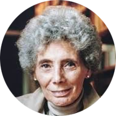

<h2 class="h2-1 text-center" align="center" id="ch5">VỀ TÁC GIẢ</h2>

<b>Jacqueline Harpman</b>

Jacqueline Harpman sinh năm 1929 tại Etterbeek, Bỉ. Gia đình bà đã chạy trốn đến Casablanca khi phát xít Đức xâm lược và chỉ trở về quê hương sau chiến tranh. Sau khi theo học văn học Pháp, bà bắt đầu đào tạo để trở thành bác sĩ nhưng không thể hoàn thành việc học do mắc bệnh lao. Bà chuyển sang viết văn vào năm 1954, và tác phẩm đầu tay của bà được xuất bản năm 1958. Vào năm 1980, bà tốt nghiệp chuyên ngành phân tâm học. Harpman đã viết hơn mười lăm tiểu thuyết và giành được nhiều giải thưởng văn học, trong đó có giải Prix Médicis cho cuốnOrlanda. Tôi, Người Chưa Từng Biết Tới Đàn Ông là tiểu thuyết đầu tiên của bà được dịch sang tiếng Anh và ban đầu được xuất bản với tựa đề Nữ chúa của cõi lặng thinh. Harpman qua đời năm 2012.

